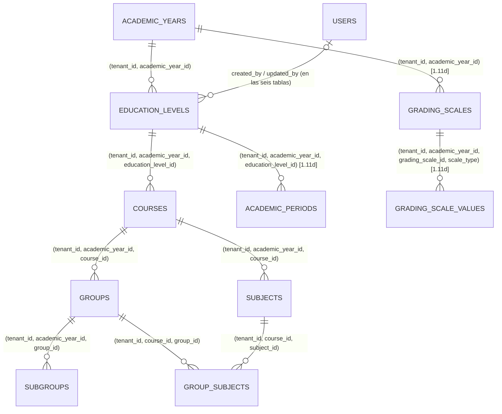

# REQ-ACAD · Modelo de datos

> **Estado**: **`1.11d-a` implementada (2026-10-17, rama `feature/REQ-ACAD-1-11d-a-periodos`); `1.11d-b` pendiente.** **APROBADA** (2026-10-10), paso **1.11** (`REQ-ACAD-001`), con las recomendaciones de `funcional.md §15` aprobadas por el usuario y los contratos de `ADR-062`/`ADR-063` (ACEPTADA). **Implementado en `1.11-b`** (2026-10-12): ver `funcional.md §16` para las desviaciones aprobadas respecto a este documento.
>
> **Resumen**: seis tablas de tenant nuevas, **todas con `academic_year_id`** (`OPEN-ACAD-03` = B): `education_levels`, `courses`, `groups`, `subgroups`, `subjects`, `group_subjects`. Son las **primeras tablas reales con el disparador `academic_year_write_guard`** (`ADR-057`) y las primeras con contenido traducible (`ADR-062`). §1.7-§1.9 describen las tablas de `1.11d`. Ninguna migración altera tablas existentes. Fuera de `acad`, `1.11` cambia dos ayudantes de `TenantMigration` (§7).
>
> **`1.11d`** (especificación **APROBADA** el 2026-10-16; `funcional.md §17`): tres tablas de tenant nuevas con `academic_year_id` —`academic_periods`, `grading_scales`, `grading_scale_values`—, §1.7-§1.9, §3.1, §4, §8. Ninguna altera una tabla existente ni toca `TenantMigration`.

---

## 1. Entidades

Todas se crean con `TenantMigration::tenantTable()` (RLS `ENABLE`+`FORCE`, `tenant_id` con `DEFAULT app.current_tenant_id()`, `created_by`/`updated_by`, `created_at`/`updated_at`/`deleted_at` en `timestamptz`, `UNIQUE (tenant_id, id)`), en `apps/api/app/Modules/Acad/Database/migrations/`. Al tener `academic_year_id`, el ayudante les engancha el disparador sin código adicional. Columnas comunes que no se repiten: `id bigint`, `tenant_id bigint`, `created_by`/`updated_by bigint NULL`, `created_at`/`updated_at timestamptz`, `deleted_at timestamptz NULL`.

**Columna traducible** (`ADR-062 §5.1`): donde dice `name_translations jsonb`, la crea el **ayudante de `TenantMigration`** para columnas traducibles (nombre final en implementación), que emite `jsonb NOT NULL` y el `CHECK` en línea: `jsonb_typeof(col) = 'object'`; `col <> '{}'::jsonb`; `(col - ARRAY['es-ES','en','de','fr']) = '{}'::jsonb`; todos los valores son cadena (expresión `jsonb_path` inmutable; texto exacto en implementación, lo revisa `db-reviewer`). Nadie escribe ese `CHECK` a mano; lo vigila `AR-16`. Que esté el idioma por defecto del centro y solo idiomas activos es validación de servidor (varía por centro). No existe columna `name` en estas tablas: el valor resuelto es representación.

### 1.1 `education_levels` — etapa

| Columna | Tipo | Nulo | Descripción |
|---------|------|------|-------------|
| `public_id` | `character(26)` | No | ULID, único (`AR-05`) |
| `academic_year_id` | `bigint` | No | `tenantForeignId`: FK compuesta `(tenant_id, academic_year_id) → academic_years (tenant_id, id)`, `NO ACTION`, e índice `(tenant_id, academic_year_id)` (#407) |
| `code` | `text` | No | Contenido del centro, no se traduce |
| `name_translations` | `jsonb` | No | Columna traducible (arriba). Claves `es-ES`, `en`, `de`, `fr` |
| `stage` | `text` | No | `CHECK (stage IN ('infantil','primaria','eso','bachillerato','fp','universidad'))` |
| `regime` | `text` | No | `CHECK (regime IN ('publico','privado','concertado'))` (`ADR-020`) |
| `position` | `integer` | No | `CHECK (position >= 1)` |

Restricción: `UNIQUE (tenant_id, academic_year_id, id)` (destino de la FK compuesta de `courses`, `RN-CURSO-27`; no parcial, `ADR-034 §6`).

### 1.2 `courses` — curso de etapa

| Columna | Tipo | Nulo | Descripción |
|---------|------|------|-------------|
| `public_id` | `character(26)` | No | ULID |
| `academic_year_id` | `bigint` | No | `tenantForeignId` a `academic_years` (FK + índice) |
| `education_level_id` | `bigint` | No | FK **de tres columnas** `(tenant_id, academic_year_id, education_level_id) → education_levels (tenant_id, academic_year_id, id)`, `NO ACTION` (`RN-ACAD-15`, `RN-CURSO-27`). Se declara a mano porque `tenantForeignId()` solo emite dos columnas; es una excepción justificada a la convención del ayudante para referencias obligatorias (issue #104), no un descuido |
| `code` | `text` | No | |
| `name_translations` | `jsonb` | No | Columna traducible |
| `position` | `integer` | No | `CHECK (position >= 1)` |

Restricción: `UNIQUE (tenant_id, academic_year_id, id)` (destino de `groups` y `subjects`).

### 1.3 `groups` — grupo

| Columna | Tipo | Nulo | Descripción |
|---------|------|------|-------------|
| `public_id` | `character(26)` | No | ULID |
| `academic_year_id` | `bigint` | No | `tenantForeignId` a `academic_years` |
| `course_id` | `bigint` | No | FK `(tenant_id, academic_year_id, course_id) → courses (tenant_id, academic_year_id, id)`, `NO ACTION`, a mano (#104, como §1.2) |
| `code` | `text` | No | P. ej. `A` |
| `name` | `text` | No | Texto simple, **no traducible** (`funcional.md` Anexo A punto 6) |
| `position` | `integer` | No | `CHECK (position >= 1)` |

Restricciones: `UNIQUE (tenant_id, academic_year_id, id)` (destino de `subgroups` y, en `1.15`, de la matrícula) y `UNIQUE (tenant_id, course_id, id)` (destino de `group_subjects`).

Nombre de tabla: `groups` es palabra clave **no reservada** en PostgreSQL; se admite como identificador. Si la implementación encuentra un problema real, `class_groups`, avisando antes.

### 1.4 `subgroups` — subgrupo

| Columna | Tipo | Nulo | Descripción |
|---------|------|------|-------------|
| `public_id` | `character(26)` | No | ULID |
| `academic_year_id` | `bigint` | No | `tenantForeignId` a `academic_years` |
| `group_id` | `bigint` | No | FK `(tenant_id, academic_year_id, group_id) → groups (tenant_id, academic_year_id, id)`, `NO ACTION`, a mano |
| `code` | `text` | No | |
| `name` | `text` | No | Texto simple |
| `position` | `integer` | No | `CHECK (position >= 1)` |

### 1.5 `subjects` — asignatura

| Columna | Tipo | Nulo | Descripción |
|---------|------|------|-------------|
| `public_id` | `character(26)` | No | ULID |
| `academic_year_id` | `bigint` | No | `tenantForeignId` a `academic_years` |
| `course_id` | `bigint` | No | FK `(tenant_id, academic_year_id, course_id) → courses (tenant_id, academic_year_id, id)`, `NO ACTION`, a mano |
| `code` | `text` | No | P. ej. `MAT` |
| `name_translations` | `jsonb` | No | Columna traducible |
| `position` | `integer` | No | `CHECK (position >= 1)` |

Restricción: `UNIQUE (tenant_id, course_id, id)` (destino de `group_subjects`).

### 1.6 `group_subjects` — asignaturas que cursa un grupo

| Columna | Tipo | Nulo | Descripción |
|---------|------|------|-------------|
| `public_id` | `character(26)` | No | ULID. No sale en ninguna ruta, pero se incluye por coherencia con `AR-05`/`HasPublicId` y porque el par grupo × asignatura es lo que `ADR-063 §5.3` llama «clase»: la asignación docente futura lo referenciará **[DERIVADA]** |
| `academic_year_id` | `bigint` | No | `tenantForeignId` a `academic_years` |
| `course_id` | `bigint` | No | Desnormalizado a propósito para las FK siguientes; lo fija el servicio a partir del grupo. FK `(tenant_id, academic_year_id, course_id) → courses (tenant_id, academic_year_id, id)`, `NO ACTION` |
| `group_id` | `bigint` | No | FK `(tenant_id, course_id, group_id) → groups (tenant_id, course_id, id)`, `NO ACTION` |
| `subject_id` | `bigint` | No | FK `(tenant_id, course_id, subject_id) → subjects (tenant_id, course_id, id)`, `NO ACTION`. Con la anterior, el motor garantiza `RN-ACAD-30` (`CA-ACAD-019`) |

Borrado lógico; una baja es `deleted_at` por instancia (`AR-15`).

*§1.7-§1.9: especificación ejecutable de `1.11d` (APROBADA). La forma aprobada en `1.11` se cita al principio de cada tabla; las diferencias están en `funcional.md §17.3`. Las tres se crean con `TenantMigration::tenantTable()` (RLS, autoría, `timestamptz`, borrado lógico, `UNIQUE (tenant_id, id)`, disparador `academic_year_write_guard` por tener `academic_year_id`), en `apps/api/app/Modules/Acad/Database/migrations/`, con el patrón real de `2026_10_13_100200_create_courses_table.php`: FK de más de dos columnas con nombre explícito declaradas a mano, `CHECK` e índices parciales por `DB::connection('pgsql_owner')->statement()`, `down()` con `DROP TABLE IF EXISTS`.*

### 1.7 `academic_periods` — período lectivo (`1.11d`, `OPEN-ACAD-17` = A + Y)

*Forma aprobada*: `academic_year_id`, `education_level_id` (FK de tres columnas), `public_id`, `period_type`, `position`, `name_translations`, `starts_on`, `ends_on` con `CHECK (ends_on > starts_on)`; dentro del curso, sin solape y del mismo tipo por etapa: validación de servidor; exclusión descartada (`ADR-034 §4`, `btree_gist`).

| Columna | Tipo | Nulo | Descripción |
|---------|------|------|-------------|
| `public_id` | `character(26)` | No | ULID, `UNIQUE` (`AR-05`) |
| `academic_year_id` | `bigint` | No | `tenantForeignId($t, 'academic_year_id', 'academic_years')`: FK compuesta `NO ACTION` + índice `academic_periods__academic_year_id_tenant_idx` |
| `education_level_id` | `bigint` | No | FK de tres columnas `academic_periods_tenant_year_level_foreign`: `(tenant_id, academic_year_id, education_level_id) → education_levels (tenant_id, academic_year_id, id)`, `NO ACTION` (`RN-CURSO-27`; destino ya existente `education_levels_tenant_year_id_unique`) |
| `period_type` | `text` | No | `CHECK (period_type IN ('trimestre','cuatrimestre','semestre'))` (`academic_periods_period_type_check`) |
| `name_translations` | `jsonb` | No | `TenantMigration::translatableColumn($t, 'name')` (`CHECK` del ayudante, `AR-16`) |
| `starts_on` | `date` | No | Fecha civil (`ADR-038 §3.2`) |
| `ends_on` | `date` | No | `CHECK (ends_on > starts_on)` (`academic_periods_dates_check`) |
| `position` | `integer` | No | `CHECK (position >= 1)` (`academic_periods_position_check`) |

Restricción: `UNIQUE (tenant_id, academic_year_id, id)` (`academic_periods_tenant_year_id_unique`), destino de las futuras FK de `CALIF` que impongan el mismo curso académico (`funcional.md §12`).

Sin `code`: la forma aprobada no lo tiene (`RN-ACAD-53`). Lo que el motor **no** garantiza (dentro del curso, sin solape, un solo tipo): §8.

### 1.8 `grading_scales` — escala (`1.11d`, `OPEN-ACAD-18` = A)

*Forma aprobada*: `academic_year_id`, `public_id`, `code`, `name_translations`, `scale_type`; para `numerica`/`mixta`: `min_value`, `max_value` `numeric(5,2)`, `decimals smallint`, `passing_min_value numeric(5,2)`, con `CHECK` de coherencia por tipo. `numeric` y no céntimos: una calificación no es un importe.

| Columna | Tipo | Nulo | Descripción |
|---------|------|------|-------------|
| `public_id` | `character(26)` | No | ULID, `UNIQUE` |
| `academic_year_id` | `bigint` | No | `tenantForeignId` a `academic_years` (FK + índice `grading_scales__academic_year_id_tenant_idx`) |
| `code` | `text` | No | Contenido del centro, no se traduce |
| `name_translations` | `jsonb` | No | Columna traducible |
| `scale_type` | `text` | No | `CHECK (scale_type IN ('numerica','cualitativa','mixta'))` (`grading_scales_scale_type_check`). Inmutable (`RN-ACAD-70`; el motor lo impide mientras haya valores, §1.9) |
| `min_value` | `numeric(5,2)` | Sí | Solo `numerica`/`mixta` |
| `max_value` | `numeric(5,2)` | Sí | Ídem |
| `decimals` | `smallint` | Sí | Ídem; 0, 1 o 2 |
| `passing_min_value` | `numeric(5,2)` | Sí | Ídem; umbral de aprobado (`RN-ACAD-74`) |

**`CHECK` de coherencia** (`grading_scales_type_fields_check`), una sola expresión:

```sql
CHECK (
  (scale_type = 'cualitativa'
     AND min_value IS NULL AND max_value IS NULL
     AND decimals IS NULL AND passing_min_value IS NULL)
  OR
  (scale_type IN ('numerica', 'mixta')
     AND min_value IS NOT NULL AND max_value IS NOT NULL
     AND decimals IS NOT NULL AND passing_min_value IS NOT NULL
     AND decimals BETWEEN 0 AND 2
     AND min_value < max_value
     AND passing_min_value BETWEEN min_value AND max_value
     AND round(min_value, decimals) = min_value
     AND round(max_value, decimals) = max_value
     AND round(passing_min_value, decimals) = passing_min_value)
)
```

(texto exacto en implementación; lo revisa `db-reviewer`. `round(numeric, int)` es inmutable.)

Las columnas numéricas son anulables porque no aplican a la cualitativa; la regla de `ADR-034 §4` («obligatorio o ausente») es solo para `academic_year_id`. Alternativa descartada: tabla aparte para los campos numéricos (una fila 1:1 más, otra FK y otro disparador para cuatro columnas).

Restricciones: `UNIQUE (tenant_id, academic_year_id, id, scale_type)` (`grading_scales_tenant_year_id_type_unique`), destino de la FK de `grading_scale_values`. Ver §3.1 para el código único.

### 1.9 `grading_scale_values` — valores cualitativos o tramos (`1.11d`)

*Forma aprobada*: `academic_year_id`, `grading_scale_id` (FK de tres columnas), `public_id`, `code`, `label_translations`, `position`, `is_passing boolean`, y para `mixta` `range_min`/`range_max numeric(5,2)` sin solape (validación de servidor).

**Filas hijas y no `jsonb` en la escala** (decisión de esta especificación, razonada):

1. **`ADR-062 §5.1`**: el contenido traducible es una columna `<campo>_translations jsonb` con el `CHECK` del ayudante, y `AR-16` lo vigila por columna. Una etiqueta traducible anidada dentro de un `jsonb` de valores quedaría fuera del `CHECK`, de `AR-16` y del resolutor común (`ADR-062 §5.3`), y su auditoría no se desglosaría por idioma (`ADR-062 §5.5`): habría que reinventar las cuatro piezas para un caso.
2. **`ADR-029`**: un valor que `CALIF` referenciará (la calificación cualitativa «Notable») necesita identidad estable, `public_id` ULID y **clave foránea**: el motor no puede garantizar que una calificación apunta a un valor existente, vivo y del mismo curso si el valor es un elemento de un array.
3. **`ADR-057`**: el disparador protege filas; en `jsonb` el bloqueo seguiría funcionando (la fila de la escala tiene `academic_year_id`), así que este punto no discrimina.
4. **Auditoría por valor** (`INV-003`): con filas, cada alta, cambio o baja de un valor es una entrada propia.

Coste aceptado: la sincronización del conjunto (`RN-ACAD-88`) y una tabla más con su disparador.

| Columna | Tipo | Nulo | Descripción |
|---------|------|------|-------------|
| `public_id` | `character(26)` | No | ULID, `UNIQUE` |
| `academic_year_id` | `bigint` | No | `tenantForeignId` a `academic_years` (FK + índice `grading_scale_values__academic_year_id_tenant_idx`) |
| `grading_scale_id` | `bigint` | No | Parte de la FK de cuatro columnas (abajo) |
| `scale_type` | `text` | No | **Copia** del tipo de la escala, fijada por el servicio desde la escala. `CHECK (scale_type IN ('cualitativa','mixta'))` (`grading_scale_values_scale_type_check`): una numérica no tiene valores (`RN-ACAD-81`) |
| `code` | `text` | No | Contenido del centro |
| `label_translations` | `jsonb` | No | `translatableColumn($t, 'label')` |
| `position` | `integer` | No | `CHECK (position >= 1)`; la fija el servidor (`RN-ACAD-83`) |
| `is_passing` | `boolean` | Sí | Solo cualitativa (`RN-ACAD-82`, `-87`) |
| `range_min` | `numeric(5,2)` | Sí | Solo mixta |
| `range_max` | `numeric(5,2)` | Sí | Solo mixta |

FK **de cuatro columnas** `grading_scale_values_tenant_year_scale_foreign`: `(tenant_id, academic_year_id, grading_scale_id, scale_type) → grading_scales (tenant_id, academic_year_id, id, scale_type)`, `NO ACTION`. Garantiza en el motor: mismo centro, mismo curso académico (`RN-CURSO-27`) y **mismo tipo que la escala**; y, al ser `NO ACTION`, un `UPDATE` del `scale_type` de una escala con valores (vivos o borrados) falla con `23503` (`CA-ACAD-086`).

**`CHECK` por fila** (`grading_scale_values_type_fields_check`):

```sql
CHECK (
  (scale_type = 'cualitativa'
     AND is_passing IS NOT NULL AND range_min IS NULL AND range_max IS NULL)
  OR
  (scale_type = 'mixta'
     AND is_passing IS NULL AND range_min IS NOT NULL AND range_max IS NOT NULL
     AND range_min <= range_max)
)
```

Restricción: `UNIQUE (tenant_id, academic_year_id, id)` (`grading_scale_values_tenant_year_id_unique`), destino de la futura FK de una calificación cualitativa (`funcional.md §12`).

Lo que el motor **no** garantiza (tramos dentro del rango de la escala, contiguos, umbral en frontera, al menos un aprobado, precisión de los límites según `decimals`): validación de servidor bajo el bloqueo de la escala (§8).

---

## 2. Relaciones



Toda FK es **`NO ACTION`**, incluidas las de autoría a `users` (`ADR-057 §5.2`, `AR-13`; `CA-ACAD-022`, y `CA-ACAD-089` para las tablas de `1.11d`). Ninguna tabla de otro módulo apunta a estas en `1.11` ni en `1.11d`.

---

## 3. Índices

Desde `1.11`, **`tenantForeignId()` crea el índice `(tenant_id, <columna>)`** (issue #407, `CA-ACAD-038`): las seis tablas reciben así `(tenant_id, academic_year_id)` sin declararlo. Los que siguen son los que el ayudante **no** crea (FK de tres columnas declaradas a mano, unicidad y destinos de FK). Cada uno con la consulta que lo necesita.

| Índice | Tabla | Consulta |
|--------|-------|----------|
| `UNIQUE (public_id)` | las seis | Detalle por `public_id` (`GET/PATCH/DELETE /<recurso>/{public_id}`, listados anidados por grupo y resolución de padres del cuerpo). Lo exige `AR-05` (índice único propio, no parcial: un `public_id` no se reutiliza, `ADR-034 §6`). **Única excepción** a «`tenant_id` primera columna»: el ULID es globalmente único y RLS acota el tenant |
| `(tenant_id, academic_year_id)` | las seis | **Del ayudante** (#407): listados `?academic_year=` sin más filtro y la FK a `academic_years` |
| `UNIQUE (tenant_id, academic_year_id, code) WHERE deleted_at IS NULL` | `education_levels` | `RN-ACAD-01` |
| `UNIQUE (tenant_id, academic_year_id, code) WHERE deleted_at IS NULL` | `courses` | `RN-ACAD-01` |
| `(tenant_id, education_level_id) WHERE deleted_at IS NULL` | `courses` | Listado `?education_level=` e hijos vivos de una etapa (`RN-ACAD-20`). Al ser parcial **no cubre** la FK de tres columnas (esa la sirve el índice `(tenant_id, academic_year_id)` del ayudante, por prefijo) |
| `UNIQUE (tenant_id, course_id, code) WHERE deleted_at IS NULL` | `groups` | `RN-ACAD-01`; listado `?course=`; hijos vivos de un curso de etapa |
| `UNIQUE (tenant_id, group_id, code) WHERE deleted_at IS NULL` | `subgroups` | `RN-ACAD-01`; listado anidado; hijos vivos de un grupo |
| `UNIQUE (tenant_id, course_id, code) WHERE deleted_at IS NULL` | `subjects` | `RN-ACAD-01`; listado `?course=`; hijos vivos |
| `UNIQUE (tenant_id, group_id, subject_id) WHERE deleted_at IS NULL` | `group_subjects` | Una asignatura una vez por grupo; `GET/PUT /groups/{id}/subjects` |
| `(tenant_id, course_id, group_id)` y `(tenant_id, course_id, subject_id)` (no parciales) | `group_subjects` | Cubren las dos FK de tres columnas (comprobación de integridad ante un `DELETE` físico del padre, p. ej. la purga de un tenant); un índice parcial no las cubre (`operacion.md §6.2`) |
| `(tenant_id, subject_id) WHERE deleted_at IS NULL` | `group_subjects` | Borrado de una asignatura (`RN-ACAD-20`), ficha de asignatura con sus grupos |
| `UNIQUE (tenant_id, academic_year_id, id)`, `UNIQUE (tenant_id, course_id, id)` | según §1 | Destino de las FK compuestas |

Respecto a la versión anterior de esta especificación, se retiran los índices parciales `(tenant_id, academic_year_id) WHERE deleted_at IS NULL` de `groups` y `subjects`: los cubre el índice que crea el ayudante. Las FK de tres columnas hacia `courses`, `groups` y `education_levels` por `(tenant_id, academic_year_id, …)` se sirven por prefijo con el índice `(tenant_id, academic_year_id)` del ayudante; las dos de `group_subjects` hacia `groups` y `subjects` tienen índice no parcial propio (arriba), porque los únicos parciales no las cubren; el disparador busca en `academic_years` por `(tenant_id, id)`, ya indexado. Ningún índice sobre `name_translations`: ningún listado ordena ni busca por nombre (`ADR-062 §5.4`).

### 3.1 Índices de `1.11d`

Criterio de #407/#412 aplicado a cada FK compuesta nueva: un índice **no parcial** cuyas primeras columnas son las de la FK. El ayudante cubre `(tenant_id, academic_year_id)`; las FK de tres y cuatro columnas se cubren con un índice propio de exactamente sus columnas (precedente: los de `group_subjects`, §3), no con el prefijo del ayudante, para no depender de un recorrido parcial en la comprobación de integridad.

| Índice | Tabla | Consulta |
|--------|-------|----------|
| `UNIQUE (public_id)` | las tres | Detalle, `PATCH`, `DELETE` por `public_id`; sincronización de valores por `public_id` (`RN-ACAD-88`) |
| `(tenant_id, academic_year_id)` | las tres | **Del ayudante**: listados `?academic_year=`, FK a `academic_years` |
| `academic_periods_tenant_year_level_idx` `(tenant_id, academic_year_id, education_level_id)` (no parcial) | `academic_periods` | Cubre la FK de tres columnas; períodos de una etapa (`?education_level=`, comprobación de solape y tipo de `RN-ACAD-58`/`-59`, hijos vivos de una etapa en `RN-ACAD-61`) |
| `UNIQUE (tenant_id, academic_year_id, id)` | `academic_periods` | Destino de FK futuras (§1.7) |
| `UNIQUE (tenant_id, academic_year_id, code) WHERE deleted_at IS NULL` (`grading_scales_tenant_year_code_unique`) | `grading_scales` | `RN-ACAD-71`; la carrera se traduce a `422 code_taken` |
| `UNIQUE (tenant_id, academic_year_id, id, scale_type)` | `grading_scales` | Destino de la FK de los valores |
| `grading_scale_values_tenant_year_scale_idx` `(tenant_id, academic_year_id, grading_scale_id, scale_type)` (no parcial) | `grading_scale_values` | Cubre la FK de cuatro columnas; valores de una escala (lectura con la escala, sincronización, borrado de la escala) |
| `UNIQUE (tenant_id, grading_scale_id, code) WHERE deleted_at IS NULL` (`grading_scale_values_tenant_scale_code_unique`) | `grading_scale_values` | `RN-ACAD-83` |
| `UNIQUE (tenant_id, academic_year_id, id)` | `grading_scale_values` | Destino de FK futuras (§1.9) |

Sin índice único sobre `position` (ni en períodos ni en valores): no es única (`RN-ACAD-60`) o la reescribe el servidor en bloque (`RN-ACAD-83`), y un único sin `DEFERRABLE` —un índice parcial no puede serlo— rompería la reordenación. Sin índice por `starts_on`: una etapa tiene unos pocos períodos y el índice de la FK los acota.

---

## 4. Modelos y auditoría

| Modelo (`Acad\Domain\Models`) | Tabla | Alias *morph map* | Política (`ADR-035`) |
|---|---|---|---|
| `EducationLevel` | `education_levels` | `education_level` | `Full` |
| `Course` | `courses` | `course` | `Full` |
| `Group` | `groups` | `group` | `Full` |
| `Subgroup` | `subgroups` | `subgroup` | `Full` |
| `Subject` | `subjects` | `subject` | `Full` |
| `GroupSubject` | `group_subjects` | `group_subject` | `Full` |
| `AcademicPeriod` (`1.11d`) | `academic_periods` | `academic_period` | `Full` |
| `GradingScale` (`1.11d`) | `grading_scales` | `grading_scale` | `Full` |
| `GradingScaleValue` (`1.11d`) | `grading_scale_values` | `grading_scale_value` | `Full` |

Todos `extends TenantModel`, `implements Auditable`, `HasPublicId`; alias en `AcadServiceProvider::boot()` (`AR-06`). `Full`: sin datos personales. Escrituras por instancia (`AR-15`). En `1.11d`, los decimales se leen como cadena (*cast* `decimal:2` o equivalente sin `float`, `RN-ACAD-75`) y `label_translations`/`name_translations` como `array`, igual que en `1.11`.

**Auditoría de columnas traducibles** (`ADR-062 §5.5`, `CA-ACAD-013`): el constructor de `changes` **desglosa** `name_translations` en una entrada por idioma que cambia —`"name_translations.es-ES": {"from": …, "to": …}`—, sin entradas para los idiomas que no cambian; los cinco pasos de `ADR-035 §4` y el tope de 256 caracteres de `§5` se aplican a cada entrada por separado. No se guarda el objeto entero.

---

## 5. Checklist obligatorio

- [x] `tenant_id` primera columna de todos los índices (§3), **salvo** `UNIQUE (public_id)`, que `AR-05` exige como índice único propio sobre el ULID.
- [x] RLS en cada tabla nueva (`tenantTable()`). *`IsolationBatteryTest` #8.*
- [x] `academic_year_id` `NOT NULL` en las seis, con `tenantForeignId` (FK e índice) y FK compuestas de tres columnas hacia el padre (`RN-CURSO-27`). Disparador puesto por `tenantTable()`. Ninguna acción referencial. *`AR-13`, que gana la aserción de no vacuidad sobre el esquema real (`CA-ACAD-021`).*
- [x] `created_at`, `updated_at`, `deleted_at`, `created_by`, `updated_by` (`INV-005`).
- [x] FK, `CHECK` y unicidad en base de datos.
- [x] Política de auditoría, desglose de traducciones y alias (§4). *`AR-06`.*

### Convenciones de tipos (`ADR-029`, ampliado por `ADR-062`)

- [x] `timestamptz`; `date` en fechas civiles de `1.11d`. *`AR-04`.*
- [x] `text`, nunca `varchar(n)`. *`AR-04`.*
- [x] Importes: no hay. Calificaciones de `1.11d` en `numeric(5,2)` (no céntimos: no es un importe), `decimals` en `smallint`, `is_passing` en `boolean`.
- [x] Enumerados como `text` con `CHECK`. *`AR-04`.*
- [x] Contenido traducible en `<campo>_translations jsonb NOT NULL` con el `CHECK` del ayudante. *`AR-16` (`CA-ACAD-015`).*
- [x] `public_id` ULID en las seis tablas. *`AR-05`.* **Claves de catálogo expuestas: ninguna** (`code` lo crea el centro: no cumple C1 de `ADR-051`).
- [x] Unicidad parcial `WHERE deleted_at IS NULL` en las reglas de código; las de destino de FK no son parciales.

### Resto

- [x] Categoría especial: ninguna.
- [x] Particionado: no (tablas pequeñas; `RDB-001` solo para alto crecimiento).

---

## 6. Retención y supresión

Datos del centro sin datos personales. Se conservan mientras exista el tenant; borrado lógico ordinario (`ADR-004` nivel 1). Purga física: con la del tenant (issue #371), como propietario, exento del disparador. **Orden de restauración**: `academic_years` → `education_levels` → `courses` → `groups`/`subjects` → `subgroups`/`group_subjects`; en `1.11d`, además `education_levels` → `academic_periods` y `academic_years` → `grading_scales` → `grading_scale_values`.

---

## 7. Cambios de esquema fuera de `acad` en `1.11`

| Cambio | Dónde | Efecto en el esquema |
|--------|-------|----------------------|
| `tenantForeignId()` crea el índice `(tenant_id, <columna>)` (#407) | `App\Support\Tenancy\TenantMigration` | Solo en migraciones nuevas. **No retroactivo**: las tablas ya migradas que usaron el ayudante no lo ganan. Se inventarían en el cierre; si alguna lo necesita por una consulta real, issue aparte con su migración (`db-reviewer`) |
| Ayudante de columna traducible (`ADR-062 §5.1`) | `App\Support\Tenancy\TenantMigration` | Ninguno hasta que lo use una migración; las primeras, las de `acad` |

`1.11d` no cambia nada fuera de `acad` en el esquema. Los cambios de `1.11d-a` en `curso` (punto de extensión del cambio de fechas, lectura con bloqueo compartido, filtro por módulo contratado) son código, sin migración (`REQ-CURSO/datos.md`, cabecera).

---

## 8. `1.11d`: garantías entre filas y ciclo de vida

### 8.1 Borrado

| Qué se borra | Efecto sobre `1.11d` |
|--------------|----------------------|
| Una etapa | Prohibido con períodos vivos (`RN-ACAD-61`, `409 has_dependents`); con períodos solo borrados, se admite (la FK `NO ACTION` no mira `deleted_at`, y un borrado lógico no es un `DELETE`) |
| Un período | Lógico; nada lo referencia en `1.11d` |
| Una escala | Lógico, junto con sus valores vivos, por instancia (`RN-ACAD-76`) |
| Un curso académico | No existe borrado de cursos (`RN-CURSO-07`) |
| Purga física del tenant (#371) | Como propietario, exento del disparador; orden inverso al de restauración |

### 8.2 Cierre del curso académico

Al pasar a `cerrado`, el disparador `academic_year_write_guard` congela las tres tablas (`AR-13`): ni altas, ni cambios, ni borrados, tampoco por la sincronización de valores, que es una sucesión de escrituras por instancia y falla en la primera (la transacción entera se revierte). La reapertura (`ADR-059`, ventana T1) las devuelve a escritura sin cambio alguno aquí.

### 8.3 Reglas entre filas: qué garantiza el motor y qué el servicio

| Regla | Motor | Servicio | Por qué no el motor |
|-------|-------|----------|---------------------|
| Período dentro del curso académico (`RN-ACAD-57`) | No | Sí, en dos lados: (1) al escribir el período, con las fechas del `AcademicYearSummary` que devuelve `AcademicYearSharedLock::lockForShareById()` de `curso`, leído bajo `FOR SHARE` sobre la fila del curso y retenido hasta confirmar (`RN-ACAD-54`, `REQ-CURSO RN-CURSO-55`); (2) al cambiar las fechas del curso, con la validación que `acad` registra en `curso` (`RN-ACAD-62`, `OPEN-ACAD-24` = B), ejecutada bajo el `FOR UPDATE` del curso. Como `FOR SHARE` y `FOR UPDATE` sobre la misma fila se excluyen, una de las dos transacciones ve siempre lo que confirmó la otra (`REQ-CURSO RN-CURSO-58`, `CA-CURSO-120`) | Un `CHECK` no ve otra tabla; un disparador que leyera `academic_years` sería un segundo disparador por tabla y una lectura de otro módulo en SQL (`INV-007`). Límite: con `acad` descontratado, el cambio de fechas no valida (`REQ-CURSO RN-CURSO-52`, decisión del usuario) |
| Sin solape entre períodos vivos de una etapa (`RN-ACAD-58`) | No | Sí, bajo `FOR UPDATE` de la etapa (`RN-ACAD-54`) | Una restricción `EXCLUDE USING gist (tenant_id WITH =, education_level_id WITH =, daterange(starts_on, ends_on, '[]') WITH &&) WHERE (deleted_at IS NULL)` exige la extensión **`btree_gist`** para la igualdad sobre `bigint`. No está instalada (la base solo tiene `plpgsql`, comprobado el 2026-10-16) y `ADR-034 §4` la descartó para `academic_years`; la forma aprobada de `1.11d` (`§1.7`) la descarta también. Introducirla es una dependencia de esquema nueva (`CLAUDE.md §1`) que exigiría decisión del usuario; esta especificación no la propone |
| Un solo `period_type` por etapa (`RN-ACAD-59`) | No | Sí, bajo el mismo bloqueo | Alternativas valoradas y no propuestas: (a) columna `period_type` en `education_levels` con FK de los períodos que la incluya: cambia una tabla ya mezclada y obliga a un estado «etapa sin tipo de período» anulable; (b) disparador propio: lo prohíbe la convención de no escribir disparadores a mano fuera del ayudante y duplicaría el patrón de `ADR-057` para una regla de negocio. La validación de servicio con bloqueo y la prueba con dos procesos reales (`CA-ACAD-069`) es honesta sobre su límite: un camino de escritura que no pase por el servicio podría romperla. El único que existe es el servicio |
| Tipo de los valores = tipo de la escala; campos por tipo | **Sí** | También (para dar `422`) | FK de cuatro columnas y `CHECK` (§1.8, §1.9) |
| Al menos un valor aprobado; tramos contiguos que cubren la escala; umbral en frontera (`RN-ACAD-82`, `-85`, `-86`) | No | Sí, sobre el conjunto completo y bajo `FOR UPDATE` de la escala (en el alta, la escala es nueva y nadie más la ve) | Reglas sobre un conjunto de filas: un `CHECK` es por fila; un disparador diferido sería código de negocio en SQL |

**Mecanismo de bloqueo** (`RN-ACAD-54`, reescrita el 2026-10-16 por `OPEN-CURSO-25` = B). En el **alta y la edición** de un período, dentro de la misma transacción y en este orden: (1) `AcademicYearSharedLock::lockForShareById($academicYearId)` de `Curso\Domain` (`FOR SHARE` sobre la fila de `academic_years`; `acad` no consulta esa tabla, `AR-01`); (2) `EducationLevel::query()->whereKey($id)->lockForUpdate()` (hoy el alta de un curso de etapa usa `sharedLock()` sobre su etapa: dos altas de período con `FOR SHARE` no se excluirían entre sí, por eso aquí es `FOR UPDATE`); (3) lectura de los períodos hermanos y escritura. El **borrado** de un período toma solo el paso (2). El borrado de una etapa ya toma `lockForUpdate()` (`EducationLevelService::delete`), así que alta de período y borrado de etapa se serializan. **Bloqueos sobre la fila del curso**: el paso (1) y el `FOR SHARE` que pide el disparador al escribir son compatibles entre sí y con los de otras escrituras; los dos esperan a un cierre, una reapertura o un `PATCH` de fechas en curso (`FOR UPDATE`, `REQ-CURSO RN-CURSO-32`, `-46`, `-51`), y estos esperan a que el período confirme. Sin interbloqueo: esas transacciones de `curso` toman el `FOR UPDATE` del curso antes que nada y no bloquean filas de `acad` mientras lo retienen (`REQ-CURSO RN-CURSO-58`).

**Condición de seguridad del orden de bloqueos** (observación de `db-reviewer`, `1.11d-a`). El orden curso → etapa del alta y la edición de un período frente al orden etapa → curso del borrado de etapa y del disparador es una inversión formal que no produce `40P01` porque el segundo bloqueo del curso es siempre `FOR SHARE`, compatible con el `FOR SHARE` ya retenido, y en PostgreSQL 18 un `FOR SHARE` nuevo no se encola tras un `FOR UPDATE` en espera (`RN-CURSO-58`, `CA-CURSO-122`). La garantía cae si en el futuro una escritura de `acad` toma `FOR UPDATE` sobre la fila del curso, o si una transacción de `curso` bloquea filas de `acad` mientras retiene su `FOR UPDATE` del curso: ambas cosas exigen revisar este apartado y `RN-CURSO-58`.
