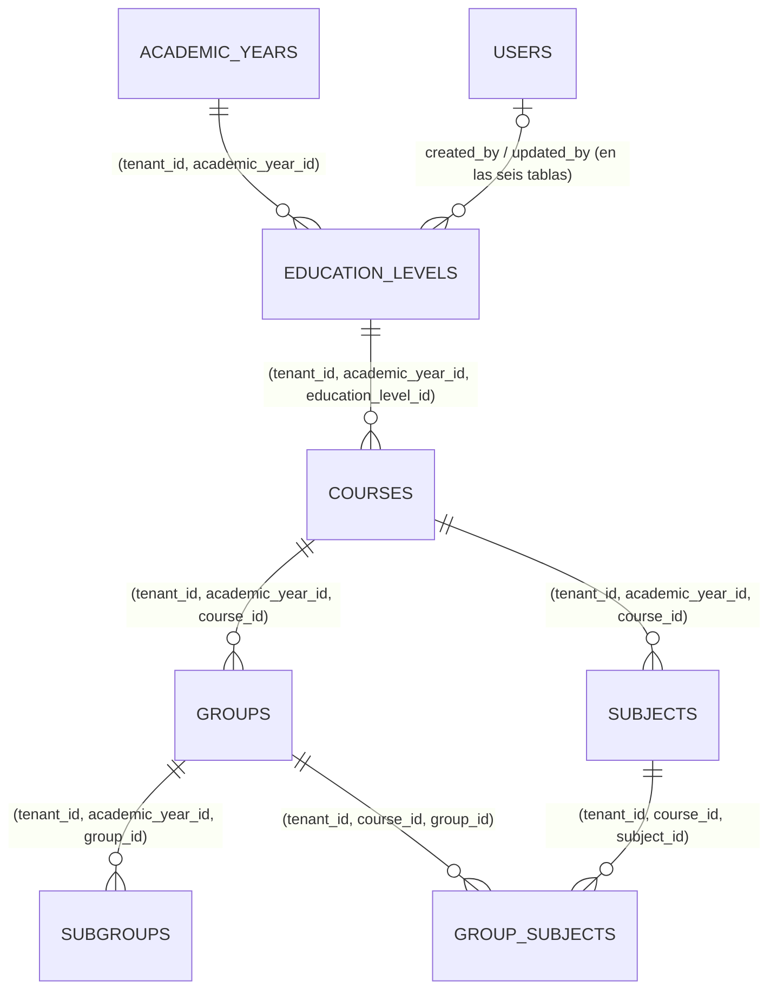

# REQ-ACAD · Modelo de datos

> **Estado**: **APROBADA** (2026-10-10), paso **1.11** (`REQ-ACAD-001`), con las recomendaciones de `funcional.md §15` aprobadas por el usuario y los contratos de `ADR-062`/`ADR-063` (ACEPTADA).
>
> **Resumen**: seis tablas de tenant nuevas, **todas con `academic_year_id`** (`OPEN-ACAD-03` = B): `education_levels`, `courses`, `groups`, `subgroups`, `subjects`, `group_subjects`. Son las **primeras tablas reales con el disparador `academic_year_write_guard`** (`ADR-057`) y las primeras con contenido traducible (`ADR-062`). §1.7-§1.9 describen las tablas de `1.11d`. Ninguna migración altera tablas existentes. Fuera de `acad`, `1.11` cambia dos ayudantes de `TenantMigration` (§7).

---

## 1. Entidades

Todas se crean con `TenantMigration::tenantTable()` (RLS `ENABLE`+`FORCE`, `tenant_id` con `DEFAULT app.current_tenant_id()`, `created_by`/`updated_by`, `created_at`/`updated_at`/`deleted_at` en `timestamptz`, `UNIQUE (tenant_id, id)`), en `apps/api/app/Modules/Acad/Database/migrations/`. Al tener `academic_year_id`, el ayudante les engancha el disparador sin código adicional. Columnas comunes que no se repiten: `id bigint`, `tenant_id bigint`, `created_by`/`updated_by bigint NULL`, `created_at`/`updated_at timestamptz`, `deleted_at timestamptz NULL`.

**Columna traducible** (`ADR-062 §5.1`): donde dice `name_translations jsonb`, la crea el **ayudante de `TenantMigration`** para columnas traducibles (nombre final en implementación), que emite `jsonb NOT NULL` y el `CHECK` en línea: `jsonb_typeof(col) = 'object'`; `col <> '{}'::jsonb`; `(col - ARRAY['es-ES','en','de','fr']) = '{}'::jsonb`; todos los valores son cadena (expresión `jsonb_path` inmutable; texto exacto en implementación, lo revisa `db-reviewer`). Nadie escribe ese `CHECK` a mano; lo vigila `AR-16`. Que esté el idioma por defecto del centro y solo idiomas activos es validación de servidor (varía por centro). No existe columna `name` en estas tablas: el valor resuelto es representación.

### 1.1 `education_levels` — etapa

| Columna | Tipo | Nulo | Descripción |
|---------|------|------|-------------|
| `public_id` | `character(26)` | No | ULID, único (`AR-05`) |
| `academic_year_id` | `bigint` | No | `tenantForeignId`: FK compuesta `(tenant_id, academic_year_id) → academic_years (tenant_id, id)`, `NO ACTION`, e índice `(tenant_id, academic_year_id)` (#407) |
| `code` | `text` | No | Contenido del centro, no se traduce |
| `name_translations` | `jsonb` | No | Columna traducible (arriba). Claves `es-ES`, `en`, `de`, `fr` |
| `stage` | `text` | No | `CHECK (stage IN ('infantil','primaria','eso','bachillerato','fp','universidad'))` |
| `regime` | `text` | No | `CHECK (regime IN ('publico','privado','concertado'))` (`ADR-020`) |
| `position` | `integer` | No | `CHECK (position >= 1)` |

Restricción: `UNIQUE (tenant_id, academic_year_id, id)` (destino de la FK compuesta de `courses`, `RN-CURSO-27`; no parcial, `ADR-034 §6`).

### 1.2 `courses` — curso de etapa

| Columna | Tipo | Nulo | Descripción |
|---------|------|------|-------------|
| `public_id` | `character(26)` | No | ULID |
| `academic_year_id` | `bigint` | No | `tenantForeignId` a `academic_years` (FK + índice) |
| `education_level_id` | `bigint` | No | FK **de tres columnas** `(tenant_id, academic_year_id, education_level_id) → education_levels (tenant_id, academic_year_id, id)`, `NO ACTION` (`RN-ACAD-15`, `RN-CURSO-27`). Se declara a mano porque `tenantForeignId()` solo emite dos columnas; es una excepción justificada a la convención del ayudante para referencias obligatorias (issue #104), no un descuido |
| `code` | `text` | No | |
| `name_translations` | `jsonb` | No | Columna traducible |
| `position` | `integer` | No | `CHECK (position >= 1)` |

Restricción: `UNIQUE (tenant_id, academic_year_id, id)` (destino de `groups` y `subjects`).

### 1.3 `groups` — grupo

| Columna | Tipo | Nulo | Descripción |
|---------|------|------|-------------|
| `public_id` | `character(26)` | No | ULID |
| `academic_year_id` | `bigint` | No | `tenantForeignId` a `academic_years` |
| `course_id` | `bigint` | No | FK `(tenant_id, academic_year_id, course_id) → courses (tenant_id, academic_year_id, id)`, `NO ACTION`, a mano (#104, como §1.2) |
| `code` | `text` | No | P. ej. `A` |
| `name` | `text` | No | Texto simple, **no traducible** (`funcional.md` Anexo A punto 6) |
| `position` | `integer` | No | `CHECK (position >= 1)` |

Restricciones: `UNIQUE (tenant_id, academic_year_id, id)` (destino de `subgroups` y, en `1.15`, de la matrícula) y `UNIQUE (tenant_id, course_id, id)` (destino de `group_subjects`).

Nombre de tabla: `groups` es palabra clave **no reservada** en PostgreSQL; se admite como identificador. Si la implementación encuentra un problema real, `class_groups`, avisando antes.

### 1.4 `subgroups` — subgrupo

| Columna | Tipo | Nulo | Descripción |
|---------|------|------|-------------|
| `public_id` | `character(26)` | No | ULID |
| `academic_year_id` | `bigint` | No | `tenantForeignId` a `academic_years` |
| `group_id` | `bigint` | No | FK `(tenant_id, academic_year_id, group_id) → groups (tenant_id, academic_year_id, id)`, `NO ACTION`, a mano |
| `code` | `text` | No | |
| `name` | `text` | No | Texto simple |
| `position` | `integer` | No | `CHECK (position >= 1)` |

### 1.5 `subjects` — asignatura

| Columna | Tipo | Nulo | Descripción |
|---------|------|------|-------------|
| `public_id` | `character(26)` | No | ULID |
| `academic_year_id` | `bigint` | No | `tenantForeignId` a `academic_years` |
| `course_id` | `bigint` | No | FK `(tenant_id, academic_year_id, course_id) → courses (tenant_id, academic_year_id, id)`, `NO ACTION`, a mano |
| `code` | `text` | No | P. ej. `MAT` |
| `name_translations` | `jsonb` | No | Columna traducible |
| `position` | `integer` | No | `CHECK (position >= 1)` |

Restricción: `UNIQUE (tenant_id, course_id, id)` (destino de `group_subjects`).

### 1.6 `group_subjects` — asignaturas que cursa un grupo

| Columna | Tipo | Nulo | Descripción |
|---------|------|------|-------------|
| `public_id` | `character(26)` | No | ULID. No sale en ninguna ruta, pero se incluye por coherencia con `AR-05`/`HasPublicId` y porque el par grupo × asignatura es lo que `ADR-063 §5.3` llama «clase»: la asignación docente futura lo referenciará **[DERIVADA]** |
| `academic_year_id` | `bigint` | No | `tenantForeignId` a `academic_years` |
| `course_id` | `bigint` | No | Desnormalizado a propósito para las FK siguientes; lo fija el servicio a partir del grupo. FK `(tenant_id, academic_year_id, course_id) → courses (tenant_id, academic_year_id, id)`, `NO ACTION` |
| `group_id` | `bigint` | No | FK `(tenant_id, course_id, group_id) → groups (tenant_id, course_id, id)`, `NO ACTION` |
| `subject_id` | `bigint` | No | FK `(tenant_id, course_id, subject_id) → subjects (tenant_id, course_id, id)`, `NO ACTION`. Con la anterior, el motor garantiza `RN-ACAD-30` (`CA-ACAD-019`) |

Borrado lógico; una baja es `deleted_at` por instancia (`AR-15`).

*§1.7-§1.9 son la forma aprobada para `1.11d`, no especificación ejecutable: la especificación de `1.11d` cierra columnas e índices y numera sus reglas y criterios (`funcional.md §1.1`).*

### 1.7 `academic_periods` — período lectivo (`1.11d`, `OPEN-ACAD-17` = A + Y)

`academic_year_id` (`tenantForeignId`), `education_level_id` (FK de tres columnas a `education_levels`), `public_id`, `period_type text CHECK IN ('trimestre','cuatrimestre','semestre')`, `position`, `name_translations` (columna traducible), `starts_on date`, `ends_on date` con `CHECK (ends_on > starts_on)`. Dentro de las fechas del curso académico, sin solape y del mismo tipo dentro de una etapa: **validación de servidor** (fechas del curso por `AcademicYearDirectory`); restricción de exclusión descartada como en `ADR-034 §4` (`btree_gist`). El detalle se cierra al abrir `1.11d`.

### 1.8 `grading_scales` — escala (`1.11d`, `OPEN-ACAD-18` = A)

`academic_year_id`, `public_id`, `code`, `name_translations`, `scale_type text CHECK IN ('numerica','cualitativa','mixta')`; para `numerica`/`mixta`: `min_value numeric(5,2)`, `max_value numeric(5,2)`, `decimals smallint`, `passing_min_value numeric(5,2)` (el aprobado se declara, decisión aprobada), con `CHECK` de coherencia por tipo. `numeric` y no céntimos: una calificación no es un importe (`ADR-056 §3.4`).

### 1.9 `grading_scale_values` — valores cualitativos o tramos (`1.11d`)

`academic_year_id`, `grading_scale_id` (FK de tres columnas), `public_id`, `code`, `label_translations` (columna traducible), `position`, `is_passing boolean`, y para `mixta` `range_min`/`range_max numeric(5,2)` sin solape (validación de servidor).

---

## 2. Relaciones

Toda FK es **`NO ACTION`**, incluidas las de autoría a `users` (`ADR-057 §5.2`, `AR-13`; `CA-ACAD-022`). Ninguna tabla de otro módulo apunta a estas en `1.11`.

---

## 3. Índices

Desde `1.11`, **`tenantForeignId()` crea el índice `(tenant_id, <columna>)`** (issue #407, `CA-ACAD-038`): las seis tablas reciben así `(tenant_id, academic_year_id)` sin declararlo. Los que siguen son los que el ayudante **no** crea (FK de tres columnas declaradas a mano, unicidad y destinos de FK). Cada uno con la consulta que lo necesita.

| Índice | Tabla | Consulta |
|--------|-------|----------|
| `UNIQUE (public_id)` | las seis | Detalle por `public_id` (`GET/PATCH/DELETE /<recurso>/{public_id}`, listados anidados por grupo y resolución de padres del cuerpo). Lo exige `AR-05` (índice único propio, no parcial: un `public_id` no se reutiliza, `ADR-034 §6`). **Única excepción** a «`tenant_id` primera columna»: el ULID es globalmente único y RLS acota el tenant |
| `(tenant_id, academic_year_id)` | las seis | **Del ayudante** (#407): listados `?academic_year=` sin más filtro y la FK a `academic_years` |
| `UNIQUE (tenant_id, academic_year_id, code) WHERE deleted_at IS NULL` | `education_levels` | `RN-ACAD-01` |
| `UNIQUE (tenant_id, academic_year_id, code) WHERE deleted_at IS NULL` | `courses` | `RN-ACAD-01` |
| `(tenant_id, education_level_id) WHERE deleted_at IS NULL` | `courses` | Listado `?education_level=`, hijos vivos de una etapa (`RN-ACAD-20`); cubre la FK manual |
| `UNIQUE (tenant_id, course_id, code) WHERE deleted_at IS NULL` | `groups` | `RN-ACAD-01`; listado `?course=`; hijos vivos de un curso de etapa |
| `UNIQUE (tenant_id, group_id, code) WHERE deleted_at IS NULL` | `subgroups` | `RN-ACAD-01`; listado anidado; hijos vivos de un grupo |
| `UNIQUE (tenant_id, course_id, code) WHERE deleted_at IS NULL` | `subjects` | `RN-ACAD-01`; listado `?course=`; hijos vivos |
| `UNIQUE (tenant_id, group_id, subject_id) WHERE deleted_at IS NULL` | `group_subjects` | Una asignatura una vez por grupo; `GET/PUT /groups/{id}/subjects` |
| `(tenant_id, subject_id) WHERE deleted_at IS NULL` | `group_subjects` | Borrado de una asignatura (`RN-ACAD-20`), ficha de asignatura con sus grupos |
| `UNIQUE (tenant_id, academic_year_id, id)`, `UNIQUE (tenant_id, course_id, id)` | según §1 | Destino de las FK compuestas |

Respecto a la versión anterior de esta especificación, se retiran los índices parciales `(tenant_id, academic_year_id) WHERE deleted_at IS NULL` de `groups` y `subjects`: los cubre el índice que crea el ayudante. Las FK de tres columnas por `(tenant_id, academic_year_id, …)` quedan cubiertas por los índices únicos con ese prefijo o por los declarados aquí; el disparador busca en `academic_years` por `(tenant_id, id)`, ya indexado. Ningún índice sobre `name_translations`: ningún listado ordena ni busca por nombre (`ADR-062 §5.4`).

---

## 4. Modelos y auditoría

| Modelo (`Acad\Domain\Models`) | Tabla | Alias *morph map* | Política (`ADR-035`) |
|---|---|---|---|
| `EducationLevel` | `education_levels` | `education_level` | `Full` |
| `Course` | `courses` | `course` | `Full` |
| `Group` | `groups` | `group` | `Full` |
| `Subgroup` | `subgroups` | `subgroup` | `Full` |
| `Subject` | `subjects` | `subject` | `Full` |
| `GroupSubject` | `group_subjects` | `group_subject` | `Full` |

Todos `extends TenantModel`, `implements Auditable`, `HasPublicId`; alias en `AcadServiceProvider::boot()` (`AR-06`). `Full`: sin datos personales. Escrituras por instancia (`AR-15`).

**Auditoría de columnas traducibles** (`ADR-062 §5.5`, `CA-ACAD-013`): el constructor de `changes` **desglosa** `name_translations` en una entrada por idioma que cambia —`"name_translations.es-ES": {"from": …, "to": …}`—, sin entradas para los idiomas que no cambian; los cinco pasos de `ADR-035 §4` y el tope de 256 caracteres de `§5` se aplican a cada entrada por separado. No se guarda el objeto entero.

---

## 5. Checklist obligatorio

- [x] `tenant_id` primera columna de todos los índices (§3), **salvo** `UNIQUE (public_id)`, que `AR-05` exige como índice único propio sobre el ULID.
- [x] RLS en cada tabla nueva (`tenantTable()`). *`IsolationBatteryTest` #8.*
- [x] `academic_year_id` `NOT NULL` en las seis, con `tenantForeignId` (FK e índice) y FK compuestas de tres columnas hacia el padre (`RN-CURSO-27`). Disparador puesto por `tenantTable()`. Ninguna acción referencial. *`AR-13`, que gana la aserción de no vacuidad sobre el esquema real (`CA-ACAD-021`).*
- [x] `created_at`, `updated_at`, `deleted_at`, `created_by`, `updated_by` (`INV-005`).
- [x] FK, `CHECK` y unicidad en base de datos.
- [x] Política de auditoría, desglose de traducciones y alias (§4). *`AR-06`.*

### Convenciones de tipos (`ADR-029`, ampliado por `ADR-062`)

- [x] `timestamptz`; `date` en fechas civiles de `1.11d`. *`AR-04`.*
- [x] `text`, nunca `varchar(n)`. *`AR-04`.*
- [x] Importes: no hay. Calificaciones de `1.11d` en `numeric`.
- [x] Enumerados como `text` con `CHECK`. *`AR-04`.*
- [x] Contenido traducible en `<campo>_translations jsonb NOT NULL` con el `CHECK` del ayudante. *`AR-16` (`CA-ACAD-015`).*
- [x] `public_id` ULID en las seis tablas. *`AR-05`.* **Claves de catálogo expuestas: ninguna** (`code` lo crea el centro: no cumple C1 de `ADR-051`).
- [x] Unicidad parcial `WHERE deleted_at IS NULL` en las reglas de código; las de destino de FK no son parciales.

### Resto

- [x] Categoría especial: ninguna.
- [x] Particionado: no (tablas pequeñas; `RDB-001` solo para alto crecimiento).

---

## 6. Retención y supresión

Datos del centro sin datos personales. Se conservan mientras exista el tenant; borrado lógico ordinario (`ADR-004` nivel 1). Purga física: con la del tenant (issue #371), como propietario, exento del disparador. **Orden de restauración**: `academic_years` → `education_levels` → `courses` → `groups`/`subjects` → `subgroups`/`group_subjects`.

---

## 7. Cambios de esquema fuera de `acad` en `1.11`

| Cambio | Dónde | Efecto en el esquema |
|--------|-------|----------------------|
| `tenantForeignId()` crea el índice `(tenant_id, <columna>)` (#407) | `App\Support\Tenancy\TenantMigration` | Solo en migraciones nuevas. **No retroactivo**: las tablas ya migradas que usaron el ayudante no lo ganan. Se inventarían en el cierre; si alguna lo necesita por una consulta real, issue aparte con su migración (`db-reviewer`) |
| Ayudante de columna traducible (`ADR-062 §5.1`) | `App\Support\Tenancy\TenantMigration` | Ninguno hasta que lo use una migración; las primeras, las de `acad` |
