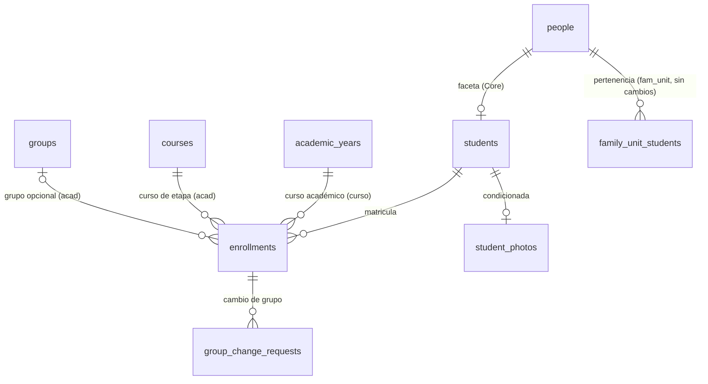

# REQ-ALUM · Modelo de datos

> **Estado**: **APROBADA** (2026-11-06) junto con `funcional.md` (ver su cabecera); lo marcado [DERIVADA] o dependiente de un `OPEN-ALUM` no bloqueante sigue como propuesta. Solo `student_photos` sigue *condicionada* (`OPEN-ALUM-08`); `group_change_requests` entra por `OPEN-ALUM-13` = A. El ADR que formaliza `OPEN-ALUM-11` = B en `§16` es `ADR-071` (`ACEPTADA`, 2026-11-09; `funcional.md` C4). Migraciones con `db-reviewer` obligatorio. **Implementada en `1.15-a`: `students`; en `1.15-b` T1b: `enrollments`** (el resto sigue sin implementar).

Todas las tablas son **de tenant**, creadas con `TenantMigration::tenantTable()` (o `tenantTableAppendOnly()` donde se dice), que aporta `id bigint`, `tenant_id`, RLS `ENABLE` + `FORCE` con la política estándar, `UNIQUE (tenant_id, id)` y `created_at`/`updated_at`/`deleted_at` (`TIMESTAMPTZ`), `created_by`/`updated_by` (`ADR-033`, `ADR-034 §6`/`§7`, `INV-005`). Solo se listan las columnas propias. Toda clave foránea a otra tabla de tenant es **compuesta** `(tenant_id, …)` con `TenantMigration::tenantForeignId()`. Las tablas con `academic_year_id` la declaran con `tenantForeignId($blueprint, 'academic_year_id', 'academic_years')`, que engancha el disparador `academic_year_write_guard` (`ADR-057`, `AR-13`); **ninguna** usa `CASCADE`, `SET NULL` ni `SET DEFAULT` (solo `NO ACTION`). Sin `ENUM`: `text` + `CHECK` (`AR-04`). `public_id` `character(26)` ULID con índice único propio (`AR-05`). Todo es aditivo (*expand*): ninguna tabla existente pierde ni renombra columnas.

---

## 1. Entidades

### 1.1 `students` — faceta de `people` (`ADR-034 §1`) · `1.15-a`

| Columna | Tipo | Nulo | Descripción |
|---------|------|------|-------------|
| `public_id` | `character(26)` | No | ULID (`ADR-029`) |
| `person_id` | `bigint` | No | FK compuesta → `people` (tabla de `Core`; la FK está permitida, la lectura va por `Core\Domain`, `INV-007`) |

Restricciones: `UNIQUE (tenant_id, person_id) WHERE deleted_at IS NULL` (forma de faceta de `ADR-034 §1`, `RN-ALUM-01`).

**Sin `academic_year_id`**: ser alumno del centro no depende del curso; lo que depende es la matrícula (`§16.3` regla 3). No guarda nombre, documento, fecha de nacimiento ni contacto (`§16.3` regla 1, `RN-ALUM-02`). Sin número de expediente (`OPEN-ALUM-25`).

### 1.2 `enrollments` — matrícula · `1.15-b`

| Columna | Tipo | Nulo | Defecto | Descripción |
|---------|------|------|---------|-------------|
| `public_id` | `character(26)` | No | — | ULID |
| `student_id` | `bigint` | No | — | FK compuesta → `students` |
| `academic_year_id` | `bigint` | No | — | FK compuesta → `academic_years` con `tenantForeignId()` (disparador) |
| `course_id` | `bigint` | No | — | Curso de etapa. FK compuesta `(tenant_id, academic_year_id, course_id)` → `courses (tenant_id, academic_year_id, id)` (`RN-ALUM-20`) |
| `group_id` | `bigint` | Sí | `NULL` | Grupo, opcional (`OPEN-ALUM-11` = B). FK compuesta `(tenant_id, course_id, group_id)` → `groups (tenant_id, course_id, id)`, `MATCH SIMPLE` (nulo permitido) |
| `status` | `text` | No | `'activa'` | `CHECK (status IN ('activa','baja'))` (`OPEN-ALUM-12`) |
| `enrolled_on` | `date` | No | — | Fecha de matrícula (fecha civil, sin hora: precedente `academic_years.starts_on`, `ADR-038 §3.2`) |
| `withdrawn_on` | `date` | Sí | — | Fecha de baja |
| `withdrawal_reason` | `text` | Sí | — | `CHECK (withdrawal_reason IN ('traslado','baja_voluntaria','otro'))` [DERIVADA] |

Restricciones:

- `CHECK ((status = 'activa' AND withdrawn_on IS NULL AND withdrawal_reason IS NULL) OR (status = 'baja' AND withdrawn_on IS NOT NULL AND withdrawal_reason IS NOT NULL AND withdrawn_on >= enrolled_on))` (`RN-ALUM-22`).
- `UNIQUE (tenant_id, academic_year_id, student_id) WHERE status = 'activa' AND deleted_at IS NULL` (`RN-ALUM-21`).
- `UNIQUE (tenant_id, course_id, group_id, id)` solo si hace falta como destino de la FK compuesta de `group_change_requests` (lo decide `db-reviewer`).

**Coherencia curso académico ↔ curso de etapa ↔ grupo en el motor**: las dos FK compuestas encadenan matrícula → curso de etapa del mismo curso académico → grupo de ese curso de etapa. Sus destinos **ya existen** en `acad`: `courses_tenant_year_id_unique` `(tenant_id, academic_year_id, id)` y `groups_tenant_course_id_unique` `(tenant_id, course_id, id)` (migraciones `2026_10_13_100200` y `2026_10_13_100300`). `1.15` no cambia el esquema de `acad`.

`people.birth_date` ya existe (`create_people_table.php`); solo falta su lectura en `PersonDirectory` (`OPEN-ALUM-19` = A). Ningún cambio de esquema en `Core`.

La fila de la matrícula **no** se mueve entre cursos académicos: el *rollover* no la copia (`REQ-CURSO-003`, `1.17b`).

### 1.3 `group_change_requests` · `1.15-c` (`OPEN-ALUM-13` = A)

| Columna | Tipo | Nulo | Defecto | Descripción |
|---------|------|------|---------|-------------|
| `public_id` | `character(26)` | No | — | ULID |
| `enrollment_id` | `bigint` | No | — | FK compuesta → `enrollments` |
| `academic_year_id` | `bigint` | No | — | El de la matrícula (desnormalizado para el disparador y el `AcademicYearReadAccess`); FK compuesta `(tenant_id, academic_year_id, enrollment_id)` → `enrollments (tenant_id, academic_year_id, id)` para que no pueda divergir |
| `from_group_id` | `bigint` | No | — | FK compuesta → `groups` |
| `to_group_id` | `bigint` | No | — | FK compuesta → `groups`; `CHECK (to_group_id <> from_group_id)` |
| `reason` | `text` | No | — | `CHECK (length(reason) BETWEEN 1 AND 500)`; no se audita su valor (`RN-ALUM-45`) |
| `status` | `text` | No | `'pendiente'` | `CHECK (status IN ('pendiente','aprobada','rechazada','cancelada'))` |
| `requested_by` | `bigint` | No | — | FK compuesta → `users` |
| `decided_by` | `bigint` | Sí | — | FK compuesta → `users`. Quien aprueba, rechaza o cancela (en `cancelada` puede ser el solicitante, `RN-ALUM-42`) |
| `decided_at` | `TIMESTAMPTZ` | Sí | — | |
| `decision_note` | `text` | Sí | — | `CHECK (decision_note IS NULL OR length(decision_note) <= 500)`; no se audita su valor |

**Nota para `1.15-c` (db-reviewer, issue #602)**: la FK compuesta `(tenant_id, academic_year_id, enrollment_id)` → `enrollments (tenant_id, academic_year_id, id)` exige crear `UNIQUE (tenant_id, academic_year_id, id)` en `enrollments` en la migración de `1.15-c` (patrón `courses_tenant_year_id_unique`). No se crea en `1.15-b`.

Restricciones: `UNIQUE (tenant_id, enrollment_id) WHERE status = 'pendiente' AND deleted_at IS NULL` (`RN-ALUM-41`); `CHECK ((status = 'pendiente' AND decided_by IS NULL AND decided_at IS NULL) OR (status <> 'pendiente' AND decided_by IS NOT NULL AND decided_at IS NOT NULL))` (toda transición registra autor e instante, también `rechazada` y `cancelada`); `CHECK (status <> 'aprobada' OR decided_by <> requested_by)` (`RN-ALUM-44`: la prohibición de autoría propia es **solo** para aprobar; cancelar o rechazar la propia solicitud se admite). Que ambos grupos sean del curso de etapa de la matrícula lo valida el servicio bajo el `FOR UPDATE` de la matrícula (el motor necesitaría desnormalizar `course_id`; se deja a `db-reviewer` si lo prefiere en el motor).

### 1.4 `student_photos` · `1.15-c` · *condicionada a `OPEN-ALUM-08`*

Misma forma que `pickup_photos` de `fam_unit` (`REQ-FAM-UNIT/datos.md §8`, `ADR-068`), sin compartir tabla (`INV-007`):

| Columna | Tipo | Nulo | Descripción |
|---------|------|------|-------------|
| `public_id` | `character(26)` | No | ULID |
| `student_id` | `bigint` | No | FK compuesta → `students` |
| `object_key` | `text` | No | Clave del objeto en el *bucket* privado (`ADR-013`), generada por `App\Support\Files` |
| `content_type` | `text` | No | `CHECK (content_type IN ('image/jpeg','image/png'))` |
| `byte_size` | `bigint` | No | `CHECK (byte_size > 0)` |

Restricciones: `UNIQUE (tenant_id, student_id) WHERE deleted_at IS NULL` (`RN-ALUM-50`). Sin `academic_year_id`.

---

## 2. Relaciones

`alum` no tiene FK hacia tablas de `fam_unit`: la pertenencia se escribe por `FamilyUnitStudents` y vive en `family_unit_students` (`REQ-FAM-UNIT/datos.md §1.3`), que ya referencia `people`.

---

## 3. Índices

| Tabla | Índice | Consulta que lo necesita |
|-------|--------|--------------------------|
| `students` | Único parcial `(tenant_id, person_id) WHERE deleted_at IS NULL` | Faceta única; resolver persona → alumno (`StudentDirectory`, resolutor `unidad_familiar`) |
| `enrollments` | Único parcial `(tenant_id, academic_year_id, student_id) WHERE status='activa' AND deleted_at IS NULL` | `RN-ALUM-21`; matrícula vigente de un alumno en un curso (`StudentEnrollmentDirectory`) |
| `enrollments` | `(tenant_id, group_id, status) WHERE deleted_at IS NULL` | Lista de clase; resolutor `grupo` (`group_id IN (…)`); `EnrollmentRoster` (`1.13`) |
| `enrollments` | `(tenant_id, academic_year_id, course_id)` | Listado por curso académico y curso de etapa; FK compuesta (sirve también al veto de borrado de curso de etapa) |
| `enrollments` | `(tenant_id, student_id)` | Ficha (matrículas de un alumno); FK a `students` |
| `group_change_requests` | Único parcial `(tenant_id, enrollment_id) WHERE status='pendiente' AND deleted_at IS NULL` | `RN-ALUM-41` |
| `group_change_requests` | `(tenant_id, academic_year_id, status, created_at DESC, id DESC)` | Bandeja de pendientes por curso, orden estable |
| `student_photos` | Único parcial `(tenant_id, student_id) WHERE deleted_at IS NULL` | `RN-ALUM-50`; foto vigente |

**Implementado (`1.15-b` T1b)**: la FK compuesta a `groups` `(tenant_id, course_id, group_id)` se cubre con el índice no único `enrollments_tenant_course_group_idx` (`AR-16`); **no** se creó el `UNIQUE (tenant_id, course_id, group_id, id)` opcional de §1.2, que solo hará falta cuando `group_change_requests` (`1.15-c`) apunte a la matrícula (decide `db-reviewer`; si se crea, el índice no único sobra).

**Implementado (`1.15-b`, revisión de `db-reviewer`)**: la FK a `academic_years` se declara con `tenantForeignId(…, withIndex: false)`; el índice `(tenant_id, academic_year_id, course_id)` la cubre por su prefijo (`AR-16`) y el automático `enrollments__academic_year_id_tenant_idx` era redundante. La migración `create_enrollments` se editó (tabla aún sin desplegar); un entorno de desarrollo ya migrado conserva el índice sobrante hasta recrear la base.

Índices de FK no listados: los añade `tenantForeignId()` o los pide `AR-16` (#407); `db-reviewer` comprueba redundancias (precedente `REQ-FAM-UNIT §15`, D-12).

**Particionado**: no. `enrollments` crece ~1.200 filas por centro y curso (`1.15b`: 300-1.200 alumnos); muy por debajo del umbral que justificaría particionar por curso académico (`ADR-029`).

**Medición `#382`** (`CA-ALUM-060`): `AcademicYearWriteGuardOverheadTest` con 20.000 inserciones en `enrollments`, con y sin disparador.

---

## 4. Auditoría (`ADR-035`) y *morph map*

| Modelo | Alias | Política | Valores no registrados |
|--------|-------|----------|------------------------|
| `Student` | `alum_student` | `Full` (solo ids) | — |
| `Enrollment` | `alum_enrollment` | `Full` | — (fechas, estado e ids no son identificadores personales) |
| `GroupChangeRequest` | `alum_group_change_request` | `Selective` | `reason`, `decision_note` (texto libre) |
| `StudentPhoto` | `alum_student_photo` | `Selective` | `object_key` |

Los datos personales del alumno los audita `Core` en la persona. Lectura: fila `read` solo en respuestas con URL de foto (`RN-ALUM-52`). Escrituras por instancia, nunca masivas (`AR-15`).

---

## 5. Checklist obligatorio

- [x] `tenant_id` primera columna de todos los índices (propuesta de §3)
- [x] RLS en las cuatro tablas por el ayudante (`IsolationBatteryTest` #8)
- [x] `group_id` nulo en `enrollments` (`OPEN-ALUM-11` = B; `ADR-071` aceptada; `funcional.md` C4)
- [x] `academic_year_id` en `enrollments` y `group_change_requests`, `NOT NULL`, con `tenantForeignId()` y sin acciones referenciales (`AR-13`); ausente en `students` y `student_photos` (no dependen del curso)
- [x] `created_at`, `updated_at`, `deleted_at`, `created_by`, `updated_by` (ayudante)
- [x] FK compuestas y `CHECK` en el motor (§1)
- [x] Política de auditoría y alias del *morph map* (§4)
- [x] `TIMESTAMPTZ`; fechas civiles en `date` (precedente `academic_years`); `text` con `CHECK`; sin `ENUM`; `public_id` `character(26)`
- [x] Importes: no hay (el pago de matrícula es `REQ-FIN`, `OPEN-ALUM-04`)
- [x] Claves de catálogo expuestas en URL o API: **ninguna**
- [x] `NULLS NOT DISTINCT`: no aplica (los únicos parciales no comparan nulos)
- [x] **Categoría especial: ninguna** en `1.15` (`OPEN-ALUM-02`); `AR-09` no se activa
- [x] Particionado evaluado y descartado (§3)

## 6. Retención y supresión

- **Expediente y matrícula**: historial académico con obligación legal de conservación ⇒ **anonimización** al vencer, no purga (`ADR-004` nivel 2). Plazo y base legal: catálogo de `REQ-PRIV-006`/`1.23b` (`OPEN-13`), condición previa a datos reales.
- **Fotografía**: sin obligación de conservación; purga física al dar de baja al alumno o al vencer el plazo que fije `1.23b` (propuesta a ratificar allí, como `OPEN-FAM-UNIT-37`).
- **Solicitudes de cambio de grupo**: siguen a la matrícula.
- **Baja lógica** (`INV-004`): las cuatro tablas.
- **Antiguo alumno** (`ADR-071`, `OPEN-071-02`): no es un estado ni una columna; se deriva (sin matrícula `activa` y con alguna en `baja` o en un curso `cerrado`/`archivado`). Un uso futuro que dependa de ello (p. ej., bonificación a hermanos) exige que el plazo de conservación de `1.23b` (`OPEN-13`) no borre el hecho de haber sido alumno; el contacto de antiguos alumnos requiere consentimiento propio (`REQ-CRM-004`).
- **Respuesta de idempotencia del alta** (pendiente, #558): `idempotency_keys.response_body` guarda 24 h la respuesta `201` de `POST /students`, que incluye datos de un menor (nombre, fecha de nacimiento, documento enmascarado). Deuda conocida de la tabla de `Core`, no de `alum`; se trata en el issue #558.
