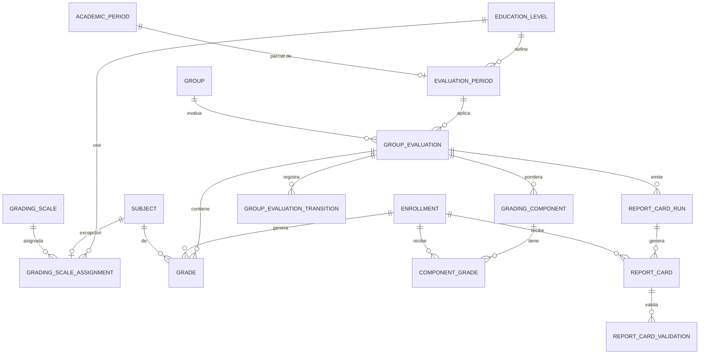

# REQ-CALIF · Modelo de datos

> **Estado**: PROPUESTO (2026-11-12) junto con `funcional.md`. Aplica las recomendaciones de `OPEN-CALIF-02`, `-03`, `-07`, `-21` y `-26`; si el usuario decide otra cosa, cambian las tablas señaladas. Los nombres de columna son la propuesta; los nombres de restricciones e índices se fijan en implementación. `1.16-c` (competencias) no tiene tablas aquí hasta resolver `OPEN-CALIF-12`.

## 1. Entidades

Común a todas salvo que se diga otra cosa: `id bigint` (clave interna), `public_id character(26)` ULID único, `tenant_id`, `created_at`, `updated_at`, `deleted_at` (`timestamptz`), `created_by`, `updated_by` (`INV-005`); creadas con `TenantMigration::tenantTable()` (RLS de `ADR-033`) y `academic_year_id` con `TenantMigration::tenantForeignId()` (disparador `academic_year_write_guard`, `ADR-057`). Todas las FK son `NO ACTION` (`AR-13`). Las FK a tablas de otros módulos son **compuestas con `tenant_id` y `academic_year_id`** donde el padre los tiene, para que el motor impida mezclar cursos (precedente `REQ-ACAD/datos.md §2`).

### 1.1 `evaluation_periods` (`1.16-a`)

| Campo | Tipo | Nulo | Por defecto | Descripción |
|-------|------|------|-------------|-------------|
| `academic_year_id` | `bigint` | No | — | El de la etapa |
| `education_level_id` | `bigint` | No | — | FK a `education_levels` (`acad`) |
| `kind` | `text` | No | — | `CHECK` ∈ `parcial`, `final`, `extraordinaria` |
| `academic_period_id` | `bigint` | Sí | — | FK a `academic_periods`; `CHECK`: no nulo si y solo si `kind = 'parcial'` |
| `name_translations` | `jsonb` | No | — | `translatableColumn()` (`ADR-062`, `AR-16`) |
| `position` | `integer` | No | — | ≥ 1 |

### 1.2 `grading_scale_assignments` (`1.16-a`, `OPEN-CALIF-03`)

| Campo | Tipo | Nulo | Descripción |
|-------|------|------|-------------|
| `academic_year_id` | `bigint` | No | El de la etapa |
| `education_level_id` | `bigint` | No | FK a `education_levels` |
| `subject_id` | `bigint` | Sí | FK a `subjects`; nulo = por defecto de la etapa |
| `grading_scale_id` | `bigint` | No | FK compuesta a `grading_scales` con `academic_year_id` |

Que la asignatura sea de un curso de esa etapa lo valida el servicio (`SubjectDirectory`); el motor no puede sin duplicar columnas de `acad` [DERIVADA].

### 1.3 `group_evaluations` (`1.16-a`; columnas de transición usadas desde `1.16-b`)

| Campo | Tipo | Nulo | Por defecto | Descripción |
|-------|------|------|-------------|-------------|
| `academic_year_id` | `bigint` | No | — | |
| `evaluation_period_id` | `bigint` | No | — | FK compuesta |
| `group_id` | `bigint` | No | — | FK compuesta a `groups` |
| `status` | `text` | No | `abierta` | `CHECK` ∈ `abierta`, `cerrada` |
| `closed_at` / `closed_by` | `timestamptz` / `bigint` | Sí | — | `CHECK`: ambos no nulos si y solo si `status = 'cerrada'` |
| `published_at` / `published_by` | `timestamptz` / `bigint` | Sí | — | `CHECK`: `published_at` nulo si `status = 'abierta'` |

### 1.4 `grades` (`1.16-a`)

| Campo | Tipo | Nulo | Descripción |
|-------|------|------|-------------|
| `academic_year_id` | `bigint` | No | |
| `group_evaluation_id` | `bigint` | No | FK compuesta |
| `enrollment_id` | `bigint` | No | FK compuesta a `enrollments` (`alum`); eje de `§16.3` regla 4 |
| `subject_id` | `bigint` | No | FK compuesta a `subjects` |
| `grading_scale_id` | `bigint` | No | Escala con la que se puso (`RN-CALIF-16`) |
| `numeric_value` | `numeric(5,2)` | Sí | Escalas `numerica` y `mixta` |
| `scale_value_id` | `bigint` | Sí | FK a `grading_scale_values`; escalas `cualitativa` |
| `comment` | `text` | Sí | 1-2000; texto plano |

`CHECK`: `numeric_value` y `scale_value_id` no ambos a la vez; al menos uno de `numeric_value`, `scale_value_id`, `comment` no nulo. No hay columnas de «aprobado» ni de estado (`RN-CALIF-36`, provisional/definitiva derivado). No es un importe: `numeric(5,2)` es el tipo de las escalas de `acad` (`RN-ACAD-73`); en PHP se trata como cadena decimal, nunca `float`.

### 1.5 `grading_components` (`1.16-b`, `OPEN-CALIF-07`)

| Campo | Tipo | Nulo | Descripción |
|-------|------|------|-------------|
| `academic_year_id` | `bigint` | No | |
| `group_evaluation_id` | `bigint` | No | FK compuesta |
| `subject_id` | `bigint` | No | FK compuesta |
| `name` | `text` | No | 1-120; contenido del docente, no traducible |
| `weight` | `smallint` | No | `CHECK` 1-100 |
| `position` | `integer` | No | La fija el servidor por el orden de la lista |

La suma 100 es validación de servicio bajo `FOR UPDATE` de la evaluación de grupo, no del motor (precedente `datos.md §8.3` de `REQ-ACAD`).

### 1.6 `component_grades` (`1.16-b`)

`academic_year_id`, `grading_component_id` (FK compuesta), `enrollment_id` (FK compuesta), `numeric_value numeric(5,2) NOT NULL`.

### 1.7 `group_evaluation_transitions` (`1.16-b`; **solo anexar**)

Creada con `TenantMigration::tenantTableAppendOnly()` (precedente `academic_year_reopenings`). Sin `updated_at`, `deleted_at` ni `updated_by`.

| Campo | Tipo | Nulo | Descripción |
|-------|------|------|-------------|
| `academic_year_id` | `bigint` | No | |
| `group_evaluation_id` | `bigint` | No | |
| `kind` | `text` | No | `CHECK` ∈ `cierre`, `reapertura`, `publicacion`, `retirada_publicacion` |
| `reason` | `text` | Sí | Obligatorio en `reapertura` (`CHECK`), 1-500 |
| `missing_grades` | `integer` | Sí | En `cierre`: cuántas faltaban al confirmar |
| `occurred_at` / `actor_id` | `timestamptz` / `bigint` | No | |

### 1.8 `report_card_settings` (`1.17-a`)

Una fila por centro; **sin** `academic_year_id` [DERIVADA: es configuración del centro, como `facilities`; un boletín emitido no depende de ella porque es inmutable]. `footer_translations jsonb` (texto plano, ≤ 500 por idioma), `tutor_validation_required boolean NOT NULL DEFAULT false` (`1.17-b`).

### 1.9 `report_card_runs` (`1.17-a`)

| Campo | Tipo | Nulo | Descripción |
|-------|------|------|-------------|
| `academic_year_id` | `bigint` | No | |
| `group_evaluation_id` | `bigint` | No | Una emisión por evaluación de grupo; la petición por período crea varias |
| `status` | `text` | No | `CHECK` ∈ `pendiente`, `en_curso`, `completada`, `completada_con_errores`, `fallida` |
| `total` / `generated` / `failed` | `integer` | No | Recuentos |
| `batch_id` | `text` | Sí | Identificador de `job_batches` |
| `requested_by` | `bigint` | No | Actor del trabajo |
| `finished_at` | `timestamptz` | Sí | |

### 1.10 `report_cards` (`1.17-a`)

| Campo | Tipo | Nulo | Descripción |
|-------|------|------|-------------|
| `academic_year_id` | `bigint` | No | |
| `report_card_run_id` | `bigint` | No | |
| `group_evaluation_id` | `bigint` | No | |
| `enrollment_id` | `bigint` | No | |
| `locale` | `text` | No | `CHECK` ∈ `es-ES`, `en`, `de`, `fr` |
| `status` | `text` | No | `CHECK` ∈ `pendiente`, `generado`, `fallido`, `sustituido` |
| `object_key` | `text` | Sí | Clave en el almacén privado (`tenants/<public_id>/calif-report-cards/<ULID>.pdf`); nunca se expone |
| `sha256` | `character(64)` | Sí | Huella del PDF. **Comprobar en implementación** que `AR-04` admite `character(64)`; si no, `text` con `CHECK` de longitud |
| `size_bytes` / `page_count` | `bigint` / `integer` | Sí | |
| `generated_at` | `timestamptz` | Sí | |
| `failure_code` | `text` | Sí | Código de error, sin contenido |

`CHECK`: `object_key`, `sha256`, `size_bytes`, `generated_at` no nulos si `status` ∈ `generado`, `sustituido`.

### 1.11 `report_card_validations` (`1.17-b`; **solo anexar**; condicionada a `ADR-082`, `OPEN-CALIF-26`)

Patrón de `terms_acceptances`: `report_card_id`, `user_id`, `sha256` validado, `locale` mostrado, `occurred_at`, `ip_address inet`, `user_agent text` (≤ 512), método de identificación (valor de catálogo). La forma definitiva la fija `ADR-082 §4.5` cuando se acepte.

## 2. Relaciones

`ENROLLMENT ||--o{ GRADE` es la relación de `§16.2`; no se modifica ninguna entidad núcleo de `§16` (no hace falta ADR).

## 3. Índices

Cada tabla tiene además el índice `(tenant_id, academic_year_id)` que crea `tenantForeignId()` (#407), usado por las validaciones de cierre y por las lecturas por curso.

| Tabla | Índice | Consulta que lo necesita |
|-------|--------|--------------------------|
| `evaluation_periods` | Único parcial `(tenant_id, academic_period_id) WHERE deleted_at IS NULL AND academic_period_id IS NOT NULL` | `RN-CALIF-11`; veto de borrado de un período lectivo |
| `evaluation_periods` | Único parcial `(tenant_id, education_level_id, kind) WHERE deleted_at IS NULL AND kind <> 'parcial'` | `RN-CALIF-11`; listado por etapa |
| `evaluation_periods` | `(tenant_id, education_level_id)` | Listado por etapa (incluye parciales) |
| `grading_scale_assignments` | Único parcial `(tenant_id, education_level_id, subject_id) NULLS NOT DISTINCT WHERE deleted_at IS NULL` | `RN-CALIF-15`; resolución de escala |
| `grading_scale_assignments` | `(tenant_id, grading_scale_id)` | Veto de escala en uso (`RN-CALIF-17`) |
| `group_evaluations` | Único parcial `(tenant_id, evaluation_period_id, group_id) WHERE deleted_at IS NULL` | `RN-CALIF-20`; apertura idempotente |
| `group_evaluations` | `(tenant_id, group_id)` | Resolutor `grupo`; veto de borrado de grupo |
| `group_evaluations` | Parcial `(tenant_id, academic_year_id) WHERE deleted_at IS NULL AND (status = 'abierta' OR published_at IS NULL)` | Validación de cierre del curso (`RN-CALIF-28`) |
| `grades` | Único parcial `(tenant_id, group_evaluation_id, enrollment_id, subject_id) WHERE deleted_at IS NULL` | `RN-CALIF-30`; rejilla de una clase y de un grupo |
| `grades` | `(tenant_id, enrollment_id)` | Historial; resolutor `unidad_familiar`; veto de anulación de matrícula |
| `grades` | `(tenant_id, group_evaluation_id, subject_id)` | Resolutor `clase`; veto de asignatura; recuento de pendientes en el cierre |
| `grades` | `(tenant_id, grading_scale_id)` | Veto de escala en uso |
| `grading_components` | `(tenant_id, group_evaluation_id, subject_id)` | Elementos de una clase |
| `component_grades` | Único parcial `(tenant_id, grading_component_id, enrollment_id) WHERE deleted_at IS NULL` | Nota de elemento; cálculo de la media de una clase |
| `group_evaluation_transitions` | `(tenant_id, group_evaluation_id, occurred_at)` | Historial de una evaluación de grupo |
| `report_card_runs` | Único parcial `(tenant_id, group_evaluation_id) WHERE status IN ('pendiente','en_curso')` | `RN-CALIF-50` |
| `report_cards` | Único parcial `(tenant_id, group_evaluation_id, enrollment_id, locale) WHERE status = 'generado' AND deleted_at IS NULL` | Un vigente por idioma (`RN-CALIF-58`) |
| `report_cards` | `(tenant_id, enrollment_id)` | Historial de boletines de un alumno; ámbito `unidad_familiar` |
| `report_cards` | `(tenant_id, report_card_run_id, status)` | Progreso de la emisión |

Las FK compuestas que no queden cubiertas por un índice **no parcial** llevan el suyo (lección de `REQ-ACAD §16`, `db-reviewer` BAJO-1): se comprueba en implementación.

### 3.1 Particionado (`ADR-029`, `OPEN-CALIF-28`)

Evaluado: un centro de 1.200 alumnos con 10 asignaturas y 5 evaluaciones produce del orden de 60.000 filas de `grades` por curso, y unas 300.000 de `component_grades` si todos los docentes usan cinco elementos (estimación, sin medir). Con decenas de centros son millones de filas por año, bien servidas por índices que empiezan por `tenant_id`. **Propuesta: no particionar en fase 1**; se revisa con `db-reviewer` y con la medición de `REQ-SEED`. El particionado posterior por `academic_year_id` es posible porque la columna es obligatoria en todas las tablas.

## 4. Checklist obligatorio

- [x] `tenant_id` presente y primera columna de todos los índices
- [x] RLS en toda tabla (`tenantTable()` / `tenantTableAppendOnly()`); `IsolationBatteryTest` #8 (`CA-CALIF-023`)
- [x] `academic_year_id` obligatorio en todas salvo `report_card_settings`, con el ayudante; solo `NO ACTION` (`AR-13`)
- [x] Campos de `INV-005`, salvo en las dos tablas de solo anexar
- [x] FK y `CHECK` en base de datos (§1)
- [x] **Auditoría (`ADR-035`) y alias en el *morph map*** (`AR-06`), propuesta `OPEN-CALIF-11`:

| Modelo | Alias | Política | No se registra el valor de |
|--------|-------|----------|----------------------------|
| `EvaluationPeriod` | `evaluation_period` | `Full` | — (traducciones desglosadas por idioma) |
| `GradingScaleAssignment` | `grading_scale_assignment` | `Full` | — |
| `GroupEvaluation` | `group_evaluation` | `Full` | — |
| `Grade` | `grade` | `Selective` | `comment` (texto libre sobre un menor) |
| `GradingComponent` | `grading_component` | `Full` | — |
| `ComponentGrade` | `component_grade` | `Full` | — |
| `GroupEvaluationTransition` | `group_evaluation_transition` | Solo anexar | `reason` |
| `ReportCardSettings` | `report_card_settings` | `Full` | — |
| `ReportCardRun` | `report_card_run` | `Full` | — |
| `ReportCard` | `report_card` | `Selective` | `object_key` |
| `ReportCardValidation` | `report_card_validation` | Solo anexar | `ip_address`, `user_agent` |

- [x] `timestamptz` siempre; `text` (nunca `varchar`); enumerados como `text` con `CHECK`; sin `ENUM`
- [x] **Importes**: el módulo no tiene ninguno
- [x] `public_id` ULID en todas las tablas. **Claves de catálogo expuestas en URL o API: ninguna** (todo parámetro de ruta es un `public_id`)
- [x] `NULLS NOT DISTINCT` en `grading_scale_assignments`
- [ ] **Categoría especial**: el módulo no declara ninguna. Riesgo abierto: el comentario libre (`OPEN-CALIF-27`). La escala adaptada de `REQ-NEAE-003` queda fuera
- [x] Particionado evaluado (§3.1)

## 5. Retención y supresión

| Dato | Regla propuesta | Base |
|------|-----------------|------|
| Calificaciones, elementos, evaluaciones de grupo, transiciones | Borrado lógico operativo (`INV-004`). Ante supresión: **anonimización**, no purga, mientras dure la obligación de conservar el historial académico (`ADR-004`, nivel 2). El plazo no está fijado para un registro **interno** (lo oficial vive en Raíces, `ADR-016`): **pendiente de validación jurídica** | `ADR-004`, `REQ-PRIV-006` |
| Comentarios | Se suprimen (se vacían) en la anonimización: son texto libre con posible identificación | `ADR-035` |
| Boletines (fila y objeto) | Inmutables. Los `sustituido` se conservan lo mismo que los vigentes hasta que el catálogo de `ADR-077` diga otra cosa. La purga de un centro borra los objetos por prefijo (`ADR-077`, propuesta) | `ADR-078 §7.2`, `OPEN-PDF-10` |
| Auditoría de lectura | Retención de `audit_logs` (`ADR-035`) | — |
| Restauración de una copia | Como `OPEN-FAM-UNIT-21`: restaurar una copia anterior a una revocación de tutor no devuelve acceso, porque la visibilidad se calcula en origen con los vínculos vigentes; sí puede **devolver una publicación retirada**: el procedimiento de `1.26` debe revisarla | `REQ-BKP` |

Cada entidad se declara en el catálogo de `REQ-PRIV-006` cuando exista. Base legal por dato: `OPEN-CALIF-27` (`INV-008`).
