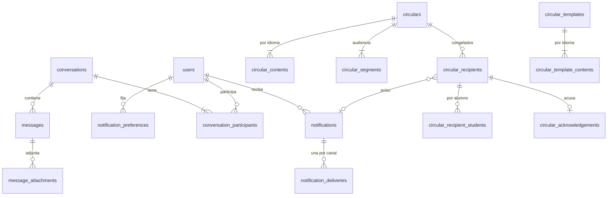

# REQ-COM · Modelo de datos

> **Estado: PROPUESTO** (2026-11-13). Esquema conceptual para revisión de `db-reviewer`; nombres orientativos salvo las restricciones marcadas **obligatorio**. Convenciones de `ADR-029` sin excepciones: `TIMESTAMPTZ`, `text` con `CHECK` de longitud donde es regla, enumerados como `text` + `CHECK`, clave `bigint` interna y `public_id` ULID (`character(26)`, único) en todo lo expuesto. Ningún importe. Todas las tablas son de tenant: `TenantMigration::tenantTable()` (o `tenantTableAppendOnly()`), `tenant_id` primera columna de los índices frecuentes y **RLS** (`IsolationBatteryTest` #8).
>
> Las tablas marcadas [`1.19a`], [`1.19e`] y [`1.19f`] son del módulo `core` (`ADR-079 §4.1`); el resto, de `com`.

## 1. Entidades

### 1.1 [`1.19a`] `notifications` (aviso en la aplicación, `core`)

| Campo | Tipo | Nulo | Descripción |
|---|---|---|---|
| `id` | `bigint` | no | Interna |
| `public_id` | `character(26)` | no | ULID, único |
| `tenant_id` | `bigint` | no | FK `tenants` |
| `recipient_user_id` | `bigint` | no | FK `users` |
| `type_code` | `text` | no | Tipo declarado (`<módulo>.<nombre>`); `CHECK` de formato `^[a-z_]+\.[a-z_]+$`. La pertenencia al catálogo la garantiza el contrato (`RN-COM-01`), no la base de datos (el catálogo vive en código) |
| `category` | `text` | no | `CHECK` en (`seguridad_cuenta`, `urgente`, `servicio_educativo`, `administracion_plataforma`, `informativa_comercial`); copia de la del tipo al emitir, para filtrar y medir |
| `priority` | `text` | no | `CHECK` en (`urgente`, `normal`, `masiva`) |
| `params` | `jsonb` | no | Parámetros del texto; **nunca datos de categoría especial** (`RN-COM-08`). Valor por defecto `'{}'` |
| `link` | `text` | sí | Ruta interna de la SPA (relativa, `CHECK` que empiece por `/` y no por `//`) |
| `origin_key` | `text` | sí | Correlación con el objeto de origen (p. ej. `com.circular:<public_id>`) para estadísticas sin tabla de cruce |
| `idempotency_key` | `text` | sí | Clave del emisor, `CHECK` 1-128 |
| `read_at` | `timestamptz` | sí | Lectura en la aplicación |
| `expires_at` | `timestamptz` | sí | Caducidad opcional |
| `created_at`, `updated_at` | `timestamptz` | no | |

Sin `deleted_at` ni `created_by`/`updated_by`: no es una entidad crítica (`INV-004`), la crea el sistema y se purga por retención (`OPEN-079-09`). Excepción a `INV-005` que `db-reviewer` debe confirmar.

### 1.2 [`1.19a`] `notification_deliveries` (traza, `core`)

| Campo | Tipo | Nulo | Descripción |
|---|---|---|---|
| `id`, `public_id`, `tenant_id` | | no | |
| `notification_id` | `bigint` | no | FK `notifications` (el aviso ya identifica al destinatario) |
| `channel` | `text` | no | `CHECK` en (`email`, `push`, `sms`) — `sms` existe en el enumerado y ningún código lo produce (`ADR-079 §4.3`) |
| `status` | `text` | no | `CHECK` en (`pendiente`, `enviado`, `entregado`, `rebotado`, `queja`, `fallido`, `omitido`) |
| `skip_reason` | `text` | sí | `CHECK` en (`preferencia`, `categoria_no_permitida`, `sin_direccion`, `no_entregable`, `sin_suscripcion`, `usuario_inactivo`, `limite`, `centro_inactivo`); obligatorio si y solo si `status = 'omitido'` (`CHECK`) |
| `failure_reason` | `text` | sí | Motivo normalizado (lista cerrada en código), nunca el texto del proveedor con la dirección |
| `attempts` | `integer` | no | `CHECK >= 0`, por defecto 0 |
| `destination_hint` | `text` | sí | Indicio enmascarado (`a***@e***.com`), `CHECK` ≤ 64; **nunca la dirección completa** (`ADR-079 §4.9.3`) |
| `opaque_ref` | `text` | no | Identificador aleatorio propio que viaja en el mensaje; único **por tenant** (`1.19f` localiza la entrega por él; `ADR-079 §4.9.4`) |
| `provider_message_id` | `text` | sí | Identificador del proveedor |
| `simulated` | `boolean` | no | Modo de prueba (`ADR-079 §4.10.7`), por defecto `false` |
| `queued_at`, `sent_at`, `delivered_at`, `failed_at` | `timestamptz` | sí | |
| `created_at`, `updated_at` | `timestamptz` | no | |

Restricción **obligatoria**: `UNIQUE (notification_id, channel)` (idempotencia, `RN-COM-11`).

### 1.3 [`1.19a`] `notification_preferences` y `notification_tenant_defaults` (`core`)

| Tabla | Campos | Unicidad |
|---|---|---|
| `notification_preferences` | `tenant_id`, `user_id` (FK), `category`, `channel`, `enabled` (`boolean`), `created_at`, `updated_at`, `created_by`, `updated_by` | `UNIQUE (tenant_id, user_id, category, channel)` |
| `notification_tenant_defaults` | `tenant_id`, `category`, `channel`, `enabled`, `created_at`, `updated_at`, `created_by`, `updated_by` | `UNIQUE (tenant_id, category, channel)` |

Sin `public_id`: no se exponen por fila; la API trabaja con el conjunto del usuario o del centro. `CHECK` que impide guardar `enabled = false` para `seguridad_cuenta` y `urgente` (defensa en profundidad de `RN-COM-06`). Sin fila = valor por defecto del producto (`ADR-079 §4.7`).

### 1.4 [`1.19b`] Mensajería (`com`)

**`conversations`**

| Campo | Tipo | Nulo | Descripción |
|---|---|---|---|
| `id`, `public_id`, `tenant_id` | | no | |
| `kind` | `text` | no | `CHECK` en (`individual`, `grupo`) |
| `subject` | `text` | sí | `CHECK` ≤ 200 |
| `individual_pair_key` | `text` | sí | `"<menor_user_id>:<mayor_user_id>"`; `CHECK`: no nulo si y solo si `kind = 'individual'` |
| `last_message_at` | `timestamptz` | no | Orden del listado |
| `created_at`, `updated_at`, `deleted_at`, `created_by`, `updated_by` | | | `INV-005` |

Índice único **obligatorio** parcial: `(tenant_id, individual_pair_key) WHERE kind = 'individual' AND deleted_at IS NULL` (`RN-COM-21`, sin carrera).

**`conversation_participants`**: `id`, `tenant_id`, `conversation_id` (FK), `user_id` (FK), `last_read_message_id` (FK `messages`, nulo), `last_read_at` (nulo), `created_at`, `updated_at`. `UNIQUE (conversation_id, user_id)`. Sin `public_id` (se exponen por el usuario).

**`messages`** (solo anexar, `tenantTableAppendOnly()`: un mensaje no se edita, `RN-COM-25`)

| Campo | Tipo | Nulo | Descripción |
|---|---|---|---|
| `id`, `public_id`, `tenant_id` | | no | |
| `conversation_id` | `bigint` | no | FK |
| `sender_user_id` | `bigint` | no | FK `users` |
| `body` | `text` | no | `CHECK char_length BETWEEN 1 AND 10000` |
| `idempotency_key` | `text` | sí | `UNIQUE (tenant_id, sender_user_id, idempotency_key)` |
| `created_at` | `timestamptz` | no | |

**`message_attachments`**

| Campo | Tipo | Nulo | Descripción |
|---|---|---|---|
| `id`, `public_id`, `tenant_id` | | no | |
| `message_id` | `bigint` | sí | Nulo mientras está subido y no enlazado (purga a 24 h, `RN-COM-26`) |
| `uploaded_by_user_id` | `bigint` | no | |
| `object_key` | `text` | no | Clave en el almacén privado con prefijo del centro (`ADR-076`); nunca expuesta |
| `original_name` | `text` | no | `CHECK` ≤ 255; saneado |
| `media_type` | `text` | no | Tipo real detectado por contenido; solo PDF y ofimáticos, sin imágenes (`RN-COM-26`, `OPEN-COM-32`) |
| `size_bytes` | `bigint` | no | `CHECK > 0 AND <= 10485760` (`OPEN-COM-09`) |
| `sha256` | `text` | no | `CHECK` 64 hexadecimales |
| `created_at`, `updated_at`, `deleted_at` | | | |

### 1.5 [`1.19c`] Circulares (`com`)

**`circular_templates`**: `id`, `public_id`, `tenant_id`, `name` (`CHECK` 1-120), `created_at`, `updated_at`, `deleted_at`, `created_by`, `updated_by`. Contenido por idioma en **`circular_template_contents`**: `tenant_id`, `template_id`, `locale` (`CHECK` en `es`, `en`, `de`, `fr`), `title` (`CHECK` 1-200), `body` (`CHECK` ≤ 50.000; **texto plano**, el servidor rechaza el marcado, `RN-COM-33`), `UNIQUE (template_id, locale)`. Sin `academic_year_id` (se reutilizan entre cursos). Forma del contenido traducible según `ADR-062` (**sin verificar** que este sea su patrón exacto; el implementador lo contrasta con `ADR-062` y lo ajusta sin cambiar las reglas).

**`circulars`**

| Campo | Tipo | Nulo | Descripción |
|---|---|---|---|
| `id`, `public_id`, `tenant_id` | | no | |
| `academic_year_id` | `bigint` | no | `TenantMigration::tenantForeignId(...)`, `NO ACTION` (`OPEN-COM-20`) |
| `status` | `text` | no | `CHECK` en (`borrador`, `programada`, `enviando`, `enviada`, `fallida_programacion`) |
| `requires_ack` | `boolean` | no | Acuse obligatorio |
| `default_locale` | `text` | no | Idioma por defecto del centro al crearla |
| `author_user_id` | `bigint` | no | Quien la creó |
| `sent_by_user_id` | `bigint` | sí | Quien la envió o programó |
| `scheduled_for` | `timestamptz` | sí | `CHECK`: no nulo si y solo si `status = 'programada'` [`1.19d`] |
| `sent_at` | `timestamptz` | sí | `CHECK`: no nulo si `status = 'enviada'` |
| `recipient_count` | `integer` | sí | Congelado al enviar |
| `idempotency_key` | `text` | sí | `UNIQUE (tenant_id, sent_by_user_id, idempotency_key)` |
| `source_template_id` | `bigint` | sí | FK `circular_templates`, informativo |
| `created_at`, `updated_at`, `deleted_at`, `created_by`, `updated_by` | | | `deleted_at` solo en borradores (`CHECK deleted_at IS NULL OR status = 'borrador'`) |

**`circular_contents`**: `tenant_id`, `academic_year_id`, `circular_id`, `locale`, `title`, `body` (texto plano, como en las plantillas, `RN-COM-33`), `content_sha256` (fijado al enviar), `UNIQUE (circular_id, locale)`.

**`circular_segments`**: `id`, `tenant_id`, `academic_year_id`, `circular_id`, `kind` (`CHECK` en `centro`, `familias_centro`, `familias_grupo`, `familias_alumno`, `profesorado`), `group_id` (FK `groups`, nulo), `student_person_id` (FK `people`, nulo). `CHECK`: `group_id` no nulo si y solo si `kind = 'familias_grupo'`; `student_person_id` no nulo si y solo si `kind = 'familias_alumno'`. `UNIQUE NULLS NOT DISTINCT (circular_id, kind, group_id, student_person_id)`.

**`circular_recipients`** (congelados al enviar, `RN-COM-34`): `id`, `tenant_id`, `academic_year_id`, `circular_id`, `user_id`, `locale_resolved`, `notification_id` (FK `notifications`, nulo hasta crearse), `first_read_at` (nulo), `created_at`, `updated_at`. `UNIQUE (circular_id, user_id)`.

**`circular_recipient_students`**: `tenant_id`, `academic_year_id`, `recipient_id` (FK), `student_person_id` (FK `people`). `UNIQUE (recipient_id, student_person_id)`. Permite el informe por alumno (`RN-COM-44`).

**`circular_acknowledgements`** (solo anexar, `tenantTableAppendOnly()`, evidencia de `RN-COM-41`)

| Campo | Tipo | Nulo | Descripción |
|---|---|---|---|
| `id`, `public_id`, `tenant_id` | | no | |
| `academic_year_id` | `bigint` | no | El disparador de `ADR-057` impide acuses con el curso cerrado |
| `circular_id`, `recipient_id` | `bigint` | no | FK |
| `user_id`, `person_id` | `bigint` | no | Quién |
| `locale_shown` | `text` | no | Idioma mostrado |
| `content_sha256` | `text` | no | Resumen del contenido mostrado |
| `acknowledged_at` | `timestamptz` | no | Hora del servidor (`INV-010`) |
| `ip_address` | `inet` | sí | |
| `user_agent` | `text` | sí | `CHECK` ≤ 512 |
| `request_id` | `text` | no | `INV-013` |

`UNIQUE (circular_id, user_id)` **obligatorio** (idempotencia).

### 1.6 [`1.19e`] `push_subscriptions` (`core`)

`id`, `public_id`, `tenant_id`, `user_id`, `endpoint_encrypted`, `p256dh_encrypted`, `auth_encrypted` (`text`, cifrados con el *cast* cifrado de Laravel, `ADR-079 §4.4.4`), `endpoint_hash` (`text`, SHA-256 del *endpoint* para unicidad sin descifrar), `device_label` (`text` ≤ 120, del agente de usuario), `last_used_at`, `created_at`, `updated_at`. `UNIQUE (tenant_id, endpoint_hash)`.

### 1.7 [`1.19f`] `notification_address_status` (`core`)

`tenant_id`, `user_id`, `channel` (`email`), `status` (`CHECK` en `no_entregable`), `reason` (`CHECK` en `rebote_permanente`), `since`, `cleared_at`, `cleared_by`, `created_at`, `updated_at`. `UNIQUE (tenant_id, user_id, channel)`. Las bajas por queja se guardan como preferencia (`notification_preferences.enabled = false`) con auditoría de origen `queja`.

## 2. Relaciones

Las claves foráneas hacia tablas de otros módulos (`users`, `people`, `groups`, `academic_years`, `notifications`) se permiten en base de datos; la **lectura** va siempre por las interfaces de `§6` de `funcional.md` (`INV-007`).

## 3. Índices

| Índice | Consulta que lo necesita |
|---|---|
| `notifications (tenant_id, recipient_user_id, created_at DESC, id DESC)` | Listado de la campana con cursor |
| `notifications (tenant_id, recipient_user_id) WHERE read_at IS NULL` | Recuento de no leídos por sondeo (la consulta más frecuente del motor) |
| `notifications (tenant_id, origin_key)` | Estadísticas de una circular (`RN-COM-52`) |
| `UNIQUE notifications (tenant_id, recipient_user_id, type_code, idempotency_key)` | Idempotencia del emisor |
| `notification_deliveries (tenant_id, status, created_at)` | Traza filtrada por estado; retención |
| `UNIQUE notification_deliveries (tenant_id, opaque_ref)` | `1.19f` |
| `conversation_participants (tenant_id, user_id)` + `conversations (tenant_id, last_message_at DESC, id DESC)` | Listado de conversaciones del usuario |
| `messages (tenant_id, conversation_id, id DESC)` | Mensajes de una conversación con cursor |
| `message_attachments (tenant_id, created_at) WHERE message_id IS NULL` | Purga de adjuntos huérfanos |
| `circulars (tenant_id, academic_year_id, status, sent_at DESC)` | Historial |
| `circulars (status, scheduled_for) WHERE status = 'programada'` | Comando de programación [`1.19d`]; sin `tenant_id` delante porque recorre todos los centros y fija cada uno después (`INV-001`, revisión) |
| `circular_recipients (tenant_id, user_id, created_at DESC)` | «Mis circulares» |
| `circular_recipient_students (tenant_id, student_person_id)` | Informe por alumno |

## 4. Checklist obligatorio

- [x] `tenant_id` en todas las tablas e indexado delante en las consultas frecuentes (salvo el índice del comando de programación, justificado).
- [x] RLS en todas las tablas nuevas (`IsolationBatteryTest` #8). **Ninguna tabla de plataforma nueva** (`ADR-079 §6.4`).
- [x] `academic_year_id` obligatorio en las tablas de circulares (salvo plantillas), con `tenantForeignId`, disparador de `ADR-057` y solo `NO ACTION` (`AR-13`). Las de mensajería y `core` no lo llevan (no dependen del curso).
- [x] `created_at`, `updated_at`, `deleted_at`, `created_by`, `updated_by` en entidades críticas; excepciones declaradas: `notifications` y `notification_deliveries` (sistema, retención), `messages` y `circular_acknowledgements` (solo anexar).
- [x] Claves foráneas, `CHECK` y unicidades en base de datos.
- [ ] **Política de auditoría (`ADR-035`) y alias en el *morph map*** (los fija el implementador con estos valores):

| Modelo | Alias | Política | Notas |
|---|---|---|---|
| `Notification` | `notification` | `None` | La traza es su registro (`ADR-079 §4.1.8`); `AR-06` exige `Auditable` igualmente |
| `NotificationDelivery` | `notification_delivery` | `None` | Ídem |
| `NotificationPreference`, `NotificationTenantDefault` | `notification_preference`, `notification_tenant_default` | `Full` | `CA-COM-014` |
| `Conversation` | `conversation` | `Selective` (`kind`, `deleted_at`); `subject` redactado | |
| `ConversationParticipant` | `conversation_participant` | `None` en `last_read_*` | Escritura muy frecuente sin valor de auditoría |
| `Message` | `message` | `Redacted`: evento `created` sin `body` | `CA-COM-030` |
| `MessageAttachment` | `message_attachment` | `Selective` (`media_type`, `size_bytes`, `message_id`); `original_name` redactado | |
| `Circular`, `CircularContent`, `CircularSegment`, `CircularTemplate`, `CircularTemplateContent` | `circular`, … | `Selective`: estado, `requires_ack`, `scheduled_for`, `recipient_count`, segmentos; `body` sustituido por su resumen | `CA-COM-053` |
| `CircularRecipient`, `CircularRecipientStudent` | `circular_recipient`, … | `None` | Miles por envío; el envío se audita en `Circular` |
| `CircularAcknowledgement` | `circular_acknowledgement` | `Selective` (`created`) | Es evidencia en sí misma |
| `PushSubscription` | `push_subscription` | `Selective`; claves nunca registradas | |

- [ ] **Inserciones masivas** (`notifications`, `notification_deliveries`, `circular_recipients`): por lotes con `insert()`, que no dispara eventos de modelo. `AR-15` no vigila `insert()`; con política `None` no se pierde auditoría, pero `db-reviewer` debe confirmarlo y la excepción queda escrita aquí.
- [x] `TIMESTAMPTZ`, `text`, enumerados con `CHECK`, `public_id` ULID en lo expuesto. **Claves de catálogo expuestas en URL o API: ninguna** (los códigos de tipo de aviso y de categoría viajan en el cuerpo, nunca como parámetro de ruta).
- [x] `NULLS NOT DISTINCT` en `circular_segments`.
- [x] Datos de categoría especial: **ninguna columna** los contiene por diseño. Los textos libres (mensajes, circulares) pueden recibirlos por error del usuario: se advierte en la interfaz (`RN-COM-37`) y no se puede impedir por código (`ADR-079 §4.11.6`).
- [ ] **Particionado**: `notifications` y `notification_deliveries` son de alto crecimiento (una fila por destinatario y canal; `RDB-001` cita «notificaciones»). No dependen del curso. Propuesta para `db-reviewer`: particionado por rango mensual de `created_at` y retención por `DROP` de particiones, **o** sin particionar y purga por lotes hasta medir volumen real (`OPEN-079-09`). `messages` y circulares: sin particionar en `1.19`.

## 5. Retención y supresión

| Datos | Propuesta | Estado |
|---|---|---|
| `notifications`, `notification_deliveries` | 12 meses, purga por lotes o por partición | `OPEN-079-09` (bloquea `datos.md` de `1.19a`) |
| Mensajes y adjuntos | Plazo fijado por el centro con mínimo a validar; supresión de un usuario: sus mensajes se conservan con el autor mostrado como marcador neutro | `OPEN-COM-25` |
| Circulares, destinatarios y acuses | Vida del curso + plazo de conservación del centro; los acuses viven lo que la circular | `OPEN-079-09`, `OPEN-COM-20` |
| `ip_address`, `user_agent` de acuses | Tabla sin `UPDATE`: su supresión sigue el procedimiento pendiente de issue #371, como `image_consent_decisions` (#480); no se inventa otro | Pendiente de #371 |
| Suscripciones *push* | Hasta revocación, 410 o 12 meses sin uso | Propuesta |
| Purga de tenant (`ADR-077`, borrador) | Todas las tablas llevan `tenant_id` (las encuentra el catálogo); objetos de adjuntos bajo el prefijo del centro; listas de supresión del proveedor de correo como recurso de tercero (`ADR-079 §6.4`) | Depende de `ADR-077` |
