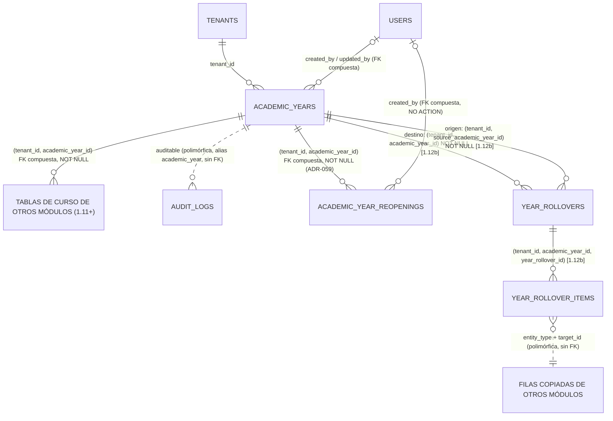

# REQ-CURSO · Modelo de datos

> **Estado**: **APROBADA** (2026-10-07), paso **1.10**, con los ajustes de `ADR-057` (aceptado). **`academic_year_reopenings` (§1.5) implementada el 2026-10-17 en `1.11c`.** Ver `funcional.md` para alcance y preguntas abiertas.
>
> **Resumen**: 1.10 **no crea ninguna tabla ni altera ninguna columna**. `academic_years` existe desde 0.8.2 (`ADR-034 §4`) con la forma que `REQ-CURSO-001` necesita, y las entidades de `REQ-CURSO-002` a `-005` (`YearRollover`, `PromotionDecision`, `RenewalCampaign`, `YearArchive`) quedan fuera de alcance (`funcional.md §1.2`). **Sí trae una migración**: la que crea la función `app.assert_academic_year_writable()` del bloqueo de escritura (`ADR-057 §5.2`, §1.4). Lo que además añade este documento es el contrato de datos que deben cumplir **las tablas de los demás módulos** que dependen del curso, y el traslado del modelo al módulo (que no es esquema, `OPEN-CURSO-03`).
>
> **Ampliación por `ADR-059`** (aceptado el 2026-10-08, reapertura de un curso cerrado, `OPEN-CURSO-08`): **una tabla nueva**, `academic_year_reopenings` (§1.5), *append-only* y con `academic_year_id`. **No altera** `academic_years`, la función del bloqueo ni ningún disparador. El paso de implementación lo fija `PLAN-IMPLEMENTACION.md`.
>
> **Ampliación por `1.11d-a`** (2026-10-16, `OPEN-ACAD-24` = B, aprobada por el usuario; `funcional.md §5.6`): el punto de extensión de validaciones del cambio de fechas **no cambia el esquema**: ni tabla, ni columna, ni índice, ni migración en `curso`. Las validaciones leen las tablas de su propio módulo (`acad`: `academic_periods`, `REQ-ACAD/datos.md`). El único efecto sobre datos de `curso` es que el `PATCH` toma `FOR UPDATE` sobre la fila de `academic_years` del curso antes de validar (`RN-CURSO-51`), el mismo bloqueo que ya toman las transiciones. **La lectura con bloqueo compartido** (`OPEN-CURSO-25` = B, `funcional.md §5.6.1`) tampoco cambia el esquema: es un `SELECT … FOR SHARE` sobre la misma fila, el mismo modo de bloqueo que ya toma el disparador (§1.4), sobre el índice `UNIQUE (tenant_id, id)` existente y con el privilegio `UPDATE` sobre `academic_years` que los roles de aplicación ya tienen por el disparador (PostgreSQL exige `UPDATE` para `FOR SHARE`). Lo único nuevo es que un módulo lo pide **desde la aplicación**, antes de bloquear sus propias filas (orden curso → filas del módulo, `RN-CURSO-58`).
>
> **Ampliación por `1.12b`** (2026-10-20, `REQ-CURSO-002`, apertura del curso siguiente; **APROBADA 2026-10-20 por el usuario; implementada el 2026-10-21 en `1.12b`**; `funcional.md §1.4`, `§5.7`): **dos tablas nuevas** del módulo, `year_rollovers` (§1.6) y `year_rollover_items` (§1.7), ambas con `academic_year_id` = curso **destino** y, por tanto, con el disparador `academic_year_write_guard`. **Corregida el 2026-10-21** con la revisión de documentación: columnas que los ayudantes no crean y se declaran a mano (M-4), mensajes no persistidos (M-3) y auditoría de cada *item* (`OPEN-CURSO-37` = b, decisión del usuario del 2026-10-21). **APROBADA 2026-10-21 por el usuario, sin preguntas abiertas.** **No altera** `academic_years`, la función del bloqueo ni ningún disparador, ni ninguna tabla de otro módulo: lo copiado lo escribe cada módulo en sus propias tablas.

---

## 1. Entidades

### 1.1 `academic_years` (existente, 0.8.2; sin cambios en 1.10)

Migración: `apps/api/database/migrations/2026_08_18_100100_create_academic_years_table.php`. Tabla de tenant ordinaria (`TenantMigration::tenantTable()`, RLS `ENABLE`+`FORCE`, `UNIQUE (tenant_id, id)`).

| Columna | Tipo | Nulo | Por defecto | Descripción |
|---------|------|------|-------------|-------------|
| `id` | `bigint` | No | secuencia | Clave interna. No sale de la API (`ADR-029`) |
| `tenant_id` | `bigint` | No | `app.current_tenant_id()` | `ADR-033` |
| `public_id` | `character(26)` | No | — | ULID, único (`AR-05`) |
| `code` | `text` | No | — | Código del curso, p. ej. `2026-2027`. Contenido del centro, no se traduce. Único por centro entre no borrados |
| `starts_on` | `date` | No | — | Primer día del curso. `date`, no `timestamptz`: es una fecha civil sin hora, sin conversión de zona |
| `ends_on` | `date` | No | — | Último día del curso. `CHECK (ends_on > starts_on)` |
| `status` | `text` | No | `'planificacion'` | `CHECK IN ('planificacion','activo','cerrado','archivado')`. Lo escribe solo el servicio de transiciones (`RN-CURSO-10`) |
| `created_at`, `updated_at`, `deleted_at` | `timestamptz` | `deleted_at` sí | — | `INV-005`, de `tenantTable()` |
| `created_by`, `updated_by` | `bigint` | Sí | — | FK compuesta a `users` (`ADR-034 §6`) |

**Por qué no se añade nada en 1.10:**

- **Fechas de transición** (`activated_at`, `closed_at`): las registra `audit_logs` (`RN-CURSO-13`). Añadirlas después es *expand* puro (columna anulable).
- **Motivo de cierre**, **usuario que cerró**: no los pide ningún requisito; la auditoría guarda el actor.
- **Restricción de exclusión contra solapes**: `ADR-034 §4` la descartó (exige `btree_gist`); la regla de `RN-CURSO-05` (aprobada) se valida en el servicio.
- **`CHECK` de código no vacío**: la validación de servidor basta para el único escritor (`RN-CURSO-10`); si se quiere en el motor, es un `ADD CONSTRAINT … NOT VALID` + `VALIDATE` en una entrega posterior, sin bloqueo. No lo propongo porque la tabla solo tiene un escritor.

### 1.2 Modelo y enumerado (`OPEN-CURSO-03`, aprobada)

| Antes de 1.10 | Resultado (hecho) |
|-----|-----------|
| `App\Models\AcademicYear` (`TenantModel`, `Auditable`, `AuditValuePolicy::Full`, `HasPublicId`) | `App\Modules\Curso\Domain\Models\AcademicYear`, sin cambiar nada más |
| `App\Models\AcademicYearStatus` | `App\Modules\Curso\Domain\AcademicYearStatus` (fuera de `Domain\Models`, para que otros módulos puedan usar el vocabulario sin tocar el modelo, `AR-01`) |
| Alias `academic_year` en `AppServiceProvider` | El **mismo** alias, ya registrado en `CursoServiceProvider::boot()` con `Relation::enforceMorphMap` (precedente `CoreServiceProvider`) |

Mover el modelo **no es un cambio de esquema** y no toca `audit_logs` (que guarda el alias, nunca el FQCN, `ADR-034 §3`). La migración **no se mueve**.

### 1.3 Tabla sonda de test (solo en la suite, nunca en producción)

Para probar el contrato transversal sin consumidor real (`funcional.md §1.3`): tabla creada dentro del test con `TenantMigration::tenantTable()` + `tenantForeignId($table, 'academic_year_id', 'academic_years')`, con su modelo de test. Al crearse con el ayudante, **recibe el disparador `academic_year_write_guard`** (§1.4). Precedente: `tenant_model_probes` (0.7/0.8, bug 4 de `docs/historial/0.8-modelo-de-datos-nucleo.md`: crear el *fixture* con el ayudante real, no con `Schema::create()` a mano). Ojo al bug 3 de 0.7 (crear y borrar por la misma conexión que la usa).

Una **segunda sonda, creada a propósito sin el ayudante** (`Schema::create` con columna `academic_year_id`), sirve a los casos fijos de `AR-13`: su presencia debe hacer fallar la regla (`CA-CURSO-043`, `CA-057-06`).

### 1.4 Función `app.assert_academic_year_writable()` y disparador `academic_year_write_guard` (`ADR-057`)

**Única migración de 1.10**, en `apps/api/database/migrations/` (esquema del núcleo, junto a la de `academic_years`), con `down()` que elimina la función. Es la **primera función PL/pgSQL** del proyecto; revisión obligatoria de `db-reviewer`. El texto exacto de la función es de la implementación; lo que sigue es lo que fija `ADR-057 §5.1`-`§5.3`.

| Aspecto | Decisión |
|---------|----------|
| Ubicación y propiedad | Esquema `app` (junto a `app.current_tenant_id()`), propiedad del rol propietario, `SECURITY INVOKER` (sujeta a RLS como quien escribe; nunca `SECURITY DEFINER`), nombres totalmente cualificados |
| Qué bloquea | Si el curso es de solo lectura (`status` ∈ {`cerrado`, `archivado`}): `INSERT` con ese curso (`NEW`); `UPDATE` de una fila de ese curso (`OLD`) o que pase a él (`NEW`) —incluidos borrado lógico y restauración—; `DELETE` (`OLD`). `planificacion` y `activo` admiten escritura |
| Exención | El **propietario real de la tabla** (comparado con `pg_class.relowner` de `TG_RELID`, no con un nombre de rol escrito en SQL) no está sujeto: migraciones de relleno, purga física de un tenant (issue #371), archivado |
| Serialización | Lee la fila de `academic_years` del curso afectado con `FOR SHARE` (filtrando por `tenant_id` e `id`); choca con el `FOR UPDATE` del cierre (`funcional.md RN-CURSO-32`), de la reapertura (`RN-CURSO-46`) y, desde `1.11d-a`, del `PATCH` de fechas (`RN-CURSO-51`). Desde `1.11d-a` un módulo puede tomar ese mismo `FOR SHARE` antes, desde la aplicación, con `AcademicYearSharedLock` (`RN-CURSO-55`); dentro de la misma transacción, el del disparador lo encuentra ya concedido |
| Error | `RAISE EXCEPTION` con `SQLSTATE` propio **`YC001`** (nunca `P0001` ni `42501`) y mensaje `academic_year_closed:<public_id del curso>`, compuesto por el producto, independiente de `lc_messages`. La implementación comprueba que la clase `CY` no la usa la versión instalada de PostgreSQL |
| Curso inexistente | No lo decide la función: lo rechaza la FK compuesta (`23503`) |
| Vocabulario de estados | Duplicado en SQL y en el enumerado `AcademicYearStatus`, unido por test de paridad (`CA-057-07`). Añadir un estado ya exige migración (`CHECK`), y la función se actualiza en la misma entrega |
| Enganche | `TenantMigration::tenantTable()` y `tenantTableAppendOnly()` crean el disparador `academic_year_write_guard` (`BEFORE INSERT OR UPDATE OR DELETE … FOR EACH ROW EXECUTE FUNCTION app.assert_academic_year_writable()`) si la tabla tiene `academic_year_id`; `TenantMigration::guardAcademicYearWrites(string $table)` cubre añadir la columna a una tabla existente. Las particiones heredan el disparador del padre |
| Privilegios necesarios | `UPDATE` sobre `academic_years` para el `FOR SHARE` (los dos roles de aplicación lo tienen). **Ningún rol de aplicación tiene `TRUNCATE`** sobre tablas de curso (`TRUNCATE` no dispara disparadores de fila); concederlo sería una regresión (`CA-057-10`) |
| Retirar la columna | `DROP TRIGGER academic_year_write_guard ON <tabla>` **antes** de `DROP COLUMN academic_year_id` (y, en *contract*, de `DROP TABLE` no hace falta). Un disparador que sobrevive a la columna leería `NEW.academic_year_id` inexistente y fallaría en cada escritura; `AR-13` lo vigila (tabla con el disparador sin la columna) |
| Requisito previo de despliegue | El rol propietario necesita `CREATE` sobre el esquema `app` (`GRANT CREATE ON SCHEMA app TO <propietario>`, `RUNBOOK.md` paso 0); la migración lo comprueba y aborta con el comando exacto. La función fija `SET search_path = pg_catalog, pg_temp` |
| Excepciones al bloqueo | Ninguna en 1.10. Su forma futura (variable de configuración local a la transacción con pares `tabla:operación`, fijada solo desde `Curso\Domain`) está en `ADR-057 §5.7`; no se construye ahora. La reapertura (`ADR-059`) **no** es una excepción: cambia `academic_years.status`, tabla sin disparador (§1.5) |

### 1.5 `academic_year_reopenings` (nueva, `ADR-059 §5.4`)

Registro *append-only* de cada reapertura de un curso cerrado (`funcional.md §4.6`, `RN-CURSO-43`). Responde «quién reabrió, cuándo y por qué» sin leer `audit_logs` y sin depender de que `AuditRecorder` escriba `audit_logs.context` (no lo hace hoy). Precedente: `mfa_resets`.

Migración del módulo (`apps/api/app/Modules/Curso/Database/migrations/2026_10_17_100400_create_academic_year_reopenings_table.php`, cargada con `loadMigrationsFrom`) con **`TenantMigration::tenantTableAppendOnly()`** y `TenantMigration::tenantForeignId($table, 'academic_year_id', 'academic_years')`: RLS `ENABLE`+`FORCE`, `UNIQUE (tenant_id, id)`, y **el disparador `academic_year_write_guard`**, sin excepción en `AR-13` (es dato del curso).

| Columna | Tipo | Nulo | Por defecto | Descripción |
|---------|------|------|-------------|-------------|
| `id` | `bigint` | No | secuencia | Clave interna. No sale de la API (`ADR-029`) |
| `tenant_id` | `bigint` | No | `app.current_tenant_id()` | `ADR-033` |
| `public_id` | `character(26)` | No | — | ULID, único (`AR-05`) |
| `academic_year_id` | `bigint` | No | — | Curso reabierto. FK compuesta `(tenant_id, academic_year_id) → academic_years (tenant_id, id)`, **`NO ACTION`** (prohibidas las acciones referenciales en tablas con `academic_year_id`, `AR-13`) |
| `reason` | `text` | No | — | Motivo de la reapertura, recortado y no vacío (validado en servidor, `INV-010`). Contenido del centro; el manual advierte de no escribir datos personales |
| `created_by` | `bigint` | No | — | Usuario que reabrió. FK compuesta a `users`, también **`NO ACTION`**: en una tabla con `academic_year_id` está prohibido `nullOnDelete`/`cascadeOnDelete` (`AR-13`) |
| `created_at` | `timestamptz` | No | — | Momento de la reapertura |

Sin `updated_at`, `updated_by` ni `deleted_at`: es *append-only* (lo que dé `tenantTableAppendOnly()`, igual que `mfa_resets`). No se añade columna de motivo a `academic_years`: se sobrescribiría en la segunda reapertura y mezclaría histórico con estado (`ADR-059 §8`).

**Nota sobre `created_by`**: el único camino de alta es el *endpoint* autenticado, así que en la práctica siempre lleva valor; si se declara `NOT NULL` o anulable lo fija la implementación con el mismo criterio que `mfa_resets`. **Implementado `NOT NULL`** (1.11c), como `mfa_resets.performed_by`. No se propone `CHECK` de motivo no vacío en el motor: hay un único escritor y la validación de servidor basta (mismo criterio que `code` en §1.1).

**Orden de escritura** (`ADR-059 §5.3`): la fila se inserta **después** de cambiar `academic_years.status` a `activo`, en la misma transacción; el disparador lee el estado ya actualizado por la propia transacción y la admite. Si el curso se vuelve a cerrar, sus filas quedan inmutables, que es lo deseado.

**Modelo**: `Curso\Domain\Models\AcademicYearReopening` **[DERIVADA: nombre]**, `extends AppendOnlyModel` (**no `TenantModel`**, como se escribió al especificar: `TenantModel` escribe `updated_by` y usa `deleted_at`, que esta tabla *append-only* no tiene; el precedente `MfaReset` también es `AppendOnlyModel`; corregido en `1.11c`), `implements Auditable` con `AuditValuePolicy::Full` (`ADR-035 §8`, criterio de `user_mfa_exemptions.reason`), alias de *morph map* `academic_year_reopening` registrado en `CursoServiceProvider::boot()` (`AR-06`). Su alta queda como `created` en `audit_logs`; sin evento nuevo (`ADR-039 §5.3`).

### 1.6 `year_rollovers` (nueva, `1.12b`, APROBADA 2026-10-20)

Una fila por **copia** (ejecución del *rollover*): selección, estado, resultado y fallo (`funcional.md RN-CURSO-67`, `-69`, `-73` a `-75`). Es el «log de resultados» de `REQ-CURSO-002`. Migración del módulo en `apps/api/app/Modules/Curso/Database/migrations/` con **`TenantMigration::tenantTable()`** y `TenantMigration::tenantForeignId($t, 'academic_year_id', 'academic_years')`: RLS `ENABLE`+`FORCE`, autoría, `timestamptz`, borrado lógico (sin *endpoint* de borrado), `UNIQUE (tenant_id, id)` y el disparador `academic_year_write_guard`, sin excepción en `AR-13`. Precedente de forma: `data_exports` (estado de un trabajo en cola consultado por la interfaz).

| Columna | Tipo | Nulo | Por defecto | Descripción |
|---------|------|------|-------------|-------------|
| `public_id` | `character(26)` | No | — | ULID, único (`AR-05`). Identificador de las rutas `/academic-year-rollovers/{public_id}` |
| `academic_year_id` | `bigint` | No | — | Curso **destino**. `tenantForeignId`: FK compuesta `(tenant_id, academic_year_id) → academic_years (tenant_id, id)`, **`NO ACTION`**, e índice. Al ser `academic_year_id`, la fila queda congelada si el destino llega a cerrarse, lo deseado: una copia de un curso cerrado ya no cambia |
| `source_academic_year_id` | `bigint` | No | — | Curso **origen**. `tenantForeignId($t, 'source_academic_year_id', 'academic_years')`: FK compuesta `NO ACTION` e índice `(tenant_id, source_academic_year_id)`. **No** es `academic_year_id`: el disparador no la mira, de modo que cerrar el origen no congela la copia (sí la del destino) **[DERIVADA]** |
| `status` | `text` | No | `'pendiente'` | `CHECK (status IN ('pendiente','en_curso','completado','fallido','revirtiendo','revertido'))` (`year_rollovers_status_check`). Lo escriben solo el servicio y los dos trabajos de `curso` |
| `elements` | `jsonb` | No | — | Lista de códigos de la **selección efectiva**: los elegidos más, si `copy_teaching_assignments`, los del paquete (`RN-CURSO-64`, `-82`). `CHECK (jsonb_typeof(elements) = 'array' AND jsonb_array_length(elements) >= 1)` (`year_rollovers_elements_check`). Códigos declarados en código, sin datos personales |
| `copy_teaching_assignments` | `boolean` | No | `false` | La casilla «copiar la asignación docente» (`RN-CURSO-82`, decisión del usuario sobre `OPEN-CURSO-29`). Se guarda aparte de `elements` para no depender de qué participantes estén registrados al leer la copia |
| `date_offset_days` | `integer` | Sí | — | Desplazamiento aplicado (`RN-CURSO-72`); lo fija la ejecución. `NULL` hasta entonces |
| `result` | `jsonb` | Sí | — | Por elemento `{code, copied, skipped: [{reason, count}], adjusted: [{reason, count}]}` al terminar en `completado` (`RN-CURSO-73`). Solo códigos y cuentas: las omisiones de profesorado inactivo no guardan quién (`REQ-ACAD RN-ACAD-154`) |
| `failure` | `jsonb` | Sí | — | `{code, errors: [{code, params, element}]}` si `fallido`. **Sin mensajes traducidos**: se traducen al leer (`RN-CURSO-73`) |
| `revert_failure` | `jsonb` | Sí | — | Último fallo de una reversión (la copia vuelve a `completado`, `RN-CURSO-75`); misma forma. Se pone a `NULL` al pedir una nueva reversión (`RN-CURSO-74`) |
| `started_at`, `finished_at` | `timestamptz` | Sí | — | Inicio y fin de la ejecución |
| `reverted_by` | `bigint` | **Sí** | — | Usuario que pidió revertir. **Declarada a mano** (corrección de la revisión de documentación, M-4): `tenantForeignId()` crea una columna `NOT NULL`, y esta es anulable. Columna `bigint NULL`, FK compuesta `(tenant_id, reverted_by) → users (tenant_id, id)` con nombre explícito (`year_rollovers_tenant_reverted_by_foreign`), `MATCH SIMPLE` (con `NULL` no se comprueba), **`NO ACTION`** (prohibido `nullOnDelete` en tabla con `academic_year_id`, `AR-13`), e índice `(tenant_id, reverted_by)` declarado también a mano |
| `reverted_at` | `timestamptz` | Sí | — | Fin de la reversión |
| `created_at`, `updated_at`, `deleted_at`, `created_by`, `updated_by` | — | — | — | De `tenantTable()` (`INV-005`). `created_by` es quien pidió la copia; siempre informado (único camino de alta, el *endpoint* autenticado) y es el actor del trabajo de copia (`RN-CURSO-83`) |

`public_id` lo declara la migración (`$table->ulid('public_id')->unique()`), como en todas las tablas de tenant: `tenantTable()` no lo crea (revisión de documentación M-4; skill `modulo-nuevo`). **Comprobar en implementación** qué columnas crea exactamente `tenantTable()` y declarar a mano las que falten de esta tabla.

**Restricciones** (`CHECK` por sentencia del propietario, como en `acad`; nombres exactos en implementación, los revisa `db-reviewer`):

- `year_rollovers_distinct_years_check`: `CHECK (source_academic_year_id <> academic_year_id)`.
- `year_rollovers_revert_check`: `CHECK ((status NOT IN ('revirtiendo','revertido') OR reverted_by IS NOT NULL) AND (status <> 'revertido' OR reverted_at IS NOT NULL))`.
- `year_rollovers_tenant_year_id_unique`: `UNIQUE (tenant_id, academic_year_id, id)`, no parcial: destino de la FK de `year_rollover_items` (`RN-CURSO-27`).
- `year_rollovers_tenant_year_live_unique`: `UNIQUE (tenant_id, academic_year_id) WHERE status IN ('pendiente','en_curso','completado','revirtiendo') AND deleted_at IS NULL` (`RN-CURSO-67`); la carrera se traduce a `409 rollover_exists`, nunca `500`.

Lo que el motor **no** garantiza (servicio, bajo los bloqueos de `funcional.md RN-CURSO-70`): que el destino esté en `planificacion` y el origen sea anterior (`RN-CURSO-63`), que las transiciones de estado sean las válidas (`pendiente → en_curso → completado|fallido`, `completado → revirtiendo → revertido|completado`) y la forma interna de los `jsonb`.

**Modelo**: `Curso\Domain\Models\YearRollover` **[DERIVADA: nombre]**, `extends TenantModel`, `implements Auditable` con `AuditValuePolicy::Full` (sin datos personales: códigos y cuentas; los `jsonb` grandes los redacta el tope de `ADR-035 §5`), `HasPublicId`, alias `year_rollover` en `CursoServiceProvider::boot()` (`AR-06`). Escrituras por instancia (`AR-15`).

### 1.7 `year_rollover_items` (nueva, `1.12b`, APROBADA 2026-10-20)

Qué filas creó cada copia, para poder revertirla (`funcional.md RN-CURSO-73`, `-75`). *Append-only*. Polimórfica **sin FK** hacia las tablas copiadas, con el patrón de `audit_logs` (`auditable_type` + `auditable_id`): `curso` guarda lo que le devuelve cada participante y se lo devuelve al revertir; **nunca** lee ni escribe las tablas a las que apuntan (`INV-007`). Migración del módulo con **`TenantMigration::tenantTableAppendOnly()`** y `tenantForeignId($t, 'academic_year_id', 'academic_years')` (disparador incluido, sin excepción en `AR-13`).

| Columna | Tipo | Nulo | Descripción |
|---------|------|------|-------------|
| `public_id` | `character(26)` | No | ULID, único, **declarado a mano** en la migración (M-4). No sale en ninguna ruta; por coherencia con `AR-05`/`HasPublicId` (precedente `group_subjects`, `timetables`) |
| `academic_year_id` | `bigint` | No | Curso destino. `tenantForeignId` (FK compuesta `NO ACTION` + índice) |
| `year_rollover_id` | `bigint` | No | FK de tres columnas, declarada a mano con nombre explícito `year_rollover_items_tenant_year_rollover_foreign`: `(tenant_id, academic_year_id, year_rollover_id) → year_rollovers (tenant_id, academic_year_id, id)`, `NO ACTION` (`RN-CURSO-27`) |
| `module_code` | `text` | No | Código del módulo participante (`ADR-045`) |
| `entity_type` | `text` | No | Alias del *morph map* de la tabla copiada (p. ej. `education_level`); el mismo vocabulario que `audit_logs.auditable_type` |
| `source_id` | `bigint` | No | Id interno de la fila de origen |
| `target_id` | `bigint` | No | Id interno de la fila creada en el destino |
| `created_at` | `timestamptz` | No | **Declarada a mano** (M-4): `tenantTableAppendOnly()` no crea marcas de tiempo ni autoría (precedente `academic_year_reopenings`, `mfa_resets`); la rellena el modelo al crear |
| `created_by` | `bigint` | No | **Declarada a mano**: FK compuesta `(tenant_id, created_by) → users (tenant_id, id)` con nombre explícito, **`NO ACTION`** (`AR-13`), e índice `(tenant_id, created_by)`. Es el solicitante de la copia (el actor fijado por `RN-CURSO-83`) |

Sin `updated_at` ni `deleted_at`: la reversión **no** borra *items* (quedan como rastro de qué se copió y se revirtió). Restricciones: `UNIQUE (tenant_id, year_rollover_id, entity_type, target_id)` (`year_rollover_items_target_unique`). Ningún `CHECK` sobre `entity_type`: el vocabulario es de los módulos y cambia con ellos (como `audit_logs`).

**Modelo**: `Curso\Domain\Models\YearRolloverItem` **[DERIVADA: nombre]**, `extends AppendOnlyModel` (precedente `AcademicYearReopening`), `implements Auditable` (`Full`), **sin exclusión de eventos**: cada *item* deja su `created` (`OPEN-CURSO-37` = b, decisión del usuario del 2026-10-21; sin ADR; `funcional.md §15.4.1`), `HasPublicId`, alias `year_rollover_item` (`AR-06`). Se inserta a través del modelo dentro de la transacción de la copia; una inserción masiva por constructor de consultas queda descartada **[DERIVADA]**: saltaría el modelo y la auditoría (`AR-15`).

**Volumen**: una fila por fila copiada: con la selección completa de `acad`, de cientos a pocos miles por copia (con la casilla de asignación docente, ≈ 1.200 sesiones más en un centro de 40 grupos) y una copia viva por destino. Sin particionado. Con `OPEN-CURSO-37` = b, el mismo número de entradas `created` adicionales en `audit_logs` por copia.

---

## 2. Contrato de datos para los módulos que dependen del curso

Lo fija `ADR-034 §4` y se repite aquí porque este módulo es su dueño. **Ninguna de estas reglas es nueva salvo las marcadas.**

| Regla | Origen |
|-------|--------|
| `academic_year_id` es `NOT NULL` o no existe. Nunca anulable | `ADR-034 §4`; test de esquema de 0.8.10 |
| Se declara con `TenantMigration::tenantForeignId(Blueprint $blueprint, 'academic_year_id', 'academic_years')` (firma real: `Blueprint $blueprint, string $column, string $referencedTable, ?string $constraintName = null`): columna, índice y FK compuesta `(tenant_id, academic_year_id) → academic_years (tenant_id, id)` | `ADR-034 §7`, `ADR-033 §6` |
| Índice compuesto con `tenant_id` primero y `academic_year_id` segundo en las consultas frecuentes | `RDB-009`, `§16.3` regla 2 |
| «Ante la duda, la entidad no es del curso: su matrícula sí lo es» | `ADR-034 §4`, `§16.3` regla 4 |
| **[Nueva]** Una hija no pertenece a un curso distinto del de su padre; se recomienda imponerlo con FK compuesta que incluya `academic_year_id` | `RN-CURSO-27` |
| **[Nueva]** Toda tabla con `academic_year_id` lleva el disparador `academic_year_write_guard`, que ponen los ayudantes de `TenantMigration` (§1.4); lo comprueba `AR-13` sobre el esquema real. Lista de excepciones de `AR-13` vacía; ampliarla exige especificación aprobada expresamente por el usuario | `RN-CURSO-23`, `ADR-057 §5.3` |
| **[Aviso]** Si la tabla se particiona por curso (`RDB-001`), la clave primaria y los índices únicos deben incluir `academic_year_id`, y las FK que apunten a ella también; se decide en la primera migración de la tabla | `RDB-001`, `funcional.md §12` |
| Ningún otro módulo lee `academic_years` por SQL ni por el modelo: usa las interfaces de `Curso\Domain` | `INV-007`, `RARQ-ARC-003`, `RN-CURSO-26` |

---

## 3. Relaciones

Futuras (fuera de 1.10, todas con `academic_year_id NOT NULL`): `year_rollovers` (`REQ-CURSO-002`; **especificada en §1.6-§1.7 para `1.12b`, con `year_rollover_items`**), `promotion_decisions` (`-003`), `renewal_campaigns` (`-004`), y lo que decida el ADR de archivado para `YearArchive` (`-005`).

---

## 4. Índices

Existentes, y suficientes para 1.10. **No se propone ninguno nuevo.**

| Índice | Consulta que lo necesita |
|--------|---------------------------|
| `academic_years_tenant_code_unique` — `(tenant_id, code) WHERE deleted_at IS NULL`, único | Unicidad del código (`RN-CURSO-01`) |
| `academic_years_tenant_status_unique` — `(tenant_id, status) WHERE status IN ('activo','planificacion') AND deleted_at IS NULL`, único | Un activo y un en planificación como mucho (`RN-CURSO-04`, `-11`) **y** resolución del curso activo en cada petición (`RN-CURSO-24`: `WHERE tenant_id = ? AND status = 'activo' AND deleted_at IS NULL`, búsqueda por índice único) |
| `UNIQUE (tenant_id, id)` | Destino de las FK compuestas de los demás módulos |
| `UNIQUE (public_id)` | Detalle por `public_id` |

El listado (`ORDER BY starts_on DESC, id DESC`) no lleva índice propio: un centro tiene un curso por año y la tabla tendrá decenas de filas por tenant en toda su vida. Un índice para eso es deuda (plantilla `datos.md`).

**Reapertura (`ADR-059`)**: la condición «es el cerrado más reciente» (`RN-CURSO-41`) es una consulta sobre `academic_years` del centro filtrada por estado y `starts_on`; con decenas de filas por centro no justifica índice. `academic_year_reopenings` lleva el índice `(tenant_id, academic_year_id)` que crea `tenantForeignId()` y el único de `public_id`; ninguno más (pocas filas por curso).

**Apertura del curso siguiente (`1.12b`, APROBADA 2026-10-20)**:

| Índice | Tabla | Consulta |
|--------|-------|----------|
| `UNIQUE (public_id)` | las dos | Detalle y reversión por `public_id` (`year_rollovers`); `AR-05` (`year_rollover_items`) |
| `(tenant_id, academic_year_id)` | las dos | Del ayudante: listado `?academic_year=` y FK a `academic_years` |
| `(tenant_id, source_academic_year_id)` | `year_rollovers` | Del ayudante: filtro `source` (aviso de reapertura, `RN-CURSO-77`) y FK |
| `(tenant_id, reverted_by)` | `year_rollovers` | Declarado a mano (la columna es anulable, M-4): cubre la FK a `users` |
| `(tenant_id, created_by)` | `year_rollover_items` | Declarado a mano: cubre la FK a `users` |
| `year_rollovers_tenant_year_live_unique` (único parcial) | `year_rollovers` | Una copia viva por destino (`RN-CURSO-67`) y la lectura «¿hay copia en vuelo?» de la activación (`RN-CURSO-71`) |
| `year_rollovers_tenant_year_id_unique` | `year_rollovers` | Destino de la FK de los *items* |
| `(tenant_id, academic_year_id, year_rollover_id)` (no parcial) | `year_rollover_items` | Cubre la FK de tres columnas y la lectura de los *items* de una copia al revertir (criterio de #407/#412: índice propio con exactamente las columnas de la FK) |
| `year_rollover_items_target_unique` | `year_rollover_items` | Una fila creada no se anota dos veces en la misma copia |

Sin índice por `status` más allá del parcial: decenas de copias por centro en toda su vida. Sin índice por `entity_type`/`source_id`: nadie busca hoy «qué se creó a partir de esta fila» (la interfaz pública de mapa está fuera de alcance, `funcional.md §1.4`; si `1.17b` la pide, añade su índice).

---

## 5. Checklist obligatorio

- [x] `tenant_id` presente e indexado como primera columna de las consultas frecuentes (los dos índices únicos parciales)
- [x] **Política de RLS** declarada (`tenantTable()`, 0.8.2). *Lo comprueba `IsolationBatteryTest` #8.*
- [ ] `academic_year_id` — **no aplica**: es la tabla a la que apunta
- [x] `created_at`, `updated_at`, `deleted_at`, `created_by`, `updated_by` (`INV-005`)
- [x] Claves foráneas, `CHECK` de estado y de fechas e índices únicos en base de datos
- [x] **Política de auditoría**: `Full` (sin datos personales, `ADR-035 §8`). Alias estable `academic_year` en el *morph map* (hoy `AppServiceProvider`; pasa a `CursoServiceProvider`, `OPEN-CURSO-03` aprobada). *`AR-06` comprueba `Auditable`.*

### Convenciones de tipos (`ADR-029`)
- [x] **`TIMESTAMPTZ`** en las marcas de tiempo; `starts_on`/`ends_on` son `date` a propósito (fecha civil). *`AR-04`.*
- [x] **`text`**, sin `varchar`. *`AR-04`.*
- [ ] Importes — **no aplica**, sin importes
- [x] **Enumerado** `status` como `text` + `CHECK`, sin `ENUM`. *`AR-04`.*
- [x] `public_id` `character(26)` con índice único. *`AR-05`.* **Línea de `public_id`: ninguna clave de catálogo expuesta**; `code` **no** se usa como identificador de ruta (fallaría C1 y C2 de `ADR-051`: lo escribe el centro y es único por centro)
- [ ] `NULLS NOT DISTINCT` — no aplica (ninguna columna anulable en las claves únicas)

### `academic_year_reopenings` (`ADR-059`, §1.5)
- [x] `tenant_id` + RLS por `tenantTableAppendOnly()`; `academic_year_id NOT NULL` con `tenantForeignId()` y disparador `academic_year_write_guard` (*`AR-13`*, sin excepción)
- [x] Sin acciones referenciales (`NO ACTION`) en ninguna FK, incluida la de `created_by` (*`AR-13`*)
- [x] `public_id` ULID único (*`AR-05`*), `text`, `timestamptz` (*`AR-04`*)
- [x] `Auditable`, política `Full`, alias `academic_year_reopening` (*`AR-06`*)
- [x] *Append-only*: sin `updated_at`/`deleted_at`; ningún *endpoint* de modificación ni de borrado

### `year_rollovers` y `year_rollover_items` (`1.12b`, APROBADA 2026-10-20; §1.6, §1.7)
- [x] `tenant_id` + RLS (`tenantTable()` / `tenantTableAppendOnly()`); `academic_year_id NOT NULL` (destino) con `tenantForeignId()` y disparador (*`AR-13`*, sin excepción); `source_academic_year_id` con FK compuesta y **sin** disparador
- [x] Ninguna acción referencial (`NO ACTION`) en ninguna FK, incluidas `reverted_by` y la de tres columnas de los *items* (*`AR-13`*)
- [x] `public_id` ULID único en las dos (*`AR-05`*); `text`, `jsonb`, `integer`, `boolean`, `timestamptz` (*`AR-04`*); enumerado `status` como `text` + `CHECK`
- [x] `Auditable` y alias `year_rollover`, `year_rollover_item` (*`AR-06`*); *items* auditados sin exclusión (`OPEN-CURSO-37` = b, decisión del usuario del 2026-10-21)
- [x] Columnas declaradas a mano: `public_id` en las dos; `created_at`/`created_by` en los *items* (este con `tenantForeignId`, mismo DDL: `funcional.md §16.1`, D-4); `reverted_by` anulable con su FK compuesta e índice (M-4)
- [x] Ninguna FK hacia tablas de otros módulos (polimórfica, `INV-007`); ningún dato personal salvo la autoría (`created_by`, `reverted_by`)
- [ ] Revisión de `db-reviewer` obligatoria (dos migraciones nuevas)

### Resto
- [ ] Datos de categoría especial — **no aplica**
- [ ] Particionado — **no aplica** a `academic_years` (decenas de filas por centro). Sí condiciona a las tablas de otros módulos (§2, aviso)

---

## 6. Retención y supresión

`academic_years` **no contiene datos personales**. Su retención la gobierna la de los datos que cuelgan de ella: un curso no puede purgarse mientras existan actas, historiales o facturas de ese curso con obligación legal de conservación (`ADR-004` niveles 1 y 3). El catálogo de retención por entidad es de `REQ-PRIV-006` (paso `2.x`, issue #371); esta tabla debe aparecer en él como **«se conserva mientras exista cualquier dato dependiente; sin supresión propia»**. Borrado lógico únicamente (`INV-004`); en 1.10 ni siquiera lógico (`OPEN-CURSO-12`).

Las filas de `academic_years` entran en la purga física de un tenant (issue #371) **después** de todas las tablas que las referencian, por el orden de dependencias de las FK (no hay `ON DELETE CASCADE`, y no puede haberlo: **prohibido `cascadeOnDelete`/`nullOnDelete`/`ON UPDATE CASCADE` en cualquier tabla con `academic_year_id`**, porque PostgreSQL ejecuta las acciones referenciales como propietario de la tabla hija, exento del disparador, y saltarían el bloqueo; lo comprueba `AR-13`). La purga de filas de cursos cerrados la ejecuta el propietario de las tablas, exento del disparador (§1.4).

**`academic_year_reopenings`** (`ADR-059`): dato del curso; se conserva con el curso y entra en la purga física de un tenant antes que `academic_years` (FK). `reason` es texto libre del centro: aunque el manual advierte de no escribir datos personales, si los contuviera quedaría sujeto a lo mismo que el resto de datos de un curso cerrado (siguiente párrafo).

**`year_rollovers` y `year_rollover_items`** (`1.12b`): datos del curso destino sin datos personales salvo la autoría (`created_by`, `reverted_by`: vínculo de un usuario del personal con una operación del centro, como en `academic_year_reopenings`). Con la casilla de asignación docente, los *items* apuntan también a asignaciones y tutorías copiadas (que sí contienen el vínculo persona ↔ docencia, `REQ-ACAD/datos.md §9.6`), pero solo por identificador interno: el dato personal vive en la tabla de `acad`, con su retención. Se conservan con el curso; borrado lógico de `year_rollovers` sin *endpoint* (una copia no se borra: se revierte); los *items* son *append-only*. En la purga física de un tenant: `year_rollover_items` → `year_rollovers` → `academic_years` (FK), como propietario. **Orden de restauración**: `academic_years` → `year_rollovers` → `year_rollover_items`. Los *items* apuntan sin FK a filas de otros módulos: tras una restauración granular que no incluya esas filas, un *item* puede apuntar a una fila inexistente; la reversión del participante trata «fila no encontrada» como «ya borrada» **[DERIVADA]**.

**Pendiente (`OPEN-057-04`)**: suprimir o anonimizar datos personales en tablas de un curso cerrado choca con el bloqueo de escritura. Lo decide `REQ-PRIV-006` (como tarea del propietario o con excepción declarada de `ADR-057 §5.7`) antes de admitir datos reales.
