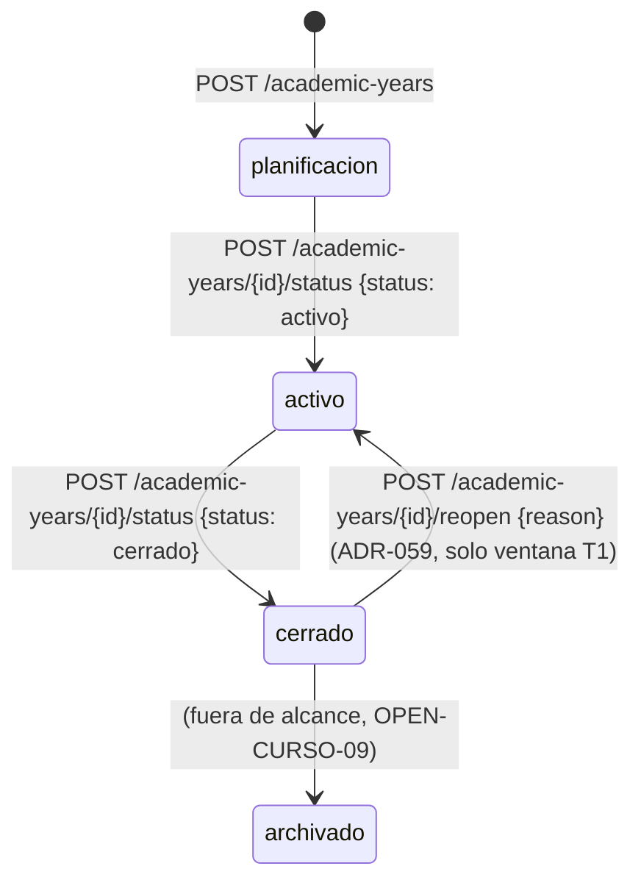

# REQ-CURSO · Ciclo de vida del curso académico · Funcional

| Campo | Valor |
|-------|-------|
| Código | `REQ-CURSO` (sección 5.28 del documento de requisitos; `REQ-CURSO-001` a `REQ-CURSO-005`) |
| Prioridad | MUST |
| Fase | 1 · paso **1.10** del plan (⚠️ paso crítico) |
| Depende de | Según el documento: `ACAD`, `ALUM`. **Ver §0: esa dependencia forma un ciclo con el esquema ya fijado y no puede declararse tal cual**. Decisión aprobada (`OPEN-CURSO-01`): `depends_on: []` |
| Esencial | **`essential: true`** (aprobado, `OPEN-CURSO-01`) |
| Estado | **`1.12b` (apertura del curso siguiente o *rollover*, `REQ-CURSO-002`) IMPLEMENTADA el 2026-10-21** (rama `feature/REQ-CURSO-1-12b-rollover`; decisiones de implementación en §16; cada `CA-CURSO-123` a `-158` tiene su test salvo `CA-CURSO-147`, E2E escrito y **sin ejecutar**, y `CA-CURSO-149`, medición opt-in con su cifra en `CHANGELOG.md`). **Implementada el 2026-10-17 en `1.11d-a`** (punto de extensión del cambio de fechas, `RN-CURSO-49` a `-60`, `CA-CURSO-108` a `-122`), **y la reapertura de un curso cerrado** (`ADR-059`, `RN-CURSO-40` a `-48`, `CA-CURSO-087` y `-100` a `-107`, y la mitad de reapertura de `CA-CURSO-121`) **implementada el 2026-10-17 en `1.11c`**. **APROBADA** (2026-10-07). El usuario aprobó las 23 recomendaciones de `OPEN-CURSO-01` a `-23` y aceptó `ADR-057` (`OPEN-057-01` y `-02`), que sustituye la recomendación original de `OPEN-CURSO-04` (rasgo de modelo) por un **disparador de PostgreSQL**. `OPEN-CURSO-06` (resuelta el 2026-10-08) y `OPEN-057-03` quedaron resueltas; `OPEN-057-04` sigue en §15. **Ampliada el 2026-10-08 con `ADR-059` (aceptado)**: `OPEN-CURSO-08` queda resuelta (opción B, reapertura acotada a la ventana T1); se añaden la transición `cerrado → activo` (§4.6, `RN-CURSO-40` a `-48`) y sus criterios (`CA-CURSO-100` a `-107`, de `ADR-059 §9`, y `CA-CURSO-087` de interfaz). La reapertura se implementó en el paso `1.11c` del plan (§4.6, «Implementación en 1.11c»). **Ampliada el 2026-10-12 por `1.11-a`** (`REQ-ACAD-001`, `OPEN-ACAD-11`/`-12`, #409, #387 B-5): `GET /academic-years/selectable`, `AcademicYearDirectory` por identificador interno y comprobación de `retired_at` en `curso:grant-year-permissions`. **Ampliada el 2026-10-16 por `1.11d-a`** (`REQ-ACAD-001`, `OPEN-ACAD-24` = **B**, `RN-ACAD-62`): **punto de extensión de validaciones del cambio de fechas** de un curso (§5.6, `RN-CURSO-49` a `-54`, `CA-CURSO-108` a `-116`). **APROBADA el 2026-10-16** por el usuario como parte de `OPEN-ACAD-24` = B; se implementa en el paso **`1.11d-a`** de `REQ-ACAD`, junto con su primer consumidor (`acad`). **Completada el 2026-10-16** con las decisiones del usuario sobre `OPEN-CURSO-25` (**B**: lectura del curso con bloqueo compartido, §5.6.1, `RN-CURSO-55` a `-59`), `OPEN-CURSO-26` (**A**: un módulo no contratado no valida, `RN-CURSO-52`) y `OPEN-CURSO-27` (**A**: el mismo filtro en los registros de cierre y de reapertura, `RN-CURSO-60`); criterios nuevos `CA-CURSO-117` a `-121`, y `CA-CURSO-122` (tres procesos reales) en la revisión de documentación del 2026-10-17. Las tres preguntas quedan resueltas (§15.2). **Ampliada el 2026-10-20 con la especificación de `1.12b` (`REQ-CURSO-002`, apertura del curso siguiente o *rollover*): APROBADA 2026-10-20 por el usuario; implementada el 2026-10-21 en `1.12b`** (§0.1, §1.4, §1.5, §4.7, §5.7, §7.4, §10.6, `RN-CURSO-61` a `-86`, `CA-CURSO-123` a `-158`). **Corregida el 2026-10-21** con la revisión de documentación de la especificación (actor y ciclo de vida de los trabajos, cancelación de copias huérfanas, transacción `REPEATABLE READ`, mensajes traducidos al leer: `RN-CURSO-83` a `-86`, `CA-CURSO-154` a `-158`). **APROBADA 2026-10-21 por el usuario, sin preguntas abiertas**: `OPEN-CURSO-37`, reabierta en esa revisión, la resolvió el usuario con la opción b (auditar cada *item*), y aceptó la caducidad de 30 minutos de la cancelación (`RN-CURSO-85`). El usuario resolvió `OPEN-CURSO-28` a `-37` (§15.4) con la recomendación A, salvo `OPEN-CURSO-29`, que cambia (estructura, períodos, escalas y plantillas de horario siempre, más una casilla opcional, desmarcada por defecto, «copiar la asignación docente», `RN-CURSO-82`), y `OPEN-CURSO-28`, que queda en A **con el issue #128 (*worker* de colas) resuelto antes de implementar**. Las sub-preguntas `OPEN-CURSO-29-a` a `-d` (§15.4.2) las resolvió también el usuario el 2026-10-20 con la recomendación, incluida la ampliación de `Core\Domain\UserDirectory` (`-d`). **No quedan preguntas abiertas de `1.12b`** (`OPEN-CURSO-37` resuelta por el usuario el 2026-10-21, §15.4.1). El participante de `acad` se trasladó a `REQ-ACAD/funcional.md §21` (`RN-ACAD-145` a `-157`, `CA-ACAD-142` a `-153`). Nada de lo aprobado antes cambia salvo `RN-CURSO-11` (activación), que gana la condición de `RN-CURSO-71`. |
| Decisiones vinculantes de partida | `ADR-034 §4` (tabla `academic_years`, regla «obligatorio o ausente», sin *global scope* de curso, `AcademicYearContext` diferido a 1.10), `ADR-029`, `ADR-033`, `ADR-038`, `ADR-044`, `ADR-045`, `ADR-048 §4.9`, `ADR-053`, `ADR-056`, **`ADR-057`** (bloqueo de escritura de cursos cerrados por disparador, error `academic-year-closed`, regla `AR-13`, forma de las excepciones), **`ADR-059`** (reapertura de un curso cerrado: opción B, permiso propio, motivo obligatorio, ventana T1) |

> Donde esta especificación añade algo que ni los requisitos ni un ADR fijan, se marca **[DERIVADA]** y se argumenta. Las preguntas abiertas de §15 están resueltas salvo las señaladas allí. Donde el texto conserva la palabra «propuesta» junto a un `OPEN-CURSO-NN` aprobado, debe leerse como la decisión aprobada.

---

## 0. Contradicciones y huecos detectados antes de especificar (regla 0 de `CLAUDE.md`)

Se señalan aquí, antes del alcance, porque condicionan todo lo demás. Ninguna se resuelve en este documento: cada una tiene su `OPEN-CURSO-NN`.

| # | Hallazgo | Fuentes | Consecuencia | Pregunta |
|---|----------|---------|--------------|----------|
| C1 | **Ciclo de dependencias.** `§5.28` dice que `REQ-CURSO` *depende de* `ACAD` y `ALUM`. Pero `§16.2` (`ACADEMIC_YEAR ||--o{ COURSE`), `§16.1` (`Group/Course/Subject`: «siempre por `AcademicYear`») y `ADR-034 §4` (toda tabla de curso lleva `academic_year_id NOT NULL` con FK compuesta a `academic_years`) hacen que **`ACAD` y `ALUM` dependan de `REQ-CURSO`**. Si ambos declaran `depends_on` literal, el grafo tiene un ciclo y `platform:sync-registry` **aborta el despliegue** (`RMOD-006`, `ADR-045`). El plan ya resolvió el orden a favor del esquema (1.10 antes que 1.11 y 1.15) | `§5.28`, `§16.1`, `§16.2`, `ADR-034 §4`, `RMOD-006`, `PLAN 1.10` | La dependencia del documento describe **funcionalidades** (`REQ-CURSO-002` a `-005`), no el módulo. No puede declararse como `depends_on` del módulo | `OPEN-CURSO-01` |
| C2 | **Alcance del bloqueo de escritura.** `REQ-CURSO-005` enumera tres cosas que el cierre bloquea («calificaciones, asistencia y facturación del período»); `REQ-CURSO-001` dice que los cursos cerrados se consultan «en modo solo lectura», sin enumerar. No son incompatibles, pero dejan sin decidir si el bloqueo es universal (todo dato del curso) o solo de esas tres familias, y qué pasa con lo que en la vida real sigue vivo tras el cierre (cobro de un recibo pendiente de un curso cerrado en `REQ-FIN`) | `REQ-CURSO-001`, `REQ-CURSO-005` | Afecta al contrato transversal que consumirán 50 módulos | `OPEN-CURSO-20` |
| C3 | **Dependencias de fase 2/3 dentro de un requisito MUST de fase 1.** `REQ-CURSO-003` exige «acta de evaluación final **firmada digitalmente**» (firma = `REQ-DOC-002`, fase 2) y exportación a Raíces (`ADR-016`, `REQ-SEC`, fase 2). `REQ-CURSO-004` exige firma digital, servicios de comedor/transporte/extraescolares (`REQ-COMED`, `REQ-TRAN`, `REQ-EXTRA`, fases 2-3) y liberación a lista de espera (`REQ-OFE`, fase 2). `REQ-CURSO-005` incluye «cierre contable» (`REQ-FIN`, fase 2) | `§5.28`, `§17`, `PLAN` fase 2 | `REQ-CURSO-003`/`-004`/`-005` no pueden completarse en fase 1 tal como están escritos | `OPEN-CURSO-21` |
| C4 | **Referencia errónea.** `REQ-CURSO-005` cita `RDB-010` para el archivado en frío; `RDB-010` es «claves foráneas y restricciones declaradas en base de datos». El requisito de archivado es **`RDB-012`** | `REQ-CURSO-005`, `§9` | Errata del documento de requisitos. Severidad Baja. **No la corrige esta especificación** (fuera de su ámbito de escritura); corrección aprobada, la aplica la sesión principal | `OPEN-CURSO-22` |
| C5 | **«Puede coexistir con uno en planificación».** `REQ-CURSO-001` no dice si puede haber **varios** en planificación. `ADR-034 §4` ya lo interpretó como **como mucho uno** y lo impuso con índice único parcial (implementado en 0.8.2). No es contradicción: es una interpretación ya tomada por ADR que esta especificación **respeta** y no reabre | `REQ-CURSO-001`, `ADR-034 §4`, migración `2026_08_18_100100_create_academic_years_table.php` | Ninguna | — |

### 0.1 Hallazgos antes de especificar `1.12b` (`REQ-CURSO-002`, 2026-10-20)

Ninguno obliga a detenerse: son huecos o dependencias, cada uno con su pregunta. Uno (C7) es una **dependencia no implementada** que se declara antes de seguir.

| # | Hallazgo | Fuentes | Consecuencia | Pregunta |
|---|----------|---------|--------------|----------|
| C6 | **«Ejecución asíncrona» (requisito) frente a «contrato síncrono por módulo» (plan).** No es contradicción: `ADR-048 §4.9` separa el contrato entre módulos —síncrono, en el `Domain` del propietario, porque quien llama necesita el resultado y el fallo— de la asincronía, que «la pone el llamador con su propio trabajo en cola, no el contrato» | `REQ-CURSO-002`, `PLAN 1.12b`, `ADR-048 §4.9` | Se especifican las dos cosas: un registro de participantes con contrato síncrono (§5.7) invocado desde un trabajo en cola de `curso` | — |
| C7 | **Dependencia no implementada: no hay *worker* de colas desplegado** (issue #128, Alta). `CLAUDE.md §1`: `QUEUE_CONNECTION=database`, sin `queue:work` ni Horizon en `compose.yaml` ni en `infra/quadlet/` | `REQ-CURSO-002` («ejecución asíncrona»), `INV-012`, #128 | Fuera del desarrollo local y de los tests, una copia o una reversión encoladas se quedan en `pendiente` para siempre. No impide especificar ni probar (los tests ejecutan el trabajo directamente). **Decisión del usuario (2026-10-20, `OPEN-CURSO-28`): #128 se resuelve antes de implementar `1.12b`** (en otra rama, con `queue:work` sobre el *driver* `database`, sin Horizon) | `OPEN-CURSO-28` (resuelta) |
| C8 | **La lista del requisito no coincide con lo que existe.** «Niveles, cursos, grupos, asignaturas» existen (`acad`, `1.11`); «plantillas de horario» existen como marcos horarios y franjas (`1.12`); **«tarifas» no existen** (`REQ-FIN`, fase 2); **«criterios de evaluación» no existen como tales** (`CALIF`, `1.16`), y `REQ-ACAD/funcional.md §12` propuso tratar períodos lectivos y escalas de calificación como su parte disponible. Asignación docente, tutorías, sesiones y reservas existen y el requisito **no** las nombra | `REQ-CURSO-002`, `REQ-ACAD/funcional.md §12`, `§18.7` | Se copia solo lo que existe; el contrato hace aditivo añadir tarifas y criterios cuando lleguen sus módulos. Decisión del usuario: asignación docente y tutorías como casilla opcional (`RN-CURSO-82`) | `OPEN-CURSO-29` (resuelta, con sus sub-preguntas `-29-a` a `-d`) |
| C9 | **Fechas del curso origen.** Los períodos lectivos y los marcos horarios especiales llevan fechas del curso origen: copiadas tal cual quedarían fuera del destino (`RN-ACAD-57`, `-111`) | `REQ-ACAD/funcional.md §12` («lo decide `1.12b`») | Hay que decidir cómo se desplazan | `OPEN-CURSO-30` |
| C10 | **«Asistente de creación del curso siguiente» y «curso actual»**: el requisito no dice si el asistente crea el curso destino (hoy lo crea `POST /academic-years`, `RN-CURSO-01` a `-05`) ni si el origen solo puede ser el activo. Con `OPEN-CURSO-06` = A, entre el cierre de un curso y la activación del siguiente no hay curso activo | `REQ-CURSO-002`, `RN-CURSO-03`, `OPEN-CURSO-06` | — | `OPEN-CURSO-31` |
| C11 | **«Revertir» sin definir**: el requisito no dice qué pasa con lo copiado que se ha editado después ni con datos añadidos a mano que dependen de lo copiado | `REQ-CURSO-002` | — | `OPEN-CURSO-33` |
| C12 | **Reevaluación pendiente de `OPEN-CURSO-01`**: la recomendación aprobada decía «reevaluar **C** (partir el módulo) cuando se especifique `REQ-CURSO-002`, si el producto quiere vender el rollover por separado» | `OPEN-CURSO-01` (§15.3) | — | `OPEN-CURSO-35` |
| C13 | **Primer uso de aislamiento `REPEATABLE READ`** en el producto (`RN-CURSO-69`), para leer el origen como una foto coherente. `RN-CURSO-58` ya lo admite si el consumidor trata el error de serialización `40001` | `RN-CURSO-58` | Se especifica el tratamiento (`RN-CURSO-69`, `operacion.md §7`) | — |

**No hace falta ADR nuevo** **[DERIVADA, razonado]**: el contrato aplica la regla general de `ADR-048 §4.9` con la misma forma que los registros ya especificados sin ADR (`RN-CURSO-30`, `-45`, `-49`); la tabla de lo creado (`datos.md §1.7`) reutiliza el patrón polimórfico de `audit_logs` (alias del *morph map* + identificador, sin FK); `ADR-057`, `ADR-058`, `ADR-059` y la convención del curso de referencia (§3.2) no cambian. La excepción a la auditoría de creación que proponía `OPEN-CURSO-37` (A) se apoyaba en `ADR-040 §4.5`, que exige un ADR y tres condiciones; el usuario decidió el 2026-10-21 la opción b (auditar cada *item*), que **no** necesita ADR ni toca el test guardián de exclusiones (`SessionLifecycleTest`). Con `OPEN-CURSO-35` = A (aprobada) no hace falta revisar `OPEN-CURSO-01`. La ampliación de `Core\Domain\UserDirectory` que necesita la casilla de asignación docente (`OPEN-CURSO-29-d`) es un cambio de interfaz aditivo, no de arquitectura: se aprueba como pregunta, no como ADR (precedente `REQ-ACAD/funcional.md §19.1`, I-1).

---

## 1. Alcance

### 1.1 Qué entra en 1.10 (aprobado, `OPEN-CURSO-02`)

**Todo `REQ-CURSO-001` y el contrato transversal que lo hace útil a los módulos posteriores.** Nada de `REQ-CURSO-002` a `-005` salvo los puntos de extensión que evitan migrar después.

| Pieza | Qué se entrega | Requisito |
|-------|----------------|-----------|
| Módulo `curso` | `apps/api/app/Modules/Curso/` con `CursoServiceProvider` (descriptor, catálogo de permisos, migraciones), `Http/routes.php`, `lang/{es,en,de,fr}/curso.php`, entrada `modules.curso` | `RMOD-001`, `ADR-056` (`AR-03`, `AR-12`) |
| Alta y edición de cursos | `POST /academic-years`, `PATCH /academic-years/{id}`, listado y detalle | `REQ-CURSO-001` punto 1 |
| Transiciones de estado | `planificacion → activo` y `activo → cerrado`, con su auditoría (automática por el *observer*, política `Full` ya declarada) | `REQ-CURSO-001` punto 1, `REQ-CURSO-005` (solo la transición; ver §1.2) |
| Un solo activo por tenant | Ya impuesto en base de datos desde 0.8.2 (índice único parcial). 1.10 lo **traduce a errores de API** y lo prueba de punta a punta | `REQ-CURSO-001` punto 2 |
| Contrato transversal | Interfaces públicas en `Curso\Domain` para que los demás módulos: (a) resuelvan el curso activo y un curso por `public_id`, (b) **impidan escribir** en un curso cerrado, (c) **autoricen la lectura** de un curso cerrado. Convención de API para recursos dependientes del curso | `REQ-CURSO-001` puntos 2-3, criterio de aceptación 1 de `§5.28`, `ADR-034 §4` (`AcademicYearContext`) |
| Pantallas de administración | Listado, alta, ficha (con acciones de transición) y edición de cursos | `REQ-CURSO-001` punto 1, `INV-006` |
| Selector de curso | **Aprobado: especificado aquí, construido en 1.11** con su primer consumidor (`OPEN-CURSO-17`) | `REQ-CURSO-001` punto 3 |

### 1.2 Qué NO entra, explícitamente

| Fuera de alcance | Requisito | Por qué | Dónde se retoma (aprobado, `OPEN-CURSO-21`) |
|------------------|-----------|---------|-----------------------------------------------|
| **Rollover** (asistente, copia de estructura, *dry-run*, ejecución asíncrona, reversión) | `REQ-CURSO-002` | Copia «niveles, cursos, grupos, asignaturas, plantillas de horario, tarifas, criterios de evaluación»: **ninguna de esas entidades existe** (`ACAD` 1.11-1.12, `CALIF` 1.16, tarifas `REQ-FIN` fase 2) | Paso nuevo tras `1.12` (horarios), p. ej. **`1.12b · REQ-CURSO-002`**, copiando solo lo que exista entonces; tarifas al llegar `REQ-FIN`. **Especificado el 2026-10-20 en §1.4 (APROBADA 2026-10-20)** |
| **Promoción, repetición y titulación** | `REQ-CURSO-003` | Necesita alumnos y matrícula (`ALUM` 1.15), calificaciones (`CALIF` 1.16), firma digital (`REQ-DOC-002`, fase 2) y exportación a Raíces (`REQ-SEC`, fase 2) | Tras `1.16`/`1.17`, p. ej. **`1.17b · REQ-CURSO-003`** sin firma ni exportación; firma y exportación en fase 2 |
| **Campaña de renovación** | `REQ-CURSO-004` | Necesita portal de familias (1.22), comunicaciones (1.19), firma (fase 2), servicios opcionales (fases 2-3) y lista de espera (`REQ-OFE`, fase 2) | **Fase 2**, tras `REQ-OFE` y `REQ-DOC` |
| **Checklist de cierre con validaciones bloqueantes** | `REQ-CURSO-005` punto 4 | Sus validaciones son de otros módulos («no se puede cerrar con calificaciones sin publicar» es `CALIF`). 1.10 deja el **punto de extensión** (`RN-CURSO-30`) y lo entrega vacío (`OPEN-CURSO-07`) | Cada módulo registra su validación al llegar (`CALIF` en 1.16) |
| **Paquete de cierre** (actas, boletines finales, historiales, cierre contable) | `REQ-CURSO-005` punto 2 | Documentos de `CALIF` (1.17), `ALUM` (1.15) y `REQ-FIN` (fase 2) | Tras `1.17`, junto con `REQ-CURSO-003` |
| **Archivado en frío** (`archivado`) | `REQ-CURSO-005` punto 3, `RDB-012` | Exige decidir qué es «almacenamiento frío» con la base compartida de `ADR-001` (particiones desacopladas, exportación a objeto, réplica) y depende de que existan tablas particionadas por curso (`RDB-001`). El estado existe en el `CHECK` desde 0.8 pero **1.10 no lo hace alcanzable** (`OPEN-CURSO-09`) | Paso propio con ADR (`architect`), no antes del primer curso cerrado real |
| ~~**Reapertura de un curso cerrado**~~ | — | **Resuelta por `ADR-059`** (`OPEN-CURSO-08`): entra en esta especificación, acotada a la ventana T1 (§4.6). Siguen fuera: reabrir con otro curso `activo`, reabrir un curso que no es el cerrado más reciente, y reabrir un curso `archivado` (`ADR-059 §2`, `§3`) | Paso de implementación: lo fija `PLAN-IMPLEMENTACION.md` |
| **Rectificación de datos de un curso cerrado** (p. ej. reclamación de una nota tras el cierre) | — | No está en ningún requisito; es de `CALIF` (`OPEN-CURSO-19`) | `1.16` |
| **`RPERM-008`** (permisos condicionales «solo durante el período de evaluación») | `RPERM-008` | Diferido a `REQ-CALIF` 1.16 por `ADR-044 §4.5`; depende de períodos de evaluación, no del ciclo del curso | `1.16` |
| **Eventos de dominio emitidos** | `INV-007`, `RARQ-ARC-006` | Se **especifican** aquí; aprobado emitirlos con su primer consumidor (`OPEN-CURSO-18`, precedente `ADR-048`), salvo `AcademicYearReopened`, emitido desde `1.11c` (ver §4.6) | `1.11` o el primer consumidor |

### 1.3 Dependencias no implementadas y cómo se tratan

1.10 se adelanta a `ACAD` y `ALUM` por diseño (`ADR-034 §4`, plan): **ningún dato de negocio depende todavía del curso**. Eso tiene dos consecuencias que la especificación no esconde:

1. **El contrato transversal (§7) no tiene consumidor real en 1.10.** Se prueba con una tabla sonda de test creada con `TenantMigration::tenantTable()` y `tenantForeignId($table, 'academic_year_id', 'academic_years')` (precedente: `tenant_model_probes` de 0.7/0.8), que **recibe por tanto el disparador `academic_year_write_guard`** de `ADR-057 §5.3`. Una **segunda sonda creada sin el ayudante** (`Schema::create`) sirve a los casos fijos de `AR-13` (debe hacer fallar la regla). Es la única forma de cumplir `INV-015` sin inventar un recurso de negocio. Lo valida de verdad `1.11`.
2. **El selector de curso no tiene nada que seleccionar** hasta que exista un dato por curso. Ver `OPEN-CURSO-17`.

### 1.4 Alcance de `1.12b` · `REQ-CURSO-002`, apertura del curso siguiente (APROBADA 2026-10-20)

Las preguntas de §15.4, incluidas las sub-preguntas `OPEN-CURSO-29-a` a `-d`, están resueltas por el usuario (2026-10-20); donde el texto cita una de ellas con su opción o con «recomendación», es la decisión aprobada.

**Entra:**

| Pieza | Qué se entrega | Reglas |
|-------|----------------|--------|
| Punto de extensión de participantes | Contrato `AcademicYearRolloverParticipant` y sus objetos de valor en `Curso\Domain`; registro *singleton* en `Curso\Infrastructure`. Cada módulo copia **sus** tablas | `RN-CURSO-61`, `-62` |
| Simulación previa (*dry-run*) | `GET /academic-year-rollovers/preview`: informe por elemento de lo que se creará, lo que se omite y lo que impide ejecutar. Síncrona, sin escrituras | `RN-CURSO-65`, `-66` |
| Ejecución | `POST /academic-year-rollovers` valida y encola; un trabajo de `curso` copia en **una** transacción, todo o nada | `RN-CURSO-67` a `-70`, `-72` |
| Registro de resultados (el «log» del requisito) | Tablas `year_rollovers` (estado, selección, resultado o fallo) y `year_rollover_items` (qué filas creó cada copia) | `RN-CURSO-73`; `datos.md §1.6`, `§1.7` |
| Reversión | `POST /academic-year-rollovers/{id}/revert` mientras el destino siga en `planificacion`; también en cola | `RN-CURSO-74` a `-76` |
| Participante de `acad` | Estructura, períodos, escalas y plantillas de horario, siempre ofrecidos; y, con la casilla opcional «copiar la asignación docente» (desmarcada por defecto), asignaciones docentes, tutorías de grupo y sesiones del horario (`OPEN-CURSO-29`, decisión del usuario) | `RN-CURSO-82`; `REQ-ACAD/funcional.md §21` (§7.4 es la referencia) |
| Permisos | Recurso nuevo `apertura_curso_academico` (`leer`, `crear`, `eliminar`), siembra y comando para centros existentes | `RN-CURSO-78`; `permisos.md §1`, `§4` |
| Activación con copia en vuelo | `409` (`OPEN-CURSO-36` = A) | `RN-CURSO-71` |
| Asignación docente opcional | Campo booleano `copy_teaching_assignments` en la simulación y la solicitud (por defecto `false`); los elementos del paquete `teaching_assignments` se copian juntos solo con él | `RN-CURSO-82` |
| Ciclo de vida de los trabajos | Actor = quien pidió la operación; un intento sin reentrega; transiciones condicionales; cancelación de copias huérfanas (*endpoint* y comando) | `RN-CURSO-83` a `-86` |
| Interfaz | Asistente, sección «Copia de estructura» en la ficha del curso, avisos en los diálogos de activación y reapertura | §10.6 |

**No entra:**

| Fuera | Por qué | Dónde se retoma |
|-------|---------|-----------------|
| Tarifas | `REQ-FIN` no existe (fase 2) | Participante de `REQ-FIN`, con su especificación |
| Criterios de evaluación de `CALIF` | `CALIF` no existe (`1.16`) | Participante de `CALIF`, si su especificación lo decide |
| Alumnado, matrícula, promoción | `REQ-CURSO-003`, `1.15`/`1.17b` | `1.17b` |
| Reservas de espacios | Puntuales y con fecha: no son estructura | — |
| Espacios (`facilities`) | Sin curso académico (`OPEN-ACAD-33`): ya existen para el destino | — |
| Transición combinada «cerrar y activar» | `OPEN-CURSO-06` = B sigue **diferida**: no hay datos de uso real que la pidan | — |
| Copiar hacia un curso `activo` o «encima» de datos existentes | `RN-CURSO-48`, `OPEN-CURSO-34` = A | — |
| Eventos de dominio | Sin consumidor (`ADR-048`, `OPEN-CURSO-18`) | Con su primer consumidor |
| Interfaz pública «fila destino de esta fila origen» para otros módulos | Sin consumidor; `1.17b` puede necesitarla («asignación del alumno al curso/grupo del año siguiente»), y sería aditiva sobre `year_rollover_items` | `1.17b`, si su especificación lo decide |

### 1.5 Dependencias de `1.12b`

- **Implementadas**: `REQ-CURSO` (`1.10`, `1.11c`, `1.11d-a`: `AcademicYearSharedLock`, filtro por módulo contratado) y `acad` (`1.11`, `1.11d`, `1.12`).
- **No implementada: *worker* de colas** (issue #128). Ver C7. **Decisión del usuario (`OPEN-CURSO-28`, 2026-10-20): #128 se resuelve antes de implementar `1.12b`**; según el encargo, se está resolviendo en otra rama con `queue:work` sobre el *driver* `database`, sin Horizon (no verificado por esta especificación). La implementación de `1.12b` empieza cuando ese cambio esté mezclado.
- **`Core`**: la autorización por elemento (`RN-CURSO-78`) pregunta a `Core` si el usuario tiene un permiso por su código con **`PermissionResolver::can()`**, la interfaz que según la revisión de documentación ya existe para eso fuera del *middleware* `permission:` (firma exacta, la del código). Ningún cambio en `Core` por esto.
- **`Core\Domain\UserDirectory`** (solo para la casilla de asignación docente): hace falta una consulta por lote de usuarios activos por identificador interno que hoy no existe. **Ampliación aprobada por el usuario el 2026-10-20** (`OPEN-CURSO-29-d`): `activeIdsAmong(array $ids): array`, firma y semántica en `REQ-ACAD/funcional.md §21.8` (I-19) y `RN-ACAD-157`. Se implementa en la misma entrega que `1.12b`.
- **`TeachingMembership`** (`REQ-ACAD/funcional.md §18.7`): **no** es dependencia. El participante de `acad` lee sus propias tablas; la interfaz de pertenencia sigue sin construir hasta su primer consumidor (`OPEN-ACAD-43` = A).
- **`REQ-ACAD`**: el participante de `acad` está especificado en `REQ-ACAD/funcional.md §21` (trasladado desde §7.4 el 2026-10-20, con la aprobación).

---

## 2. Actores y roles implicados

| Actor | Qué hace en este módulo |
|-------|--------------------------|
| **Administrador de Centro** (`administrador_centro`) | Crea y edita cursos, los activa y los cierra (siembra aprobada, `OPEN-CURSO-14`), y reabre el cerrado más reciente en la ventana T1 (`ADR-059 §5.2`) |
| **Dirección / Jefatura**, **Secretaría** | Consultan cursos y datos de cursos cerrados (aprobado, `OPEN-CURSO-14`) |
| **Cualquier usuario autenticado** | Necesita saber cuál es el curso activo (selector, cabeceras de pantalla). Aprobado: por autoservicio (`OPEN-CURSO-15`) |
| **Roles personalizados** | Ciudadanos de primera: nada de esta especificación compara códigos de rol (`RN-PERM-46`, skill `permisos-y-roles` regla 6) |
| **Módulos de negocio** (`ACAD`, `ALUM`, `CALIF`, `FIN`…) | Consumidores del contrato de §6: asocian sus datos al curso y respetan el bloqueo de escritura |
| **`soporte_plataforma`**, **`super_administrador`** | Sin permisos de este módulo (mismo criterio que `REQ-PERM/permisos.md §5.4`/`§5.5`) |

---

## 3. Conceptos

### 3.1 Estados y máquina de transiciones

| Estado | Significado | ¿Admite escritura de datos del curso? | ¿Quién lo consulta? |
|--------|-------------|----------------------------------------|---------------------|
| `planificacion` | Curso en preparación (el siguiente). Como mucho uno por centro (`ADR-034 §4`) | Sí | Quien tenga el permiso del módulo dueño del dato (`OPEN-CURSO-16`) |
| `activo` | Curso en curso. Como mucho uno por centro (`REQ-CURSO-001`) | Sí | Quien tenga el permiso del módulo dueño del dato |
| `cerrado` | Curso terminado. Solo lectura (`REQ-CURSO-001`, `-005`) | **No** (`RN-CURSO-20`) | Quien tenga además `curso_historico.leer` (`OPEN-CURSO-16`) |
| `archivado` | Curso en almacenamiento frío (`REQ-CURSO-005`, `RDB-012`). **Inalcanzable en 1.10** | **No** | Igual que `cerrado` |

Transiciones admitidas (las dos primeras desde 1.10; la reapertura desde `ADR-059`):

**Reapertura** (`cerrado → activo`, `ADR-059`): es transición **válida**, pero solo por su *endpoint* propio (`POST /academic-years/{id}/reopen`, con motivo obligatorio y permiso `reapertura_curso_academico.actualizar`) y solo dentro de la **ventana T1**: no hay otro curso `activo` en el centro, el curso es el cerrado más reciente y ninguna validación de reapertura registrada la impide (`RN-CURSO-40` a `-45`). Un curso `archivado` no se reabre.

En el *endpoint* de estado (`POST /academic-years/{id}/status`), con destino admitido (`activo`, `cerrado`), toda transición que no sea `planificacion → activo` o `activo → cerrado` responde `409` según el estado de origen: `planificacion → cerrado`, `cerrado → activo` (la reapertura no se ejecuta por este *endpoint*, `RN-CURSO-40`), `activo → activo` y `archivado → activo`/`cerrado` (`RN-CURSO-12`). Un `status` de destino distinto de `activo`/`cerrado` (`planificacion`, `archivado`) **no es una transición**: es `422` de validación (`api.md §2`).

### 3.2 Curso «de referencia» de una petición

`ADR-034 §4` prohíbe el *global scope* de curso y difiere a 1.10 el `AcademicYearContext`. **[DERIVADA]** En esta especificación, el curso de una operación se determina así, en este orden, y nunca a partir del estado de la sesión del usuario (`RARQ-DEP-002`; una selección guardada en sesión rompería con dos pestañas abiertas en cursos distintos):

1. **Escritura sobre una entidad existente**: el curso es el de la propia entidad (`academic_year_id` de la fila), **nunca** uno que envíe el cliente.
2. **Alta de una entidad hija**: el curso es el de su entidad padre (la calificación hereda el de la matrícula). Si la entidad no tiene padre con curso, el cuerpo lo lleva **explícito** como `academic_year` (`public_id`); **no hay curso por omisión en una escritura** (`RN-CURSO-22`).
3. **Lectura de una colección dependiente del curso**: parámetro de consulta `academic_year` (`public_id`). Si se omite, el **curso activo**; si no hay activo, `404` específico (`api.md §4`).

Esto es convención transversal para 50 módulos: **ratificada sin cambios por `ADR-057 §5.8`**.

---

## 4. Flujos principales

### 4.1 Alta de un curso

1. El usuario con `curso_academico.crear` abre «Nuevo curso» y rellena código, fecha de inicio y fecha de fin.
2. `POST /academic-years`. El servidor valida (`RN-CURSO-01` a `-05`).
3. El curso se crea **siempre** en `planificacion` (`RN-CURSO-03`). El cuerpo no admite `status`.
4. Si ya existe un curso en `planificacion`, `409` (`RN-CURSO-04`).
5. El *observer* registra `created` en `audit_logs` con los valores (`Full`).

### 4.2 Edición

1. Con `curso_academico.actualizar`, `PATCH /academic-years/{id}` con las claves a cambiar.
2. Solo se admite en `planificacion` (`RN-CURSO-06`, `OPEN-CURSO-10`). En cualquier otro estado, `409`.
3. Mismas validaciones que el alta, excluyendo el propio curso de la comprobación de unicidad y solape.
4. **Desde `1.11d-a`**: si el `PATCH` cambia `starts_on` o `ends_on`, el servidor ejecuta además, dentro de la transacción y con `FOR UPDATE` sobre la fila del curso, las **validaciones del cambio de fechas** registradas por los módulos contratados (`RN-CURSO-49` a `-54`; la primera, de `acad`: ningún período lectivo vivo puede quedar fuera, `RN-ACAD-62`). Si alguna falla, `409 curso.conflict.date_change_checks_failed` con una entrada por validación en `errors.date_change[]`, y nada cambia. Las escrituras de otros módulos que dependen de las fechas del curso (alta y edición de un período lectivo) leen esas fechas con la **lectura con bloqueo compartido** de §5.6.1, de modo que no pueden validarse contra fechas que un `PATCH` concurrente está cambiando (`RN-CURSO-55` a `-58`).

### 4.3 Activación (`planificacion → activo`)

1. Con `estado_curso_academico.actualizar`, desde la ficha del curso en `planificacion`, acción «Activar curso», con diálogo de confirmación (`ConfirmDialog`).
2. `POST /academic-years/{id}/status` con `{"status": "activo"}`.
3. Si existe otro curso `activo`, `409` con código `curso.conflict.active_exists` y el `public_id` y código del activo en `params` (`RN-CURSO-11`). **Propuesta: el curso activo hay que cerrarlo antes** (`OPEN-CURSO-06`).
4. En éxito, el curso pasa a `activo` y queda auditado como `updated` con `status` de `planificacion` a `activo`.

### 4.4 Cierre (`activo → cerrado`)

1. Con `estado_curso_academico.actualizar`, desde la ficha del curso activo, acción «Cerrar curso». El diálogo advierte de que bloquea la escritura de todos los datos del curso (`OPEN-CURSO-20`) y de que el cierre **solo puede deshacerse mientras no se active otro curso**, por quien tenga el permiso de reapertura y dejando constancia del motivo (§4.6, `ADR-059`); una vez activado el siguiente curso, no se puede reabrir.
2. `POST /academic-years/{id}/status` con `{"status": "cerrado"}`.
3. El servidor ejecuta la lista de validaciones de cierre registradas por los módulos (`RN-CURSO-30`). **En 1.10 la lista está vacía.** Si alguna falla, `409` con una entrada por validación fallida en `errors.closure[]` y nada cambia.
4. En éxito, el curso pasa a `cerrado`. Desde ese instante toda escritura sobre datos de ese curso la rechaza el disparador de `ADR-057` y responde `409` con `type` propio (`RN-CURSO-21`, `OPEN-CURSO-05`, `ADR-057 §5.5`). Todo lo que el propio cierre tenga que escribir en tablas del curso se escribe **antes** de cambiar `status`, en la misma transacción (`ADR-057 §5.4`).
5. Tras el cierre **no queda ningún curso activo** hasta que se active el de `planificacion`. Las lecturas sin `academic_year` responden `404` específico en ese intervalo (§3.2 punto 3).

### 4.5 Consulta de un curso cerrado (contrato, consumido desde 1.11)

1. Un usuario pide una colección o un recurso de otro módulo perteneciente a un curso `cerrado` o `archivado`.
2. El módulo dueño comprueba su propio permiso (`calificacion.leer`…) **y** pide al contrato de lectura de `curso` que autorice el acceso a ese curso (`RN-CURSO-25`).
3. Sin `curso_historico.leer`: el **mismo `404`** que si no existiera (`OPEN-CURSO-16`). Con él: los datos, y la interfaz los muestra en solo lectura.

### 4.6 Reapertura (`cerrado → activo`, `ADR-059`)

Salida auditada para un **cierre por error**, en la ventana en que ocurre: después de cerrar y antes de activar el curso siguiente (ventana **T1**, `ADR-059 §1.2`). No es un mecanismo de rectificación de datos (`OPEN-CURSO-19`, `RN-CURSO-47`).

1. Con `reapertura_curso_academico.actualizar`, desde la ficha de un curso `cerrado`, acción «Reabrir curso». El diálogo pide el **motivo** (obligatorio) y advierte de que: (a) el curso vuelve a ser el curso activo del centro y **todos** sus datos vuelven a admitir escritura en todos los módulos; (b) no sirve para corregir un dato concreto; (c) el motivo queda registrado y no debe contener datos personales. Sin doble confirmación por otra persona (`OPEN-059-02`, resuelta).
2. `POST /academic-years/{id}/reopen` con `{"reason": "…"}`.
3. El servidor abre transacción y toma `FOR UPDATE` sobre la fila del curso **antes que ningún otro bloqueo** (`RN-CURSO-46`). Comprueba, en este orden **[DERIVADA]**: el curso está en `cerrado` (si no, `409 curso.conflict.invalid_transition`); no hay otro curso `activo` (`409 curso.conflict.active_exists`); el curso es el cerrado más reciente del centro (`409 curso.conflict.reopen_not_latest`); y ejecuta las validaciones de reapertura registradas por otros módulos (vacías hoy; si alguna falla, `409 curso.conflict.reopen_checks_failed` con una entrada por validación). Si algo falla, nada cambia (`RN-CURSO-41`, `RN-CURSO-45`).
4. En éxito, cambia `status` a `activo` y **después**, en la misma transacción, inserta la fila de `academic_year_reopenings` con el motivo (`RN-CURSO-43`). Queda auditado como `updated` del curso (`changes.status = {from: "cerrado", to: "activo"}`) y `created` de la reapertura (`RN-CURSO-44`).
5. Desde la confirmación, el disparador de `ADR-057` deja de rechazar escrituras sobre ese curso, sin ningún cambio en la función ni en el disparador (`RN-CURSO-46`). `GET /academic-years/current` devuelve el curso reabierto.
6. **Volver a cerrarlo** es el cierre ordinario de §4.4, con sus validaciones de cierre. No hay atajo.

**Implementación en `1.11c` (2026-10-17).** Decisiones de implementación que la especificación dejaba a la entrega (todas **[DERIVADA]**) o en las que el código real obliga a una forma concreta:

- **Servicio y *endpoint***: `AcademicYearTransitions::reopen()` (no una cuarta transición de `transition()`: `POST …/status` sigue sin admitir `cerrado → activo`, `CA-CURSO-023`) y `AcademicYearsController::reopen()`; petición `ReopenAcademicYearRequest`; ruta con `permission:reapertura_curso_academico.actualizar`. El `404` de otro centro llega antes que cualquier regla de transición (`CA-CURSO-107`).
- **Límite del motivo**: 1000 caracteres, el mismo que los demás motivos del producto (`mfa_resets.reason`, `user_mfa_exemptions.reason`); el motivo se recorta y no puede quedar vacío. Un motivo ausente, no textual o vacío tras recortar es `422 curso.validation.reason_required`; uno de más de 1000 caracteres, el `422` de forma ordinario.
- **Registro de validaciones de reapertura**: `AcademicYearReopenRegistry` (singleton, vacío), `AcademicYearReopenCheck` (`moduleCode()` + `check(AcademicYearSummary)`) y `AcademicYearReopenFailure`, simétricos al de cierre; el filtro por módulo contratado es el mismo `ModuleScopedChecks` (`RN-CURSO-60`).
- **Tabla y modelo**: migración del módulo `Modules/Curso/Database/migrations/2026_10_17_100400_create_academic_year_reopenings_table.php` (cargada con `loadMigrationsFrom` desde `CursoServiceProvider`, como el resto de módulos con tablas propias). `created_by` es `NOT NULL` (como `mfa_resets.performed_by`). El modelo `AcademicYearReopening` extiende **`AppendOnlyModel`** y no `TenantModel` como decía `datos.md §1.5`: `TenantModel` escribe `updated_by` y usa `deleted_at`, columnas que la tabla *append-only* no tiene; el precedente que la propia especificación cita (`MfaReset`) también es `AppendOnlyModel`. `created_at` y `created_by` los rellena el modelo al crear. Por ser `AppendOnlyModel` entra, como `MfaReset`, en la lista de excepciones documentada de `IsolationBatteryTest` («todo modelo de `app/Modules` extiende `TenantModel`») y en el conjunto de política `Full` de `CoreModelsTest`.
- **Evento `AcademicYearReopened`** (`Curso\Domain\Events`): el plan de `1.11c` lo incluye en el alcance, de modo que **se emite** tras el *commit* de la reapertura (nunca dentro de la transacción), con `tenantId`, `academicYearPublicId`, `code` y `occurredAt`, sin el motivo; un oyente que falla se registra y no revierte la reapertura (`ADR-048 §4.9`). Hoy **no tiene ningún consumidor**. `AcademicYearActivated` y `AcademicYearClosed` siguen sin emitirse (`OPEN-CURSO-18` = A): la asimetría es deliberada y la resuelve el primer consumidor de los tres.
- **Siembra**: constante aparte `ProvisionTenantDefaults::ACADEMIC_YEAR_REOPEN_PERMISSION_GRANTS` (centros nuevos) y comando `curso:grant-reopen-permission` (centros existentes, `OPEN-CURSO-24` = b), `operacion.md §3.1`.
- **Interfaz**: «Reabrir curso» en la ficha (`AcademicYearDetailView`) con el diálogo `ReopenAcademicYearDialog`; el diálogo de cierre ya explica la ventana (`CA-CURSO-084`).

### 4.7 Apertura del curso siguiente (*rollover*, `1.12b`, APROBADA 2026-10-20)

Terminología: **origen** es el curso del que se copia; **destino**, el curso en `planificacion` al que se copia; **elemento**, cada familia de datos que un módulo ofrece copiar («Etapas», «Grupos», «Marcos horarios»…); **copia**, una ejecución registrada en `year_rollovers`.

1. **Destino.** Con `apertura_curso_academico.crear`, en la ficha de un curso en `planificacion`, «Copiar estructura de otro curso» abre el asistente (§10.6). Si el centro no tiene ningún curso en `planificacion`, el listado de cursos ofrece «Abrir curso siguiente»: el primer paso del asistente es el alta ordinaria (§4.1, `POST /academic-years`) y continúa con el curso recién creado como destino (`OPEN-CURSO-31` = A). El *endpoint* de copia nunca crea cursos.
2. **Origen.** Por defecto, el curso `activo`; puede elegirse un curso `cerrado` que empiece antes que el destino (con `curso_historico.leer`, `RN-CURSO-63`).
3. **Elementos.** El asistente muestra el catálogo de `GET /academic-year-rollovers/elements` (solo módulos contratados, `RN-CURSO-62`). Al marcar un elemento se marcan los que necesita (no se copian grupos sin sus cursos de etapa); los no marcados se crearán desde cero a mano («selección de qué elementos se copian y cuáles se crean desde cero», `REQ-CURSO-002`). Aparte, una casilla **«Copiar la asignación docente»**, **desmarcada por defecto**, copia además el profesorado de cada asignatura y grupo, las tutorías y, si se copian los marcos horarios, las sesiones del horario, omitiendo a las personas que ya no están activas (`RN-CURSO-82`, `REQ-ACAD/funcional.md §21`).
4. **Simulación.** `GET /academic-year-rollovers/preview`: por elemento, cuántas filas se crearán, cuántas se omiten y por qué, y qué impide ejecutar (p. ej. el destino ya tiene etapas); el desplazamiento de fechas en días y las fechas resultantes de los elementos con fecha. No escribe nada (`RN-CURSO-65`).
5. **Confirmar.** `POST /academic-year-rollovers` repite en el servidor validaciones y bloqueos; si pasan, registra la copia en `pendiente`, la encola tras confirmar la transacción y responde `202` (`RN-CURSO-68`).
6. **Ejecución en cola.** El trabajo copia todo en **una** transacción: termina en `completado`, con el resultado por elemento, o en `fallido`, con el motivo y **nada** copiado (`RN-CURSO-69`). La ficha consulta el estado con espera creciente (§10.6).
7. **Revisar.** Lo copiado son datos ordinarios del destino: se editan, se añaden y se borran con las pantallas de cada módulo.
8. **Revertir**, solo mientras el destino siga en `planificacion`: con `apertura_curso_academico.eliminar`, `POST /academic-year-rollovers/{id}/revert`. Borra lógicamente lo que creó esa copia, aunque se haya editado después, salvo que datos añadidos a mano dependan de ello (`409`, `OPEN-CURSO-33` = A). También en cola (`RN-CURSO-74`, `-75`).
9. **Activar** el destino es la transición ordinaria (§4.3). Con una copia o una reversión en vuelo sobre él, `409 curso.conflict.rollover_in_progress` (`RN-CURSO-71`, `OPEN-CURSO-36` = A). Una vez activo, la copia ya no se revierte.

---

## 5. Reglas de negocio

### 5.1 Datos del curso

| ID | Regla |
|----|-------|
| `RN-CURSO-01` | `code` es obligatorio, se recorta de espacios en los extremos, no puede quedar vacío y es **único por centro** entre cursos no borrados (`academic_years_tenant_code_unique`, ya existente). El formato es **libre**: el documento solo da un ejemplo (`2026-2027`), no una regla (`OPEN-CURSO-10`). Límite de longitud [DERIVADA]: el mismo que el resto de textos cortos del producto, a fijar en implementación sin inventar un número de negocio |
| `RN-CURSO-02` | `starts_on` y `ends_on` son fechas (`AAAA-MM-DD`, `ADR-038 §3.2`), obligatorias, con `ends_on > starts_on` (`academic_years_dates_check`, ya existente). Se validan en servidor antes de llegar al `CHECK` (`INV-010`) |
| `RN-CURSO-03` | Un curso se crea siempre en `planificacion`. `status` no es un campo de entrada ni en el alta ni en la edición: solo cambia por la transición de §4.3/§4.4 |
| `RN-CURSO-04` | Como mucho **un** curso en `planificacion` por centro (`ADR-034 §4`, índice `academic_years_tenant_status_unique`). Crear otro responde `409 curso.conflict.planning_exists`. Una violación del índice por carrera entre dos peticiones se traduce al mismo `409`, nunca a `500` |
| `RN-CURSO-05` | **Aprobada** (`OPEN-CURSO-11`): las fechas de un curso no se solapan con las de otro curso no borrado del mismo centro; solaparse responde `422 curso.validation.dates_overlap` con el `code` del curso con el que solapa (`OPEN-CURSO-11`). `ADR-034 §4` dejó esta decisión expresamente a 1.10 y no pidió restricción de exclusión en base de datos |
| `RN-CURSO-06` | **Aprobada** (`OPEN-CURSO-10`): un curso solo se edita en `planificacion`. En `activo`, `cerrado` o `archivado` el `PATCH` responde `409 curso.conflict.not_editable` (`OPEN-CURSO-10`). Es la opción más estricta y la única cuya relajación posterior es compatible (`ADR-038 §7.2`: relajar una validación es compatible; endurecerla no) |
| `RN-CURSO-07` | **Aprobada** (`OPEN-CURSO-12`): no hay borrado de cursos en 1.10 (`OPEN-CURSO-12`). Un curso en `planificacion` creado por error se corrige con `PATCH` |

### 5.2 Transiciones

| ID | Regla |
|----|-------|
| `RN-CURSO-10` | Las transiciones válidas son exactamente `planificacion → activo`, `activo → cerrado` y, desde `ADR-059`, `cerrado → activo` (**reapertura**, solo por su *endpoint* propio y con las condiciones de `RN-CURSO-40` a `-45`) (§3.1). Las ejecuta un único servicio de aplicación del módulo; ningún otro código escribe `academic_years.status` |
| `RN-CURSO-11` | Como mucho **un** curso `activo` por centro (`REQ-CURSO-001`). Activar con otro activo responde `409 curso.conflict.active_exists`. La garantía última es el índice único parcial; la carrera se traduce al mismo `409`. **Desde `1.12b`** (`OPEN-CURSO-36` = A, aprobada el 2026-10-20): tampoco se activa un curso que es destino de una copia o una reversión en vuelo (`409 curso.conflict.rollover_in_progress`, `RN-CURSO-71`) |
| `RN-CURSO-12` | En `POST /academic-years/{id}/status`, con `status` destino ∈ {`activo`, `cerrado`}, todo par distinto de `planificacion → activo` y `activo → cerrado` (`planificacion → cerrado`, `cerrado → activo`, `activo → activo`, `archivado → activo`, `archivado → cerrado`) responde `409 curso.conflict.invalid_transition` con `params.from` y `params.to`. `cerrado → activo` es transición válida (`RN-CURSO-10`), pero **solo** por `POST /academic-years/{id}/reopen`: por el *endpoint* de estado sigue siendo `409`, porque exige otro permiso y un motivo que ese *endpoint* no autoriza ni admite (`ADR-059 §5.1`, `RN-CURSO-40`). En `POST /academic-years/{id}/reopen`, un curso que no está en `cerrado` (`planificacion`, `activo`, `archivado`) responde el mismo `409 invalid_transition`. Un `status` destino fuera de {`activo`, `cerrado`} es `422` de validación (`api.md §2`), no `409` |
| `RN-CURSO-13` | Toda transición queda en `audit_logs` como evento `updated` con `changes.status` = `{from, to}` (política `Full` de `AcademicYear`, `ADR-035`). No se añade columna de fecha de transición: el registro de auditoría ya la tiene (`occurred_at`), y añadirla sería duplicar lo que `ADR-034 §6` decidió no duplicar. Si una pantalla la necesita, se lee de la auditoría o se añade después (expand) |
| `RN-CURSO-14` | La activación no tiene condición de fecha (no exige haber llegado a `starts_on`) ni se dispara sola por calendario: **ningún requisito lo pide** y una activación automática cambiaría el curso de referencia de todo el centro sin que nadie lo decidiera |

### 5.3 Contrato transversal (para los demás módulos)

| ID | Regla |
|----|-------|
| `RN-CURSO-20` | Un curso en `cerrado` o `archivado` es **de solo lectura**: ningún módulo crea, modifica, borra ni restaura filas cuyo `academic_year_id` sea el de ese curso, ni mueve una fila hacia o desde ese curso (`REQ-CURSO-001`, `-005`, `ADR-057 §5.1`). Alcance **universal** (aprobado, `OPEN-CURSO-20`): todo dato con `academic_year_id`, con excepciones declaradas en la especificación de cada módulo, aprobadas por el usuario y con la forma de `ADR-057 §5.7`. En `1.10` no hay ninguna |
| `RN-CURSO-21` | El intento de escribir en un curso de solo lectura responde **`409`** con `type` **`urn:pge:error:academic-year-closed`** (aprobado, `OPEN-CURSO-05`; amplía el catálogo de `ADR-038 §6.2` por `ADR-057 §5.5`). El módulo `curso` traduce el error de motor con `SQLSTATE` **`YC001`** que lanza el disparador a ese `409`; si no logra resolver el curso, responde igualmente `409` con el mismo `type` y un `detail` sin código de curso. La respuesta lleva `detail` traducido que **indica el motivo** (criterio de aceptación 1 de `§5.28`: «el sistema lo impide e indica el motivo») y el código del curso. No es `403`: el usuario puede tener el permiso; lo que falla es el estado del dato |
| `RN-CURSO-22` | Ninguna escritura usa un curso por omisión. El curso de una escritura sale de la entidad o de su padre; si no hay ninguno, el cliente lo envía explícito (§3.2) |
| `RN-CURSO-23` | El bloqueo de escritura **no depende de que cada controlador se acuerde de comprobarlo**. Lo impone el **motor** (`ADR-057 §5`): toda tabla con `academic_year_id` lleva el disparador `academic_year_write_guard` (`BEFORE INSERT OR UPDATE OR DELETE … FOR EACH ROW`), que ejecuta la función `app.assert_academic_year_writable()`. El disparador lo ponen automáticamente `TenantMigration::tenantTable()`/`tenantTableAppendOnly()` (y `TenantMigration::guardAcademicYearWrites()` al añadir la columna a una tabla existente); ningún módulo escribe el `CREATE TRIGGER` a mano. La regla **`AR-13`** lo comprueba sobre el esquema real (`pg_trigger`). Cubre todo camino de escritura: ORM, actualizaciones y borrados masivos por constructor de consultas o por relación, `DB::table()`, SQL crudo, colas y consola. El **propietario de la tabla** (migraciones, mantenimiento) está exento (`ADR-057 §5.2`, `OPEN-057-02`). Mismo argumento que `INV-001` para el tenant: «a nivel de framework, nunca solo en el controlador» |
| `RN-CURSO-24` | El curso activo se resuelve una vez por petición y se memoiza en la petición; **sin caché entre peticiones** [DERIVADA]. Es una consulta por índice único parcial (`academic_years_tenant_status_unique`), y una caché obligaría a invalidarla en cada transición — el modo de fallo sería escribir en un curso ya cerrado, que es justo lo que este módulo existe para impedir (mismo razonamiento que `ADR-044 §4.7`) |
| `RN-CURSO-25` | Leer datos de un curso `cerrado` o `archivado` exige, además del permiso del módulo dueño, `curso_historico.leer`. Sin él, `404` (no `403`: no se confirma que existan datos de ese curso, `ADR-038 §6.4`). Propuesta en `OPEN-CURSO-16` |
| `RN-CURSO-26` | Los demás módulos acceden al curso **solo** por las interfaces públicas de `Curso\Domain` (§9.2), nunca por el modelo Eloquent ni consultando `academic_years` (`INV-007`, `AR-01`, `RARQ-ARC-003`). La clave foránea en base de datos sí es obligatoria (`ADR-034 §4`, `tenantForeignId`) |
| `RN-CURSO-27` | Una entidad hija no puede pertenecer a un curso distinto del de su padre (la matrícula y su grupo, la calificación y su matrícula). **[DERIVADA]** Es regla para los módulos consumidores, no código de 1.10: se recomienda imponerla con clave foránea compuesta que incluya `academic_year_id` (`(tenant_id, academic_year_id, group_id) → groups (tenant_id, academic_year_id, id)`). Se deja escrita para `ACAD`/`ALUM` |

### 5.4 Cierre

| ID | Regla |
|----|-------|
| `RN-CURSO-30` | **Punto de extensión del checklist de cierre** (`REQ-CURSO-005` punto 4): `curso` expone en su `Domain` un contrato por el que cada módulo registra validaciones bloqueantes del cierre (precedente: `ScopeResolverRegistry` de `ADR-044`). El cierre las ejecuta todas antes de cambiar el estado y, si alguna falla, no cambia nada. **En 1.10 el registro está vacío** y se prueba con una validación falsa en test (`OPEN-CURSO-07`). Contrato síncrono en el módulo propietario, no evento: el cierre necesita el resultado (`ADR-048 §4.9`). **Desde `1.11d-a`** solo se ejecutan las validaciones de módulos utilizables en el centro (`RN-CURSO-60`, `OPEN-CURSO-27` = A) |
| `RN-CURSO-31` | Que el checklist sea «configurable» (`REQ-CURSO-005`: «checklist de cierre configurable») —qué validaciones activa cada centro— **no se especifica en 1.10**: con cero validaciones no hay nada que configurar. Se decide con la primera validación real (`CALIF`, 1.16) |
| `RN-CURSO-32` | Una escritura concurrente con el cierre **nunca se confirma después del cierre** (`ADR-057 §5.4`). Mecanismo: el **cierre** abre transacción y toma `SELECT … FOR UPDATE` sobre la fila del curso **antes que ningún otro bloqueo**, ejecuta las validaciones de cierre (`RN-CURSO-30`), cambia `status` y confirma; **toda escritura** sobre una tabla de curso toma, dentro del disparador, `FOR SHARE` sobre la misma fila. Como `FOR SHARE` y `FOR UPDATE` son incompatibles, o la escritura confirma antes de que el cierre obtenga su bloqueo, o espera y falla con `YC001` (en `REPEATABLE READ`, con error de serialización, que también es rechazo). **Prohibido** que una validación de cierre tome bloqueos de filas de otros módulos antes que el del curso (riesgo de interbloqueo). Las validaciones de cierre deben ser acotadas: mientras el cierre retiene el bloqueo, toda escritura del centro en ese curso espera |
| `RN-CURSO-33` | **Criterio de aceptación obligatorio de lectura denegada de curso cerrado** (`OPEN-057-03`, resuelta el 2026-10-08 por decisión del usuario, recomendación aceptada). La especificación de **todo módulo con datos por curso** (tablas con `academic_year_id`) incluye, por cada recurso por curso, un criterio de aceptación con la forma: *dado* un usuario con el permiso de lectura del módulo pero **sin** `curso_historico.leer`, *cuando* pide el **listado** filtrando por un curso `cerrado` o `archivado`, *y cuando* pide por `public_id` el **detalle** de un registro de ese curso, *entonces* recibe `404` (`RN-CURSO-25`), con el mismo cuerpo que si no existiera; con `curso_historico.leer` recibe los datos. Va en listado **y** en detalle, como el ámbito en `ADR-044 §4.2`. Motivo: la lectura se protege invocando el contrato `AcademicYearReadAccess` desde cada *endpoint* (no hay equivalente automático al disparador de escritura: un ámbito global de curso lo prohíbe `ADR-034 §4`), y ningún test estático ve *endpoints*, así que un módulo que se olvide de invocarlo solo se atrapa con este criterio y en revisión. El fallo es una lectura de más dentro del mismo centro, no una fuga entre tenants. `1.11` lo cumple con su primera entidad real |

### 5.5 Reapertura (`ADR-059`, aceptado; resuelve `OPEN-CURSO-08`)

*Numeración: `RN-CURSO-40..48` y `CA-CURSO-100..107` son el bloque de reapertura; `RN-CURSO-34..39` y `CA-CURSO-088..099` quedan reservados sin uso (los saltos por decenas ya tienen precedente en esta especificación). No se renumera.*

| ID | Regla |
|----|-------|
| `RN-CURSO-40` | La reapertura (`cerrado → activo`) la ejecuta el **mismo** servicio de transiciones (`RN-CURSO-10`), por un *endpoint* propio, `POST /academic-years/{id}/reopen`, con el permiso **`reapertura_curso_academico.actualizar`** (`OPEN-059-02`, resuelta: recurso propio, sin doble confirmación). `estado_curso_academico.actualizar` **no** basta. Ninguna otra transición nueva: `archivado → *` sigue siendo `409` (`ADR-059 §5.1`, `§5.2`) |
| `RN-CURSO-41` | **Ventana T1.** Solo se reabre si, comprobado dentro de la transacción y tras el `FOR UPDATE` sobre la fila del curso: (1) **no hay otro curso `activo`** en el centro —garantía última, el índice único parcial `academic_years_tenant_status_unique`; la carrera con una activación simultánea se traduce al `409 curso.conflict.active_exists` existente—; (2) el curso es el **cerrado más reciente** del centro: no existe otro curso `cerrado` o `archivado` con `starts_on` posterior (bien definido porque las fechas no se solapan, `RN-CURSO-05`); violación, `409 curso.conflict.reopen_not_latest`; (3) ninguna **validación de reapertura** registrada falla (`RN-CURSO-45`) (`ADR-059 §5.1`) |
| `RN-CURSO-42` | **Sin plazo de fecha** (`OPEN-059-03`, resuelta: solo hechos). La ventana la acotan hechos —activación del curso siguiente, cierre de un curso posterior y lo que registren otros módulos—, no un número de días que ningún requisito da |
| `RN-CURSO-43` | **Motivo obligatorio.** El cuerpo lleva `reason`, texto que se recorta de espacios y no puede quedar vacío (`422`, `INV-010`). Se guarda en la entidad *append-only* **`academic_year_reopenings`** (`datos.md §1.5`), insertada **después** de cambiar `status` y en la **misma** transacción (el disparador lee el estado ya actualizado por la propia transacción y la admite). No se añade columna a `academic_years`: un motivo en la fila del curso se sobrescribiría en la segunda reapertura (`ADR-059 §5.3`, `§5.4`). Límite de longitud **[DERIVADA]**: el mismo criterio que `RN-CURSO-01`, a fijar en implementación sin inventar un número de negocio |
| `RN-CURSO-44` | **Auditoría sin evento nuevo** (`ADR-039 §4.5`, `§5.3`): queda como `updated` de `academic_year` con `changes.status = {from: "cerrado", to: "activo"}` (automático, `RN-CURSO-13`) y `created` de `academic_year_reopening` con el motivo, el actor y el curso (política `Full`, criterio de `ADR-035 §8`: contenido del centro). La interfaz y el manual advierten de no escribir datos personales en el motivo |
| `RN-CURSO-45` | **Registro de validaciones bloqueantes de reapertura** (`OPEN-059-04`, resuelta: se construye ya, vacío). `curso` expone en `Curso\Domain` un registro simétrico al de cierre (`RN-CURSO-30`), con las mismas reglas de bloqueo (`RN-CURSO-32`: ninguna validación toma bloqueos de otros módulos antes que el del curso). Se entrega **vacío** y probado con una validación falsa en test. Si alguna falla, `409 curso.conflict.reopen_checks_failed` con una entrada por validación y nada cambia. Nace con el filtro por módulo contratado de `RN-CURSO-60` (`OPEN-CURSO-27` = A): solo se ejecutan las validaciones de módulos utilizables en el centro. **Obligación para especificaciones futuras** (no decisión de esta): `1.17b` decide si «promoción aplicada» o «paquete de cierre generado» impiden reabrir y, en su caso, registra la validación; fase 2 (`REQ-DOC-002`, `REQ-SEC`) decide lo mismo para actas firmadas o exportadas a Raíces (`OPEN-059-06`) |
| `RN-CURSO-46` | **Frente al bloqueo de escritura (`ADR-057`, `ADR-058`)**: no hay excepción ni cambio en `app.assert_academic_year_writable()`, en el disparador, en `AR-13` ni en el `SQLSTATE` `YC001`. La reapertura actualiza una fila de `academic_years`, que no tiene `academic_year_id` ni disparador; al confirmar, el disparador deja de rechazar las filas del curso. Concurrencia: la reapertura toma `FOR UPDATE` sobre la fila del curso **antes que ningún otro bloqueo** (como el cierre, `RN-CURSO-32`); una escritura concurrente en una tabla de ese curso, cuyo disparador pide `FOR SHARE`, espera y relee: ve `activo` (se admite) o, si la reapertura se revierte, `cerrado` (`YC001`). Ninguna escritura se confirma con el curso cerrado. **Volver a cerrar** es la transición `activo → cerrado` ordinaria, con sus validaciones de cierre (`RN-CURSO-30`) (`ADR-059 §5.3`) |
| `RN-CURSO-47` | **Prohibido**, se reafirma: reabrir por SQL, con las credenciales del propietario o desactivando el disparador (`ADR-057 §5.7` punto 6, `AR-14`). Fuera de la ventana T1 (curso siguiente ya `activo`, curso no más reciente, curso `archivado`) **no hay vía de reapertura**; un error detectado entonces solo tiene la rectificación por módulo cuando exista (`OPEN-CURSO-19`, `ADR-057 §5.7`). La reapertura **no es** el mecanismo de rectificación de un dato concreto: abre el curso entero a todos los módulos y usuarios con permiso (`ADR-059 §2`, `§7`) |
| `RN-CURSO-48` | **Rollover** (`1.12b`): no se ve afectado. Copia estructura hacia un curso en `planificacion` y no escribe en el curso origen; reabrir el origen después de un rollover no deshace la copia. La interfaz lo **advierte sin bloquear** (obligación para la especificación de `1.12b`, `ADR-059 §5.5`) |

### 5.6 Validaciones del cambio de fechas (`1.11d-a`; `OPEN-ACAD-24` = B, `RN-ACAD-62`)

**APROBADA el 2026-10-16** por el usuario como parte de `OPEN-ACAD-24` = B (`REQ-ACAD/funcional.md §15.2`). Se implementa en el paso **`1.11d-a`** de `REQ-ACAD`, con su primer consumidor: `acad` registra la validación «el cambio no deja fuera ningún período lectivo vivo» (`RN-ACAD-62`, `RN-ACAD-57`). Las decisiones de detalle que no fija `OPEN-ACAD-24` se marcan **[DERIVADA]**; las tres que necesitaban decisión del usuario (`OPEN-CURSO-25` a `-27`, §15.2) las tomó el usuario el 2026-10-16: lectura del curso con bloqueo compartido (§5.6.1), un módulo no contratado no valida (`RN-CURSO-52`) y el mismo filtro en los registros de cierre y reapertura (`RN-CURSO-60`).

*Numeración: `RN-CURSO-49..60` y `CA-CURSO-108..122` son el bloque de esta ampliación, a continuación del último número existente antes de ella (`RN-CURSO-48`, `CA-CURSO-107`); `RN-CURSO-55..60` y `CA-CURSO-117..121` se añadieron el 2026-10-16 con las decisiones de `OPEN-CURSO-25` a `-27`, y `CA-CURSO-122` el 2026-10-17 en la revisión de documentación. Siguen reservados sin uso `RN-CURSO-34..39` y `CA-CURSO-088..099`.*

**Problema que resuelve.** `RN-CURSO-06` permite cambiar las fechas de un curso en `planificacion`, pero `curso` no sabe qué datos de otros módulos dependen de ellas (`acad` depende de `curso`, nunca al revés: `INV-007`, `OPEN-CURSO-01`). Sin este punto de extensión, un `PATCH` de fechas puede dejar períodos lectivos fuera del curso y romper `RN-ACAD-57` sin que nadie lo valide (`REQ-ACAD/funcional.md §6.1`, `§14`).

| ID | Regla |
|----|-------|
| `RN-CURSO-49` | **Punto de extensión** (forma de `RN-CURSO-30`): `curso` expone en `Curso\Domain` (nunca en `Domain\Models`) cuatro piezas, cuyos nombres fija esta especificación **[DERIVADA: nombres, simétricos a los de cierre]**: (1) la interfaz **`AcademicYearDateChangeCheck`**, que implementa cada módulo, con dos operaciones: `moduleCode()` (el código de módulo del descriptor, `ADR-045`, del módulo dueño de la validación) y `check(AcademicYearDateChange)`, que devuelve `null` si el cambio se admite o un `AcademicYearDateChangeFailure` si no; (2) el objeto de valor inmutable **`AcademicYearDateChange`**, con tres propiedades públicas: **`year`**, el `AcademicYearSummary` del curso **antes** del cambio (`id`, `publicId`, `code`, `status`, `startsOn`, `endsOn`), y **`startsOn`** y **`endsOn`**, las dos fechas **resultantes** del cambio (`CarbonImmutable`; la que el `PATCH` no envía es la actual); (3) el objeto de valor **`AcademicYearDateChangeFailure`** (`code`, `message` ya traducido al idioma resuelto, `params`), misma forma que `AcademicYearClosureFailure`; (4) el registro **`AcademicYearDateChangeRegistry`** (`register`, `all`), implementado en `Curso\Infrastructure` como *singleton* del contenedor, igual que `InMemoryAcademicYearClosureRegistry`. Cada módulo registra su validación desde el `boot()` de su `ServiceProvider`; `acad` lo hace en `AcadServiceProvider` (`1.11d-a`). La clase que implementa la validación vive en el módulo dueño y solo lee **sus** tablas; `curso` no importa nada de él y él solo importa `Curso\Domain` (`INV-007`, `AR-01`, `RN-CURSO-26`). Contrato síncrono, no evento: el `PATCH` necesita el resultado (`ADR-048 §4.9`). **Se construye con su primer consumidor**, no vacío (`ADR-048`): el registro de cierre (`RN-CURSO-30`) se entregó vacío por aprobación expresa (`OPEN-CURSO-07`); este no lo necesita |
| `RN-CURSO-50` | **Cuándo se invoca**: en **todo** cambio de `starts_on` o `ends_on` de un curso **ya existente**. Hoy la única vía es `PATCH /academic-years/{id}` sobre un curso en `planificacion` (`RN-CURSO-06`). Se invoca solo si alguna de las dos fechas resultantes **difiere** de la actual **[DERIVADA]**: un `PATCH` que solo cambia `code`, o que envía las mismas fechas, no ejecuta validaciones (no hay cambio de fechas que validar). **No** se invoca en el alta (`POST`: ningún dato puede referenciar un curso que aún no existe), ni en las transiciones de estado ni en la reapertura (no cambian fechas). **Obligación** para cualquier especificación futura que abra otra vía de cambio de fechas (p. ej. relajar `RN-CURSO-06` a cursos `activo`, opción B de `OPEN-CURSO-10`, o el *rollover* de `1.12b` si modificara fechas de un curso existente): debe invocar este mismo registro |
| `RN-CURSO-51` | **Orden y atomicidad** **[DERIVADA]**, con la forma del cierre (`RN-CURSO-32`). Todo en **una** transacción: (1) `SELECT … FOR UPDATE` sobre la fila del curso **antes que ningún otro bloqueo**; (2) `RN-CURSO-06` se evalúa **bajo ese bloqueo** (`409 curso.conflict.not_editable`); (3) las validaciones propias de `curso` (`RN-CURSO-01`, `-02`, `-05`): si alguna falla, `422` y **no se ejecutan** las de los módulos (reciben siempre fechas válidas por sí mismas); (4) las validaciones registradas de los módulos contratados (`RN-CURSO-52`), **todas**, sin detenerse en la primera que falla; (5) si alguna falla, `409` (`RN-CURSO-53`) y nada cambia; si no, se guarda y se confirma. **Las validaciones son de solo lectura y no toman ningún bloqueo de fila** (ni `FOR SHARE` ni `FOR UPDATE`), más estricto que `RN-CURSO-32`: muchas escrituras ordinarias de los módulos toman primero sus propios bloqueos de fila y solo después su disparador pide `FOR SHARE` sobre la fila del curso (p. ej. el borrado de una etapa retiene el `FOR UPDATE` de la etapa, `RN-ACAD-54`), así que una validación que bloqueara filas de otro módulo mientras el `PATCH` retiene el `FOR UPDATE` del curso podría esperar a una de esas escrituras, que a su vez espera al curso: interbloqueo. Leer sin bloquear basta: mientras el `PATCH` retiene `FOR UPDATE` sobre la fila del curso, toda escritura en una tabla de ese curso espera en su disparador (`FOR SHARE`, `ADR-057 §5.4`), y con el aislamiento por defecto (`READ COMMITTED`) cada sentencia de la validación ve todo lo confirmado antes de obtener el bloqueo. Deben ser **acotadas**: mientras se ejecutan, toda escritura del centro en ese curso espera. **Escrituras que leyeron las fechas antes del `PATCH`**: el riesgo que dejaba abierto la versión anterior de esta regla (una escritura que valida contra las fechas del curso leídas **antes** de que el `PATCH` tome el bloqueo y escribe **después** de que confirme) lo cierra la lectura con bloqueo compartido de §5.6.1 (`OPEN-CURSO-25` = B): quien valida contra las fechas del curso las lee **bajo** `FOR SHARE` y lo retiene hasta confirmar, así que el `PATCH` espera a que confirme (y su validación ve la escritura) o la escritura espera al `PATCH` (y lee las fechas nuevas) (`RN-CURSO-58`) |
| `RN-CURSO-52` | **Módulo no contratado** (decisión del usuario, 2026-10-16, `OPEN-CURSO-26` = A): `curso` ejecuta solo las validaciones cuyo `moduleCode()` esté utilizable en el centro según `App\Support\Modules\ModuleAvailability::isEnabled()` (núcleo, la misma definición de «utilizable» que el *middleware* `module-enabled:` y el resolutor de permisos; `INV-007`). Un módulo descontratado **no valida**. Consecuencia que no se oculta: sus datos se conservan (`RMOD-003`), y un cambio de fechas hecho mientras está descontratado puede dejar, por ejemplo, períodos fuera del curso que, al volver a contratar `acad`, incumplen `RN-ACAD-57` hasta que alguien los edite. El filtro lo aplica `curso` en un único sitio, no cada validación, y es el mismo para los registros de cierre y de reapertura (`RN-CURSO-60`) |
| `RN-CURSO-53` | **Error** (`ADR-038 §6`): `409` con `type` **`urn:pge:error:conflict`** y `code` **`curso.conflict.date_change_checks_failed`**; `detail` y `title` del catálogo de `curso` en el idioma resuelto (`api.md §5`); **una entrada por validación fallida en `errors.date_change[]`**, con el `code`/`message`/`params` que aporte el módulo dueño. Forma simétrica a `closure_checks_failed` (`errors.closure[]`) y `reopen_checks_failed` (`errors.reopen[]`). Es `409` y no `422`, como fija `OPEN-ACAD-24`: las fechas son válidas por sí mismas; lo que falla es su coherencia con otros datos del centro. La entrada **no contiene datos personales** y se limita a lo necesario para entender el rechazo: el usuario del `PATCH` (`curso_academico.actualizar`) puede no tener permisos del módulo dueño, y el rechazo no es un permiso (`permisos.md §5`). El `code`, `message` y `params` de la entrada de `acad` los fija `REQ-ACAD` (`RN-ACAD-62`: `acad.conflict.periods_outside_academic_year`, con `params` `count`, `periods_starts_on` y `periods_ends_on`), no esta especificación |
| `RN-CURSO-54` | **Auditoría** (`INV-003`): un `PATCH` rechazado no escribe nada y **no deja entrada** en `audit_logs` (como un cierre rechazado por `RN-CURSO-30`). Uno admitido deja la entrada `updated` de `academic_year` con `changes.starts_on`/`changes.ends_on` `{from, to}` que ya registra el *observer* (política `Full`, `CA-CURSO-007`). Sin evento de dominio nuevo (`OPEN-CURSO-18`) |

#### 5.6.1 Lectura del curso con bloqueo compartido (`OPEN-CURSO-25` = B, decisión del usuario del 2026-10-16)

**Problema que resuelve.** El punto de extensión impide que un `PATCH` de fechas deje fuera datos **ya confirmados**. No impide lo contrario: que otro módulo valide un dato contra las fechas del curso leídas **antes** de que el `PATCH` tome su `FOR UPDATE` y lo escriba **después** de que confirme (en `acad`, el alta o la edición de un período lectivo frente a `RN-ACAD-57`). Esa escritura no la ve la validación del `PATCH` (aún no estaba confirmada) ni la suya propia (usó fechas obsoletas). La decisión del usuario es que `curso` ofrezca una lectura del curso que **retiene `FOR SHARE` sobre su fila**, para que quien valida contra sus fechas las lea bajo el mismo bloqueo que el disparador ya toma al escribir. **Cambia `RN-ACAD-54` y `RN-ACAD-57`** de `REQ-ACAD`, ya aprobadas; el usuario lo sabe y lo acepta.

| ID | Regla |
|----|-------|
| `RN-CURSO-55` | **Contrato** **[DERIVADA: nombres]**. `curso` expone en `Curso\Domain` (nunca en `Domain\Models`) la interfaz **`AcademicYearSharedLock`** con una operación, **`lockForShareById(int $id): ?AcademicYearSummary`**: dado el identificador interno de un curso del centro en curso, ejecuta sobre su fila de `academic_years` un `SELECT … FOR SHARE` filtrado por centro (`TenantScope` y RLS) y devuelve el **`AcademicYearSummary`** (`id`, `publicId`, `code`, `status`, `startsOn`, `endsOn`) **leído bajo el bloqueo**. La implementa `Curso\Infrastructure` (registrada en el contenedor sin estado por petición, a diferencia de `AcademicYearDirectory`). Solo por identificador interno: el único consumidor (`acad`) parte de una fila propia que ya guarda `academic_year_id`; una variante por `public_id` se añadirá con el consumidor que la necesite (`ADR-048`). **No usa la memoización por petición de `AcademicYearDirectory`** (`CA-ACAD-042`): consulta la base de datos en cada llamada, ni lee ni actualiza ese memo, porque un resumen memoizado antes de bloquear puede estar obsoleto; el consumidor toma toda decisión que dependa de las fechas del resumen que le devuelve esta operación. No es una autorización ni una lectura para la API: nunca sale en una respuesta HTTP |
| `RN-CURSO-56` | **Transacción obligatoria** **[DERIVADA]**. Solo tiene sentido dentro de una transacción de base de datos abierta en la conexión de la aplicación: el bloqueo se mantiene hasta que la transacción **más externa** confirma o revierte (no un punto de guardado). Si se invoca **sin transacción abierta**, no ejecuta la consulta y lanza una excepción de lógica (error de programación, `500`): fuera de transacción el `FOR SHARE` se liberaría al terminar la sentencia y la garantía de `RN-CURSO-58` desaparecería en silencio, que es justo el fallo que esta operación existe para evitar. Lo prueba `CA-CURSO-117` |
| `RN-CURSO-57` | **Curso inexistente, de otro centro o de solo lectura**. Inexistente, borrado o de otro centro ⇒ devuelve `null` y no bloquea ninguna fila (RLS y `TenantScope` no dejan ver la fila ajena: `INV-001`); el consumidor lo trata como «no encontrado», con la respuesta que su especificación fije. Un curso **`cerrado` o `archivado`** **sí** se devuelve, con su `status`, y queda bloqueado en `FOR SHARE` hasta el final de la transacción: la operación **no** aplica `RN-CURSO-25`/`RN-CURSO-33` (no decide si el usuario puede **leer** datos de ese curso; eso lo hace el consumidor por su propio camino, p. ej. `RN-ACAD-52`, antes de llamarla) y no es la barrera de escritura (la escritura que siga la rechaza el disparador, `RN-CURSO-21`). Retener `FOR SHARE` sobre un curso cerrado solo hace esperar a una reapertura concurrente hasta que la transacción termine, lo mismo que ya provoca el disparador de cualquier escritura (`RN-CURSO-46`) |
| `RN-CURSO-58` | **Orden de bloqueos y ausencia de interbloqueo** (`RN-CURSO-32`, `ADR-057 §5.4`). El consumidor la invoca **antes de tomar ningún bloqueo sobre filas propias** (orden **curso → filas del módulo**; en `acad`, curso → etapa, `RN-ACAD-54`), el mismo orden que `RN-CURSO-32` impone a quien bloquea el curso. Frente a los demás: (1) es **compatible** con el `FOR SHARE` que pide el disparador de cualquier escritura (de la misma transacción o de otras): no espera a escrituras ordinarias ni las hace esperar; (2) es **incompatible** con el `FOR UPDATE` que toman el `PATCH` de fechas (`RN-CURSO-51`), el cierre (`RN-CURSO-32`) y la reapertura (`RN-CURSO-46`) sobre la misma fila: si el consumidor bloquea primero, el `PATCH` espera a que confirme y, con `READ COMMITTED`, su validación ve lo que el consumidor escribió; si el `PATCH` bloquea primero, el consumidor espera y, al obtener el bloqueo, recibe la versión de la fila que dejó el `PATCH` (fechas nuevas si confirmó, las anteriores si revirtió). Con aislamiento `REPEATABLE READ` o superior, el segundo caso termina en error de serialización (`40001`) y no en lectura de la versión nueva: el producto usa `READ COMMITTED` y un consumidor que suba el aislamiento debe tratar `40001`. **Sin interbloqueo**: las únicas transacciones que toman `FOR UPDATE` sobre la fila de un curso son las de `curso` (`PATCH` de fechas, transiciones, reapertura) y las tres lo toman **antes que ningún otro bloqueo** (`RN-CURSO-32`, `-46`, `-51`). Mientras lo retienen, las validaciones del cambio de fechas no piden ningún bloqueo de fila (`RN-CURSO-51`) y los registros de cierre y de reapertura están vacíos. Así, quien espera por la fila del curso con esta operación no retiene todavía nada que esas transacciones necesiten (la invoca antes de bloquear filas propias), y no se forma ciclo. *Límite que no introduce esta operación*: una validación futura de cierre o de reapertura que bloqueara filas de otro módulo con el curso retenido podría interbloquear con una escritura que bloquea primero sus filas y después el curso (riesgo ya escrito en `RN-CURSO-32` y `operacion.md §7`); la especificación que registre esa validación lo resuelve. Las escrituras que toman antes sus propios bloqueos y después el `FOR SHARE` del disparador (orden filas del módulo → curso, p. ej. el borrado de una etapa) tampoco forman ciclo con el consumidor: los dos piden `FOR SHARE` sobre el curso, que no entra en conflicto, y el `FOR UPDATE` del curso nunca espera por una fila de módulo. Esto descansa en una propiedad de PostgreSQL: **un `FOR SHARE` nuevo sobre una fila que solo tienen otros en `FOR SHARE` se concede sin encolarse tras un `FOR UPDATE` que está esperando por esa fila**; si se encolara, la escritura que bloquea primero su fila y después el curso esperaría al `PATCH`, el `PATCH` al consumidor y el consumidor a esa escritura. La propiedad se **verificó a mano en PostgreSQL 18 el 2026-10-16 con tres sesiones reales**, y `CA-CURSO-122` la fija como test con tres procesos, para que un cambio de versión del motor (`ADR-061`) que la alterase se detecte. Lo prueban `CA-CURSO-119` y `-120` con dos procesos reales y `CA-CURSO-122` con tres |
| `RN-CURSO-59` | **Quién debe usarla**. Todo módulo que **valide una regla contra las fechas del curso y escriba datos que dependen de ellas** lee esas fechas con esta operación, dentro de la transacción de la escritura, y no con `AcademicYearDirectory` (memoizado y sin bloqueo). Hoy, `acad` en el alta y la edición de un período lectivo (`RN-ACAD-54`, `-57`). No sustituye a `AcademicYearReadAccess` (lectura, `RN-CURSO-25`), ni a `AcademicYearWriteGuard` (comprobación consultiva, `ADR-057 §5.6`), ni al disparador (barrera de escritura). Es la pareja del punto de extensión de §5.6: las validaciones del cambio de fechas protegen los datos ya confirmados; esta lectura, los que se están escribiendo |
| `RN-CURSO-60` | **Filtro por módulo contratado en los tres registros** (decisión del usuario del 2026-10-16, `OPEN-CURSO-27` = A). El criterio de `RN-CURSO-52` se aplica igual a las validaciones de **cierre** (`RN-CURSO-30`) y de **reapertura** (`RN-CURSO-45`): `curso` ejecuta solo las de módulos utilizables en el centro según `ModuleAvailability::isEnabled()`, en un único sitio y con la misma definición para los tres registros. Para ello, la interfaz de validación de cierre (`AcademicYearClosureCheck`) gana la operación **`moduleCode()`**, como `AcademicYearDateChangeCheck`, y la de reapertura nace con ella. **Sin cambio de comportamiento hoy**: los registros de cierre y de reapertura están vacíos en producción. **Coste en `1.11d-a`** (cambio trivial, razonado en §15.2): el registro de reapertura **no existe todavía en el código** (la reapertura no está implementada: `AcademicYearTransitions` no tiene esa rama), así que para él la regla es solo de especificación y la aplica el paso que implemente la reapertura; el de cierre existe, sin ninguna implementación de producción, y el cambio es añadir `moduleCode()` a la interfaz, adaptar las validaciones de prueba y filtrar en `AcademicYearTransitions` con el mismo filtro que el `PATCH` de fechas |

### 5.7 Apertura del curso siguiente (*rollover*, `1.12b`, `REQ-CURSO-002`; APROBADA 2026-10-20)

*Numeración: `RN-CURSO-61..86` y `CA-CURSO-123..158` son el bloque de `1.12b`, a continuación del último número existente (`RN-CURSO-60`, `CA-CURSO-122`); `RN-CURSO-82` y `CA-CURSO-151..153` se añadieron el 2026-10-20 con la decisión del usuario sobre `OPEN-CURSO-29`, y `RN-CURSO-83..86` y `CA-CURSO-154..158` con las correcciones de la revisión de documentación (A-2, A-3, M-2). `OPEN-CURSO-28..37`, a continuación de `OPEN-CURSO-27`, y las sub-preguntas `OPEN-CURSO-29-a..-d`. Siguen reservados sin uso `RN-CURSO-34..39` y `CA-CURSO-088..099`. No se renumera.*

Los nombres de interfaces, objetos de valor, tablas y códigos son **[DERIVADA: nombres]**, simétricos a los de los registros de cierre, reapertura y cambio de fechas.

| ID | Regla |
|----|-------|
| `RN-CURSO-61` | **Punto de extensión** (`ADR-048 §4.9`; forma de `RN-CURSO-30`/`-49`). `curso` expone en `Curso\Domain` (nunca en `Domain\Models`): (1) la interfaz **`AcademicYearRolloverParticipant`**, que implementa cada módulo que ofrece copiar datos, con las operaciones `moduleCode()`, `elements()`, `preview(AcademicYearRolloverPlan)`, `copy(AcademicYearRolloverPlan)`, `checkRevert(AcademicYearRolloverReversal)` y `revert(AcademicYearRolloverReversal)`; (2) los objetos de valor inmutables **`AcademicYearRolloverElement`** (`RN-CURSO-62`), **`AcademicYearRolloverPlan`** (origen y destino como `AcademicYearSummary`, el último leído bajo bloqueo; códigos de los elementos seleccionados de ese módulo; desplazamiento de fechas en días; identificador interno de la copia), **`AcademicYearRolloverReport`** (por elemento: filas que se crearían, omisiones por motivo, incidencias que impiden ejecutar), **`AcademicYearRolloverResult`** (por elemento: filas creadas y omisiones; y la lista de **`AcademicYearRolloverItem`** = alias del *morph map*, id interno de origen, id interno creado), **`AcademicYearRolloverReversal`** (destino y los *items* de ese módulo en esa copia) y **`AcademicYearRolloverIssue`** (`code`, `message` ya traducido, `params`, `element`; forma de `AcademicYearDateChangeFailure`; el `message` solo se usa en respuestas inmediatas, lo persistido es `code` + `params`, `RN-CURSO-73`); (3) el registro: la **interfaz** `AcademicYearRolloverRegistry` (`register`, `all`) en `Curso\Domain` y su implementación **`InMemoryAcademicYearRolloverRegistry`** en `Curso\Infrastructure`, registrada como *singleton* del contenedor (misma forma que `AcademicYearClosureRegistry` / `InMemoryAcademicYearClosureRegistry`; revisión de documentación B-3). **Filtro por módulo contratado**: `AcademicYearRolloverParticipant` declara `moduleCode()` igual que las validaciones de cierre, reapertura y cambio de fechas, y `curso` lo filtra con el mismo `ModuleScopedChecks`. Si `ModuleScopedChecks` está tipado hoy contra las interfaces de validación concretas, se generaliza a una interfaz común de `Curso\Domain` con solo `moduleCode()` (nombre **[DERIVADA]**, p. ej. `ModuleScopedContribution`) que extienden las cuatro; **comprobar en implementación** su firma actual. Cambio interno de `curso`, sin efecto en los consumidores existentes. Cada módulo registra su participante desde el `boot()` de su `ServiceProvider`; la clase vive en el módulo dueño, **lee y escribe solo sus tablas** y solo importa `Curso\Domain`; `curso` no importa nada de él (`INV-007`, `AR-01`, `RN-CURSO-26`). Contrato **síncrono**: `curso` necesita el resultado y el fallo de cada módulo para confirmar o revertir toda la copia; la asincronía la pone `curso` con su trabajo en cola (`ADR-048 §4.9`, C6). Se construye con su primer consumidor, `acad` (`REQ-ACAD/funcional.md §21`), no vacío (`ADR-048`) |
| `RN-CURSO-62` | **Elementos.** Cada `AcademicYearRolloverElement` declara: `code` con forma `<moduleCode>.<nombre>` (único en el registro; un duplicado es error de programación detectado por test), `labelKey` (clave de traducción del módulo dueño), `requires` (códigos de elementos que deben copiarse con él, también de otros módulos), `createPermission` (código del permiso de alta de sus filas, `RN-CURSO-78`) y `bundle` (`null`, o el código de un **paquete** cuyos elementos no se eligen uno a uno, `RN-CURSO-82`). El grafo de `requires` es acíclico, lo comprueba un test sobre el registro real, y `curso` invoca a los participantes en un orden compatible con él (un módulo cuyos elementos requieren los de otro va después). **Solo cuentan los participantes de módulos utilizables en el centro**, con el filtro único de `RN-CURSO-52`/`-60` (`ModuleAvailability::isEnabled()`): sus elementos no se ofrecen, no se aceptan y no se ejecutan |
| `RN-CURSO-63` | **Origen y destino** (`OPEN-CURSO-31` = A). El **destino** llega como `academic_year` (`public_id`) y debe ser un curso del centro en `planificacion` (`409 curso.conflict.rollover_target_not_planning`); inexistente o de otro centro ⇒ `422 curso.validation.rollover_target_not_found`. El **origen** llega como `source`, obligatorio (`422 curso.validation.rollover_source_required`): un curso del centro en `activo` o `cerrado`, distinto del destino y con `starts_on` anterior al del destino (`422 curso.validation.rollover_source_invalid`); inexistente, de otro centro, o `cerrado` sin `curso_historico.leer` (`RN-CURSO-25`, invocando `AcademicYearReadAccess`) ⇒ `422 curso.validation.rollover_source_not_found`, indistinguibles. `archivado` es inalcanzable (`OPEN-CURSO-09`) y se trataría como `cerrado`. El *endpoint* de copia **nunca crea** el curso destino: lo crea `POST /academic-years` (§4.1), que el asistente encadena (§10.6) |
| `RN-CURSO-64` | **Selección.** `elements` es una lista no vacía de códigos (`422 curso.validation.rollover_elements_required`), tratada como conjunto. Un código desconocido o de un módulo no utilizable ⇒ `422 curso.validation.rollover_element_unknown` (`params.element`). Un elemento con `bundle` en `elements` ⇒ `422 curso.validation.rollover_element_not_selectable` (`params.element`): se pide con su campo booleano (`RN-CURSO-82`). Las reglas de este punto, de `RN-CURSO-62` y de `RN-CURSO-78` se aplican a la **selección efectiva** (`elements` más los elementos de los paquetes pedidos). Un elemento de la selección efectiva sin alguno de sus `requires` ⇒ `422 curso.validation.rollover_element_requires` (`params.element`, `params.requires`): el servidor **no** completa la selección por su cuenta; lo hace la interfaz al marcar (§10.6) |
| `RN-CURSO-65` | **Simulación (*dry-run*).** `GET /academic-year-rollovers/preview` aplica `RN-CURSO-63`, `-64` y `-78`, y llama a `preview()` de cada participante con elementos seleccionados. Es **síncrona, de solo lectura y no toma bloqueos de fila**: no escribe nada, ni en `year_rollovers`, ni en `audit_logs`. Sin `academic_year` (destino) ⇒ `422 curso.validation.rollover_target_required` (no rige el «omitido ⇒ activo» de §3.2: el destino nunca es el activo). Devuelve los resúmenes de origen y destino, el desplazamiento de fechas (`RN-CURSO-72`), por elemento las filas que se crearían (`to_copy` cuenta **solo las filas principales** del elemento —escalas, marcos—; los valores de una escala y las franjas de un marco se copian con su padre, tienen su *item* y no se cuentan aparte), las omisiones por motivo y las incidencias que impiden ejecutar, las incidencias propias de `curso` (`RN-CURSO-66`) y `executable` (`true` si no hay ninguna). **No es una garantía**: la ejecución vuelve a evaluarlo todo (`RN-CURSO-68`, `-69`) |
| `RN-CURSO-66` | **Lo que impide ejecutar** (incidencias, no errores de validación): las que devuelva cada participante (p. ej. el destino ya tiene filas vivas del elemento, `OPEN-CURSO-34` = A; fechas que quedarían fuera del destino tras el desplazamiento, `OPEN-CURSO-30` = A), una copia viva sobre el mismo destino (`curso.rollover.exists`, `RN-CURSO-67`; **solo en la simulación**: en la solicitud se comprueba antes, como `409 rollover_exists`, `RN-CURSO-68`) y que la selección no cree ninguna fila (`curso.rollover.empty`) **[DERIVADA]**: una copia vacía ocuparía el único hueco de copia viva del destino sin hacer nada. En la simulación salen en el informe; en la ejecución, como `409 rollover_blocked` (`RN-CURSO-68`) o como `fallido` (`RN-CURSO-69`) |
| `RN-CURSO-67` | **Una copia viva por destino** (`OPEN-CURSO-34` = A). Son vivas las copias en `pendiente`, `en_curso`, `completado` o `revirtiendo`; `fallido` y `revertido` no cuentan. Lo garantiza un índice único parcial (`datos.md §1.6`); crear otra ⇒ `409 curso.conflict.rollover_exists` (`params.public_id`, `params.status`). **Orden** (revisión de documentación M-1): en la solicitud se comprueba **antes** de la simulación de los participantes (`RN-CURSO-68` paso 3), de modo que una copia viva gana siempre sobre cualquier otra incidencia; la carrera entre dos solicitudes la resuelve el índice en el alta (paso 5) y se traduce al mismo `409`, nunca `500`. Para copiar otra selección en el mismo destino se revierte antes la anterior |
| `RN-CURSO-68` | **Solicitud de ejecución** (`POST /academic-year-rollovers`), en una transacción y en este orden: (1) `AcademicYearSharedLock::lockForShareById()` del destino, **antes que ningún otro bloqueo** (`RN-CURSO-55`, `-58`), y comprobación de que sigue en `planificacion`; (2) `RN-CURSO-63`, `-64`, `-78`; (3) ¿hay copia viva hacia el destino? ⇒ `409 curso.conflict.rollover_exists` (`RN-CURSO-67`), sin invocar a los participantes; (4) `preview()` de los participantes y `curso.rollover.empty` (`RN-CURSO-66`): si hay alguna incidencia, `409 curso.conflict.rollover_blocked` con una entrada por incidencia en `errors.rollover[]` y nada cambia; (5) alta de `year_rollovers` en `pendiente` con la selección efectiva y `created_by` (violación del índice único parcial ⇒ el mismo `409 rollover_exists`); (6) confirmación y, **después** de confirmar, envío del trabajo a la cola (nunca dentro de la transacción, issue #189). Si el envío falla tras confirmar, la copia queda en `pendiente` sin trabajo: la salida es la cancelación de `RN-CURSO-85`. Respuesta `202` con la copia y cabecera `Location` |
| `RN-CURSO-69` | **Ejecución** (trabajo en cola de `curso`, `INV-012`, `OPEN-CURSO-28` = A; ciclo de vida en `RN-CURSO-84`, actor en `RN-CURSO-83`). (0) Fija el actor (`RN-CURSO-83`); si no es posible, termina en `fallido` `actor_unavailable` sin ejecutar nada. (a) En una transacción corta propia: `FOR UPDATE` sobre la fila de la copia; si **no** está en `pendiente`, termina sin hacer nada (`RN-CURSO-84`); si lo está, la pasa a `en_curso` con `started_at` y confirma. (b) Abre la transacción de la copia con aislamiento **`REPEATABLE READ`** mediante el ayudante de `RN-CURSO-86` **[DERIVADA]**, para que el origen se lea como una foto coherente aunque se siga editando (C13); su primera sentencia es `lockForShareById()` del destino. (c) Toma `FOR UPDATE` sobre la fila de la copia y comprueba que sigue en `en_curso` (si no —p. ej. cancelada, `RN-CURSO-85`—, revierte y termina sin hacer nada). (d) Comprueba que el destino sigue en `planificacion`, que los módulos de los elementos siguen utilizables y calcula el desplazamiento (`RN-CURSO-72`). (e) Por cada participante, en el orden de `RN-CURSO-62`: `preview()` y, si hay incidencias, **falla toda la copia**; si no, `copy()`. (f) Inserta los *items* devueltos en `year_rollover_items` y deja la copia en `completado` con `result` y `finished_at`. (g) Confirma. **Todo o nada**: cualquier error revierte la transacción entera y el trabajo deja la copia en `fallido`, en otra transacción y **solo si sigue en `en_curso`** (`FOR UPDATE` + comprobación, `RN-CURSO-84`), con `failure.code` ∈ {`rollover_blocked` (con las incidencias), `target_not_planning`, `target_changed` (error de serialización `40001` o de unicidad `23505` por escrituras concurrentes en el destino), `actor_unavailable` (`RN-CURSO-83`), `cancelled` (`RN-CURSO-85`), `internal_error`}. Un `40001` se reintenta **dentro** del trabajo, repitiendo la transacción completa hasta **3** veces en total (`RN-CURSO-86`), antes de fallar (`RN-CURSO-58` lo exige a quien sube el aislamiento). La copia **no toma `FOR UPDATE` sobre ninguna fila de `academic_years`** y nunca escribe en el origen |
| `RN-CURSO-70` | **Orden de bloqueos** de la solicitud, la ejecución y la reversión: fila del curso destino (`FOR SHARE`, `AcademicYearSharedLock`) → fila de la copia (`FOR UPDATE`) → bloqueos propios del participante (en `acad`, el ancla `timetables` del destino en `FOR UPDATE`, `RN-ACAD-125`) → escrituras (el disparador pide `FOR SHARE` sobre el destino, ya retenido). **Sin interbloqueo** con lo existente: las transacciones que toman `FOR UPDATE` sobre la fila de un curso (`PATCH` de fechas, transiciones, reapertura) lo toman antes que nada y no bloquean filas de `year_rollovers` (la activación solo las **lee**, `RN-CURSO-71`); el argumento de `RN-CURSO-58` y la condición de `REQ-ACAD/datos.md §8.3` se mantienen porque la copia solo pide `FOR SHARE` sobre cursos. Mientras la copia retiene su `FOR SHARE`, la activación, el cierre, la reapertura y el `PATCH` de fechas del destino esperan a que confirme: la transacción debe ser acotada (`operacion.md §4`) |
| `RN-CURSO-71` | **Activación del destino con una copia en vuelo** (`OPEN-CURSO-36` = A, aprobada; amplía `RN-CURSO-11`). La transición `planificacion → activo` de un curso que es destino de una copia en `pendiente`, `en_curso` o `revirtiendo` responde `409 curso.conflict.rollover_in_progress` (`params.public_id`, `params.status`) y no cambia nada. Se comprueba bajo el `FOR UPDATE` de la transición, leyendo `year_rollovers` sin bloquear. Como la solicitud y el trabajo retienen `FOR SHARE` sobre el destino, la activación o ve la copia registrada o la copia ve el curso ya `activo` (`409 rollover_target_not_planning`); nunca se copia en un curso activo |
| `RN-CURSO-72` | **Fechas** (`OPEN-CURSO-30` = A). El desplazamiento es `destino.starts_on − origen.starts_on` en días, con las fechas del destino leídas bajo el `FOR SHARE` de la ejecución (no las de la simulación). Cada participante lo aplica a sus filas con fecha y, si una fecha resultante cae fuera del destino, lo declara como incidencia (`RN-CURSO-66`): **no recorta fechas en silencio**. La copia **no cambia** las fechas de ningún curso, así que no invoca el registro del cambio de fechas (`RN-CURSO-50`); a partir de confirmar, un `PATCH` de fechas del destino valida lo copiado como cualquier otro dato (`RN-ACAD-62`, `-144`) |
| `RN-CURSO-73` | **Registro de resultados** (el «log de resultados» del requisito). `year_rollovers` guarda la selección efectiva y el campo `copy_teaching_assignments` (`RN-CURSO-82`), el desplazamiento, el resultado por elemento (`{code, copied, skipped: [{reason, count}], adjusted: [{reason, count}]}`; `skipped` = filas del origen que no se copian, `adjusted` = filas copiadas con algún cambio respecto al origen, p. ej. una sesión sin su aula dada de baja, ambos con el motivo que declare el módulo), el fallo de la ejecución y el último fallo de reversión (`{code, errors: [{code, params, element}]}`), y las marcas `started_at`, `finished_at`, `reverted_at`. **Se guardan códigos y parámetros, nunca mensajes traducidos** (revisión de documentación M-3): la API traduce **al leer**, en el idioma de la petición, con la clave que es el propio `code` (`curso.*` o `<módulo>.rollover.*`, que viven en `lang/*/<módulo>.php`) y, para `skipped`/`adjusted`, `<módulo>.rollover.skipped.<reason>` / `<módulo>.rollover.adjusted.<reason>`, con el módulo tomado del prefijo del código del elemento; sin clave, se devuelve el código. `curso` no importa nada del módulo: usa el traductor del *framework*. Coherente con `skipped[].label` (`api.md §2.1`). **Sin datos personales**: solo códigos y cuentas (`ADR-035`). `year_rollover_items` guarda qué filas creó cada copia (`datos.md §1.7`), y es lo que permite revertir |
| `RN-CURSO-74` | **Solicitud de reversión** (`POST /academic-year-rollovers/{id}/revert`), en una transacción, con el orden de `RN-CURSO-70`: (1) `FOR SHARE` del destino; (2) `FOR UPDATE` de la copia; (3) la copia está en `completado` (si no, `409 curso.conflict.rollover_not_revertible`, `params.status`); (4) el destino sigue en `planificacion` (`409 curso.conflict.rollover_target_not_planning`); (5) todos los módulos con *items* en la copia son utilizables (`409 curso.conflict.rollover_revert_module_unavailable`, `params.module`) **[DERIVADA]**: revertir sin el participante dejaría sus filas copiadas sin borrar y la copia marcada como revertida; (6) `checkRevert()` de cada participante: si alguno devuelve incidencias, `409 curso.conflict.rollover_revert_blocked` con una entrada por incidencia en `errors.rollover_revert[]` y nada cambia; (7) la copia pasa a `revirtiendo` con `reverted_by` y se **limpia `revert_failure`** (queda `null`: el fallo anterior deja de ser el último; la auditoría conserva el valor previo); (8) confirmación y encolado del trabajo de reversión (si el envío falla, la copia queda en `revirtiendo` sin trabajo: salida por `RN-CURSO-85`). Respuesta `202` |
| `RN-CURSO-75` | **Ejecución de la reversión** (`OPEN-CURSO-33` = A). Trabajo en cola con el actor `reverted_by` (`RN-CURSO-83`) y el ciclo de vida de `RN-CURSO-84`; una transacción (`READ COMMITTED`: no lee el origen) con el orden de `RN-CURSO-70`; bajo el `FOR UPDATE` de la copia comprueba que sigue en `revirtiendo` (si no, termina sin hacer nada); repite las comprobaciones (4) a (6) de `RN-CURSO-74`; llama a `revert()` de cada participante en orden **inverso** al de la copia. Cada participante borra **lógicamente** (`INV-004`), **por instancia** (`AR-15`, con su entrada `deleted`) y de hijos a padres, las filas de sus *items* que sigan vivas, **aunque se hayan editado** después de copiar; las ya borradas a mano se saltan. No toca filas que no estén en sus *items* ni el origen. Éxito: `revertido` con `reverted_at`. Fallo: la transacción se revierte entera, la copia **vuelve a `completado`** con `revert_failure` (en otra transacción, solo si sigue en `revirtiendo`) y nada cambia. Los *items* se conservan (*append-only*) |
| `RN-CURSO-76` | **Tras revertir** se puede lanzar otra copia hacia el mismo destino (`revertido` no es viva, `RN-CURSO-67`): los códigos copiados quedan libres porque la unicidad de cada módulo es entre filas vivas (`RN-ACAD-01`). Una copia `fallido` no dejó nada y tampoco impide otra |
| `RN-CURSO-77` | **El origen no se modifica** (criterio de aceptación 2 de `§5.28`: «ningún dato del curso origen ha sido modificado»). Ningún participante escribe filas del origen, ni en la copia ni en la reversión; si el origen está `cerrado`, el disparador lo impediría de todos modos (`RN-CURSO-20`). **Reapertura del origen** (`RN-CURSO-48`, obligación de esta especificación): no afecta a las copias; el diálogo de reapertura **advierte sin bloquear** cuando hay una copia `completado` desde ese curso hacia un destino en `planificacion` (§10.6) |
| `RN-CURSO-78` | **Autorización** (`OPEN-CURSO-32` = A). Catálogo de elementos, simulación y solicitud exigen `apertura_curso_academico.crear`; listado y detalle de copias, `apertura_curso_academico.leer`; reversión y cancelación de una copia huérfana (`RN-CURSO-85`), `apertura_curso_academico.eliminar` (`permisos.md §2`). La comprobación por código de permiso se hace con `PermissionResolver::can()` de `Core` (§1.5). **Además**, la simulación y la solicitud exigen, por cada elemento seleccionado, su `createPermission` (`RN-CURSO-62`): si falta alguno, `403 urn:pge:error:forbidden` con una entrada `curso.rollover.element_forbidden` (`params.element`) por elemento en `errors.elements[]` y nada cambia; el catálogo marca cada elemento con `allowed` para que la interfaz no lo ofrezca. Un origen `cerrado` exige además `curso_historico.leer` (`RN-CURSO-63`). La reversión no exige los permisos de borrado de cada módulo **[DERIVADA]**: deshace una operación que ya exigió los de alta. El trabajo en cola no vuelve a autorizar: ejecuta lo que se autorizó en la solicitud |
| `RN-CURSO-79` | **Auditoría** (`INV-003`). `year_rollovers` con política `Full` (sin datos personales): `created` en la solicitud y `updated` en cada cambio de estado. Cada fila copiada deja su `created` y cada fila revertida su `deleted`, escritas por el modelo de su módulo, **con actor el usuario que pidió la copia o la reversión** (`created_by`/`reverted_by` de la copia), no un actor de sistema; el mecanismo es `RN-CURSO-83`. `year_rollover_items`: **cada *item* deja su propia entrada `created`** (`OPEN-CURSO-37` = b, decisión del usuario del 2026-10-21, §15.4.1): sin ADR ni exclusión de eventos |
| `RN-CURSO-83` | **Actor en los trabajos en cola** (revisión de documentación A-2). El trabajo de copia carga el usuario de `year_rollovers.created_by` (el de reversión, `reverted_by`) por la vía de `Core` que usan los precedentes y lo fija con **`Auth::setUser()` antes de abrir ninguna transacción** (precedentes citados por la revisión: `ExecuteUserImport`, `RunModuleRollout`; **no verificados por esta especificación**); lo retira al terminar, también si falla. **Sin tipo de actor nuevo**: el registro de auditoría atribuye cada entrada a ese usuario como en una petición. Antes, comprueba con `UserDirectory::activeIdsAmong([$id])` (`REQ-ACAD/funcional.md §21.8`, I-19) que sigue **activo**: si está inactivo, pendiente, borrado o no existe, **no ejecuta nada** y deja la copia en `fallido` con `failure.code = "actor_unavailable"` (la reversión, de vuelta en `completado` con `revert_failure.code = "actor_unavailable"`), en una transacción corta con `FOR UPDATE` y comprobación de estado, sin actor (escritura de sistema; la entrada `updated` de `year_rollover` queda con actor nulo, como la de cualquier proceso de consola) **[DERIVADA]**: ejecutar en nombre de alguien sin cuenta activa atribuiría miles de altas a quien ya no puede responder de ellas. Otro usuario con el permiso puede repetir la copia |
| `RN-CURSO-84` | **Ciclo de vida del trabajo** (revisión de documentación A-3; modelo único). (1) **Un intento, sin reentrega**: `tries = 1`; `timeout` y `retry_after` de `operacion.md §4.1` con `retry_after` **mayor** que `timeout`, de modo que el *worker* mata el proceso antes de que la cola pueda volver a entregar el trabajo; si aun así se entregara de nuevo (caída del *worker*), el *framework* lo marca fallido por exceder intentos y llama a `failed()` sin ejecutar `handle()`. (2) **Toda transición de estado es condicional**: se hace con `FOR UPDATE` sobre la fila de la copia y comprobación del estado de partida (`pendiente → en_curso`, `en_curso → completado|fallido`, `revirtiendo → revertido|completado`), y si no coincide no cambia nada. (3) **`failed()`** (manejador de fallo del trabajo) aplica (2): `pendiente`/`en_curso` ⇒ `fallido` `internal_error`; `revirtiendo` ⇒ `completado` con `revert_failure` `internal_error`; cualquier otro estado, nada. (4) El reintento ante `40001` es **interno** al trabajo (`RN-CURSO-86`), no un reintento de la cola |
| `RN-CURSO-85` | **Copia huérfana: cancelación** (revisión de documentación A-3). Una copia en `pendiente`, `en_curso` o `revirtiendo` sin trabajo vivo (envío fallido tras confirmar, `failed_jobs`, *worker* caído) bloquea el destino (`RN-CURSO-67`, `-71`). Salida acotada: `POST /academic-year-rollovers/{id}/cancel`, con `apertura_curso_academico.eliminar`, **solo** si la copia está en uno de esos tres estados **y** su `updated_at` tiene más de **30 minutos** (caducidad: holgadamente mayor que `retry_after` y `timeout`, `operacion.md §4.1`; **aceptada por el usuario el 2026-10-21**, con la recomendación). Bajo `FOR UPDATE` de la copia (si un trabajo la retiene, la cancelación espera y luego ve su estado final): `pendiente`/`en_curso` ⇒ `fallido` con `failure.code = "cancelled"`; `revirtiendo` ⇒ `completado` con `revert_failure.code = "cancelled"`. No toca datos de ningún módulo: una copia en `en_curso` no confirmó nada (todo o nada). Auditada como `updated` con actor quien cancela. Errores: `409 curso.conflict.rollover_not_cancellable` (`params.status`) y `409 curso.conflict.rollover_cancel_too_early` (`params.available_at`). Un trabajo que llegue después la encuentra en otro estado y termina sin hacer nada (`RN-CURSO-84`). Para la plataforma, el comando **`curso:rollover-reset {public_id} --tenant=`** aplica la misma regla (mismos estados, misma caducidad, salvo `--force` para saltarse la caducidad, que exige confirmación y queda en el registro de la aplicación), auditado sin actor (`operacion.md §7`) |
| `RN-CURSO-86` | **Transacción `REPEATABLE READ`** (revisión de documentación M-2). La abre un ayudante propio de `curso` **[DERIVADA: nombre, p. ej. `RepeatableReadTransaction`]** en `Curso\Infrastructure`: (1) exige `DB::transactionLevel() === 0`; si hay una transacción abierta, lanza `LogicException` (en PostgreSQL el aislamiento solo se fija antes de la primera sentencia y no hay forma correcta de «subirlo» dentro de otra); (2) abre la transacción y su **primera sentencia** es `SET TRANSACTION ISOLATION LEVEL REPEATABLE READ`; (3) ante `40001` repite la función completa hasta 3 intentos en total y después propaga el error (`target_changed`). **Excepción de pruebas**: con `curso.rollover.allow_nested_transaction` a `true` (clave de configuración solo activada en el entorno de pruebas, nunca en producción), si `transactionLevel() > 0` ejecuta la función en un punto de guardado con el aislamiento heredado y sin reintentos, para que los tests de `tests/Feature/` que envuelven cada caso en una transacción puedan ejecutar el trabajo; **la semántica de `REPEATABLE READ` (foto coherente, `40001`) solo la prueban los tests de `tests/Concurrency/`**, que no envuelven en transacción (`CA-CURSO-132`, `-158`) |
| `RN-CURSO-80` | **Lectura de copias.** Una copia es dato del curso destino (`academic_year_id`): su listado y su detalle invocan `AcademicYearReadAccess` sobre el destino; destino `cerrado`/`archivado` sin `curso_historico.leer` ⇒ `404` en listado **y** detalle (`RN-CURSO-25`, `-33`). El listado sigue la convención de §3.2 (`academic_year` omitido ⇒ curso activo); la interfaz envía siempre el del curso que muestra. `public_id` de otro centro ⇒ `404` (`INV-001`) |
| `RN-CURSO-81` | **Idempotencia y reentrega.** La solicitud no lleva `Idempotency-Key` (`INV-011` no la exige aquí): un segundo `POST` con una copia viva responde `409 rollover_exists`, y repetir una reversión, `409 rollover_not_revertible`. **No hay reentrega** (`RN-CURSO-84`: un intento); como defensa, el trabajo solo actúa si, bajo el `FOR UPDATE` de la copia, la encuentra en el estado de partida, y su transacción es todo o nada. Su carga útil es solo el identificador interno de la copia y el centro (las colas son conscientes del centro desde `0.7`), para que un *worker* de una versión posterior pueda procesar trabajos encolados por la anterior (`CLAUDE.md §9`) |
| `RN-CURSO-82` | **Asignación docente opcional** (decisión del usuario del 2026-10-20 sobre `OPEN-CURSO-29`; forma del contrato: `OPEN-CURSO-29-c` = A, aprobada el mismo día). (1) La simulación y la solicitud admiten el campo booleano **`copy_teaching_assignments`**, opcional, **por defecto `false`**; en el asistente, una casilla desmarcada por defecto (§10.6). Un valor no booleano ⇒ `422` de forma. (2) Un elemento puede declarar `bundle = "teaching_assignments"` (`RN-CURSO-62`); es el **único** paquete que existe y `curso` solo conoce su código, nunca qué copia **[DERIVADA]**. (3) Con `true`, la selección efectiva incluye **todos** los elementos de ese paquete de los módulos utilizables; si no hay ninguno (p. ej. `acad` descontratado) ⇒ `422 curso.validation.rollover_teaching_assignments_unavailable`; con `false`, ninguno: no se simulan, no se copian y no se cuentan. (4) A la selección efectiva se aplican `requires` (`422 rollover_element_requires`), `createPermission` (`403` con `curso.rollover.element_forbidden` por elemento, `RN-CURSO-78`), las incidencias (`RN-CURSO-66`) y el orden (`RN-CURSO-62`) sin ninguna regla especial. (5) `year_rollovers` guarda el campo (`datos.md §1.6`) y la representación lo devuelve; `elements` guarda la selección efectiva. (6) Qué copia cada módulo con el paquete, qué omite y por qué, lo fija su especificación: `acad`, asignaciones docentes, tutorías y sesiones del horario, omitiendo usuarios inactivos (`REQ-ACAD/funcional.md §21`, `RN-ACAD-153` a `-157`) |

---

## 6. Casos límite y errores

| Caso | Comportamiento |
|------|----------------|
| Centro sin ningún curso | Listado vacío. `GET /academic-years/current` responde `404 urn:pge:error:not-found` con `code` `curso.no_active_year`. Ningún curso se crea solo al dar de alta un centro (`OPEN-CURSO-23`) |
| Centro con curso cerrado y el siguiente aún en `planificacion` | Sin curso activo: igual que el caso anterior. Es un estado legítimo (§4.4 paso 5) |
| Dos activaciones simultáneas de cursos distintos (imposible hoy por el índice de planificación, posible si se relaja) | Una gana; la otra recibe `409 curso.conflict.active_exists` traducido desde la violación del índice |
| Dos altas simultáneas en `planificacion` | Una gana; la otra `409 curso.conflict.planning_exists` |
| Activar un curso cuyo `ends_on` ya pasó | Se permite (`RN-CURSO-14`); la interfaz lo advierte sin impedirlo **[DERIVADA]** |
| `PATCH` con `status` en el cuerpo | `422 curso.validation.status_not_editable` (no se ignora en silencio: un cliente que crea haber cambiado el estado no debe recibir `200`). **Matiz**: `ADR-038 §5.2` ignora parámetros **de consulta** desconocidos; esto es una clave **conocida** del recurso enviada donde no se admite |
| `public_id` de un curso de otro centro | `404` (`INV-001`, `ADR-038 §6.4`) |
| `academic_year` de otro centro como parámetro de un listado de otro módulo | `404`, igual que un curso inexistente |
| Escritura de otro módulo durante el cierre | Serializada por `RN-CURSO-32` (`FOR UPDATE` del cierre frente a `FOR SHARE` del disparador): o entra antes del cierre o recibe `409 academic-year-closed` |
| Usuario con permiso de calificaciones pero sin `curso_historico.leer` pide calificaciones de un curso cerrado | `404` (`RN-CURSO-25`) |
| Módulo consumidor que escribe con `DB::table()`, SQL crudo, `Model::query()->…->update()`/`->delete()` o actualización por relación | **Rechazado por el motor**: el disparador de `ADR-057` actúa en cada fila sea cual sea el camino de escritura (`RN-CURSO-23`), con `SQLSTATE` `YC001` traducido a `409 academic-year-closed` en HTTP. *Corrección respecto a la versión anterior de esta fila*: el «test de DML crudo» que `ADR-034 §3` daba por existente **no existía** (`ADR-057 §1.1` y hallazgo 1 de `§11`), y el bloqueo no se apoya en él. Desde el issue #380 existe **`AR-15`**, con un alcance más acotado que aquel test imaginario: prohíbe la escritura **masiva por modelo** (`Modelo::…->update()/delete()/forceDelete()/upsert()`) sobre modelos `Auditable` porque se salta la auditoría (`INV-003`), **no** el DML crudo. `DB::table()` y `DB::statement` sobre tablas de negocio quedan fuera de `AR-15`; sobre las tablas de curso los cubre únicamente el disparador |
| Escritura con las credenciales del propietario de la tabla | Permitida: el propietario está exento (`ADR-057 §5.2`). Es la vía de las migraciones de relleno, la purga física de un tenant (issue #371) y el archivado. Usarla desde un proceso de aplicación para saltarse el bloqueo está **prohibido** (`ADR-057 §5.7` punto 6) |
| Inserción con un `academic_year_id` inexistente | La rechaza la clave foránea compuesta (`23503`), no el disparador |
| Proceso por lotes (cola, consola) que topa con un curso cerrado | El error llega como `QueryException` con `YC001` y **deja abortada la transacción en curso** (PostgreSQL). El proceso debe comprobar antes con `AcademicYearWriteGuard` (§7.1) o usar un punto de guardado por unidad de trabajo (`ADR-057 §5.5`) |
| Reapertura y activación simultáneas (el curso cerrado X y el de `planificacion` Y) | Exactamente una gana; la otra recibe `409 curso.conflict.active_exists`, traducido desde la violación del índice único parcial; nunca `500` (`RN-CURSO-41`) |
| Reabrir con el curso siguiente ya `activo` (ventana T2) | `409 curso.conflict.active_exists`. No hay vía: se deliberó y se descartó cerrar el curso en curso para reabrir el anterior (`ADR-059 §3`, `RN-CURSO-47`) |
| Reabrir un curso cerrado que no es el más reciente | `409 curso.conflict.reopen_not_latest` (`RN-CURSO-41`) |
| Reabrir un curso `archivado`, `activo` o en `planificacion` | `409 curso.conflict.invalid_transition` (`RN-CURSO-12`) |
| `POST …/status` con `{"status": "activo"}` sobre un curso `cerrado` | `409 curso.conflict.invalid_transition`: la reapertura solo va por `POST …/reopen` (`RN-CURSO-12`, `RN-CURSO-40`) |
| Escritura de otro módulo durante una reapertura | Serializada por `RN-CURSO-46`: espera al `FOR UPDATE` de la reapertura y, al reanudarse, ve `activo` (se admite) o, si la reapertura se revirtió, `cerrado` (`409 academic-year-closed`) |
| Curso reabierto y vuelto a cerrar | Las filas de `academic_year_reopenings` de ese curso quedan inmutables por el disparador, que es lo deseado para un registro *append-only* (`ADR-059 §5.3`). Una segunda reapertura añade otra fila |
| `PATCH` de fechas que deja fuera un período lectivo vivo de cualquier etapa del curso (`1.11d-a`) | `409 curso.conflict.date_change_checks_failed` con la entrada de `acad` en `errors.date_change[]`; nada cambia (`RN-CURSO-49` a `-53`, `RN-ACAD-62`). Un período **borrado** no cuenta. Bordes incluidos: un curso que empieza el mismo día que un período, o termina el mismo día que él, lo contiene (`RN-ACAD-57`) |
| `PATCH` que solo cambia `code`, o que envía las mismas fechas | No se ejecuta ninguna validación de cambio de fechas (`RN-CURSO-50`) |
| `PATCH` con fechas inválidas por sí mismas (`ends_before_start`, `dates_overlap`) | `422` propio de `curso`; las validaciones de los módulos no se ejecutan (`RN-CURSO-51`) |
| `PATCH` de fechas con `acad` descontratado en el centro | Se admite aunque deje períodos fuera: un módulo no contratado no valida (`RN-CURSO-52`, decisión del usuario, `OPEN-CURSO-26` = A) |
| `PATCH` de fechas y alta (o edición) de un período del mismo curso, simultáneos | Serializados por la fila del curso (`RN-CURSO-58`): el período lee las fechas con `lockForShareById` (`FOR SHARE`) antes de bloquear su etapa. Si el período bloquea primero, el `PATCH` espera a que confirme y su validación lo ve (`409 date_change_checks_failed` si quedaría fuera). Si el `PATCH` bloquea primero, el período espera y lee las fechas que deje el `PATCH`: las nuevas si confirmó (y responde `422 acad.validation.period_outside_academic_year` si queda fuera), las anteriores si revirtió. Nunca queda un período fuera de las fechas confirmadas, nunca `500` ni interbloqueo (`CA-CURSO-120`) |
| Una validación de cierre o de reapertura registrada por un módulo no contratado | No se ejecuta (`RN-CURSO-60`, `OPEN-CURSO-27` = A). Hoy ambos registros están vacíos |
| `lockForShareById` invocado fuera de una transacción | Error de programación: excepción, ninguna consulta (`RN-CURSO-56`) |
| `lockForShareById` sobre un curso de otro centro o inexistente | `null`, ninguna fila bloqueada (`RN-CURSO-57`, `INV-001`) |
| `lockForShareById` sobre un curso `cerrado` | Devuelve el resumen con `status: cerrado` y retiene el bloqueo; no decide la lectura ni la escritura (`RN-CURSO-57`) |
| `PATCH` de fechas y activación del mismo curso, simultáneos | Serializados por el `FOR UPDATE` de ambos: o el `PATCH` confirma en `planificacion` y después se activa, o la activación gana y el `PATCH` responde `409 curso.conflict.not_editable` (`RN-CURSO-51` punto 2) |
| *Rollover* (`1.12b`): centro sin curso en `planificacion` | El asistente empieza por el alta del curso destino (§4.7 paso 1). La API de copia responde `422 rollover_target_not_found` sin destino y `409 rollover_target_not_planning` si el destino no está en `planificacion` |
| *Rollover*: centro sin curso activo (entre cierre y activación, `OPEN-CURSO-06` = A) | El origen puede ser el `cerrado` más reciente, con `curso_historico.leer` (`RN-CURSO-63`) |
| *Rollover*: destino que ya tiene etapas creadas a mano y se selecciona «Etapas» | Incidencia `acad.rollover.target_not_empty` en la simulación; `409 rollover_blocked` al confirmar (`OPEN-CURSO-34` = A). Seleccionar solo elementos sin filas en el destino (p. ej. escalas) se admite |
| *Rollover*: dos solicitudes simultáneas hacia el mismo destino | Una `202`; la otra `409 rollover_exists` por el índice único parcial, nunca `500` (`RN-CURSO-67`, `CA-CURSO-131`) |
| *Rollover*: alguien crea etapas en el destino entre la solicitud y la ejecución | La ejecución vuelve a evaluar las incidencias y termina en `fallido` (`rollover_blocked` o `target_changed`); no se copia nada (`RN-CURSO-69`) |
| *Rollover*: activar el destino con la copia en `pendiente` | `409 curso.conflict.rollover_in_progress` (`RN-CURSO-71`). Con la copia `completado`, la activación procede y la copia deja de poder revertirse |
| *Rollover*: `PATCH` de fechas del destino mientras la copia se ejecuta | Espera al `FOR SHARE` de la copia; al confirmar la copia, la validación de `acad` del cambio de fechas ve lo copiado (`RN-CURSO-70`, `-72`, `RN-ACAD-62`, `-144`) |
| *Rollover*: `PATCH` de fechas del destino entre la simulación y la ejecución | La ejecución desplaza con las fechas nuevas, leídas bajo bloqueo; la simulación mostró las anteriores. Si algo queda fuera, `fallido` con la incidencia (`RN-CURSO-72`) |
| *Rollover*: se edita el origen durante la ejecución | La copia lee una foto coherente del origen (`REPEATABLE READ`); lo editado después no entra. Un `40001` se reintenta y, agotados los reintentos, `fallido` `target_changed` (`RN-CURSO-69`) |
| *Rollover*: no hay *worker* de colas (#128) | La copia se queda en `pendiente`; la ficha lo muestra como «en cola». Ver `operacion.md §7`. Con `OPEN-CURSO-28` = A, #128 se resuelve antes de implementar; el caso queda para un *worker* caído o de otra versión |
| *Rollover*: copia en `pendiente` cuyo trabajo nunca llegó a la cola (fallo tras confirmar) o acabó en `failed_jobs` sin `failed()` | Bloquea el destino (nueva copia `409 rollover_exists`; activación `409 rollover_in_progress`). A los 30 minutos de su último cambio, «Cancelar copia» (`RN-CURSO-85`) o `curso:rollover-reset` |
| *Rollover*: el solicitante se desactiva antes de que se ejecute la copia | `fallido` `actor_unavailable`, nada copiado; otro usuario con el permiso la repite (`RN-CURSO-83`) |
| *Rollover*: `copy_teaching_assignments: true` con `acad` descontratado | `422 rollover_teaching_assignments_unavailable` (`RN-CURSO-82`) |
| *Rollover*: `acad.teaching_assignments` enviado en `elements` | `422 rollover_element_not_selectable`: se pide con la casilla (`RN-CURSO-82`) |
| *Rollover*: casilla de asignación docente con profesorado ya inactivo | Se omiten sus asignaciones, sesiones y tutorías, con la cuenta por motivo; la copia no falla (`REQ-ACAD RN-ACAD-154`, `OPEN-CURSO-29-b`) |
| *Rollover*: revertir tras renombrar una asignatura copiada | Se borra igualmente: era fila de la copia (`OPEN-CURSO-33` = A). El diálogo advierte de que se pierden los cambios hechos sobre lo copiado |
| *Rollover*: revertir con un grupo creado a mano bajo un curso de etapa copiado | `409 rollover_revert_blocked` con la entrada de `acad`; nada cambia. Se borra antes el grupo añadido (o se deja la copia) |
| *Rollover*: revertir con el destino ya `activo` | `409 rollover_target_not_planning`: no hay reversión fuera de `planificacion` (`REQ-CURSO-002`) |
| *Rollover*: revertir con `acad` descontratado después de copiar | `409 rollover_revert_module_unavailable` (`RN-CURSO-74` punto 5) |
| *Rollover*: reabrir el origen después de copiar | Se admite (`RN-CURSO-48`); el diálogo de reapertura avisa de la copia existente (`RN-CURSO-77`) |
| *Rollover*: copia de un curso cuyo idioma por defecto cambió desde que se escribieron sus nombres | Los `*_translations` se copian tal cual, sin revalidarlos contra los idiomas actuales del centro; se leen por caída (`ADR-062 §5.3`) y la siguiente edición del campo exige el idioma por defecto (`REQ-ACAD/funcional.md §6`) **[DERIVADA]** |

---

## 7. Interacción con otros módulos

### 7.1 Interfaces públicas que expone (`Curso\Domain`, nunca `Domain\Models`)

Descripción funcional; la firma exacta es trabajo de implementación dentro de lo que fija `ADR-057`.

| Interfaz | Para qué | Consumidores previstos |
|----------|----------|------------------------|
| `AcademicYearContext` | Curso activo del centro en curso (o ninguno); memoizado por petición (`RN-CURSO-24`). Es la pieza que `ADR-034 §4` encargó a 1.10 | Todos los módulos con datos por curso |
| `AcademicYearDirectory` | Resolver un `public_id` de curso del centro (`findByPublicId`), o (desde `1.11-a`, `OPEN-ACAD-12`, `CA-ACAD-042`) su identificador interno —`findById`, `findManyById`—, a su resumen **`AcademicYearSummary`**: identificador interno (`id`), `publicId`, código (`code`), estado (`status`), **fecha de inicio (`startsOn`) y fecha de fin (`endsOn`)**, estas dos como fecha inmutable; `null`/ausente si no existe o es de otro centro. *Corrección documental (2026-10-16): la versión anterior de esta fila describía el resumen solo con «identificador interno, código y estado»; el código ya incluía `publicId`, `startsOn` y `endsOn`, que `acad` usa para `RN-ACAD-57` (`REQ-ACAD/funcional.md §7.4`).* La búsqueda por identificador se memoiza por petición y centro: una consulta por identificador | `ACAD`, `ALUM`, `CALIF`… para traducir el parámetro `academic_year` |
| `AcademicYearWriteGuard` | **Comprobación previa consultiva, no barrera** (`ADR-057 §5.6`): «¿admite escritura este curso?» y «afirma que la admite o lanza la excepción de dominio», que el manejador traduce al mismo `409 academic-year-closed` (`RN-CURSO-21`). No toma bloqueos ni sustituye al disparador: entre la comprobación y la escritura puede cerrarse el curso, y entonces responde el disparador. Su uso **no es obligatorio** | Servicios que quieren fallar antes de efectos laterales (p. ej. antes de generar un PDF), procesos por lotes que saltan filas sin abortar la transacción, y la interfaz para ocultar acciones |
| `AcademicYearReadAccess` | Afirmar que el usuario puede leer datos de ese curso (`RN-CURSO-25`); si no, la excepción que produce `404` | Controladores de lectura de todos los módulos |
| `AcademicYearClosureCheck` (+ registro) | Validación bloqueante de cierre registrada por un módulo (`RN-CURSO-30`). Desde `1.11d-a` declara `moduleCode()` y solo se ejecuta si su módulo es utilizable en el centro (`RN-CURSO-60`) | `CALIF` (1.16) y los que lo necesiten |
| `AcademicYearReopenCheck` (+ registro `AcademicYearReopenRegistry` y `AcademicYearReopenFailure`), simétricos al de cierre (`1.11c`) | Validación bloqueante de reapertura registrada por un módulo (`RN-CURSO-45`, `ADR-059 §5.5`). Se entrega vacío, con `moduleCode()` y el filtro por módulo contratado (`RN-CURSO-60`) | `1.17b` (promoción, paquete de cierre) y fase 2 (actas firmadas, exportación a Raíces), si sus especificaciones lo deciden |
| `AcademicYearDateChangeCheck` (+ registro `AcademicYearDateChangeRegistry`, objetos `AcademicYearDateChange` y `AcademicYearDateChangeFailure`) | Validación bloqueante de un cambio de fechas del curso registrada por un módulo (`RN-CURSO-49` a `-54`, `1.11d-a`). Se construye con su primer consumidor | `acad` (`1.11d-a`: períodos lectivos, `RN-ACAD-62`); los que su especificación lo decida (p. ej. `CALIF` si sus períodos de evaluación llevaran fechas propias) |
| `AcademicYearSharedLock` (`1.11d-a`, `OPEN-CURSO-25` = B) | `lockForShareById(int $id): ?AcademicYearSummary`: lee el curso con `FOR SHARE` sobre su fila, dentro de la transacción del consumidor y antes de que este bloquee filas propias, y devuelve el resumen leído bajo el bloqueo; `null` si no existe o es de otro centro; excepción si no hay transacción abierta; sin memoización (`RN-CURSO-55` a `-59`) | `acad` (`1.11d-a`: alta y edición de períodos lectivos, `RN-ACAD-54`, `-57`); todo módulo que valide datos contra las fechas del curso al escribirlos |
| `AcademicYearRolloverParticipant` (+ registro `AcademicYearRolloverRegistry` y objetos de valor `AcademicYearRolloverElement`, `-Plan`, `-Report`, `-Result`, `-Item`, `-Reversal`, `-Issue`; `1.12b`, APROBADA 2026-10-20) | Participante de la apertura del curso siguiente: declara qué elementos ofrece copiar (y su paquete, `RN-CURSO-82`), simula, copia **sus** tablas y revierte lo que copió (`RN-CURSO-61` a `-82`). Se construye con su primer consumidor | `acad` (`1.12b`, `REQ-ACAD/funcional.md §21`); `REQ-FIN` (tarifas) y `CALIF` (criterios de evaluación) si sus especificaciones lo deciden |
| `AcademicYearStatus` (enumerado) | Vocabulario de estados, hoy `App\Models\AcademicYearStatus`; pasa a `Curso\Domain` (aprobado, `OPEN-CURSO-03`). Declara qué estados son de solo lectura; un test de paridad lo contrasta con el conjunto que bloquea la función del disparador (`ADR-057 §5.2`, `CA-057-07`) | Cualquiera que necesite comparar estados |

### 7.2 Eventos de dominio (especificados; emisión según `OPEN-CURSO-18`, salvo `AcademicYearReopened`, emitido desde `1.11c`, ver §4.6)

| Evento | Cuándo | Carga | Consumidores previstos |
|--------|--------|-------|------------------------|
| `AcademicYearActivated` | Tras confirmar `planificacion → activo` | `tenant_id`, `academic_year_public_id`, `code`, `occurred_at` | `REQ-COM` (1.19, aviso al centro), módulos con trabajos programados por curso activo |
| `AcademicYearClosed` | Tras confirmar `activo → cerrado` | Ídem | `ACAD`/`CALIF` (dejar de programar trabajos sobre el curso), `REQ-COM` |
| `AcademicYearReopened` (**emitido desde `1.11c`**, §4.6) | Tras confirmar `cerrado → activo` (`ADR-059 §5.4`) | Ídem, sin el motivo | Los mismos que `AcademicYearClosed`: todo proceso que trate el cierre como hecho consumado debe tolerar que el curso vuelva a `activo` (`ADR-059 §7`). El aviso a otras personas (dirección, otros administradores) **no se decide aquí**: es `OPEN-059-05`, en `REQ-COM` (`1.19`) |
| `AcademicYearCreated` | **No se propone.** Ningún consumidor previsto; sería la «tercera fuente de verdad» que `ADR-048` rechaza | — | — |
| Copia completada o revertida (`1.12b`) | **No se propone.** Ningún consumidor previsto; el hecho ya está en `year_rollovers` y en `audit_logs` (`ADR-048`) | — | Si `REQ-COM` (`1.19`) quisiera avisar, se añade con él |

Reglas, si se emiten: tras el *commit* (nunca dentro de la transacción, issue #189), con identificadores públicos y sin datos personales; un consumidor que falla no revierte la transición (es notificación de un hecho consumado, `ADR-048 §4.9`).

### 7.3 Lo que este módulo consume

Nada de otros módulos de negocio. Del núcleo: `TenantModel`, `TenantMigration`, auditoría (`Auditable`), autorización (`RequirePermission`, `PermissionDecision`). `ModuleAvailability` no se aplica a las rutas de `curso` (es esencial), pero **desde `1.11d-a`** `curso` la consulta para decidir qué validaciones registradas ejecuta, en los tres registros (cambio de fechas, cierre y reapertura): solo las de módulos utilizables en el centro (`RN-CURSO-52`, `-60`). Las validaciones de otros módulos llegan por el registro de `Curso\Domain`; `curso` no importa nada de ellos.

### 7.4 Participante de `acad` en la apertura del curso siguiente (`1.12b`, APROBADA 2026-10-20)

**Trasladado el 2026-10-20 a `REQ-ACAD/funcional.md §21`**, con la aprobación del usuario y sin cambiar lo aprobado: elementos (§21.2), reglas `RN-ACAD-145` a `-157` (las antiguas A-1 a A-7 son `RN-ACAD-146` a `-152`), criterios `CA-ACAD-142` a `-153` y claves de traducción (§21.6). Allí se añade la casilla «copiar la asignación docente» (`OPEN-CURSO-29`, decisión del usuario; `RN-CURSO-82`). Esta sección queda solo como referencia; la fuente es `REQ-ACAD`.

Correspondencia de las referencias antiguas: A-1 ⇒ `RN-ACAD-146`; A-2 ⇒ `RN-ACAD-147`; A-3 ⇒ `RN-ACAD-148`; A-4 ⇒ `RN-ACAD-149`; A-5 ⇒ `RN-ACAD-150`; A-6 ⇒ `RN-ACAD-151`; A-7 ⇒ `RN-ACAD-152`.

---

## 8. Descriptor del módulo (`ADR-045`, `ADR-034 §5`)

| Campo | Valor propuesto | Nota |
|-------|-----------------|------|
| `code` | `curso` | Coincide con el sufijo del requisito, como `core`/`auth` |
| `name_key` | `modules.curso` | es «Curso académico», en «Academic year», de «Schuljahr», fr «Année scolaire» (a revisar por quien valide las traducciones) |
| `phase` | `'1'` | |
| `depends_on` | `[]` | `OPEN-CURSO-01` (C1). `core` es esencial y siempre está activo |
| `essential` | `true` | `OPEN-CURSO-01`. Si fuera no esencial, descontratarlo dejaría a `ACAD`/`ALUM`/`CALIF` (que lo necesitan por clave foránea) sin poder resolver el curso, y ningún módulo de fase 1 funciona sin curso |
| `feature_flags` | Ninguno | `RARQ-DEP-010` no obliga a una *flag* por módulo; nada de 1.10 se despliega apagado |

## 9. Comportamiento con el módulo desactivado

Si `essential: true` (aprobado), **no puede desactivarse**: `module-enabled:` no se aplica a sus rutas (`AR-07b` solo lo exige a los no esenciales) y sus pantallas siempre están disponibles para quien tenga permiso. Si se decidiera `essential: false` (descartado), todas sus rutas llevarían `module-enabled:curso` antes de `permission:` (`AR-07b`), sus pantallas desaparecerían (`RMOD-008`) y **habría que decidir qué hacen los módulos dependientes**, que hoy no tienen respuesta en ningún documento.

---

## 10. Interfaz: *shell* del frontend (`ADR-053`)

Módulo web `apps/web/src/modules/curso/` con `shell.ts`, `api/index.ts`, `types/index.ts`, `locales/{es,en,de,fr}.json`, registrado en `src/navigation/modules.ts` y `src/i18n/index.ts` (`AR-11`).

### 10.1 Rutas

| Nombre | Ruta | `meta.permissions` | Entrada de menú | Contenido |
|--------|------|--------------------|-----------------|-----------|
| `curso-academic-years` | `/administracion/cursos` | `['curso_academico.leer']` | Sí, sección `administracion`, icono de calendario de Lucide (`RUX-ICON-001`) | Listado con el componente de tablas (`src/data-table`, modo `page`, `ADR-054`): código, fechas, estado (etiqueta traducida), orden por defecto `-starts_on`. Filtro por estado (`enum` múltiple). Sin `q` (unos pocos cursos por centro; no hay búsqueda que justificar) ni exportación (`permisos.md §2.1`). Botón «Nuevo curso» si `curso_academico.crear` |
| `curso-academic-year-new` | `/administracion/cursos/nuevo` | `['curso_academico.crear']` | No (acción del listado) | Formulario: código, fecha de inicio, fecha de fin. Muestra los errores de campo de `422` y el `409` de planificación existente con enlace al curso en planificación |
| `curso-academic-year-detail` | `/administracion/cursos/:publicId` | `['curso_academico.leer']` | No | Ficha: datos, estado, y acciones según estado y permiso: «Editar» (`curso_academico.actualizar`, solo `planificacion`), «Activar» (`estado_curso_academico.actualizar`, solo `planificacion`), «Cerrar» (`estado_curso_academico.actualizar`, solo `activo`), «Reabrir» (`reapertura_curso_academico.actualizar`, solo `cerrado`; diálogo con motivo obligatorio, §4.6). Transiciones con `ConfirmDialog`. Muestra el `409` con su motivo y, en `active_exists`, enlace al curso activo. La elegibilidad de la ventana T1 la decide el servidor: la interfaz no la anticipa **[DERIVADA]** |
| `curso-academic-year-edit` | `/administracion/cursos/:publicId/editar` | `['curso_academico.actualizar']` | No | Mismo formulario que el alta. Si el curso no está en `planificacion`, estado propio sin formulario (la API daría `409`). **Desde `1.11d-a`**: un `409 curso.conflict.date_change_checks_failed` se muestra sobre el formulario con el `detail` y, debajo, el `message` de cada entrada de `errors.date_change[]`; el formulario conserva lo escrito (`RN-CURSO-53`) |
| `curso-academic-year-rollover` (`1.12b`) | `/administracion/cursos/:publicId/copiar` | `['apertura_curso_academico.crear']` | No (acción de la ficha de un curso en `planificacion`) | Asistente de copia hacia ese curso (§10.6). Si el curso no está en `planificacion`, estado propio sin asistente (la API daría `409`) |
| `curso-academic-year-rollover-detail` (`1.12b`) | `/administracion/cursos/copias/:publicId` | `['apertura_curso_academico.leer']` | No | Estado y resultado de una copia, con consulta periódica mientras está en `pendiente`, `en_curso` o `revirtiendo`; «Revertir» con `apertura_curso_academico.eliminar` (§10.6) |

Ninguna ruta usa `permissions: []`: la lista cerrada de `RN-CORE-24` no cambia.

### 10.2 Selector de curso (`REQ-CURSO-001` punto 3) — especificado, no construido en 1.10 (`OPEN-CURSO-17`)

Para que `1.11` no tenga que decidirlo:

- Vive en la barra superior del *shell*, visible solo en pantallas de módulos con datos por curso. **`ADR-053` no tiene punto de extensión para la barra superior** (sus tres listas son `routes`, `navigation` y `dashboardBlocks`): hace falta decidir dónde vive (`OPEN-CURSO-17`).
- El curso seleccionado vive en la **URL** de cada pantalla (parámetro `academic_year`), no en `localStorage` ni en sesión, coherente con §3.2 y con `RN-CORE-54` (estado de consulta en la URL).
- Opciones: el curso activo (por defecto), el de `planificacion` y, con `curso_historico.leer`, los `cerrado`/`archivado`.
- Con un curso de solo lectura seleccionado, la pantalla muestra un aviso persistente («Estás consultando el curso 2025-2026, cerrado. Solo lectura.») y oculta o deshabilita toda acción de escritura (`RN-CORE-61`). **La interfaz oculta; el servidor decide** (`INV-002`, `RN-CURSO-21`).
- El estado compartido (curso seleccionado, lista de cursos) **no puede** vivir en `src/modules/curso/` y consumirse desde `acad` como *composable*: `AR-11` solo permite importar `api/`, `types/` y `shell` de otro módulo. Opciones en `OPEN-CURSO-17`.

### 10.3 Bloques del panel

Ninguno en 1.10 (`OPEN-CORE-13`, issue #261 sigue abierto).

### 10.4 Textos (`INV-009`, `ADR-021`)

Todo literal en `lang/{es,en,de,fr}/curso.php` (API: estados, etiquetas de recurso de permiso, `title`/`detail`/`message` de cada error de `api.md §5`) y en `locales/{es,en,de,fr}.json` (web: títulos, campos, acciones, diálogos de confirmación, estados vacíos y de error, `RUX-006`). El **código** del curso es contenido del centro y no se traduce. Los valores de estado viajan sin traducir (`ADR-038 §3.2`); se traduce la etiqueta.

### 10.5 Accesibilidad

WCAG 2.2 AA (`RNF-UX-002`): campos de fecha con etiqueta y formato anunciado, estado no transmitido solo por color, foco devuelto a la acción tras cerrar un diálogo (issue #330 como antecedente), objetivos táctiles de 44 px.

### 10.6 Asistente de apertura del curso siguiente (`1.12b`, APROBADA 2026-10-20)

**Entradas.** (a) En el listado de cursos, «Abrir curso siguiente», visible con `curso_academico.crear` **y** `apertura_curso_academico.crear` y solo si el centro no tiene curso en `planificacion`: abre el formulario de alta (`curso-academic-year-new`) y, al crear, lleva al asistente del curso recién creado. (b) En la ficha de un curso en `planificacion`, «Copiar estructura de otro curso» con `apertura_curso_academico.crear`. (c) En la misma ficha, sección «Copia de estructura» con `apertura_curso_academico.leer`: la copia viva o la última (estado, fecha, resultado por elemento) y enlace a su detalle.

**Pasos** (componentes de shadcn-vue; cada paso es una región con encabezado; el foco va al encabezado del paso al avanzar o retroceder):

1. **Origen**: selector con los cursos de `GET /academic-years/selectable` que pueden ser origen (`activo`, y `cerrado` si el usuario tiene `curso_historico.leer`), anteriores al destino; por defecto el activo.
2. **Elementos**: lista de casillas agrupada por módulo, de `GET /academic-year-rollovers/elements`. Marcar un elemento marca sus `requires`; desmarcar uno desmarca los que lo requieren, con un aviso textual de qué se ha desmarcado (no solo visual). Los elementos con `allowed: false` se muestran deshabilitados con el motivo («No tienes permiso para crear …»). Los elementos con `bundle` **no** salen como casillas sueltas: si el catálogo trae alguno del paquete `teaching_assignments`, debajo de la lista aparece **una** casilla «Copiar la asignación docente», **desmarcada por defecto**, con un texto de ayuda (qué copia, que omite a las personas no activas y que las sesiones solo se copian si se copian también los marcos horarios); marcarla marca los `requires` de los elementos del paquete con el mismo aviso textual; si alguno llega con `allowed: false`, la casilla está deshabilitada con su motivo (`RN-CURSO-82`).
3. **Simulación**: tabla por elemento (filas que se crearán, omisiones y ajustes con motivo, `skipped`/`adjusted`) y lista de incidencias con su `message`; desplazamiento de fechas («Las fechas se desplazan 364 días») y, para elementos con fecha, el rango resultante. «Confirmar» deshabilitado si `executable` es `false`, con el motivo junto al botón.
4. **Confirmar**: `ConfirmDialog` que advierte de que la copia se ejecuta en segundo plano, de que se puede revertir mientras el curso siga en planificación y de que al revertir **se pierden los cambios hechos sobre lo copiado**. Al aceptar, `POST` y paso al detalle de la copia.

**Detalle de la copia**: estado traducido (no solo color), resultado por elemento al terminar, motivo y entradas del fallo si `fallido`. Mientras está en vuelo, consulta `GET /academic-year-rollovers/{id}` con espera creciente de 2 s a 30 s y tope de 10 min (patrón de exportaciones de `ADR-054`); pasado el tope, texto «La copia sigue en cola; vuelve a consultar más tarde» sin error y un botón **«Comprobar de nuevo»** que relanza la consulta con la misma espera creciente (patrón de `ADR-054 §8`) (cubre un *worker* caído o atascado; #128 se resuelve antes de implementar, `OPEN-CURSO-28`). Con `apertura_curso_academico.eliminar` y la copia en `pendiente`, `en_curso` o `revirtiendo` desde hace más de 30 minutos, aparece **«Cancelar copia»** con su `ConfirmDialog` («la copia se marcará como fallida; no se ha copiado nada») (`RN-CURSO-85`); antes de ese plazo, la acción no se ofrece y el `409 rollover_cancel_too_early` se muestra con su hora si llegara. Región `aria-live="polite"` para el cambio de estado. «Revertir» con `apertura_curso_academico.eliminar`, solo en `completado` y con destino en `planificacion`; su `ConfirmDialog` repite la advertencia de pérdida de cambios. Un `409 rollover_revert_blocked` se muestra con el `message` de cada entrada.

**Avisos en otros diálogos**: el de **activación** (§4.3) muestra el `409 rollover_in_progress` con enlace a la copia; el de **reapertura** (§4.6) advierte, sin bloquear, si el curso es origen de una copia `completado` hacia el curso en `planificacion` (`RN-CURSO-77`; consulta `GET /academic-year-rollovers?academic_year=<curso en planificacion>&source=<este>&status=completado`, solo si el usuario tiene `apertura_curso_academico.leer`; sin él, no hay aviso).

**Textos**: todo literal en `locales/{es,en,de,fr}.json` de `curso`, bajo el espacio de claves `rollover.*` (asistente: `rollover.wizard.*`; detalle: `rollover.detail.*`; estados y motivos de fallo: los de `api.md §5.1`; claves fijadas de la casilla en `api.md §5.1`; el resto las crea la implementación dentro de ese espacio y las vigila `CA-CURSO-146`), y en `lang/{es,en,de,fr}/curso.php` (`INV-009`); los estados viajan sin traducir y se traduce la etiqueta (`ADR-038 §3.2`); las etiquetas de los elementos las traduce el módulo dueño (`RN-CURSO-62`); los textos de la casilla de asignación docente son de `curso` (`api.md §5.1`). WCAG 2.2 AA (§10.5): casillas con etiqueta, estado no solo por color, objetivos de 44 px, a 320 px sin desplazamiento horizontal.

---

## 11. Manual de usuario

`docs/manual-usuario/admin.md` gana una sección «Cursos académicos»: crear, editar mientras está en planificación, activar, cerrar (con la advertencia de que solo se deshace en la ventana de reapertura), reabrir (ventana T1, motivo obligatorio sin datos personales, y advertencia de no usarla como rectificación, `ADR-059 §7` punto 8), y qué significa cada estado. **Desde `1.11d-a`**: al editar las fechas de un curso en planificación, por qué puede rechazarse el cambio (períodos lectivos que quedarían fuera) y qué hacer (ajustar o borrar antes esos períodos en la ficha de la etapa). `direccion.md`/`secretaria.md` solo si la siembra de `OPEN-CURSO-14` les da permisos (`CLAUDE.md §6.4`). **Desde `1.12b`** (en la entrega que lo implemente): «Abrir el curso siguiente»: crear el curso, elegir origen y elementos, leer la simulación, qué significa cada estado de la copia, que la copia no modifica el curso origen, cuándo se puede revertir y que revertir borra también los cambios hechos sobre lo copiado; qué hace la casilla «Copiar la asignación docente» (desmarcada por defecto; copia profesorado, tutorías y, con los marcos, sesiones; omite a quien ya no está activo; lo copiado es un punto de partida que hay que revisar); y qué hacer si la copia se queda «en cola» (pasados 30 minutos, «Cancelar copia» y pedirla de nuevo; si se repite, avisar al proveedor: el proceso de colas no está en marcha). Solo `admin.md`: la siembra da los permisos nuevos solo a `administrador_centro`.

---

## 12. Huecos de extensión que deja 1.10 (para no migrar después)

| Necesidad futura | Qué deja 1.10 | Coste de completarlo después |
|------------------|---------------|-------------------------------|
| `archivado` (`REQ-CURSO-005`) | Estado ya en el `CHECK` y en el enumerado desde 0.8; el contrato de lectura ya lo trata como solo lectura | Código y, según el ADR de archivado, tablas nuevas. **Ningún `ALTER` sobre `academic_years`** |
| Rollover (`REQ-CURSO-002`) | Nada en esquema. Recomendación de diseño para su paso: contrato síncrono en `Curso\Domain` que cada módulo implementa para copiar **sus** tablas (precedente exacto: `provisionFromTemplate()` de `ADR-048`, que no deja a un módulo escribir tablas ajenas), en cola (`INV-012`), con tabla `year_rollovers` propia para el log y el *dry-run*. **Especificado en `1.12b` (§1.4, §5.7, APROBADA 2026-10-20)**: dos tablas nuevas (`year_rollovers`, `year_rollover_items`), registro de participantes, `acad` como primero | Tabla nueva + contrato nuevo. Aditivo. Tarifas (`REQ-FIN`) y criterios de evaluación (`CALIF`): un participante más cada uno, sin cambiar `curso` |
| Promoción (`REQ-CURSO-003`), renovación (`-004`) | Nada. `PromotionDecision` y `RenewalCampaign` llevarán `academic_year_id NOT NULL` según `ADR-034 §4` | Tablas nuevas |
| Checklist de cierre (`-005`) | Contrato y registro vacío (`RN-CURSO-30`) | Una clase por validación, en su módulo |
| Condiciones que impidan reabrir (promoción, paquete de cierre, actas firmadas, Raíces) | Registro de validaciones de reapertura, vacío (`RN-CURSO-45`, `ADR-059 §5.5`) | Una clase por validación, en su módulo, si su especificación lo decide (`1.17b`, fase 2) |
| Datos de otros módulos que dependen de las fechas del curso | Registro de validaciones del cambio de fechas (`RN-CURSO-49`, `1.11d-a`), con `acad` como primer consumidor | Una clase por validación, en su módulo |
| Fechas de transición en pantalla | Auditoría (`RN-CURSO-13`) | Columnas anulables (expand) si se piden |
| Particionado por curso de tablas de alto crecimiento (`RDB-001`) | La regla `academic_year_id NOT NULL` de `ADR-034 §4` es la que hace posible particionar por él. **Aviso para `ACAD`/`CALIF`**: en PostgreSQL la clave primaria y los índices únicos de una tabla particionada deben incluir la clave de partición, y las FK compuestas que apunten a ella también; diseñarlo desde la primera migración de la tabla, no después | Decisión de cada módulo |
| Eventos (`OPEN-CURSO-18`) | Contrato en §7.2 | Código en `curso` cuando llegue el primer consumidor, salvo `AcademicYearReopened`, emitido desde `1.11c` (§4.6) |

---

## 13. Criterios de aceptación

Formato Dado/Cuando/Entonces. Todos los de API con test Pest en `apps/api/tests/Feature/Curso/`; los de interfaz, con Vitest (y Playwright donde se indica). Cada test referencia su `CA-CURSO-NNN` y el requisito (`INV-015`).

### 13.1 Alta y edición (`REQ-CURSO-001`)

- **`CA-CURSO-001`** — *Dado* un usuario con `curso_academico.crear`, *cuando* envía `POST /academic-years` con código, inicio y fin válidos, *entonces* recibe `201` con el recurso en `status: "planificacion"`, `public_id` ULID y fechas en `AAAA-MM-DD`, y existe una entrada `created` en `audit_logs` con `auditable_type = 'academic_year'`.
- **`CA-CURSO-002`** — *Dado* un `POST` con `status: "activo"` en el cuerpo, *entonces* `422` con `code` `curso.validation.status_not_editable` y no se crea nada (`RN-CURSO-03`).
- **`CA-CURSO-003`** — *Dado* un curso en `planificacion` en el centro, *cuando* se crea otro, *entonces* `409` con `code` `curso.conflict.planning_exists` (`RN-CURSO-04`).
- **`CA-CURSO-004`** — *Dado* un código ya usado por un curso del mismo centro, *entonces* `422` `curso.validation.code_taken`; *dado* el mismo código en **otro** centro, *entonces* `201` (`RMT-009`, unicidad por tenant).
- **`CA-CURSO-005`** — *Dado* `ends_on` igual o anterior a `starts_on`, *entonces* `422` `curso.validation.ends_before_start` y el error no llega a ser una violación del `CHECK` (`INV-010`).
- **`CA-CURSO-006`** — *(`RN-CURSO-05`, aprobada)* *Dado* un curso del 2026-09-01 al 2027-08-31, *cuando* se crea otro que empieza el 2027-06-01, *entonces* `422` `curso.validation.dates_overlap` con `params.code` del curso solapado.
- **`CA-CURSO-007`** — *Dado* un curso en `planificacion`, *cuando* `PATCH` cambia código y fechas, *entonces* `200` con el recurso completo y una entrada `updated` con los valores anterior y nuevo.
- **`CA-CURSO-008`** — *Dado* un curso `activo` o `cerrado`, *cuando* se envía `PATCH`, *entonces* `409` `curso.conflict.not_editable` y la fila no cambia (`RN-CURSO-06`).
- **`CA-CURSO-009`** — *Dadas* dos peticiones simultáneas de alta en un centro sin curso en planificación, *entonces* exactamente una obtiene `201` y la otra `409` `curso.conflict.planning_exists`, nunca `500` (prueba con dos procesos reales en `tests/Concurrency/`, precedente issue #351).

### 13.2 Transiciones y un solo activo (`REQ-CURSO-001` punto 2)

- **`CA-CURSO-020`** — *Dado* un curso en `planificacion` y ninguno activo, *cuando* un usuario con `estado_curso_academico.actualizar` envía `{"status": "activo"}`, *entonces* `200`, el curso queda `activo` y `audit_logs` tiene `updated` con `changes.status = {from: "planificacion", to: "activo"}`.
- **`CA-CURSO-021`** — *Dado* un curso `activo` y otro en `planificacion`, *cuando* se activa el segundo, *entonces* `409` `curso.conflict.active_exists` con `params.public_id` y `params.code` del activo, y ninguno cambia (`RN-CURSO-11`).
- **`CA-CURSO-022`** — *Dado* un curso `activo`, *cuando* se envía `{"status": "cerrado"}`, *entonces* `200` y queda `cerrado`; *y* `GET /academic-years/current` responde `404` con `code` `curso.no_active_year`.
- **`CA-CURSO-023`** — *Para cada* par no admitido **en `POST …/status`** con destino `activo`/`cerrado` (`planificacion→cerrado`, `cerrado→activo`, `activo→activo`, `archivado→activo`, `archivado→cerrado`), *entonces* `409` `curso.conflict.invalid_transition` con `params.from`/`params.to` y el curso no cambia (`RN-CURSO-12`); `cerrado→activo` sigue en la lista porque por este *endpoint* no se reabre, aunque el usuario tenga además `reapertura_curso_academico.actualizar` (la reapertura válida la cubren `CA-CURSO-100` a `-107`, `ADR-059`); *y para* un `status` destino `planificacion` o `archivado`, *entonces* `422` de validación (`api.md §2`).
- **`CA-CURSO-024`** — *Dado* un usuario con `curso_academico.actualizar` pero **sin** `estado_curso_academico.actualizar`, *cuando* intenta activar o cerrar, *entonces* `403` (`permisos.md §2`). *Y a la inversa*: con solo `estado_curso_academico.actualizar`, `PATCH` responde `403`.
- **`CA-CURSO-025`** — *Dado* un intento de insertar directamente en base de datos un segundo curso `activo` en el mismo centro, *entonces* el motor lo rechaza (test existente de 0.8.2, se conserva y se referencia desde aquí).
- **`CA-CURSO-026`** — *Dada* una validación de cierre registrada en test que falla, *cuando* se cierra el curso activo, *entonces* `409` con una entrada en `errors.closure[]` con el `code` de la validación, y el curso sigue `activo` (`RN-CURSO-30`). *Y con el registro vacío* (estado de 1.10), el cierre se permite.

### 13.3 Contrato transversal (`REQ-CURSO-001` punto 3, criterio de aceptación 1 de `§5.28`)

Con una **tabla sonda de test** con `academic_year_id NOT NULL` creada con `TenantMigration::tenantTable()` (lleva, por tanto, el disparador) y su modelo de test, y una segunda sonda creada sin el ayudante para `AR-13` (§1.3). Base de datos real (`ADR-033 §10`).

- **`CA-CURSO-040`** — *Dado* un curso `cerrado` y una fila de la tabla sonda de ese curso, *cuando* se intenta escribirla por **cada** uno de estos caminos —`save()` de creación y de modificación, borrado lógico, `restore()`, `forceDelete()`, `Model::query()->…->update()` y `->delete()`, actualización por relación, `DB::table()->insert()`/`->update()`/`->delete()` y `DB::statement`—, *entonces* cada operación falla con `SQLSTATE` `YC001` y la fila no cambia (`RN-CURSO-20`, `RN-CURSO-23`, `ADR-057`). **Es el criterio de aceptación 1 de `§5.28`** («un profesor intenta modificar una calificación de un curso cerrado») trasladado al único recurso por curso que existe en 1.10; `CALIF` lo repetirá con calificaciones reales en 1.16.
- **`CA-CURSO-041`** — *Dada* esa misma escritura atravesando una ruta HTTP de test, *entonces* `409` con `type` `urn:pge:error:academic-year-closed` y `detail` que nombra el curso y el motivo, en los cuatro idiomas según `Accept-Language` (`RN-CURSO-21`).
- **`CA-CURSO-042`** — *Dado* un curso `activo` o en `planificacion`, *entonces* las mismas escrituras se permiten.
- **`CA-CURSO-043`** — *Dada* una tabla con columna `academic_year_id` creada **sin** el ayudante (sin disparador), o una tabla con el disparador **deshabilitado**, *cuando* se ejecuta la regla `AR-13` (`tests/Feature/Architecture/AcademicYearWriteGuardTest.php`, grupo `arch`), *entonces* falla; *con* la sonda creada por el ayudante, pasa (`RN-CURSO-23`, `ADR-057 §5.3`; detalle en `CA-057-06`).
- **`CA-CURSO-044`** — *Dado* un usuario sin `curso_historico.leer`, *cuando* el contrato de lectura evalúa un curso `cerrado`, *entonces* deniega con la excepción que produce `404`; *con* el permiso, permite; *para* un curso `activo` o en `planificacion`, permite sin pedir ese permiso (`RN-CURSO-25`).
- **`CA-CURSO-045`** — *Dado* un `public_id` de curso de otro centro, *entonces* `AcademicYearDirectory` devuelve `null` y una ruta de test que lo use como parámetro `academic_year` responde `404` (`INV-001`).
- **`CA-CURSO-046`** — *Dado* un cierre en curso sobre el curso X (que retiene `FOR UPDATE` sobre su fila) y una escritura concurrente en la tabla sonda del curso X (cuyo disparador pide `FOR SHARE` sobre la misma fila), *entonces* o la escritura se confirma antes del cierre, o espera y recibe `YC001` (`409 academic-year-closed` en HTTP); nunca se confirma una escritura después del cierre (`RN-CURSO-32`, `ADR-057 §5.4`; dos procesos reales, `tests/Concurrency/`; detalle en `CA-057-08`).
- **`CA-CURSO-047`** — *Dentro de una misma petición*, `AcademicYearContext` consulta la base de datos una sola vez aunque se le pregunte varias (`RN-CURSO-24`).

#### 13.3.1 Criterios de `ADR-057` (Anexo A), que se suman a los anteriores

Cada test referencia su `CA-057-NN`, `ADR-057` y el `RN-CURSO-*` correspondiente (`INV-015`).

- **`CA-057-01`** — *Dado* un curso `cerrado` y una fila suya en la sonda, *cuando* se escribe por cada camino de `CA-CURSO-040`, *entonces* falla con `YC001` y la fila no cambia; *dado* el curso en `activo` o `planificacion`, *entonces* los mismos caminos funcionan.
- **`CA-057-02`** — *Dado* un `UPDATE` que mueve una fila de un curso abierto a uno cerrado, *o* de uno cerrado a uno abierto, *entonces* ambos fallan con `YC001` (`ADR-057 §5.1`).
- **`CA-057-03`** — *Dada* la conexión `pgsql_owner`, *cuando* se ejecuta una actualización masiva sobre filas de un curso cerrado (relleno de migración), *entonces* tiene éxito (exención del propietario, `ADR-057 §5.2`).
- **`CA-057-04`** — *Dada* una inserción con un `academic_year_id` inexistente, *entonces* falla con violación de clave foránea (`23503`), no con `YC001`.
- **`CA-057-05`** — *Dada* una escritura bloqueada por una ruta HTTP de test, *entonces* `409` con `type` `urn:pge:error:academic-year-closed`, `errors.academic_year[0].code` = `curso.academic_year_closed`, `params.code` y `params.status` del curso, y `detail` en los cuatro idiomas según `Accept-Language` (equivale a `CA-CURSO-041`).
- **`CA-057-06`** — *Dado* `AR-13`, *entonces* está en verde con la sonda creada por el ayudante; en rojo con una tabla con `academic_year_id` creada sin él y con una tabla cuyo disparador se ha deshabilitado; hace la aserción de no vacuidad sobre la unión de esquema real y sonda; y su lista de excepciones está vacía y solo puede reducirse (`ADR-057 §5.3`).
- **`CA-057-07`** — *Para cada* valor de `AcademicYearStatus`, la función del disparador bloquea **si y solo si** el enumerado lo declara de solo lectura (paridad SQL ↔ PHP).
- **`CA-057-08`** — *Dados* un cierre y una escritura simultáneos sobre el mismo curso en dos procesos reales (`tests/Concurrency/`), *entonces* nunca queda una fila escrita con confirmación posterior a la del cierre, y la escritura que pierde recibe `YC001` (equivale a `CA-CURSO-046`).
- **`CA-057-09`** — *Dada* una inserción masiva del mismo volumen sobre una sonda con y sin disparador, *entonces* se mide la sobrecarga y el número real se anota en `memory.md` y `CHANGELOG.md`; si supera la sobrecarga medida para RLS en `0.8.12`, se registra un issue (no se ajusta la cifra).
- **`CA-057-10`** — *Dado* el esquema, *entonces* ningún rol de aplicación (`plataforma_app`, `plataforma_platform`) tiene privilegio `TRUNCATE` sobre ninguna tabla con `academic_year_id` (`ADR-057 §5.1`).

### 13.4 Permisos y aislamiento (`INV-001`, `INV-002`)

- **`CA-CURSO-060`** — Todo *endpoint* del módulo responde `401` sin sesión y `403` sin su permiso (salvo `GET /academic-years/current`, autoservicio aprobado, `OPEN-CURSO-15`, que responde `200` a un usuario sin ningún permiso).
- **`CA-CURSO-061`** — *Con dos centros* con cursos equivalentes, ningún *endpoint* del módulo devuelve, modifica, cuenta ni activa cursos del otro; `GET/PATCH/POST …/status` sobre un `public_id` ajeno responden `404`, nunca `403`.
- **`CA-CURSO-062`** — *Dado* que todos los permisos del módulo son de ámbito `todos`, no hay recurso con ámbito restringido y `curso` **no** entra en el mapa de `AR-10` (se comprueba que el test sigue en verde sin ampliarlo).
- **`CA-CURSO-063`** — Tras `platform:sync-registry`, `permissions` contiene exactamente los códigos de `permisos.md §2` con `module_code = 'curso'` y `applicable_scopes = ['todos']`, y `modules` contiene `curso` con `essential` según la decisión de `OPEN-CURSO-01`.
- **`CA-CURSO-064`** — Tras `tenant:provision-defaults`, los roles predefinidos tienen exactamente las concesiones de `permisos.md §4`; ninguna regla del módulo compara códigos de rol (un rol personalizado con los mismos permisos obtiene el mismo resultado).
- **`CA-CURSO-065`** — `CA-PERM-134`: las etiquetas de los recursos `curso_academico`, `estado_curso_academico`, `curso_historico`, `reapertura_curso_academico` (`ADR-059`) y, desde `1.12b`, `apertura_curso_academico` existen en los cuatro idiomas (cinco etiquetas).

### 13.5 Interfaz (Vitest; Playwright contra la API real en `CA-CURSO-086`)

- **`CA-CURSO-080`** — El módulo web cumple `AR-11` (siete piezas y dos registros).
- **`CA-CURSO-081`** — Sin `curso_academico.leer`, la entrada «Cursos académicos» no aparece y la ruta muestra «sin acceso»; con él, aparece (`ADR-053 §3`).
- **`CA-CURSO-082`** — En la ficha de un curso en `planificacion`, «Editar» y «Activar» aparecen solo con su permiso respectivo; en un curso `activo` solo «Cerrar»; en un curso `cerrado`, solo «Reabrir», y solo con `reapertura_curso_academico.actualizar` (con `estado_curso_academico.actualizar` sin ese permiso, ninguna acción); en un curso `archivado`, ninguna acción.
- **`CA-CURSO-083`** — Al activar con otro curso activo, la ficha muestra el mensaje del `409` y un enlace al curso activo; nada cambia en pantalla hasta recargar.
- **`CA-CURSO-084`** — El diálogo de cierre advierte de que bloquea la escritura de todos los datos del curso y de que **solo puede deshacerse mientras no se active otro curso** (`ADR-059`), y requiere confirmación explícita; cancelar no envía ninguna petición.
- **`CA-CURSO-085`** — Ningún literal visible fuera de los catálogos (`lint:i18n`), y los cuatro `locales` con las mismas claves.
- **`CA-CURSO-086`** — Playwright contra la API real (patrón de `CA-PERM-133`): crear un curso, activarlo, crear el siguiente, intentar activarlo (ver el `409`), cerrar el primero, activar el segundo.
- **`CA-CURSO-087`** — **[DERIVADA]** de §4.6 paso 1 (`ADR-059`). El diálogo de reapertura pide el motivo (obligatorio), advierte de que el curso vuelve a admitir escritura en todos los módulos, de que no sirve para corregir un dato concreto y de que el motivo no debe contener datos personales; con el motivo vacío no envía la petición; cancelar no envía ninguna petición; un `409` (`active_exists`, `reopen_not_latest`, `reopen_checks_failed`, `invalid_transition`) se muestra con su motivo y el curso sigue `cerrado` en pantalla.

### 13.6 Reapertura (`ADR-059 §9`; `RN-CURSO-40` a `-48`)

Cada test referencia su `CA-CURSO-NNN`, el `CA-059-NN` del que procede y `ADR-059` (`INV-015`). Base de datos real (`ADR-033 §10`).

- **`CA-CURSO-100`** (`CA-059-01`) — *Dado* un curso `cerrado` que es el cerrado más reciente del centro, sin ningún curso `activo`, y un usuario con `reapertura_curso_academico.actualizar`, *cuando* envía `POST /academic-years/{id}/reopen` con un motivo no vacío, *entonces* `200` con el recurso en `status: "activo"`; `audit_logs` tiene un `updated` de `academic_year` con `changes.status = {from: "cerrado", to: "activo"}`; existe una fila en `academic_year_reopenings` con ese curso, el motivo recortado y el actor; y `audit_logs` tiene su `created` con `auditable_type = 'academic_year_reopening'` (`RN-CURSO-40`, `-43`, `-44`).
- **`CA-CURSO-101`** (`CA-059-02`) — *Dado* un usuario sin `reapertura_curso_academico.actualizar`, *cuando* intenta reabrir, *entonces* `403`; *y dado* un usuario con `estado_curso_academico.actualizar` pero sin el de reapertura, *entonces* también `403`, y el curso sigue `cerrado` (`RN-CURSO-40`).
- **`CA-CURSO-102`** (`CA-059-03`) — *Dado* un cuerpo sin `reason`, o con `reason` vacío tras recortar espacios, *entonces* `422` con `code` `curso.validation.reason_required`, el curso sigue `cerrado` y no se crea ninguna fila en `academic_year_reopenings` (`RN-CURSO-43`).
- **`CA-CURSO-103`** (`CA-059-04`) — *Dado* otro curso `activo` en el centro, *cuando* se intenta reabrir, *entonces* `409` `curso.conflict.active_exists` y nada cambia. *Y dadas* una reapertura de X y una activación de Y simultáneas en dos procesos reales (`tests/Concurrency/`), *entonces* exactamente una gana y la otra recibe `409` `active_exists`, nunca `500` (`RN-CURSO-41`).
- **`CA-CURSO-104`** (`CA-059-05`) — *Dado* un curso `cerrado` con otro curso `cerrado` de `starts_on` posterior en el centro, *cuando* se intenta reabrir el anterior, *entonces* `409` `curso.conflict.reopen_not_latest` y nada cambia; *dado* un curso `archivado`, *entonces* `409` `curso.conflict.invalid_transition` (`RN-CURSO-12`, `-41`).
- **`CA-CURSO-105`** (`CA-059-06`) — *Dado* un curso reabierto, *entonces* las escrituras de la tabla sonda en ese curso se admiten; *tras* volver a cerrarlo con la transición ordinaria, *entonces* fallan con `YC001`. La función del disparador no ha cambiado: `pg_get_functiondef` de `app.assert_academic_year_writable()` es igual al de `1.10` (`RN-CURSO-46`).
- **`CA-CURSO-106`** (`CA-059-07`) — *Dada* una validación de reapertura registrada en test que falla, *cuando* se intenta reabrir, *entonces* `409` `curso.conflict.reopen_checks_failed` con una entrada por validación fallida, y el curso sigue `cerrado`; *con* el registro vacío, la reapertura se permite (`RN-CURSO-45`).
- **`CA-CURSO-107`** (`CA-059-08`) — *Dado* el `public_id` de un curso de otro centro, *cuando* se intenta reabrir, *entonces* `404`, nunca `403`, y ninguna fila cambia en ninguno de los dos centros (`INV-001`).

### 13.7 Validaciones del cambio de fechas (`1.11d-a`; `RN-CURSO-49` a `-60`, `RN-ACAD-62`)

Cada test referencia su `CA-CURSO-NNN`, `REQ-CURSO-001`, `REQ-ACAD-001` y `OPEN-ACAD-24` (`INV-015`); los de `-117` a `-122`, además, la `OPEN-CURSO-25`/`-27` que los origina. Base de datos real (`ADR-033 §10`). Los criterios del contrato (`-108` a `-112`) se prueban con **validaciones de prueba** registradas en el test, en `apps/api/tests/Feature/Curso/`; los que ejercen la validación real de `acad` (`-113`, `-114` en su segunda parte, `-115`), en `apps/api/tests/Feature/Acad/` (y `tests/Concurrency/`), porque necesitan tablas de `acad`. «Curso de prueba»: en `planificacion`, del 2026-09-01 al 2027-08-31.

- **`CA-CURSO-108`** (`RN-CURSO-49`, `-51`, `-53`, `-54`) — *Dado* el curso de prueba y una validación de prueba registrada, de un módulo contratado, que falla con `code` `test.date_change_rejected` y `params` `{"n": 1}`, *cuando* un usuario con `curso_academico.actualizar` envía `PATCH` con `ends_on: "2027-07-31"`, *entonces* `409` con `type` `urn:pge:error:conflict`, `code` `curso.conflict.date_change_checks_failed`, `detail` traducido según `Accept-Language` en los cuatro idiomas, y `errors.date_change[0]` igual a `{code: "test.date_change_rejected", message, params: {"n": 1}}`; la fila no cambia y `audit_logs` no gana ninguna entrada. *Con dos* validaciones que fallan, `errors.date_change` tiene **dos** entradas (no se detiene en la primera).
- **`CA-CURSO-109`** (`RN-CURSO-49`, `-50`) — *Dada* una validación de prueba que registra lo que recibe, *cuando* el `PATCH` envía solo `starts_on: "2026-09-07"`, *entonces* recibe el resumen del curso **antes** del cambio (`startsOn` 2026-09-01, `endsOn` 2027-08-31, `status` `planificacion`) y las fechas resultantes 2026-09-07 y 2027-08-31. *Cuando* el `PATCH` solo cambia `code`, o envía `starts_on`/`ends_on` iguales a los actuales, *entonces* `200` y la validación **no** se ejecuta. *Cuando* se crea un curso (`POST`), se activa o se cierra, *entonces* la validación tampoco se ejecuta.
- **`CA-CURSO-110`** (`RN-CURSO-51`, `-54`) — *Dada* una validación de prueba registrada que no falla, *cuando* el `PATCH` cambia las dos fechas, *entonces* `200` con el recurso completo y una entrada `updated` con `changes.starts_on` y `changes.ends_on` `{from, to}`. *Dado* un `PATCH` con `ends_on` anterior a `starts_on`, o que solapa con otro curso, *entonces* `422` (`ends_before_start`, `dates_overlap`) y la validación de prueba **no** se ejecuta; *dado* un curso `activo`, *entonces* `409 curso.conflict.not_editable` y tampoco se ejecuta.
- **`CA-CURSO-111`** (`RN-CURSO-51`; dos procesos reales, `tests/Concurrency/`) — *Dado* un `PATCH` de fechas detenido **dentro** de una validación de prueba (proceso 1) y, mientras tanto, una escritura en la tabla sonda de ese curso (proceso 2, `datos.md §1.3`), *entonces* la escritura del proceso 2 espera hasta que el proceso 1 confirma o revierte: el `FOR UPDATE` del curso se ha tomado **antes** de invocar la validación. *Y dados* un `PATCH` de fechas y la activación del mismo curso simultáneos (dos procesos reales, `tests/Concurrency/`), *entonces* o el `PATCH` responde `200` y el curso queda activo con las fechas nuevas aplicadas antes de activarse, o responde `409 curso.conflict.not_editable` y las fechas no cambian; nunca un `500`.
- **`CA-CURSO-112`** (`RN-CURSO-52`; `OPEN-CURSO-26` = A) — *Dada* una validación de prueba que falla, declarada por un módulo **no contratado** en el centro (sin suscripción o desactivado), *cuando* se envía el `PATCH` de fechas, *entonces* `200`, la validación no se ejecuta y las fechas cambian. *Al* contratar ese módulo, el mismo `PATCH` responde `409 date_change_checks_failed`.
- **`CA-CURSO-113`** (`RN-ACAD-62`, `RN-ACAD-57`, con la validación real de `acad`) — *Dado* el curso de prueba con dos etapas, un período vivo del 2026-09-08 al 2026-12-22 en la primera y otro del 2027-04-06 al 2027-06-20 en la segunda, *cuando* el `PATCH` envía `starts_on: "2026-09-10"`, *entonces* `409 curso.conflict.date_change_checks_failed` con **una** entrada de `acad` en `errors.date_change[]` (`code` `acad.conflict.periods_outside_academic_year`, `params` `{"count": 1, "periods_starts_on": "2026-09-08", "periods_ends_on": "2027-06-20"}`, `RN-ACAD-62`, `CA-ACAD-102`) y nada cambia; *cuando* envía `ends_on: "2027-06-19"`, *entonces* el mismo `409`; *cuando* envía `starts_on: "2026-09-08"` y `ends_on: "2027-06-20"` (los bordes de los períodos, incluidos), *entonces* `200`. *Dado* además un período **borrado** que quedaría fuera, *entonces* no impide el cambio. *Dado* `acad` descontratado en el centro, el `PATCH` que dejaría fuera los períodos vivos responde `200` (`RN-CURSO-52`).
- **`CA-CURSO-114`** (`INV-001`, aislamiento entre centros) — *Dados* dos centros A y B, cada uno con un curso en `planificacion` del 2026-09-01 al 2027-08-31, y en B un período vivo del 2026-09-08 al 2026-12-22, *cuando* un usuario de A envía `PATCH` de su curso con `starts_on: "2026-10-01"`, *entonces* `200`: la validación de `acad` no ve los períodos de B (`RLS` y `TenantScope`). *Cuando* el mismo usuario de A envía el `PATCH` sobre el `public_id` del curso de B, *entonces* `404`, nunca `403` ni `409`, ninguna validación se ejecuta y ninguna fila cambia en ninguno de los dos centros. Primera parte con validación de prueba que cuenta lo que ve; segunda, con la validación real de `acad`.
- **`CA-CURSO-115`** (`RN-CURSO-51`, concurrencia con la validación real de `acad`; dos procesos reales, `tests/Concurrency/`) — *Dado* un alta de período que **confirma** dentro del curso de prueba (2026-09-08 a 2026-12-22) mientras un `PATCH` con `starts_on: "2026-09-10"` espera para tomar su `FOR UPDATE`, *entonces* el `PATCH` responde `409 curso.conflict.date_change_checks_failed`; *dado* un `PATCH` que ya retiene el `FOR UPDATE`, *entonces* la escritura del período en ese curso espera a que el `PATCH` termine (su disparador pide `FOR SHARE`); nunca un `500` ni un interbloqueo (`40P01`). El caso en que el período lee las fechas antes de que el `PATCH` tome su bloqueo y escribe después lo cubre `CA-CURSO-120`.
- **`CA-CURSO-116`** (§10.1, interfaz; Vitest) — En `curso-academic-year-edit`, un `409 curso.conflict.date_change_checks_failed` se muestra sobre el formulario con el `detail` y el `message` de cada entrada de `errors.date_change[]`, el formulario conserva lo escrito y la ficha no cambia hasta guardar con éxito; ningún literal fuera de los catálogos (`lint:i18n`) y los cuatro `locales` con las mismas claves.

**Lectura con bloqueo compartido y filtro de los tres registros** (`OPEN-CURSO-25` = B, `OPEN-CURSO-27` = A). `-117` y `-118` en `apps/api/tests/Feature/Curso/`; `-119` con la tabla sonda (`datos.md §1.3`) y `-120` con tablas de `acad`, ambos con dos procesos reales en `tests/Concurrency/`; `-121` en `apps/api/tests/Feature/Curso/`; `-122`, con tres procesos reales y tablas de `acad`, en `tests/Concurrency/`.

- **`CA-CURSO-117`** (`RN-CURSO-55`, `-56`, `-57`) — *Dado* el curso de prueba, *cuando* se invoca `AcademicYearSharedLock::lockForShareById()` con su identificador interno dentro de una transacción, *entonces* devuelve un `AcademicYearSummary` con su `publicId`, `code`, `status` y fechas 2026-09-01 y 2027-08-31, y mientras la transacción sigue abierta otro proceso que pide `FOR UPDATE` sobre esa fila espera (el bloqueo se retiene hasta el final de la transacción más externa, no del punto de guardado). *Dado* un curso `cerrado`, devuelve su resumen con `status: "cerrado"` (no `null` ni excepción de lectura). *Dado* un identificador inexistente, devuelve `null`. *Cuando* se invoca **sin** transacción abierta, lanza la excepción de lógica y no ejecuta ninguna consulta (registro de consultas vacío). *Dada* una petición en que `AcademicYearDirectory` ya resolvió el curso, `lockForShareById` consulta igualmente la base de datos (una consulta por llamada; no usa el memo).
- **`CA-CURSO-118`** (`RN-CURSO-57`, `INV-001`, aislamiento entre centros) — *Dados* dos centros A y B con un curso en `planificacion` cada uno, *cuando* en el contexto del centro A se invoca `lockForShareById()` con el identificador interno del curso de B dentro de una transacción, *entonces* devuelve `null`, y mientras esa transacción sigue abierta un segundo proceso en el contexto de B obtiene `FOR UPDATE` sobre la fila de su curso **sin esperar** (no se bloqueó ninguna fila de B) y puede cambiar sus fechas con `PATCH` (`200`). Ninguna fila de ninguno de los dos centros cambia por la lectura.
- **`CA-CURSO-119`** (`RN-CURSO-58`; dos procesos reales, `tests/Concurrency/`, tabla sonda y validación de prueba) — *Dado* el proceso 1 que, dentro de una transacción, ha invocado `lockForShareById()` sobre el curso de prueba y está detenido, *cuando* el proceso 2 envía un `PATCH` de fechas de ese curso, *entonces* el `PATCH` no termina hasta que el proceso 1 confirma o revierte. *Dado* un `PATCH` con `starts_on: "2026-09-07"` detenido dentro de una validación de prueba (proceso 2, `FOR UPDATE` ya tomado), *cuando* el proceso 1 invoca `lockForShareById()`, *entonces* espera; si el `PATCH` confirma, el proceso 1 recibe `startsOn` 2026-09-07; si el `PATCH` revierte (validación que falla, `409`), recibe 2026-09-01. *Y dadas* una escritura en la tabla sonda del curso (cuyo disparador pide `FOR SHARE`) y un proceso que retiene `lockForShareById()` sobre el mismo curso, *entonces* ninguna espera a la otra. En ningún caso `500`, `40P01` ni `40001`.
- **`CA-CURSO-120`** (`RN-CURSO-58`, `RN-ACAD-54`, `-57`, `-62`; dos procesos reales, `tests/Concurrency/`, validación real de `acad`; es el caso que antes quedaba fuera de `CA-CURSO-115`) — *Dado* el curso de prueba con una etapa sin períodos, *cuando* el proceso 1 da de alta un período del 2026-09-08 al 2026-12-22 y se detiene **después** de leer las fechas del curso con `lockForShareById()` y **antes** de insertar, y el proceso 2 envía `PATCH` con `starts_on: "2026-09-10"`, *entonces* el `PATCH` espera; el proceso 1 inserta y confirma (`201`) y el `PATCH` responde `409 curso.conflict.date_change_checks_failed` con la entrada de `acad`; las fechas del curso no cambian. *Dado* en cambio el `PATCH` con `starts_on: "2026-09-10"` detenido dentro de la validación de `acad` (proceso 2, `FOR UPDATE` tomado, sin períodos que lo impidan), *cuando* el proceso 1 da de alta el mismo período, *entonces* espera en `lockForShareById()`; el `PATCH` confirma (`200`) y el alta responde `422 acad.validation.period_outside_academic_year` con `params.academic_year_starts_on = "2026-09-10"`; no se crea el período. *Lo mismo* con un `PATCH /academic-periods/{id}` que mueve un período existente al 2026-09-08 en lugar de un alta. En ninguna corrida queda un período vivo fuera de las fechas confirmadas del curso, ni hay `500` ni `40P01`.
- **`CA-CURSO-121`** (`RN-CURSO-60`, `RN-CURSO-30`, `-45`; `OPEN-CURSO-27` = A) — *Dada* una validación de cierre de prueba que falla, declarada con `moduleCode()` de un módulo **no contratado** en el centro (sin suscripción o desactivado), *cuando* se cierra el curso activo, *entonces* `200` y el curso queda `cerrado`; *con* el módulo contratado, el mismo cierre responde `409 curso.conflict.closure_checks_failed` con su entrada en `errors.closure[]` y el curso sigue `activo`. *Con* el registro vacío, el comportamiento de `CA-CURSO-026` no cambia. **La mitad de reapertura** (misma forma con una validación de reapertura y `409 curso.conflict.reopen_checks_failed`) se prueba en `1.11c`, junto con `CA-CURSO-106` (`apps/api/tests/Feature/Curso/AcademicYearReopenTest.php`).
- **`CA-CURSO-122`** (`RN-CURSO-58`, `RN-ACAD-54`, `-57`; **tres procesos reales**, `tests/Concurrency/`, tablas y validación real de `acad`; decisión de la revisión de documentación del 2026-10-17, M-6) — *Dado* el curso de prueba en `planificacion` con una etapa E (sin cursos de etapa ni períodos), y con este estado montado antes de soltar al proceso 2 (que es quien toma primero el bloqueo de E y se detiene antes de escribir): **(1)** el proceso 1 inicia un alta de período en E (2026-09-08 a 2026-12-22), obtiene `FOR SHARE` sobre el curso con `lockForShareById()` y queda **esperando el `FOR UPDATE` de E**; **(2)** el proceso 2 ya retiene el bloqueo de E —en una corrida, el borrado de E (`FOR UPDATE`); en otra, el alta de un curso de etapa en E (`FOR SHARE` de E)— y su escritura pide `FOR SHARE` sobre el curso desde el disparador; **(3)** el proceso 3 envía un `PATCH` de fechas del curso con `starts_on: "2026-09-10"` y queda **esperando el `FOR UPDATE` del curso** (bloqueado por el `FOR SHARE` del proceso 1); se suelta entonces el proceso 2, que pide el curso; *entonces* el `FOR SHARE` del proceso 2 se concede sin esperar al proceso 3, **ningún proceso recibe `40P01`**, los tres terminan (ninguno queda colgado más allá de un tiempo límite del test), y el estado final es coherente: ningún período vivo queda fuera de las fechas confirmadas del curso (si el período se creó y el `PATCH` habría dejado fuera, el `PATCH` respondió `409 date_change_checks_failed`; si E se borró, el alta del período respondió `422 parent_not_found`), y nunca `500`. El test referencia la verificación manual en PostgreSQL 18 de `RN-CURSO-58`.

### 13.8 Apertura del curso siguiente (`1.12b`, `REQ-CURSO-002`; `RN-CURSO-61` a `-82`; APROBADA 2026-10-20)

Los criterios del participante de `acad` con la casilla de asignación docente son `CA-ACAD-142` a `-153` (`REQ-ACAD/funcional.md §21.5`); los de esta sección que ejercen el participante real de `acad` se ejecutan **sin** la casilla salvo que digan lo contrario.

**Aislamiento en los tests** (`RN-CURSO-86`, revisión de documentación M-2): los criterios de `tests/Feature/` que ejecutan el trabajo (`CA-CURSO-124` a `-130`, `-133` a `-136`, `-140` a `-142`, `-150`, `-151`, `-154` a `-156`, y `CA-ACAD-143` a `-151`) corren dentro de la transacción del test, con `curso.rollover.allow_nested_transaction` a `true`: prueban el resultado, el todo o nada (punto de guardado) y los estados, **no** la semántica de `REPEATABLE READ`. Esa la prueban `CA-CURSO-132` y `-158`, en `tests/Concurrency/`.

Cada test referencia su `CA-CURSO-NNN`, `REQ-CURSO-002` y las reglas que cita (`INV-015`). Base de datos real (`ADR-033 §10`). Los criterios del contrato se prueban con **participantes de prueba** registrados en el test (`apps/api/tests/Feature/Curso/`); los que ejercen el participante real de `acad`, en `apps/api/tests/Feature/Acad/` o con las dos tablas reales; concurrencia en `tests/Concurrency/`. El trabajo en cola se ejecuta en el test **de forma directa** (no por un *worker*), además de comprobar que se encola tras confirmar. «Origen de prueba»: curso `activo` del 2026-09-01 al 2027-08-31 con dos etapas, tres cursos de etapa, cuatro grupos, dos subgrupos, cinco asignaturas, ocho asignaturas asignadas a grupos, tres períodos lectivos (trimestres de la primera etapa), una escala numérica y una cualitativa con tres valores, un marco `ordinaria` con diez franjas y un marco `especial` del 2027-06-01 al 2027-06-30; además, una fila borrada de cada tabla. «Destino de prueba»: curso en `planificacion` del 2027-09-01 al 2028-08-31, sin datos.

- **`CA-CURSO-123`** (`RN-CURSO-62`, `-78`) — *Dado* un usuario con `apertura_curso_academico.crear` y `acad` contratado, *cuando* pide `GET /academic-year-rollovers/elements`, *entonces* `200` con los doce elementos de `REQ-ACAD/funcional.md §21.2` (nueve con `bundle: null` y tres con `bundle: "teaching_assignments"`), cada uno con `code`, `module`, `label` traducido según `Accept-Language`, `requires`, `allowed` y `bundle`; con `estructura_academica.crear` pero sin `configuracion_academica.crear`, `acad.academic_periods` y `acad.grading_scales` llegan con `allowed: false`. *Con* `acad` sin contratar, `data` vacía. *Dado* un registro con dos elementos de código igual o un ciclo en `requires`, el test del registro falla.
- **`CA-CURSO-124`** (`RN-CURSO-65`, `-72`, `RN-ACAD-146`) — *Dados* el origen y el destino de prueba, *cuando* se pide la simulación con los nueve elementos sin paquete y `copy_teaching_assignments` ausente, *entonces* `200` con `executable: true`, `date_offset_days: 365`, por elemento las filas que se crearían (2, 3, 4, 2, 5, 8, 3, 2, 2: las borradas no cuentan), y para períodos y marcos especiales el rango resultante desplazado; **y** ninguna tabla cambia, `year_rollovers` sigue vacía y `audit_logs` no gana entradas.
- **`CA-CURSO-125`** (`RN-CURSO-63`, `-64`) — En simulación y en solicitud: sin `source` ⇒ `422 rollover_source_required`; `elements` vacía ⇒ `422 rollover_elements_required`; un código inexistente ⇒ `422 rollover_element_unknown`; `acad.groups` sin `acad.courses` ⇒ `422 rollover_element_requires` con `params.element = "acad.groups"` y `params.requires = "acad.courses"`; origen en `planificacion`, igual al destino o posterior a él ⇒ `422 rollover_source_invalid`; origen de otro centro o inexistente ⇒ `422 rollover_source_not_found`; origen `cerrado` sin `curso_historico.leer` ⇒ el mismo `422 rollover_source_not_found`, y con él, `200`; sin `academic_year` (destino) ⇒ `422 rollover_target_required`; destino de otro centro ⇒ `422 rollover_target_not_found`; destino `activo` ⇒ `409 rollover_target_not_planning`. Ningún caso escribe nada.
- **`CA-CURSO-126`** (`RN-CURSO-66`, `-68`, `RN-ACAD-148`) — *Dado* el destino con una etapa viva creada a mano, *cuando* se simula con `acad.education_levels`, *entonces* `executable: false` con la incidencia `acad.rollover.target_not_empty` (`params.element`, `params.count: 1`); *cuando* se confirma, `409 curso.conflict.rollover_blocked` con esa entrada en `errors.rollover[]` y no se crea ninguna copia. *Dado* un destino del 2027-09-01 al 2028-05-31 (más corto), el marco especial desplazado (2028-05-31 a 2028-06-29) y todo período cuyo fin desplazado pase del 2028-05-31 quedan fuera: una incidencia `acad.rollover.dates_outside_target` por elemento afectado (`params.count` con los que quedan fuera) y el mismo `409` al confirmar; nada se recorta (`RN-CURSO-72`). *Dada* una selección que no crearía ninguna fila (origen sin escalas y solo `acad.grading_scales`), incidencia `curso.rollover.empty`.
- **`CA-CURSO-127`** (`RN-CURSO-68`, `-79`, `-81`) — *Dado* un usuario con los permisos necesarios, *cuando* `POST /academic-year-rollovers` con destino, origen y los nueve elementos sin paquete, *entonces* `202` con cabecera `Location`, la copia en `pendiente` con su `public_id`, `academic_year`, `source_academic_year`, `elements` y `copy_teaching_assignments: false`; una entrada `created` de `year_rollover` en `audit_logs`; y el trabajo se ha encolado **una** vez, con solo el identificador de la copia y el centro, **después** de confirmar la transacción (con la cola falsa del *framework*; si la transacción se revierte, no se encola).
- **`CA-CURSO-128`** (`RN-CURSO-69`, `-72`, `-73`, `-77`, `RN-ACAD-146`, `-147`; criterio de aceptación 2 de `§5.28`) — *Dada* la copia de `-127`, *cuando* se ejecuta el trabajo, *entonces* la copia queda en `completado` con `started_at`, `finished_at`, `date_offset_days: 365` y el resultado por elemento de `-124`; el destino tiene, por cada elemento, el **mismo** conjunto de tuplas que las filas vivas del origen (códigos, atributos, posiciones, traducciones y códigos de sus padres), con `public_id` distintos; las fechas de los períodos y del marco especial son las del origen más 365 días; las reglas `RN-ACAD-01`, `-58`, `-59`, `-110`, `-111`, `-112`, `-85` y `-86` se cumplen en el destino (consulta de comprobación que cuenta violaciones: cero); `year_rollover_items` tiene una fila por fila creada, con su alias, el id de origen y el id creado; cada fila creada tiene su `created` en `audit_logs` con actor el usuario que pidió la copia; y **ninguna fila del origen ha cambiado** (`updated_at` y `deleted_at` iguales, ninguna entrada de `audit_logs` sobre ellas posterior a la solicitud).
- **`CA-CURSO-129`** (`RN-CURSO-69`) — *Dado* un participante de prueba registrado **después** de `acad` que lanza una excepción en `copy()`, *cuando* se ejecuta el trabajo, *entonces* la copia queda en `fallido` con `failure.code = "internal_error"` y el destino **no tiene ninguna fila** de `acad` ni de `year_rollover_items` (todo o nada); *y* una nueva solicitud hacia el mismo destino responde `202` (`fallido` no es viva).
- **`CA-CURSO-130`** (`RN-CURSO-69`, `-71`) — *Dada* una copia en `pendiente`, *cuando* se activa el destino, *entonces* `409 curso.conflict.rollover_in_progress` con `params.public_id` y `params.status`, y el destino sigue en `planificacion`. *Dada* una copia en `pendiente` y una etapa viva creada a mano en el destino **después** de la solicitud, *cuando* se ejecuta el trabajo, *entonces* `fallido` con `failure.code = "rollover_blocked"` y la incidencia `acad.rollover.target_not_empty`, y nada copiado.
- **`CA-CURSO-131`** (`RN-CURSO-67`; dos procesos reales, `tests/Concurrency/`) — *Dadas* dos solicitudes simultáneas hacia el mismo destino, *entonces* exactamente una `202` y la otra `409 curso.conflict.rollover_exists`, nunca `500`. *Y dada* una copia `completado`, una nueva solicitud responde `409 rollover_exists` con `params.status = "completado"` **aunque** la selección tuviera además otra incidencia (p. ej. destino con etapas creadas a mano): la copia viva se comprueba antes que la simulación (`RN-CURSO-67`, `-68`), y en la simulación aparece como incidencia `curso.rollover.exists`.
- **`CA-CURSO-132`** (`RN-CURSO-70`, `-71`; dos procesos reales) — *Dado* el trabajo de copia detenido **dentro** de `copy()` de un participante de prueba (proceso 1, `FOR SHARE` del destino ya tomado), *cuando* el proceso 2 activa el destino, *entonces* la activación espera hasta que el proceso 1 confirma y responde `200` (la copia ya está `completado`); *cuando* el proceso 2 envía un `PATCH` de fechas del destino que dejaría fuera un período copiado, *entonces* espera y responde `409 curso.conflict.date_change_checks_failed` con la entrada de `acad`. *Dada* una edición del origen confirmada por el proceso 2 mientras el proceso 1 copia, *entonces* lo copiado es la foto del origen al empezar la transacción o la copia falla con `target_changed` tras agotar reintentos; nunca una mezcla. En ningún caso `500` ni `40P01`.
- **`CA-CURSO-133`** (`RN-CURSO-74`, `-75`, `-76`, `-79`) — *Dada* una copia `completado` y un usuario con `apertura_curso_academico.eliminar`, *cuando* `POST /academic-year-rollovers/{id}/revert`, *entonces* `202` con la copia en `revirtiendo` y `reverted_by`; *al* ejecutar el trabajo, `revertido` con `reverted_at`; todas las filas de sus *items* tienen `deleted_at`, cada una con su `deleted` en `audit_logs` y actor el que pidió revertir; el origen no ha cambiado; las filas del destino que no son de la copia (p. ej. una escala creada a mano, con `acad.grading_scales` sin seleccionar) siguen vivas; y una nueva solicitud con la misma selección responde `202`.
- **`CA-CURSO-134`** (`RN-CURSO-74`, `RN-ACAD-150`) — *Dado* un grupo creado a mano bajo un curso de etapa copiado, *cuando* se pide revertir, *entonces* `409 curso.conflict.rollover_revert_blocked` con la entrada `acad.rollover.revert_has_dependents` en `errors.rollover_revert[]` (`params.dependents` incluye `group`), la copia sigue en `completado` y nada cambia. *Dado* ese grupo creado entre la solicitud de reversión y la ejecución del trabajo, *entonces* el trabajo deja la copia en `completado` con `revert_failure` y nada borrado.
- **`CA-CURSO-135`** (`RN-CURSO-74`) — Revertir una copia en `pendiente`, `en_curso`, `fallido`, `revirtiendo` o `revertido` ⇒ `409 rollover_not_revertible` con `params.status`; con el destino `activo` ⇒ `409 rollover_target_not_planning`; con `acad` descontratado después de copiar ⇒ `409 rollover_revert_module_unavailable` con `params.module = "acad"`. Nada cambia en ningún caso.
- **`CA-CURSO-136`** (`RN-CURSO-75`, `OPEN-CURSO-33` = A) — *Dada* una asignatura copiada renombrada y un período copiado borrado a mano, *cuando* se revierte, *entonces* la asignatura queda borrada (sus cambios se pierden) y el período, que ya estaba borrado, no gana una segunda entrada `deleted`.
- **`CA-CURSO-137`** (`RN-CURSO-78`) — Sin `apertura_curso_academico.crear`: `403` en catálogo, simulación y solicitud; sin `apertura_curso_academico.leer`: `403` en listado y detalle; sin `apertura_curso_academico.eliminar`: `403` al revertir. *Con* `apertura_curso_academico.crear` pero sin `configuracion_academica.crear`, simular o confirmar con `acad.grading_scales` ⇒ `403 urn:pge:error:forbidden` con la entrada `curso.rollover.element_forbidden` (`params.element`) en `errors.elements[]`, y nada creado; sin ese elemento, `200`/`202`. Sin sesión, `401` en todos.
- **`CA-CURSO-138`** (`INV-001`, `RN-CURSO-80`) — *Con dos centros* con copias, ningún *endpoint* devuelve, cuenta ni revierte copias del otro; `GET` y `POST …/revert` sobre un `public_id` ajeno ⇒ `404`, nunca `403`; el listado no las muestra. El participante de `acad`, ejecutado en el centro A, no ve filas del centro B (RLS y `TenantScope`).
- **`CA-CURSO-139`** (`RN-CURSO-33`, `-80`) — *Dado* un usuario con `apertura_curso_academico.leer` **sin** `curso_historico.leer` y una copia cuyo destino se activó y se cerró, *cuando* pide el listado filtrando por ese curso *y* el detalle de la copia, *entonces* `404` con el mismo cuerpo que un recurso inexistente; *con* `curso_historico.leer`, los datos.
- **`CA-CURSO-140`** (`RN-CURSO-63`, `-77`) — *Dado* un origen `cerrado` (con `curso_historico.leer`), *cuando* se copia, *entonces* `completado` y el origen no cambia. *Dado* el origen reabierto después de copiar (`RN-CURSO-48`), la copia sigue `completado` y lo copiado no cambia.
- **`CA-CURSO-141`** (`RN-CURSO-62`) — *Dado* `acad` descontratado, `POST` con un elemento de `acad` ⇒ `422 rollover_element_unknown`; *dado* `acad` descontratado entre la solicitud y la ejecución, la ejecución termina en `fallido` (`rollover_blocked`, entrada `curso.rollover.element_unavailable`) y nada copiado.
- **`CA-CURSO-142`** (`RN-CURSO-72`) — *Dada* una validación de prueba del cambio de fechas registrada, *cuando* se ejecuta una copia, *entonces* la validación **no** se invoca y las fechas del destino no cambian.
- **`CA-CURSO-143`** (§10.6, Vitest) — El asistente: sin curso en `planificacion`, «Abrir curso siguiente» lleva al alta y, al crear, al asistente; marcar `acad.groups` marca `acad.courses` y `acad.education_levels`, y desmarcar `acad.courses` desmarca los que lo requieren con un aviso textual; los elementos `allowed: false` están deshabilitados con su motivo; «Confirmar» está deshabilitado con `executable: false` y muestra los `message` de las incidencias; el foco va al encabezado de cada paso.
- **`CA-CURSO-144`** (§10.6, Vitest) — El detalle de la copia consulta el estado con espera creciente (2 s, 4 s, …, tope 30 s) y deja de hacerlo al llegar a `completado`, `fallido` o `revertido`; tras 10 min en `pendiente` muestra el texto de «sigue en cola» sin error; el cambio de estado se anuncia en la región `aria-live`; «Revertir» solo aparece con `apertura_curso_academico.eliminar`, copia `completado` y destino en `planificacion`, y su diálogo advierte de la pérdida de cambios; cancelar no envía nada.
- **`CA-CURSO-145`** (`RN-CURSO-71`, `-77`, §10.6, Vitest) — El diálogo de activación muestra el `409 rollover_in_progress` con enlace a la copia; el de reapertura muestra el aviso de copia existente cuando la consulta devuelve una copia `completado`, y ningún aviso sin `apertura_curso_academico.leer`.
- **`CA-CURSO-146`** (`INV-009`) — Ningún literal visible fuera de los catálogos (`lint:i18n`); los cuatro `locales` y los cuatro `lang/*/curso.php` con las mismas claves (`AR-12`), incluidas las de `api.md §5.1` (también las de la casilla de asignación docente) y los estados de la copia; la etiqueta del recurso `apertura_curso_academico` existe en los cuatro idiomas (`CA-PERM-134`).
- **`CA-CURSO-147`** (Playwright contra la API real, patrón de `CA-CURSO-086`; ejecutarlo recrea el centro `demo` y exige permiso expreso) — Crear la estructura en un curso activo, abrir el curso siguiente con el asistente, ver la simulación, confirmar, ejecutar la cola y ver la estructura copiada en el curso nuevo; revertir y ver el curso nuevo vacío.
- **`CA-CURSO-148`** (`permisos.md §4`) — Tras `platform:sync-registry`, `permissions` contiene los tres códigos de `apertura_curso_academico` con `module_code = 'curso'` y `applicable_scopes = ['todos']`; tras `tenant:provision-defaults`, solo `administrador_centro` los tiene; `curso:grant-rollover-permissions` los concede a `administrador_centro` de los centros `Activo`, es idempotente, no toca roles personalizados y no concede nada si alguno falta en `permissions` o tiene `retired_at`.
- **`CA-CURSO-149`** (`INV-012`, medición; precedente `CA-057-09`) — Se mide la duración del trabajo de copia y de reversión con el volumen del origen de prueba multiplicado hasta el de un centro de 40 grupos (estructura, períodos, escalas y marcos, **y otra serie con la casilla de asignación docente**: asignaciones, tutorías y ≈ 1.200 sesiones), tres corridas, mediana; la cifra se anota en `CHANGELOG.md` y fija el tiempo máximo del trabajo (`operacion.md §4`). No se ajusta la cifra.
- **`CA-CURSO-150`** (`OPEN-CURSO-37` = b, decisión del usuario del 2026-10-21) — Cada fila de `year_rollover_items` deja su entrada `created` de `year_rollover_item` en `audit_logs` con actor el solicitante, además de la de la fila copiada (`CA-CURSO-128`); `YearRolloverItem` no declara ninguna exclusión de eventos y la lista cerrada de exclusiones de `ADR-040` no cambia.
- **`CA-CURSO-151`** (`RN-CURSO-82`, `-64`; participantes de prueba en `apps/api/tests/Feature/Curso/`) — *Dados* un participante de prueba con dos elementos sin paquete y uno con `bundle: "teaching_assignments"` que requiere uno de los anteriores: sin `copy_teaching_assignments`, la simulación y la solicitud no invocan nada del elemento del paquete y la copia guarda `copy_teaching_assignments: false`; con `true`, la selección efectiva lo incluye, `year_rollovers.elements` lo contiene, `year_rollovers.copy_teaching_assignments` es `true` y la representación lo devuelve; el elemento del paquete enviado en `elements` ⇒ `422 curso.validation.rollover_element_not_selectable` (`params.element`); `true` sin su requisito en `elements` ⇒ `422 rollover_element_requires`; `true` con el módulo del participante descontratado (ningún elemento del paquete disponible) ⇒ `422 curso.validation.rollover_teaching_assignments_unavailable`; `copy_teaching_assignments: "si"` ⇒ `422` de forma. Ningún caso de error escribe nada.
- **`CA-CURSO-152`** (`RN-CURSO-82`, `-78`) — *Con* `apertura_curso_academico.crear` y el `createPermission` de los elementos sin paquete pero **no** el del elemento del paquete: sin la casilla, `200`/`202`; con `copy_teaching_assignments: true`, `403 urn:pge:error:forbidden` con `curso.rollover.element_forbidden` para el elemento del paquete en `errors.elements[]`, y nada creado; el catálogo lo marca `allowed: false`.
- **`CA-CURSO-154`** (`RN-CURSO-83`, `-79`) — *Dada* una copia en `pendiente` pedida por el usuario U, *cuando* se ejecuta el trabajo con **`Auth` vacío** (como en un *worker*), *entonces* cada `created` de las filas copiadas, el de cada *item* y los `updated` de `year_rollover` tienen actor U, y al terminar `Auth` vuelve a estar vacío (también si el trabajo falla). *Dado* U desactivado (o borrado, o pendiente) entre la solicitud y la ejecución, *entonces* la copia queda en `fallido` con `failure.code = "actor_unavailable"`, ninguna fila de ningún módulo ni de `year_rollover_items` se crea, y ningún participante se invoca. *Lo mismo* para la reversión con `reverted_by`: vuelve a `completado` con `revert_failure.code = "actor_unavailable"` y nada se borra.
- **`CA-CURSO-155`** (`RN-CURSO-84`) — El trabajo de copia y el de reversión declaran `tries = 1` y un `timeout` menor que el `retry_after` de su conexión (`operacion.md §4.1`), comprobado por test. *Dado* el trabajo entregado por segunda vez con la copia ya en `en_curso` (simulado), *entonces* `handle()` no ejecuta nada. *Cuando* se invoca `failed()` con la copia en `pendiente` o `en_curso`, *entonces* `fallido` `internal_error`; en `revirtiendo`, `completado` con `revert_failure`; en `completado`, `fallido`, `revertido`, nada cambia. *Dada* una copia ya `fallido` por cancelación, el trabajo que llega después no la toca.
- **`CA-CURSO-156`** (`RN-CURSO-85`) — *Dada* una copia en `pendiente` con `updated_at` de hace 31 minutos y sin trabajo en la cola, *cuando* un usuario con `apertura_curso_academico.eliminar` envía `POST /academic-year-rollovers/{id}/cancel`, *entonces* `200` con la copia en `fallido`, `failure.code = "cancelled"`, una entrada `updated` con su actor, y una nueva solicitud hacia el destino responde `202`; con `updated_at` de hace 10 minutos ⇒ `409 rollover_cancel_too_early` con `params.available_at`; en `completado`, `fallido`, `revertido` ⇒ `409 rollover_not_cancellable`; en `revirtiendo` caducada ⇒ `completado` con `revert_failure.code = "cancelled"` y nada borrado; sin el permiso ⇒ `403`; `public_id` de otro centro ⇒ `404`. *Y dada* una copia `pendiente` caducada con la activación del destino bloqueada (`409 rollover_in_progress`), tras cancelar la activación responde `200`.
- **`CA-CURSO-157`** (`RN-CURSO-85`, `operacion.md §7`) — `curso:rollover-reset {public_id} --tenant=<centro>` cancela con las mismas reglas que el *endpoint*, sin `--force` respeta la caducidad, con `--force` la salta tras confirmación y deja un aviso en el registro de la aplicación; una copia de otro centro no la encuentra; ejecutarlo dos veces no cambia nada la segunda.
- **`CA-CURSO-158`** (`RN-CURSO-86`) — *Dado* el ayudante de transacción `REPEATABLE READ` invocado con una transacción ya abierta y `curso.rollover.allow_nested_transaction` a `false`, *entonces* `LogicException` y ninguna consulta; *invocado* sin transacción, la consulta `SHOW transaction_isolation` dentro de la función devuelve `repeatable read`; *dada* una función que lanza `40001` dos veces y luego termina, se ejecuta tres veces y confirma; *dada* una que lo lanza siempre, se ejecuta tres veces y propaga el error. En `tests/Concurrency/` (sin transacción de test envolvente), junto con `CA-CURSO-132`.
- **`CA-CURSO-153`** (§10.6, Vitest) — En el asistente, los elementos con `bundle` no aparecen como casillas sueltas; la casilla «Copiar la asignación docente» aparece desmarcada por defecto solo si el catálogo trae elementos del paquete; marcarla envía `copy_teaching_assignments: true` en la simulación y en la solicitud, y desmarcarla, `false`; está deshabilitada con su motivo si algún elemento del paquete llega con `allowed: false`; el texto de ayuda sale de los catálogos (`lint:i18n`) en los cuatro idiomas.

---

## 14. Riesgos

| Riesgo | Severidad | Mitigación propuesta |
|--------|-----------|----------------------|
| El mecanismo de bloqueo de escritura se especifica sin consumidor real y `1.11` descubre que no encaja | Media | Tabla sonda en 1.10; `ADR-057` aceptado; `1.11` tiene como criterio repetir `CA-CURSO-040` con su primera entidad y añadir la aserción de no vacuidad de `AR-13` sobre el esquema real solo |
| **Primera función PL/pgSQL del proyecto** (`app.assert_academic_year_writable()`): lógica de negocio en el motor, menos visible al leer PHP, con el vocabulario de estados duplicado en SQL y en el enumerado | Media | Una sola función, documentada en `datos.md §1.4` y `operacion.md`; revisión obligatoria de `db-reviewer`; test de paridad `CA-057-07`; tests de punta a punta sobre base de datos real (`ADR-057 §7`) |
| **Transacción abortada en procesos por lotes**: fuera de HTTP el bloqueo llega como `QueryException` con `YC001` y deja abortada la transacción en curso | Media | Los procesos por lotes comprueban antes con `AcademicYearWriteGuard` o usan un punto de guardado por unidad de trabajo (`ADR-057 §5.5`, §6) |
| Coste por fila escrita del disparador (búsqueda por clave y `FOR SHARE` sobre `academic_years`) | Baja | Se mide en la implementación (`CA-057-09`) y se anota; no se da por bueno sin medir |
| ~~Cierre irreversible sin reapertura (`OPEN-CURSO-08`)~~ | ~~Alta~~ — **baja de Alta** con `ADR-059`: un cierre por error tiene salida auditada en la ventana T1 | Sustituido por el riesgo siguiente. Queda sin vía, deliberadamente, el error detectado con el curso siguiente ya `activo` (T2): solo la rectificación por módulo cuando exista (`RN-CURSO-47`) |
| **Reapertura usada como rectificación** (`ADR-059 §7`): reabrir para corregir un dato concreto abre el curso entero a todos los módulos y usuarios con permiso | Media **[DERIVADA]**: `ADR-059` no la fija | Ventana T1 (en cuanto se activa el curso siguiente deja de ser posible), permiso propio `reapertura_curso_academico.actualizar` solo en `administrador_centro` (con `mfa_required`), motivo obligatorio registrado, advertencia en el diálogo y en el manual. **No lo impide dentro de la ventana.** La rectificación correcta es la excepción de `ADR-057 §5.7` (`OPEN-CURSO-19`, `REQ-CALIF`) |
| **«Cerrado» deja de ser definitivo durante la ventana T1** (`ADR-059 §7`): un proceso que trate el cierre como hecho consumado puede actuar sobre un curso que vuelve a `activo` | Media **[DERIVADA]**: `ADR-059` no la fija | `AcademicYearReopened` especificado junto a `AcademicYearClosed` (§7.2); todo consumidor de `AcademicYearClosed` debe tolerar la reapertura |
| ~~**Cambio de fechas concurrente con una escritura de períodos**: un período que leyó las fechas del curso antes del `PATCH` y escribe después queda fuera sin que nadie lo valide~~ | ~~Media~~ — **cerrado** por `OPEN-CURSO-25` = B | Lectura con bloqueo compartido (§5.6.1, `RN-CURSO-55` a `-59`), probada con dos procesos reales (`CA-CURSO-119`, `-120`) y con tres (`CA-CURSO-122`). Queda como riesgo nuevo, más acotado, el de la fila siguiente |
| **Un módulo valida contra las fechas del curso sin la lectura con bloqueo compartido** (`RN-CURSO-59`): usa `AcademicYearDirectory`, o la invoca fuera de transacción o después de bloquear filas propias | Media | Fuera de transacción falla en voz alta (`RN-CURSO-56`). El orden y el uso de `AcademicYearDirectory` en lugar de la lectura bloqueante no los detecta ninguna regla `AR-*`: revisión (`db-reviewer`) y el criterio de concurrencia del módulo consumidor (en `acad`, `CA-CURSO-120`) |
| **Esperas por la fila del curso** (`RN-CURSO-58`): mientras un alta o edición de período retiene `FOR SHARE`, un `PATCH` de fechas, un cierre o una reapertura del mismo curso esperan | Baja | Son transacciones cortas y humanas (decenas de filas); el `FOR SHARE` no hace esperar a ninguna escritura ordinaria |
| **Validación de cambio de fechas costosa** retiene el `FOR UPDATE` del curso: toda escritura del centro en ese curso espera mientras se ejecuta | Baja | `RN-CURSO-51` (acotadas, sin bloqueos); la de `acad` es una consulta sobre los períodos vivos de un curso (decenas de filas). Mismo criterio que `operacion.md §4` para el cierre |
| **Un módulo descontratado no valida** (`RN-CURSO-52`, `-60`): al recontratarlo, sus datos pueden incumplir la regla que su validación habría impuesto; y un curso puede cerrarse sin las validaciones de cierre de un módulo descontratado | Baja | Riesgo aceptado por el usuario al decidir `OPEN-CURSO-26` = A y `OPEN-CURSO-27` = A (2026-10-16). En `acad`, la siguiente edición del período vuelve a comprobar `RN-ACAD-57`; `operacion.md §7` advierte de no descontratar para esquivar la validación |
| Huecos sin curso activo entre cierre y activación (§4.4 paso 5) rompen pantallas que asumen un activo | Media | `404` específico y estado de pantalla propio desde 1.10; regla para consumidores: tratar «sin curso activo» como estado normal |
| Issue #60: `ValidationErrorFormatter` antepone `core.` al `code` de cualquier módulo; los códigos `curso.*` de esta especificación saldrían como `core.curso.*` o mal formados | Media | Comprobarlo en la implementación; si se reproduce, es el primer módulo de negocio que lo sufre y obliga a resolver #60 antes de mezclar |
| El selector se difiere y 1.11 tiene que decidir su ubicación con prisa | Baja | `OPEN-CURSO-17` decidido (A + X, aprobado 2026-10-07) |
| Las fechas de curso que crucen un cambio de horario se interpretan en UTC | Baja | `starts_on`/`ends_on` son `date`, sin hora: no hay conversión de zona (`§16.3` regla 8 no aplica a fechas sin hora) |
| **`1.12b`: sin *worker* de colas** (#128), la copia y la reversión se quedan en `pendiente`/`revirtiendo` en todo entorno desplegado | **Alta** (heredada de #128) | **Decisión del usuario (`OPEN-CURSO-28`): #128 se resuelve antes de implementar `1.12b`.** Queda la defensa de la interfaz («sigue en cola») para un *worker* caído; `operacion.md §7` |
| **`1.12b`: la casilla de asignación docente amplía `Core\Domain\UserDirectory`** (`OPEN-CURSO-29-d`, aprobada) | Baja | Operación aditiva de solo lectura (`REQ-ACAD/funcional.md §21.8`, I-19), con su test de aislamiento entre centros (`CA-ACAD-151`) |
| **`1.12b`: `curso` conoce el código de un paquete** (`teaching_assignments`, `RN-CURSO-82`) | Baja | Solo el código, nunca qué copia; `OPEN-CURSO-29-c` = A. Un segundo paquete obligaría a generalizar el campo booleano |
| **`1.12b`: primer uso de `REPEATABLE READ`**: un `40001` mal tratado sería un `fallido` espurio o, peor, un reintento que no repite la transacción entera | Media | `RN-CURSO-69` (reintento acotado de la transacción completa), `CA-CURSO-132`; revisión de `db-reviewer` |
| **`1.12b`: la reversión borra cambios hechos sobre lo copiado** (`OPEN-CURSO-33` = A) | Media | Advertencia en el asistente y en el diálogo de revertir; bloqueo si hay datos añadidos a mano que dependen de lo copiado; solo mientras el destino esté en `planificacion` |
| **`1.12b`: actor de auditoría dentro de un trabajo en cola**: si el registro no atribuye el actor a quien pidió la copia, miles de `created` quedarían sin «quién» (`INV-003`) | Media | `RN-CURSO-83`: `Auth::setUser()` del solicitante antes de la transacción (precedentes citados por la revisión), `actor_unavailable` si ya no está activo; `CA-CURSO-154` lo prueba con `Auth` vacío |
| **`1.12b`: copias huérfanas** (envío fallido, *worker* caído) bloquean el destino | Media | Un intento sin reentrega y transiciones condicionales (`RN-CURSO-84`); cancelación con caducidad de 30 minutos y comando de plataforma (`RN-CURSO-85`); `CA-CURSO-155` a `-157` |
| **`1.12b`: el participante copia sin pasar por los servicios de `acad`** y se apoya en que el origen cumple las reglas entre filas (`REQ-ACAD RN-ACAD-147`; con la casilla, también los conflictos del horario) | Media | Lo que garantiza el motor se comprueba al insertar; `CA-CURSO-128` y `CA-ACAD-148` cuentan violaciones en el destino; un origen con datos anteriores a una regla (si alguna regla se endurece) se detectaría ahí |
| **`1.12b`: transacción de copia larga**: mientras retiene `FOR SHARE` sobre el destino, la activación, el cierre, la reapertura y el `PATCH` de fechas de ese curso esperan | Baja | Volumen de cientos a pocos miles de filas; `CA-CURSO-149` mide y fija el tiempo máximo; ninguna escritura ordinaria espera (el `FOR SHARE` es compatible) |
| **`1.12b`: participantes futuros** (`REQ-FIN`, `CALIF`) quedan atados a «todo o nada en una transacción» | Baja | Es lo que da sentido a revertir; un participante con volumen alto lo justifica en su especificación (precedente: obligación de `operacion.md §4` para validaciones costosas) |

---

## 15. Preguntas abiertas

### 15.1 Resolución (2026-10-07)

El usuario aprobó el 2026-10-07 **las 23 recomendaciones** de la tabla de §15.3 y aceptó `ADR-057` (`OPEN-057-01`: opción C, disparador; `OPEN-057-02`: exención del propietario de la tabla). Ninguna pregunta de esta tabla bloquea ya la implementación de `1.10`.

| ID | Estado | Decisión aprobada |
|----|--------|-------------------|
| `OPEN-CURSO-01` | **APROBADA** | A: `depends_on: []`, `essential: true` |
| `OPEN-CURSO-02` | **APROBADA** | A: alcance de §1.1 |
| `OPEN-CURSO-03` | **APROBADA** | A: modelo y enumerado a `Curso\Domain`; la migración no se mueve |
| `OPEN-CURSO-04` | **APROBADA, con mecanismo sustituido por `ADR-057`** | El bloqueo es un **disparador de PostgreSQL** (opción **C**), no el rasgo de modelo (B) que recomendaba §15.3: B no cumplía `RN-CURSO-23` ni `RN-CURSO-32` (`ADR-057 §4`). `ADR-057` ratifica además la convención de §3.2 y el tipo de error de `OPEN-CURSO-05`. Ver `RN-CURSO-23`, `RN-CURSO-32` |
| `OPEN-CURSO-05` | **APROBADA** | A: `urn:pge:error:academic-year-closed` (409), ampliación de `ADR-038 §6.2` por `ADR-057 §5.5` |
| `OPEN-CURSO-06` | **RESUELTA (2026-10-08, decisión del usuario)** | **A** definitiva: el curso activo se cierra antes de activar el siguiente (dos operaciones). **B** (transición atómica «cerrar actual y activar siguiente») queda **diferida**: se añadiría como operación adicional, sin migración, solo si el uso real la pide (candidata junto a `1.12b`). Con A, entre el cierre y la activación el centro no tiene curso activo: los módulos deben tolerar `GET /academic-years/current` vacío |
| `OPEN-CURSO-07` | **APROBADA** | A: registro y contrato de validaciones de cierre, vacíos |
| `OPEN-CURSO-08` | **RESUELTA por `ADR-059`** (aceptado el 2026-10-08) | **B**: reapertura por la API del centro, acotada a la ventana T1 (sin otro activo, cerrado más reciente, validaciones de reapertura), con permiso propio `reapertura_curso_academico.actualizar` sin doble confirmación (`OPEN-059-02` a), sin plazo de fecha (`OPEN-059-03` a), motivo obligatorio en `academic_year_reopenings` y registro de validaciones de reapertura construido ya, vacío (`OPEN-059-04` a). Sin excepción al bloqueo. Ver §4.6 y `RN-CURSO-40` a `-48`. Siguen abiertas `OPEN-059-05` y `-06` (§15.2) |
| `OPEN-CURSO-09` | **APROBADA** | A: `archivado` inalcanzable; requiere ADR de almacenamiento frío |
| `OPEN-CURSO-10` | **APROBADA** | Edición A (solo en `planificacion`) y código A (texto libre único) |
| `OPEN-CURSO-11` | **APROBADA** | A: solape prohibido (`422`) |
| `OPEN-CURSO-12` | **APROBADA** | A: sin `DELETE` en 1.10 |
| `OPEN-CURSO-13` | **APROBADA** | A: recursos `curso_academico`, `estado_curso_academico`, `curso_historico` |
| `OPEN-CURSO-14` | **APROBADA** | A: siembra de `permisos.md §4` |
| `OPEN-CURSO-15` | **APROBADA** | A: `GET /academic-years/current` por autoservicio; **ampliación expresamente aprobada** de la lista cerrada de excepciones de `AR-07a` con esa única ruta |
| `OPEN-CURSO-16` | **APROBADA** | A: `cerrado`/`archivado` exigen `curso_historico.leer` |
| `OPEN-CURSO-17` | **APROBADA** | A + X: selector en `1.11`, estado en `src/academic-year/` |
| `OPEN-CURSO-18` | **APROBADA** | A: eventos especificados, emitidos con su primer consumidor (salvo `AcademicYearReopened`, emitido desde `1.11c`, ver §4.6) |
| `OPEN-CURSO-19` | **APROBADA** | Rectificación de `REQ-CALIF`; `ADR-057 §5.7` le deja sitio como excepción declarada, auditada y por módulo |
| `OPEN-CURSO-20` | **APROBADA** | A: bloqueo universal; excepciones por módulo con la forma de `ADR-057 §5.7` |
| `OPEN-CURSO-21` | **APROBADA** | Reparto de §1.2; lo anota en el plan la sesión principal |
| `OPEN-CURSO-22` | **APROBADA** | Corregir la errata `RDB-010` → `RDB-012` en `REQ-CURSO-005` del documento de requisitos (fuera del ámbito de escritura de esta especificación; la aplica la sesión principal) |
| `OPEN-CURSO-23` | **APROBADA** | A: no se crea curso al dar de alta un centro |

### 15.2 Preguntas que siguen abiertas (no bloquean `1.10`)

| ID | Pregunta | Recomendación | Bloquea |
|----|----------|---------------|---------|
| `OPEN-CURSO-06` | ~~Hueco operativo entre el inicio del curso nuevo y el cierre del anterior~~ | **Resuelta 2026-10-08** (A; B diferida) | — |
| `OPEN-CURSO-08` | ~~Reapertura de un curso cerrado: B (por API, con permiso propio y motivo) o C (procedimiento de soporte)~~ | **Resuelta 2026-10-08 por `ADR-059`** (B, ventana T1) | — |
| `OPEN-059-05` | ¿Debe avisarse a alguien (dirección, otros administradores) de una reapertura? (`ADR-059 §10`) | Decidirlo en `REQ-COM` (`1.19`); hasta entonces bastan la auditoría y `academic_year_reopenings` | No |
| `OPEN-059-06` | Implicaciones legales de reabrir tras promoción, actas o exportación a Raíces (T3/T4). ¿Hay norma (Comunidad de Madrid, Raíces) que fije cuándo un curso es definitivo? (`ADR-059 §10`) | Que la especificación de `1.17b` y la de `REQ-SEC` (fase 2) la respondan y registren la validación de reapertura correspondiente (`RN-CURSO-45`). Esta especificación no la presupone | `1.17b` |
| `OPEN-CURSO-24` | **Siembra de `reapertura_curso_academico.actualizar` en los centros ya existentes.** `ADR-059 §5.2` fija la siembra (solo `administrador_centro`) pero no cómo llega a los centros que ya ejecutaron `curso:grant-year-permissions`. Según su descripción en `operacion.md §3` («añade las concesiones de `permisos.md §4` a los roles predefinidos que no las tengan»; no verificado contra el código), volver a ejecutar ese comando con la lista ampliada **re-concedería también los cinco permisos de 1.10** a los roles predefinidos de un centro que los hubiera retirado a propósito, pisando una decisión del centro. Opciones: (a) ampliar el comando existente y aceptar ese efecto; (b) comando o modo que concede **solo** el permiso nuevo, con el mismo patrón (idempotente, solo centros `Activo`, no toca roles personalizados, comprueba antes `platform:sync-registry`) | **(b)**, porque no pisa decisiones del centro. **Acordada con el usuario el 2026-10-08: (b)**; se construye con la reapertura (`1.11c` del plan). **Implementada el 2026-10-17 en `1.11c`**: comando `curso:grant-reopen-permission` (`operacion.md §3.1`), con constante de siembra aparte para los centros nuevos | Implementada |
| `OPEN-CURSO-25` | **RESUELTA (2026-10-16), decisión del usuario: B.** Especificada en §5.6.1 (`RN-CURSO-55` a `-59`, `CA-CURSO-117` a `-120`); `REQ-ACAD` ajusta `RN-ACAD-54` y `-57` en consecuencia. *Texto original de la pregunta:* **Riesgo residual de concurrencia del cambio de fechas** (`RN-CURSO-51`; ya anticipado en la recomendación de `OPEN-ACAD-24`). El alta o la edición de fechas de un período lee las fechas del curso por `AcademicYearDirectory`, **sin bloquear** su fila, y solo después toma el `FOR UPDATE` de la etapa (`RN-ACAD-54`) y escribe; su disparador pide `FOR SHARE` sobre el curso al escribir. Si un `PATCH` de fechas confirma entre esa lectura y esa escritura, el período se escribe validado contra fechas obsoletas y puede quedar fuera. Opciones: **A** · Aceptarlo y documentarlo: ventana de milisegundos, solo en `planificacion`, y la ficha de etapa marca el período fuera de rango. **B** · `curso` ofrece en `Curso\Domain` una lectura del curso **con bloqueo compartido** (`FOR SHARE` sobre su fila, devolviendo el `AcademicYearSummary` leído bajo el bloqueo), y el servicio de períodos de `acad` la invoca dentro de su transacción **antes** del `FOR UPDATE` de la etapa y valida `RN-ACAD-57` con esas fechas. Orden curso → etapa, el mismo que ya impone `RN-CURSO-32`; sin interbloqueo con el `PATCH`, que solo lee períodos sin bloquear | **B**, porque convierte `RN-ACAD-57` en invariante también bajo concurrencia con un método más en `curso` y una línea en el servicio de períodos. **Pero B cambia `RN-ACAD-54`/`-57`, aprobadas en `REQ-ACAD`**: lo decide el usuario. **Decisión: B**, aceptando expresamente el cambio de `RN-ACAD-54` y `-57`, ya aplicado en `REQ-ACAD` | Resuelta; se implementa en `1.11d-a` |
| `OPEN-CURSO-26` | **RESUELTA (2026-10-16), decisión del usuario: A.** `RN-CURSO-52` queda como estaba escrita, sin la marca de «pendiente de confirmación». *Texto original de la pregunta (corregido):* **¿Valida un módulo no contratado?** (`RN-CURSO-52`). Ningún requisito ni ADR lo dice; la primera versión de esta ampliación lo escribió como regla **[DERIVADA]** de la propia especificación y pidió confirmación, y es el usuario quien lo ha decidido (la versión anterior de esta fila atribuía la regla al encargo de la ampliación, lo que no era exacto). **A** · No valida: coherente con `RMOD-009` (lo de un módulo no utilizable queda inerte) y el usuario no recibe un `409` por datos de un módulo que no ve; a cambio, al recontratar, sus datos pueden incumplir la regla (`RN-CURSO-52`). **B** · Valida siempre: los datos se conservan (`RMOD-003`) y la regla se mantiene, pero el `409` hablaría de datos que el centro no puede ver ni corregir sin recontratar | **A**, por coherencia con `RMOD-009`, con la consecuencia escrita en `RN-CURSO-52`. **Decisión: A** | Resuelta (`CA-CURSO-112`, `-113`) |
| `OPEN-CURSO-27` | **RESUELTA (2026-10-16), decisión del usuario: A.** Regla `RN-CURSO-60`, criterio `CA-CURSO-121`. **Dónde se implementa** (el usuario dejó elegir entre `1.11d-a` y una obligación para `1.16`): **en `1.11d-a`**, porque contra el código real el cambio es trivial y hacerlo después sería más caro: (1) el registro de reapertura **no existe en el código** (`AcademicYearTransitions` solo tiene `planificacion → activo` y `activo → cerrado`), así que para él basta la especificación (`RN-CURSO-45`, `-60`) y nace filtrado en el paso que implemente la reapertura; (2) el de cierre existe, pero ninguna clase de producción implementa `AcademicYearClosureCheck` (solo validaciones de prueba): añadirle `moduleCode()` hoy no rompe a nadie, mientras que en `1.16` obligaría a cambiar la interfaz con `CALIF` ya implementándola; (3) `1.11d-a` ya introduce en `curso` la dependencia de `ModuleAvailability` y el filtro, de modo que aplicarlo a `runClosureChecks` es reutilizarlo en un sitio más. *Texto original de la pregunta:* **Asimetría con los registros de cierre y de reapertura.** `RN-CURSO-30` y `RN-CURSO-45` no filtran por módulo contratado (el código de `AcademicYearTransitions` ejecuta todas las validaciones de cierre registradas). Con `RN-CURSO-52`, un módulo descontratado no validaría un cambio de fechas pero sí bloquearía un cierre. **A** · Extender el filtro de `RN-CURSO-52` a los tres registros (los de cierre y reapertura están vacíos hoy: sin cambio de comportamiento). **B** · Dejarlo como está y decidirlo con la primera validación de cierre (`CALIF`, `1.16`) | Lo que se decida en `OPEN-CURSO-26`, aplicado a los tres. **Decisión: A**, implementada en `1.11d-a` (arriba) | Resuelta |
| `OPEN-057-03` | **RESUELTA** (2026-10-08, recomendación aceptada; regla en `RN-CURSO-33`). **Asimetría con la lectura**: `RN-CURSO-25` depende de que cada *endpoint* de lectura invoque `AcademicYearReadAccess`, el modelo que `RN-CURSO-23` rechaza para la escritura (`ADR-057 §10`) | Mantener el contrato invocado y exigir en la especificación de cada módulo con datos por curso un criterio de aceptación de denegación de lectura de curso cerrado en listado y en detalle | Resuelta; la regla obliga a `1.11` y a todo módulo con datos por curso |
| `OPEN-057-04` | Supresión y anonimización de datos personales en tablas de cursos cerrados, que choca con el bloqueo (`ADR-057 §7`) | Decidirlo en `REQ-PRIV-006`, con la forma de `ADR-057 §5.7` o como tarea del propietario | No `1.10`; sí antes de datos reales |

### 15.3 Texto original de las preguntas (conservado como registro)

| ID | Pregunta | Opciones | Recomendación | Bloquea |
|----|----------|----------|---------------|---------|
| `OPEN-CURSO-01` | **Ciclo de dependencias y esencialidad** (C1). ¿Qué declara el descriptor de `curso`? | **A**: `depends_on: []`, `essential: true`; las dependencias de `REQ-CURSO-002`-`005` sobre `ACAD`/`ALUM` se tratan como dependencias de **funcionalidad** dentro del propio módulo cuando se construyan. **B**: `depends_on: ['acad','alum']` como dice el documento: imposible sin romper `ACAD → curso` (ciclo, aborta el despliegue). **C**: partir el módulo en dos códigos (`curso` esencial con `001`; `curso_ciclo` no esencial con `002`-`005` y `depends_on: ['acad','alum']`) | **A** ahora; reevaluar **C** cuando se especifique `REQ-CURSO-002`, si el producto quiere vender el rollover o la renovación por separado (decisión comercial, `RMOD-007`). Corregir la cabecera de `§5.28` del documento de requisitos es trabajo del dueño del documento | Implementación |
| `OPEN-CURSO-02` | **Alcance de 1.10** | **A**: §1.1 (todo `REQ-CURSO-001` + contrato + activar/cerrar). **B**: A sin cierre (solo planificación y activación). **C**: A más el selector visual | **A**. El cierre es la única forma de probar el bloqueo de escritura con un estado real; sin él, el contrato se especifica sin poder demostrarse | Implementación |
| `OPEN-CURSO-03` | **Dónde vive el modelo `AcademicYear`**. Hoy está en `App\Models` (núcleo) con su alias en `AppServiceProvider`, y la migración en `apps/api/database/migrations/` | **A**: mover modelo y enumerado a `Curso\Domain\Models`/`Curso\Domain`, alias `academic_year` (mismo valor) al `boot()` de `CursoServiceProvider`; **la migración no se mueve** (es historia ejecutada; moverla solo cambia de directorio un fichero que nadie volverá a ejecutar). **B**: dejarlo en el núcleo y que `curso` solo aporte servicios | **A**. Con B, cualquier módulo podría usar el modelo directamente (`App\Models` no es un módulo y `AR-01` no lo vigila) y saltarse el bloqueo; con A, `AR-01` prohíbe a los demás tocar `Domain\Models` y les obliga a pasar por las interfaces de §7.1. El alias no cambia, así que `audit_logs` no se toca. Comprobar en implementación quién usa hoy `App\Models\AcademicYear` (al menos los tests de 0.8) | Implementación |
| `OPEN-CURSO-04` | **Mecanismo de bloqueo de escritura transversal** (`RN-CURSO-20`/`-23`/`-32`). Es una decisión que vincula a 50 módulos: **requiere ADR** (`CLAUDE.md §6.3`) | **A**: interfaz `AcademicYearWriteGuard` que cada servicio llama a mano. **B**: rasgo (*trait*) en `Curso\Domain` que todo modelo con `academic_year_id` usa, con *hooks* `creating`/`updating`/`deleting`/`restoring` que consultan el estado del curso; nueva regla `AR-13` que falla si una tabla con `academic_year_id` tiene modelo sin el rasgo. **C**: disparador de PostgreSQL genérico que rechaza DML sobre filas de un curso no escribible (cubre SQL crudo, como RLS para el tenant) | **B**, con ADR-057 escrito por `architect` antes de implementar, que además ratifique la convención de §3.2 y el tipo de error de `OPEN-CURSO-05`. **A** depende de que nadie se olvide nunca (lo que `INV-001` rechaza para el tenant). **C** es la más fuerte, pero `ADR-034 §3` ya descartó disparadores para el caso general por coste en migraciones y por no conocer el contexto de aplicación; queda como salida si un requisito legal lo exige. **[Sustituida por `ADR-057`]**: esa lectura de `ADR-034 §3` era errónea —los disparadores se descartaron **como mecanismo de auditoría**, por necesitar actor, IP y `request_id`, que el bloqueo no necesita, y el coste en migraciones se anula con la exención del propietario—; se adopta **C** (`ADR-057 §4`, hallazgo 3 de `§11`) | Resuelta (`ADR-057`) |
| `OPEN-CURSO-05` | **Tipo de error del curso de solo lectura** | **A**: `type` nuevo `urn:pge:error:academic-year-closed` (409). **B**: el genérico `urn:pge:error:conflict` con `code` `curso.conflict.academic_year_closed` | **A**. Mismo argumento con el que `ADR-038 §6.2` separó `module-disabled` de `forbidden`: el cliente de 50 módulos debe distinguir «este curso es de solo lectura» (pasar la pantalla a modo consulta) de cualquier otro conflicto, sin analizar texto. `ADR-038` permite ampliar el catálogo por especificación de módulo | Implementación |
| `OPEN-CURSO-06` | **Activar el siguiente curso con uno activo** | **A**: hay que cerrar el activo antes (dos operaciones). **B**: transición combinada «cerrar actual y activar siguiente» atómica | **A** en 1.10. Ningún requisito pide la combinada, y B cerraría un curso como efecto lateral de otra acción. **Hueco operativo que dejo escrito**: en la realidad el curso nuevo empieza el 1 de septiembre y el anterior puede no estar listo para cerrar (evaluaciones extraordinarias, actas). Con A, el centro queda sin curso activo o retrasa el inicio del nuevo. Necesita decisión de producto antes de `1.11` | No bloquea 1.10 |
| `OPEN-CURSO-07` | **Checklist de cierre en 1.10** | **A**: registro y contrato ahora, vacíos. **B**: nada hasta `1.16` | **A**: el flujo de cierre ya invoca el registro, de modo que `CALIF` solo añade su validación sin tocar `curso`. Un registro vacío probado con una validación falsa no es andamiaje sin consumidor en el sentido de `ADR-044`: es la costura que el cierre necesita para existir | No |
| `OPEN-CURSO-08` | **Reapertura de un curso cerrado** (`cerrado → activo`). No está en ningún requisito | **A**: no existe. **B**: existe, con permiso propio, motivo obligatorio y solo si no hay otro activo. **C**: no existe por API; procedimiento de soporte documentado | **A** en 1.10, y **decidir B o C antes de 1.11** (en cuanto haya datos, un cierre por error es grave). No la invento porque reabrir un curso cuyas actas pueden estar ya entregadas a la Administración tiene implicaciones legales que no conozco | No 1.10; sí 1.11 |
| `OPEN-CURSO-09` | **`archivado` en 1.10** | **A**: inalcanzable (no hay transición). **B**: transición que solo cambia el estado | **A**. Un estado `archivado` sin archivado real mentiría sobre dónde están los datos (`RDB-012`). Requiere ADR de almacenamiento frío | No |
| `OPEN-CURSO-10` | **Edición por estado y formato del código** | Edición: **A** solo en `planificacion`; **B** también fechas en `activo`. Código: **A** texto libre único; **B** patrón `AAAA-AAAA` consecutivo | Edición **A** y código **A**. Relajar ambas después es compatible (`ADR-038 §7.2`); endurecerlas, no. El patrón no está en el requisito (solo el ejemplo) y la exportación a Raíces, que podría imponerlo, es de fase 2 | No |
| `OPEN-CURSO-11` | **Solapamiento de fechas** entre cursos | **A**: prohibido (`422`). **B**: permitido. **C**: solo se exige que `starts_on` sea posterior al del curso anterior | **A**. Los «solapes legítimos» que mencionaba `ADR-034 §4` (curso que cierra el 31 de agosto, programas de verano) no son solapes de cursos: el primero es contiguo y el segundo es dato de un módulo dentro de un curso. Relajable después | No |
| `OPEN-CURSO-12` | **Borrado de cursos** | **A**: sin `DELETE` en 1.10. **B**: `DELETE` lógico solo en `planificacion` y sin datos dependientes | **A**. B exige saber si otro módulo tiene filas del curso, que es otro contrato entre módulos sin consumidor; y la reversión del rollover (`REQ-CURSO-002`) definirá cómo se deshace un curso en planificación | No |
| `OPEN-CURSO-13` | **Recursos y nombres de permisos** | **A**: `curso_academico` (`leer`, `crear`, `actualizar`), `estado_curso_academico` (`actualizar`) para activar/cerrar, `curso_historico` (`leer`) para datos de cursos cerrados. **B**: un solo recurso `curso_academico` y las transiciones bajo `actualizar` | **A**. Precedente de `rol_datos_especiales`: separar como recurso la capacidad peligrosa en vez de inventar una acción (`RPERM-003` es cerrado). Con B, quien corrige una fecha podría cerrar el curso de todo el centro | Implementación |
| `OPEN-CURSO-14` | **Siembra en roles predefinidos**. El documento no la fija | **A**: `administrador_centro` los cinco; `direccion` y `secretaria`: `curso_academico.leer` y `curso_historico.leer`; el resto, nada. **B**: además `estado_curso_academico.actualizar` a `direccion` | **A**. Mismo criterio que `REQ-PERM/permisos.md §5.1`: las capacidades que afectan al centro entero, solo al administrador; el centro puede repartirlas con un rol personalizado. Dirección y secretaría consultan histórico por la descripción de sus roles en `§11.1` («informes académicos», «documentación oficial, certificados») | Implementación |
| `OPEN-CURSO-15` | **¿Cómo sabe cualquier usuario cuál es el curso activo?** | **A**: `GET /academic-years/current` por **autoservicio** (sin permiso, como `GET /me`), lo que amplía la lista cerrada de excepciones de `AR-07a` y exige aprobación expresa del usuario. **B**: exige `curso_academico.leer` y se concede a todos los roles predefinidos. **C**: incluirlo en `GET /me` (lo sirve `core`, que tendría que depender de `curso`) | **A**. El código y las fechas del curso activo no son datos personales; todo usuario, también familias y alumnado cuando lleguen sus portales, los necesita para entender su propia pantalla; y un permiso que se puede poner a `false` dejaría a un rol sin saber en qué curso está (argumento de `REQ-PERM/permisos.md §2.2`). C invierte la dirección de dependencia entre módulos | Implementación |
| `OPEN-CURSO-16` | **Lectura de cursos no activos** | **A**: `cerrado`/`archivado` exigen `curso_historico.leer` además del permiso del módulo; `planificacion` solo el del módulo. **B**: ningún permiso adicional (el del módulo basta para todos los cursos). **C**: también `planificacion` exige un permiso propio | **A**. Es la lectura literal de «el usuario **con permiso** puede consultar datos de cursos cerrados» (`REQ-CURSO-001`). `planificacion` sin permiso adicional porque quien prepara el curso siguiente es el mismo personal que gestiona el actual. Riesgo de A: un rol de familia que deba ver notas de cursos anteriores necesitará `curso_historico.leer` — a decidir con `REQ-FAM-PORTAL` | Implementación |
| `OPEN-CURSO-17` | **Selector de curso**: ¿en 1.10? ¿dónde vive su estado? | Cuándo: **A** en 1.11 con su primer consumidor; **B** en 1.10. Dónde: **X** carpeta de aplicación `src/academic-year/` (como `src/tenant/`), con el selector en la barra superior; **Y** nueva lista `topbar` en el `ModuleShell` (amplía `ADR-053`) | **A + X**. Sin datos por curso, el selector no cambia nada y no se puede probar de verdad (precedente: issue #261, punto de extensión del panel construido con su primer bloque). X no toca `ADR-053` y sigue el patrón de `src/tenant/` (estado transversal que todos los módulos leen); se decide ahora para que 1.11 no lo improvise | No 1.10; sí 1.11 |
| `OPEN-CURSO-18` | **Emisión de eventos de dominio** | **A**: especificados aquí y emitidos con su primer consumidor. **B**: emitidos ya en 1.10 | **A**, por el precedente de `ADR-048` (rechaza emitir `TenantProvisioned` «para dejar el enganche puesto»: el hecho ya está en la auditoría). Añadirlos después es código aditivo, sin migración | No |
| `OPEN-CURSO-19` | **Rectificación de datos de un curso cerrado** (reclamaciones de notas, correcciones de actas) | Excepción controlada del bloqueo, con permiso y motivo; o reapertura (`OPEN-CURSO-08`); o nada | Sin recomendación de fondo: es de `CALIF` y no hay requisito. Que el ADR de `OPEN-CURSO-04` **deje sitio** para una excepción explícita, auditada y por módulo, nunca un `withoutAcademicYearGuard()` libre | No 1.10 |
| `OPEN-CURSO-20` | **Alcance del bloqueo** (C2) | **A**: universal, todo dato con `academic_year_id`. **B**: solo calificaciones, asistencia y facturación, como enumera `REQ-CURSO-005` | **A** por defecto, con excepciones **declaradas en la especificación de cada módulo** y aprobadas (p. ej. `REQ-FIN` registrando un cobro de un recibo de un curso cerrado). B dejaría escribibles por omisión todos los módulos que el requisito no nombró y contradice el «solo lectura» de `REQ-CURSO-001` | Implementación |
| `OPEN-CURSO-21` | **Reparto de `REQ-CURSO-002`-`005` en el plan** (C3) | Propuesta de §1.2: `1.12b` rollover; `1.17b` promoción y paquete de cierre sin firma ni contable; renovación en fase 2; archivado con ADR propio | Aceptar el reparto y anotar en `PLAN-IMPLEMENTACION.md` que `REQ-CURSO-003`/`-004`/`-005` **no se completan en fase 1** por depender de módulos de fase 2. Lo edita la sesión principal, no yo | No 1.10 |
| `OPEN-CURSO-22` | **Errata `RDB-010` → `RDB-012`** en `REQ-CURSO-005` (C4) | Corregir en el documento de requisitos | Corregir en el cierre de 1.10 como cambio de documentación, con su entrada de historial (Baja) | No |
| `OPEN-CURSO-23` | **¿Se crea un curso al dar de alta un centro?** | **A**: no; lo crea el administrador. **B**: `tenant:provision-defaults` crea uno en `planificacion` con fechas calculadas | **A**. B inventaría fechas que fija cada centro (`ADR-034 §4`) y obligaría a `REQ-CURSO` a entrar en el contrato `TenantProvisioner` de `REQ-CORE` | No |

### 15.4 Preguntas de `1.12b` (apertura del curso siguiente, 2026-10-20)

#### 15.4.1 Resolución (decisión del usuario, 2026-10-20)

| ID | Estado | Decisión |
|----|--------|----------|
| `OPEN-CURSO-28` | **RESUELTA por el usuario (2026-10-20)** | **A, con #128 resuelto previamente**: trabajo en cola, como pide el requisito; además, el usuario quiere el *worker* de colas (issue #128) resuelto **antes de implementar** el *rollover*. Según el encargo, se está resolviendo en paralelo en otra rama con `queue:work` sobre el *driver* `database`, sin Horizon (no verificado por esta especificación). La implementación de `1.12b` espera a que esté mezclado |
| `OPEN-CURSO-29` | **RESUELTA por el usuario (2026-10-20), con cambio** | `acad` ofrece **siempre** estructura, períodos lectivos, escalas y plantillas de horario (marcos y franjas) —lo de A—, y **además** una casilla opcional en el asistente, con su campo booleano en la solicitud y en la simulación, «**copiar la asignación docente**», que copia las asignaciones docentes (profesor × asignatura de grupo) y las tutorías de grupo; **desmarcada por defecto**. Reglas: `RN-CURSO-82`; `REQ-ACAD/funcional.md §21` (`RN-ACAD-153` a `-157`). Sub-preguntas `OPEN-CURSO-29-a` a `-d` resueltas el mismo día (§15.4.2) |
| `OPEN-CURSO-30` | **RESUELTA por el usuario (2026-10-20)** | A: desplazamiento por diferencia en días entre inicios; lo que quede fuera impide ejecutar (`RN-CURSO-72`) |
| `OPEN-CURSO-31` | **RESUELTA por el usuario (2026-10-20)** | A: destino en `planificacion` ya creado (el asistente lo crea con `POST /academic-years`); origen `activo` o `cerrado` anterior, por defecto el activo (`RN-CURSO-63`) |
| `OPEN-CURSO-32` | **RESUELTA por el usuario (2026-10-20)** | A: recurso `apertura_curso_academico` (`leer`, `crear`, `eliminar`) y además el permiso de alta de cada elemento; siembra solo en `administrador_centro` (`RN-CURSO-78`, `permisos.md §4`) |
| `OPEN-CURSO-33` | **RESUELTA por el usuario (2026-10-20)** | A: revertir borra lo copiado aunque se haya editado; se bloquea si datos añadidos a mano dependen de ello (`RN-CURSO-74`, `-75`) |
| `OPEN-CURSO-34` | **RESUELTA por el usuario (2026-10-20)** | A: una copia viva por destino; cada elemento exige destino sin filas vivas de ese elemento (`RN-CURSO-67`) |
| `OPEN-CURSO-35` | **RESUELTA por el usuario (2026-10-20)** | A: el *rollover* va en `curso`, esencial, con registro de participantes; `OPEN-CURSO-01` no cambia |
| `OPEN-CURSO-36` | **RESUELTA por el usuario (2026-10-20)** | A: `409 rollover_in_progress` al activar con copia o reversión en vuelo; amplía `RN-CURSO-11` (`RN-CURSO-71`) |
| `OPEN-CURSO-37` | **RESUELTA por el usuario (2026-10-21): b** | **Decisión: b**, auditar cada *item* de `year_rollover_items` (una entrada `created` por *item*), sin ADR, sin exclusión de eventos y sin tocar el test guardián de `SessionLifecycleTest` (`RN-CURSO-79`, `datos.md §1.7`, `CA-CURSO-150`). *Registro*: reabierta el 2026-10-20 en la revisión de documentación (A-1). La A aprobada se apoyaba en `ADR-040 §4.5`, que solo admite excluir eventos de auditoría **con un ADR** y si se cumplen tres condiciones; no se escribió ADR. Opciones: **a** · ADR corto que extienda `ADR-040` a `year_rollover_items` y modifique el test guardián de la lista cerrada de exclusiones (`SessionLifecycleTest`, línea ~302 según la revisión); **b** · auditar cada *item* (una entrada `created` por fila copiada, además de la de la fila copiada): sin ADR ni excepción; cuesta duplicar entradas de auditoría en la copia; **c** · no hacer `Auditable` a `YearRolloverItem`, con ADR que lo justifique (sería el primer modelo de negocio sin auditar). Recomendación b, porque no abre ninguna excepción a `INV-003` y el volumen (cientos a pocos miles de entradas por copia, una copia viva por destino) es asumible |

#### 15.4.2 Sub-preguntas de `OPEN-CURSO-29` (**RESUELTAS por el usuario, 2026-10-20**)

Surgieron al especificar la casilla. El usuario aceptó el 2026-10-20 la recomendación de las cuatro, y además las dos lecturas que se le plantearon como dudas: (1) «siempre» significa que estructura, períodos, escalas y plantillas de horario **siempre se ofrecen** como casillas elegibles, no que se copien obligatoriamente (`RN-CURSO-64` sin cambios); (2) `acad.teaching_assignments` **exige `acad.subgroups`** en la selección aunque el centro no tenga subgrupos y se copien 0 (`RN-ACAD-153`). **No queda ninguna pregunta abierta de `1.12b`.**

| ID | Estado | Decisión |
|----|--------|----------|
| `OPEN-CURSO-29-a` | **RESUELTA (2026-10-20)** | A: las sesiones se copian con la misma casilla, solo si se copian también los marcos (si no, `frames_not_copied`); aula dada de baja ⇒ sin aula, contada en `adjusted` (`RN-ACAD-155`) |
| `OPEN-CURSO-29-b` | **RESUELTA (2026-10-20)** | A: profesor o tutor no activo ⇒ se omiten asignación, sesiones y tutoría con la cuenta por motivo, sin nombres; la copia no falla (`RN-ACAD-154`) |
| `OPEN-CURSO-29-c` | **RESUELTA (2026-10-20)** | A: atributo `bundle` en `AcademicYearRolloverElement`, paquete único `teaching_assignments` (`RN-CURSO-62`, `-82`) |
| `OPEN-CURSO-29-d` | **RESUELTA (2026-10-20)** | A: se amplía `Core\Domain\UserDirectory` con `activeIdsAmong(array $ids): array` (firma y semántica en `REQ-ACAD/funcional.md §21.8`, I-19; `RN-ACAD-157`) |

Texto original de las sub-preguntas (registro):

| ID | Pregunta | Opciones | Recomendación | Bloquea |
|----|----------|----------|---------------|---------|
| `OPEN-CURSO-29-a` | **¿Se copian las sesiones del horario con la casilla?** | **A**: sí, con la misma casilla, porque cuelgan de las asignaciones; solo si se copian también los marcos horarios (si no, se omiten con motivo `frames_not_copied`, sin impedir ejecutar); una sesión en un aula dada de baja se copia sin aula y se cuenta como ajuste. **B**: no; solo asignaciones y tutorías, y el horario se compone de nuevo. **C**: sí, con una segunda casilla propia | **A**. Sin la casilla, ninguna sesión. Una sesión sin su asignación no puede existir (`RN-ACAD-120`), y un centro que copia profesorado y marcos casi siempre quiere conservar la rejilla; C añade una casilla más por algo que el usuario ya agrupó. Copiar sin aula es mejor que perder la sesión (`RN-ACAD-155`) | La casilla |
| `OPEN-CURSO-29-b` | **¿Qué pasa con un profesor o tutor que ya no está activo?** | **A**: se omiten su asignación, sus sesiones y su tutoría, con la cuenta por motivo en la simulación y en el resultado (sin nombres ni identificadores); la copia no falla. **B**: la copia falla (`rollover_blocked`) hasta que el centro borre esas asignaciones en el origen (imposible si el origen está cerrado). **C**: se copian igualmente | **A**. B haría imposible copiar desde un curso cerrado con una sola baja; C crearía asignaciones que `RN-ACAD-92` no admite en un alta. Las cuentas sin nombres siguen `RN-CURSO-73`; quien copia puede no tener `usuario.leer` (`RN-ACAD-154`) | La casilla |
| `OPEN-CURSO-29-c` | **Forma del contrato para la casilla** | **A**: atributo `bundle` en `AcademicYearRolloverElement`; los elementos de un paquete no se eligen sueltos y entran todos con el booleano; `curso` solo conoce el código del paquete (`teaching_assignments`). **B**: los tres como elementos ordinarios seleccionables (lo que era la opción B de `OPEN-CURSO-29`), y la casilla es solo de interfaz. **C**: mecanismo genérico de «opciones» declaradas por los participantes, con campo `options: []` en la API en lugar del booleano | **A**. Cumple el booleano que pidió el usuario en la API, reutiliza sin reglas nuevas `requires`, permisos, incidencias, orden, *items* y reversión, y no hace que `curso` sepa qué es la docencia. B contradice «una casilla» en la API; C generaliza sin segundo consumidor (`ADR-048`). Si un día hiciera falta un segundo paquete, se generaliza entonces | La casilla |
| `OPEN-CURSO-29-d` | **Ampliación de `Core\Domain\UserDirectory`** para saber qué usuarios de una lista de identificadores internos siguen activos (`REQ-ACAD/funcional.md §21.1`, `RN-ACAD-157`) | **A**: añadir una operación por lote (`activeIdsAmong(list<int>): list<int>` **[DERIVADA: nombre]**), aditiva, con su test de aislamiento. **B**: no ampliar `Core`; `acad` usa `refsByIds()` y trata a todos como activos (contradice `29-b` = A). **C**: no ampliar; `acad` llama a `findActiveByPublicId()` uno a uno (necesitaría el `public_id`, que no tiene, y sería N consultas) | **A**: cambio pequeño y aditivo, mismo procedimiento que I-1 de `REQ-ACAD/funcional.md §19.1` (aprobado antes de escribirlo). **Comprobar en implementación** que no existe ya una operación equivalente (esta especificación no lo ha verificado contra el código) | La casilla |

#### 15.4.3 Texto original de las preguntas (conservado como registro)

| ID | Pregunta | Opciones | Recomendación | Bloquea |
|----|----------|----------|---------------|---------|
| `OPEN-CURSO-28` | **Ejecución asíncrona sin *worker* de colas** (C7, #128) | **A**: trabajo en cola, como pide el requisito; la especificación e implementación siguen y se prueban sin *worker*; ofrecer la función a un centro exige resolver antes #128. **B**: ejecutar dentro de la petición HTTP (aparta el requisito literal y `INV-012`). **C**: A, con ejecución síncrona de respaldo si no hay *worker* (dos caminos que mantener, y detectar «no hay *worker*» no es fiable) | **A**. Es el requisito literal y la regla de `ADR-048 §4.9`; B solo aplaza el problema y C duplica caminos. #128 ya es Alta y es infraestructura (`ADR-028`/`ADR-037`), no de este módulo | No la implementación; sí el uso por un centro |
| `OPEN-CURSO-29` | **Qué elementos ofrece `acad`** (C8) | **A**: estructura (seis tablas), períodos lectivos, escalas de calificación y plantillas de horario (marcos y franjas). **B**: A + asignaciones docentes, tutorías y sesiones, como elementos opcionales (§7.4). **C**: solo lo que el requisito nombra (estructura y plantillas de horario), sin períodos ni escalas | **A**. Períodos y escalas son la parte de «criterios de evaluación» que existe hoy, como ya propuso `REQ-ACAD/funcional.md §12`; B añade datos que el requisito no nombra y que cambian cada curso (profesorado), con datos de personal; añadirlos después es un elemento más, sin cambiar el contrato | Sí |
| `OPEN-CURSO-30` | **Desplazamiento de fechas** de períodos y marcos especiales (C9) | **A**: por la diferencia en días entre los inicios del destino y del origen; lo que quede fuera del destino impide ejecutar. **B**: mismo día y mes del año siguiente (cambia el día de la semana). **C**: múltiplo de 7 días más cercano a la diferencia (conserva el día de la semana). **D**: A, pero recortando al destino lo que quede fuera | **A**. Es la única que conserva la distancia al inicio del curso y es fácil de explicar en la simulación. B y C son razonables y la diferencia es de uno o dos días; D cambia datos en silencio. En todos los casos el centro revisa las fechas después (el calendario escolar lo fija la Administración cada año) | Sí |
| `OPEN-CURSO-31` | **Origen y destino** (C10) | **A**: el destino es un curso en `planificacion` ya creado (el asistente lo crea con `POST /academic-years` si falta); el origen, un curso `activo` o `cerrado` anterior al destino, por defecto el activo. **B**: el *endpoint* de copia crea también el destino. **C**: como A, pero el origen solo puede ser el activo | **A**. B duplicaría las reglas de alta (`RN-CURSO-01` a `-05`) en otro *endpoint*; C impide copiar cuando el centro ya cerró el curso y aún no activó el siguiente, que es justo el hueco de `OPEN-CURSO-06` = A | Sí |
| `OPEN-CURSO-32` | **Autorización y nombre del recurso** | **A**: recurso propio `apertura_curso_academico` (`leer`, `crear`, `eliminar` para revertir) **y además** el permiso de alta de cada elemento seleccionado. **B**: solo el recurso propio. **C**: sin recurso propio; basta con los permisos de alta de cada elemento | **A**. Con B, quien tiene la copia crearía estructura, escalas y horarios sin los permisos de esos recursos (`INV-002`); con C, cualquiera con `estructura_academica.crear` lanzaría una operación de todo el centro. Nombre «apertura» por el título del requisito; «revertir» como `eliminar` porque deshace altas (`RPERM-003` es cerrado). Siembra: solo `administrador_centro` (`permisos.md §4`) | Sí |
| `OPEN-CURSO-33` | **Alcance de revertir** (C11) | **A**: borra lo que creó la copia aunque se haya editado; se bloquea si datos añadidos a mano dependen de lo copiado. **B**: borra también lo añadido a mano en los elementos copiados. **C**: se bloquea si alguna fila copiada se editó | **A**. B destruye trabajo del centro que nadie pidió revertir; C hace casi imposible revertir tras la primera corrección. A deja escrito y advertido lo que se pierde | Sí |
| `OPEN-CURSO-34` | **Copias por destino y destino no vacío** | **A**: una copia viva por destino; cada elemento seleccionado exige que el destino no tenga filas vivas de ese elemento. **B**: varias copias y fusión con lo existente (resolver choques de códigos fila a fila) | **A**. B obliga a definir reglas de fusión que ningún requisito da; A deja copiar elementos sueltos que el destino aún no tiene y repetir tras revertir | Sí |
| `OPEN-CURSO-35` | **Reevaluación de `OPEN-CURSO-01`** (C12): ¿el *rollover* va en el módulo esencial `curso` o en uno aparte? | **A**: en `curso`, esencial, con el registro de participantes (sin ciclo de dependencias: `curso` no depende de `acad`). **C**: módulo aparte no esencial (`curso_ciclo`) con `depends_on` propio, para venderlo por separado | **A**. No hay requisito comercial (`RMOD-007`) que pida venderlo aparte y el registro ya evita el ciclo que motivó C. Si el producto lo pidiera, C exige revisar `OPEN-CURSO-01` con un ADR | Sí |
| `OPEN-CURSO-36` | **Activar el destino con una copia o reversión en vuelo** | **A**: `409 rollover_in_progress` (amplía `RN-CURSO-11`). **B**: se permite y el trabajo termina en `fallido` | **A**. Evita trabajos que fallan por una acción del propio centro y deja el estado claro; cuesta una lectura bajo el bloqueo que la activación ya toma | Sí |
| `OPEN-CURSO-37` | **Auditoría de `year_rollover_items`** (`INV-003`) | **A**: el modelo declara `auditExcludedEvents(['created'])` con el mecanismo de `ADR-040`: la creación de cada fila copiada ya deja su `created`, y la copia, el suyo. **B**: auditar también cada *item* (duplica las entradas de la copia) | **A**, con el mismo argumento que `ADR-040` para `UserSession`: el hecho ya está registrado. Es una excepción a «toda creación se audita» y por eso la decide el usuario | Sí |

---

## 16. Estado de implementación de `1.12b` (`REQ-CURSO-002`, 2026-10-21)

La implementación sigue la especificación al pie de la letra. Lo que sigue son las **decisiones que la especificación no fijaba** (o fijaba sin precisión) y dónde está cada pieza.

### 16.1 Decisiones de implementación que la especificación no fijaba

| # | Decisión | Motivo |
|---|----------|--------|
| D-1 | **Un segundo proceso `queue:work`** (`worker-long`, `infra/quadlet/worker-long.container`, servicio `worker-long` de `compose.yaml`) en vez de añadir la cola `long` al comando del *worker* existente. `queue:work database_long --queue=long --tries=1 --timeout=600 --max-time=3600 --max-jobs=100` | El `retry_after` es de la **conexión con la que el *worker* lee la cola**, no de la del trabajo: leída por el *worker* de `database` (180 s) la copia se reentregaría a los 3 minutos mientras sigue en marcha, contra `RN-CURSO-84`. `QueueWorkerTest` comprueba que entre los dos procesos cubren todas las colas del código y que `long` solo la consume el de `database_long` |
| D-2 | `ModuleScopedChecks` se generaliza con la interfaz **`ModuleScopedContribution`** (solo `moduleCode()`), que extienden las tres interfaces de validación y `AcademicYearRolloverParticipant` | `RN-CURSO-61` lo preveía («comprobar su firma actual»): era un tipo de unión de tres interfaces. Cambio interno de `curso`, sin efecto en los consumidores |
| D-3 | Objetos de valor añadidos a los nombrados en `RN-CURSO-61`: `AcademicYearRolloverElementReport` y `AcademicYearRolloverElementResult` (el informe y el resultado son una lista por elemento). `skipped`/`adjusted` viajan como `list<{reason, count}>` | La especificación dice «por elemento» sin nombrar el tipo [DERIVADA: nombres] |
| D-4 | `year_rollover_items.created_by` se declara con `TenantMigration::tenantForeignId($t, 'created_by', 'users')` en lugar de a mano | Produce el mismo DDL que pedía `datos.md §1.7` (columna `NOT NULL`, FK compuesta `NO ACTION` con nombre explícito, índice `(tenant_id, created_by)`) y es la forma de `academic_year_reopenings`. `reverted_by` (anulable) sí va a mano, como dice la especificación |
| D-5 | **`curso.rollover.empty`** se evalúa en la simulación y en la solicitud, **no en la ejecución** | `RN-CURSO-69` (e) solo menciona las incidencias de los participantes, interpuestas entre `preview()` y `copy()` de cada módulo; una comprobación del total exigiría simular todos antes de copiar. Una copia que quedara vacía en la ejecución termina `completado` con 0 filas |
| D-6 | Si el envío del trabajo a la cola falla **después** de confirmar, se registra con `report()` y la solicitud responde igualmente `202` | `RN-CURSO-68` paso 6: la copia queda en `pendiente` sin trabajo y la salida es la cancelación; un `500` ocultaría una copia que sí existe |
| D-7 | Orden de las comprobaciones de la simulación y la solicitud: destino requerido (`422`) → destino inexistente (`422`) → destino no en `planificacion` (`409`) → origen (`422`) → selección (`422`) → permisos por elemento (`403`) | `RN-CURSO-63`/`-64`/`-78` no fijan el orden entre familias |
| D-8 | La comprobación `rollover_in_progress` de la activación va **antes** que `active_exists` | El origen de una copia suele ser el curso activo; `CA-CURSO-130` exige `rollover_in_progress` |
| D-9 | `curso.rollover.allow_nested_transaction` es una clave de `config/curso.php` (sin variable de entorno) y se ignora en producción aunque estuviera a `true` | `RN-CURSO-86`: «nunca en producción». Los tests de `tests/Feature/` la activan por test |
| D-10 | Las etiquetas de `skipped`/`adjusted` (`label`) se resuelven **al leer** y se incluyen también en `result` de la representación de la copia | `RN-CURSO-73` («la etiqueta se resuelve al leer») |
| D-11 | `copy_teaching_assignments` en `POST` usa la regla `boolean` de Laravel (admite `true`/`false`/`0`/`1`); en `GET`, `QueryBoolean` (`true`/`false`) | `"si"` y cualquier otra cadena dan el `422` de forma que pide `RN-CURSO-82` |
| D-12 | El trabajo de copia **no relanza** la excepción de un `internal_error`: la registra con `report()`, deja la copia en `fallido` y termina | `failed()` queda para lo que ocurra fuera de `handle()` (tiempo agotado, caída del *worker*) |
| D-13 | El participante de `acad` lanza `LogicException` (⇒ `internal_error`, todo o nada) si una fila copiada necesita un padre que no se copió | Es imposible con una selección válida (`requires`) y un origen coherente; callar la omisión corrompería la copia |
| D-14 | Web: el asistente vive en `/administracion/cursos/:publicId/copiar-estructura` y el detalle en `/administracion/cursos/:publicId/copias/:rolloverId`; «Abrir curso siguiente» pasa `?next=rollover` al alta del curso | La especificación no fija las rutas (`§10.6`) |
| D-15 | Las tablas de simulación y de resultado son el componente común `DataTable` en modo `local` (`RN-CORE-53`: ninguna tabla se pinta a mano) | La lista de excepciones de `RN-CORE-53` está vacía y solo puede reducirse |
| D-16 | La medición de `CA-CURSO-149` es un test **opt-in** (`ROLLOVER_MEASURE=1`, `tests/Concurrency/RolloverMeasurementTest.php`) | Construye miles de filas y tarda minutos; no entra en `composer test`. Se ejecuta una vez por entrega |

### 16.2 Dónde está

- **Contrato**: `apps/api/app/Modules/Curso/Domain/AcademicYearRollover*.php`, `ModuleScopedContribution.php`, `YearRolloverStatus.php`; registro `Curso\Infrastructure\InMemoryAcademicYearRolloverRegistry`.
- **Servicios** (`Curso\Application\Rollover\`): `RolloverCatalog`, `RolloverResolver`, `RolloverPlanner`, `RolloverService` (solicitud y reversión), `RolloverExecutor` (los dos trabajos), `RolloverCancellation`, `RolloverFailure`. `Curso\Infrastructure\RepeatableReadTransaction`, `Jobs\RunAcademicYearRollover`, `Jobs\RevertAcademicYearRollover`, `Console\RolloverResetCommand`.
- **Datos**: migraciones `2026_10_21_100100_create_year_rollovers_table.php` y `2026_10_21_100200_create_year_rollover_items_table.php`; modelos `Domain\Models\YearRollover` y `YearRolloverItem`.
- **HTTP**: `AcademicYearRolloversController`, siete rutas bajo `/academic-year-rollovers`, `apps/api/openapi/paths/curso.yaml`.
- **Core**: `UserDirectory::activeIdsAmong()`, `ProvisionTenantDefaults::ACADEMIC_YEAR_ROLLOVER_PERMISSION_GRANTS`, `GrantRolloverPermissionsCommand` (`curso:grant-rollover-permissions`).
- **`acad`**: `Acad\Infrastructure\AcadRolloverParticipant` (`REQ-ACAD/funcional.md §21`).
- **Web**: `apps/web/src/modules/curso/` (`views/RolloverWizardView.vue`, `views/RolloverDetailView.vue`, `components/RolloverSection.vue`, `composables/useRollover.ts`, `rolloverSelection.ts`, `api/rollovers.ts`).
- **Tests**: `tests/Feature/Curso/RolloverContractTest.php`, `RolloverOpenApiTest.php`, `tests/Feature/Acad/AcadRolloverTest.php`, `AcadRolloverTeachingTest.php`, `tests/Concurrency/RolloverConcurrencyTest.php`, `RolloverMeasurementTest.php`; Vitest en `apps/web/src/modules/curso/`; E2E `apps/web/e2e/curso-rollover.spec.ts` (`CA-CURSO-147`).

### 16.3 Lo que no se ha probado

- `CA-CURSO-147` (E2E contra la API real): escrito y enlazado en `scripts/e2e-real-api.sh`; **no ejecutado**, porque recrea el centro `demo` y exige permiso expreso.
- El arranque real de `worker-long` (Compose y Quadlet) en un servidor; sí se validan sus textos por test.
- Reversión de la entrega sobre una instalación real (`operacion.md §9.3`).

