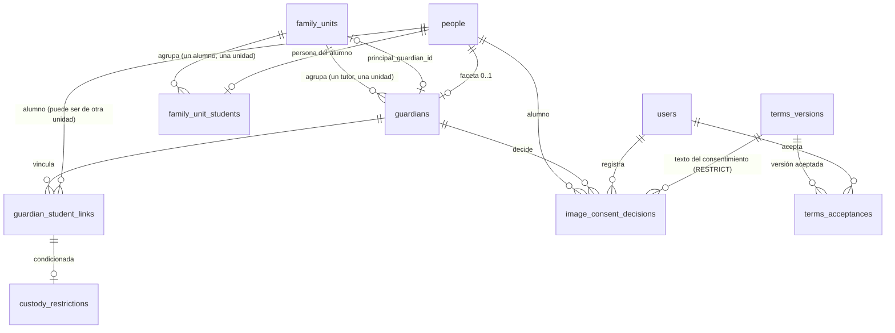

# REQ-FAM-UNIT · Modelo de datos

> **Estado**: **APROBADA por el usuario** (2026-10-26, todas las recomendaciones de `OPEN-FAM-UNIT-01..21` aceptadas tal cual; ver `funcional.md §13`). Las migraciones se escriben en `1.14-a`/`-b`/`-c` con `db-reviewer` obligatorio. **`1.14-a` implementada (2026-10-26)**: las cuatro tablas de §1.1 a §1.4 (migraciones `2026_10_26_100100` a `100500` de `apps/api/app/Modules/FamUnit/Database/migrations/`; la FK de `principal_guardian_id` va en la tercera, tras crear `guardians`). Índices de §3 no creados por redundantes: `funcional.md §15`, D-12. **Enmendada por `ADR-066` (ACEPTADA, 2026-10-27; `funcional.md §16`)**: desaparece `image_consents` (estado calculado en origen), `terms_versions` con `kind` se adelanta a `1.14-b`, y `consent_text_version_id` deja de ser condicional. **`1.14-c` IMPLEMENTADA (2026-10-28; migración `2026_10_28_100100_create_terms_acceptances_table` de `apps/api/app/Modules/FamUnit/Database/migrations/`; `funcional.md §19`)**, sin añadir nada a la tabla de §1.9 y con la política de auditoría `Selective` de §4 (`D-29`). **`1.14-b` IMPLEMENTADA (2026-10-27; migraciones `2026_10_27_100200` y `100300` de `apps/api/app/Modules/FamUnit/Database/migrations/`, y `2026_10_27_100100_widen_data_exports_kind_for_image_consents` de `Core`; `funcional.md §18`)**, aprobada por el usuario (`funcional.md §17`), con las condiciones previas a datos reales de `funcional.md §13`: §1.6 y §1.8, y el cambio de comportamiento sobre `legal_guardian_verified_at` de §1.4 (`RN-FAM-UNIT-74`), que no toca el esquema. La aprobación no añade tablas, columnas ni índices. Las tablas marcadas *condicionada* dependen de `OPEN-FAM-UNIT-05`; las marcadas con una entrega (`1.14-a`/`-b`/`-c`) siguen la partición propuesta en `funcional.md §1.2`. **Paso `1.14b`**: modelo de §8 **APROBADO** (2026-10-29, con `ADR-068` ACEPTADA); sin implementar.

Todas las tablas son **de tenant**, creadas con `TenantMigration::tenantTable()` (o `tenantTableAppendOnly()` donde se dice), que aporta `id bigint`, `tenant_id`, RLS `ENABLE` + `FORCE` con la política estándar, `UNIQUE (tenant_id, id)` y, en las ordinarias, `created_at`/`updated_at`/`deleted_at` (`TIMESTAMPTZ`) y `created_by`/`updated_by` (`ADR-033`, `ADR-034 §6`/`§7`). Solo se listan las columnas propias. Toda clave foránea a otra tabla de tenant es **compuesta** `(tenant_id, <columna>)` con `TenantMigration::tenantForeignId()` (`ADR-033 §6`). **Ninguna tabla lleva `academic_year_id`** (`ADR-034 §4`: la unidad familiar está expresamente entre las entidades que no dependen del curso), así que no aplica `AR-13` ni el disparador `academic_year_write_guard`. Ninguna usa `ON DELETE CASCADE`/`SET NULL`: las bajas son lógicas y se propagan en servicio, auditadas.

---

## 1. Entidades

### 1.1 `family_units` (`1.14-a`)

| Columna | Tipo | Nulo | Defecto | Descripción |
|---------|------|------|---------|-------------|
| `public_id` | `character(26)` ULID | No | — | `ADR-029` |
| `code` | `text` | No | — | Código único de la unidad en el centro (`REQ-FAM-UNIT-001`). Generación: `OPEN-FAM-UNIT-06`. `CHECK (length(code) BETWEEN 1 AND 40)` [DERIVADA] |
| `principal_guardian_id` | `bigint` | Sí | `NULL` | FK compuesta → `guardians`. Que sea tutor **de esta unidad** lo garantiza además el motor (`RN-FAM-UNIT-02`, issue #469): FK compuesta `(tenant_id, id, principal_guardian_id)` → `guardians (tenant_id, family_unit_id, id)` (con `UNIQUE (tenant_id, family_unit_id, id)` en `guardians`; la `id` de la unidad hace de `family_unit_id`), `MATCH SIMPLE`, así que `NULL` sigue permitido; migración `2026_10_27_100100`. Que el tutor esté **vivo** sigue validándose en servicio (una baja lógica conserva la fila) |

Restricciones: `UNIQUE (tenant_id, code) WHERE deleted_at IS NULL` (`RN-FAM-UNIT-01`).

**Dependencia circular de FK** (`family_units.principal_guardian_id` → `guardians`, `guardians.family_unit_id` → `family_units`): se crean las dos tablas y después se añade la FK de `principal_guardian_id` **en una migración aparte**, la tercera (`2026_10_26_100300_add_family_units_principal_guardian_foreign_key`), con su índice `(tenant_id, principal_guardian_id)`. No hace falta que sea `DEFERRABLE`: el principal siempre se designa después de crear el tutor, nunca en la misma sentencia.

### 1.2 `guardians` (`1.14-a`) — faceta de `people` (`ADR-034 §1`)

| Columna | Tipo | Nulo | Descripción |
|---------|------|------|-------------|
| `public_id` | ULID | No | |
| `person_id` | `bigint` | No | FK compuesta → `people` (tabla de `Core`; la FK en base de datos está permitida, la lectura va por la interfaz de `OPEN-FAM-UNIT-03`) |
| `family_unit_id` | `bigint` | No | FK compuesta → `family_units`. Un tutor pertenece a una sola unidad (`§16.2`, `RN-FAM-UNIT-11`) |

Restricciones: `UNIQUE (tenant_id, person_id) WHERE deleted_at IS NULL` (forma fijada por `ADR-034 §1` para toda faceta).

No guarda nombre, correo ni teléfono: son de `people`/`users` (`§16.3`, regla 1). El usuario del tutor se obtiene por la persona (`users.person_id`, único vivo por tenant, `ADR-034 §1`).

### 1.3 `family_unit_students` (`1.14-a`) — pertenencia del alumno

| Columna | Tipo | Nulo | Descripción |
|---------|------|------|-------------|
| `public_id` | ULID | No | Expuesto como identificador de la pertenencia en `DELETE /family-units/{id}/students/{membershipPublicId}` |
| `family_unit_id` | `bigint` | No | FK compuesta → `family_units` |
| `student_person_id` | `bigint` | No | FK compuesta → `people`. La persona del alumno (`funcional.md §7.4`, `OPEN-FAM-UNIT-01`) |

Restricciones: `UNIQUE (tenant_id, student_person_id) WHERE deleted_at IS NULL` (`RN-FAM-UNIT-20`).

Por qué tabla propia y no `students.family_unit_id`: `students` es de `ALUM` y no existe (C1). Si `1.15` prefiere la columna en su tabla, migrar esta pertenencia es *expand/contract* de una tabla pequeña; lo contrario (que `FAM-UNIT` escriba en una tabla de `ALUM`) violaría `INV-007`.

### 1.4 `guardian_student_links` (`1.14-a`) — vínculo tutor ↔ alumno

| Columna | Tipo | Nulo | Defecto | Descripción |
|---------|------|------|---------|-------------|
| `public_id` | ULID | No | — | |
| `guardian_id` | `bigint` | No | — | FK compuesta → `guardians` |
| `student_person_id` | `bigint` | No | — | FK compuesta → `people` |
| `relationship` | `text` | No | — | `CHECK IN ('padre','madre','tutor_legal','abuelo','apoderado','otro')` (`OPEN-FAM-UNIT-07`) |
| `is_legal_guardian` | `boolean` | No | `false` | Representación legal (patria potestad o tutela) [DERIVADA, `funcional.md §3.3`] |
| `legal_guardian_verified_at` | `TIMESTAMPTZ` | Sí | — | Cuándo verificó el centro la representación. Solo cambia (junto con `_by`) en la transición `false → true` de `is_legal_guardian` o al crear el vínculo con `true`; reenviar `true` no la toca (`RN-FAM-UNIT-74`). Es el umbral de las decisiones de imagen que cuentan (`RN-FAM-UNIT-72`). Regla de servicio **ya cumplida por `GuardianLinkService` de `1.14-a`** (confirmada, cubierta por test de regresión), sin cambio de esquema |
| `legal_guardian_verified_by` | `bigint` | Sí | — | FK compuesta → `users` |
| `access_level` | `text` | No | `'lectura'` | `CHECK IN ('lectura','lectura_escritura')` (`REQ-FAM-UNIT-001`). Valor por defecto: el más restrictivo [DERIVADA] |
| `restricted_categories` | `jsonb` | No | `'[]'` | Array de categorías restringidas. `CHECK (jsonb_typeof(restricted_categories) = 'array' AND restricted_categories <@ '["salud"]'::jsonb)` con el vocabulario de `OPEN-FAM-UNIT-07` |
| `is_emergency_contact` | `boolean` | No | `false` | `REQ-FAM-UNIT-002` |
| `status` | `text` | No | `'activo'` | `CHECK IN ('activo','revocado')` |
| `revocation_reason` | `text` | Sí | — | `CHECK (revocation_reason IN ('resolucion_judicial'))` |
| `revoked_at` | `TIMESTAMPTZ` | Sí | — | |
| `revoked_by` | `bigint` | Sí | — | FK compuesta → `users` |

Restricciones:

- `UNIQUE (tenant_id, guardian_id, student_person_id) WHERE deleted_at IS NULL` (`RN-FAM-UNIT-30`).
- `UNIQUE (tenant_id, student_person_id) WHERE is_emergency_contact AND status = 'activo' AND deleted_at IS NULL` (`RN-FAM-UNIT-31`: garantizado por índice, no por comprobación, porque dos peticiones simultáneas lo romperían).
- Coherencia de estado: `CHECK ((status = 'activo' AND revocation_reason IS NULL AND revoked_at IS NULL) OR (status = 'revocado' AND revocation_reason IS NOT NULL AND revoked_at IS NOT NULL))`.
- `CHECK (NOT (is_emergency_contact AND status = 'revocado'))`.
- `CHECK (legal_guardian_verified_at IS NULL OR is_legal_guardian)`.
- La guarda de autovínculo (`RN-FAM-UNIT-21`: la persona del tutor no es la del alumno) se valida en servicio: exigirla en base de datos requeriría desnormalizar `person_id` del tutor en el vínculo.

Al levantar una revocación, `revocation_reason`, `revoked_at` y `revoked_by` vuelven a `NULL`; el histórico de las dos transiciones queda en `audit_logs` con su autor y su instante (`CA-FAM-UNIT-035`).

### 1.5 `custody_restrictions` — *condicionada a `OPEN-FAM-UNIT-05`*

Tabla **separada** de categoría especial (`CLAUDE.md §8`, `§16.3` regla 5). Campos mínimos propuestos, **[DERIVADA]** (ningún requisito los enumera):

| Columna | Tipo | Nulo | Descripción |
|---------|------|------|-------------|
| `public_id` | ULID | No | |
| `guardian_student_link_id` | `bigint` | No | FK compuesta → `guardian_student_links`; `UNIQUE (tenant_id, guardian_student_link_id) WHERE deleted_at IS NULL` |
| `resolution_reference_encrypted` | `text` | No | Referencia de la resolución, **cifrada a nivel de campo** (`RSEC-ISO-008`). Mecanismo y claves: ADR pendiente |
| `resolution_date_encrypted` | `text` | Sí | Fecha de la resolución, cifrada |
| `document_object_key` | `text` | Sí | Clave del documento en el *bucket* privado (`ADR-013`), objeto cifrado; descarga por URL firmada de caducidad corta tras comprobar el permiso |

Política de auditoría `Redacted` (`ADR-035`): nunca se registra ningún valor. Cada lectura registra `read` (`RPERM-015`). Sin índice más allá del único: la consulta es siempre por vínculo.

### 1.6 `image_consent_decisions` (`1.14-b`) — histórico inmutable

`TenantMigration::tenantTableAppendOnly()`: sin `deleted_at`, sin `updated_at`, `REVOKE UPDATE, DELETE` para `plataforma_app`; modelo `AppendOnlyModel` (`ADR-034 §6`, `§16.3` regla 6, `RN-FAM-UNIT-42`). Mismo patrón que `academic_year_reopenings` (`1.11c`).

| Columna | Tipo | Nulo | Descripción |
|---------|------|------|-------------|
| `public_id` | ULID | No | |
| `student_person_id` | `bigint` | No | FK compuesta → `people` |
| `level` | `text` | No | `CHECK IN ('web','redes_sociales')` |
| `decision` | `text` | No | `CHECK IN ('autorizo','no_autorizo')` (`RN-FAM-UNIT-67`, antes segundo `RN-FAM-UNIT-40`) |
| `guardian_id` | `bigint` | No | FK compuesta → `guardians`. Quién decide |
| `recorded_by` | `bigint` | No | FK compuesta → `users`. Quién la registra (el propio tutor o personal del centro) |
| `channel` | `text` | No | `CHECK IN ('portal','presencial')` |
| `consent_text_version_id` | `bigint` | Sí | FK compuesta → `terms_versions`, **`ON DELETE RESTRICT`** (`ADR-066 §5.8`). Siempre presente; **nula solo con `no_autorizo`** sin texto publicado: `CHECK (decision = 'no_autorizo' OR consent_text_version_id IS NOT NULL)` (`RN-FAM-UNIT-68`). Que el `kind` de la versión corresponda al nivel (`consentimiento_imagen_web` ↔ `web`, `consentimiento_imagen_redes` ↔ `redes_sociales`) y su estado (`RN-FAM-UNIT-69`) se validan **en servicio** |
| `shown_locale` | `text` | Sí | Idioma en que se mostró **realmente** el texto por el canal `portal` (tras la caída de `ADR-062`: el idioma por defecto del centro si no hay traducción al de la petición, `OPEN-FAM-UNIT-25` resuelta el 2026-10-27; no cambia la columna); `CHECK (shown_locale IS NULL OR shown_locale IN ('es-ES','en','de','fr'))`. Nulo por `presencial` (`RN-FAM-UNIT-43`) [DERIVADA, `ADR-066 §9.5`; aceptada por el usuario el 2026-10-27] |
| `occurred_at` | `TIMESTAMPTZ` | No | Fecha y hora de la decisión. **Precisión de segundos** (`timestamptz(0)`, como todo el esquema): una decisión en el mismo segundo que `legal_guardian_verified_at` no cuenta (`funcional.md §18` D-15) |
| `ip_address` | `inet` | Sí | IP de la petición |
| `user_agent` | `text` | Sí | |

**Cálculo del estado vigente** (`RN-FAM-UNIT-45`, `ADR-066 §5.2`), en una sola consulta por lote de alumnos: quienes deciden son los vínculos vivos con `is_legal_guardian = true` (`guardian_student_links`, `activo` o `revocado`); de cada uno cuenta su última decisión por `(occurred_at DESC, id DESC)` con `occurred_at > legal_guardian_verified_at` de ese vínculo (`DISTINCT ON (student_person_id, level, guardian_id)`, `RN-FAM-UNIT-72`). Sin bloqueo de fila: dos decisiones simultáneas son dos filas (`RN-FAM-UNIT-44`, sustituida).

### 1.7 `image_consents` — **eliminada** (`ADR-066 §5.2`, `OPEN-066-01` ratificada)

La proyección de estado vigente prevista en la especificación aprobada **no se crea**. El estado se calcula en cada consulta (§1.6). Motivo: una proyección se desfasa en cuanto cambia el conjunto de quienes deciden (alta, baja o cambio de `is_legal_guardian` de un vínculo) y no tiene fila para quien nunca decidió. Añadir una proyección más adelante, si una medición lo pide, es aditivo y requiere su propio ADR.

### 1.8 `terms_versions` (**`1.14-b`**, adelantada desde `1.14-c` por `ADR-066 §5.5`)

| Columna | Tipo | Nulo | Defecto | Descripción |
|---------|------|------|---------|-------------|
| `public_id` | ULID | No | — | |
| `kind` | `text` | No | — | **Desde la creación**. `CHECK IN ('condiciones_uso','consentimiento_imagen_web','consentimiento_imagen_redes')` (`RN-FAM-UNIT-73`). En `1.14-b` el servicio rechazaba `condiciones_uso`; desde `1.14-c` se gestiona (el `CHECK` ya lo admitía, sin migrar) |
| `version_number` | `integer` | No | — | Correlativo **por centro y tipo**, asignado en servicio bajo bloqueo; `UNIQUE (tenant_id, kind, version_number)` (no parcial: un número no se reutiliza nunca) |
| `title_translations` | `jsonb` | No | — | Columna traducible con el ayudante de `ADR-062 §5.1` (`AR-16`) |
| `body_translations` | `jsonb` | No | — | Ídem. Texto legal del centro |
| `status` | `text` | No | `'borrador'` | `CHECK IN ('borrador','publicada','retirada')` |
| `requires_reacceptance` | `boolean` | No | `false` | Fijado al publicar (`REQ-FAM-UNIT-003`). Solo tiene sentido en `condiciones_uso`: `CHECK (kind = 'condiciones_uso' OR NOT requires_reacceptance)` |
| `published_at` | `TIMESTAMPTZ` | Sí | — | `CHECK ((status = 'borrador') = (published_at IS NULL))` |

Restricciones: `UNIQUE (tenant_id, kind) WHERE status = 'publicada' AND deleted_at IS NULL` (`RN-FAM-UNIT-60`, `-73`, por índice y no por comprobación). Una versión `publicada` o `retirada` no se edita ni se borra (servicio, `409`); solo se borra un `borrador`, y una versión referenciada por una decisión no se puede borrar ni físicamente (`RESTRICT` de §1.6). La FK compuesta de §1.6 exige que la tabla tenga `UNIQUE (tenant_id, id)`, que aporta `tenantTable()`.

### 1.9 `terms_acceptances` (`1.14-c`, implementada) — histórico inmutable

`tenantTableAppendOnly()` y `AppendOnlyModel`, como §1.6.

| Columna | Tipo | Nulo | Descripción |
|---------|------|------|-------------|
| `public_id` | ULID | No | |
| `user_id` | `bigint` | No | FK compuesta → `users` |
| `terms_version_id` | `bigint` | No | FK compuesta → `terms_versions` |
| `shown_locale` | `text` | No | `CHECK IN ('es-ES','en','de','fr')` (`RN-FAM-UNIT-65`) |
| `accepted_at` | `TIMESTAMPTZ` | No | |
| `ip_address` | `inet` | Sí | |
| `user_agent` | `text` | Sí | |

Restricciones: `UNIQUE (tenant_id, user_id, terms_version_id)` (`RN-FAM-UNIT-64`, idempotencia).

La tabla **carece de `created_at`, `created_by` y `deleted_at`** (es de solo anexar): `accepted_at` hace de marca de creación y la autoría consta en `audit_logs`.

---

## 2. Relaciones

`people` y `users` son de `Core`: este módulo los referencia por clave foránea y los **lee** solo por interfaz (`INV-007`, `OPEN-FAM-UNIT-03`).

---

## 3. Índices

Además de los únicos de §1 (que ya sirven a sus consultas) y del índice `(tenant_id, <columna>)` que `tenantForeignId()` crea en cada FK desde #407:

| Índice | Consulta que lo necesita |
|--------|---------------------------|
| `guardian_student_links (tenant_id, guardian_id) WHERE status = 'activo' AND deleted_at IS NULL` | El **resolutor `unidad_familiar`** y `FamilyMembership`: alumnos alcanzados por el tutor del sujeto. Se ejecuta en cada petición de un tutor; es la consulta más caliente del módulo |
| `guardian_student_links (tenant_id, student_person_id) WHERE deleted_at IS NULL` | Tutores de un alumno (`FamilyMembership`, `GuardianRecipients`, ficha); `isAccessRevoked()`  **Omitido en `1.14-a`: cubierto por `tenantForeignId()` (`funcional.md §15`, D-12).** |
| `family_unit_students (tenant_id, family_unit_id) WHERE deleted_at IS NULL` | Alumnos de una unidad (ficha, regla `RN-FAM-UNIT-03`)  **Omitido en `1.14-a`: cubierto por `tenantForeignId()` (`funcional.md §15`, D-12).** |
| `guardians (tenant_id, family_unit_id) WHERE deleted_at IS NULL` | Tutores de una unidad  **Omitido en `1.14-a`: cubierto por `tenantForeignId()` (`funcional.md §15`, D-12).** |
| `image_consent_decisions (tenant_id, student_person_id, level, guardian_id, occurred_at DESC, id DESC)` | Cálculo del estado vigente: `DISTINCT ON` por tutor (`ADR-066 §9.18`). Sirve también al histórico por alumno y nivel. Si el histórico paginado por cursor `(occurred_at DESC, id DESC)` de un alumno sin filtro de nivel lo necesita, lo decide `db-reviewer` con el plan de ejecución  **No hay índice aparte `(tenant_id, student_person_id)`** en esa FK (`withIndex: false`): sería redundante con este, que ya empieza por esas columnas (`db-reviewer` B-1, `funcional.md §18` D-28). |
| `image_consent_decisions (tenant_id, consent_text_version_id)` | Lo declara **a mano la migración** (la FK a `terms_versions` es nullable y `tenantForeignId()` fuerza `NOT NULL`): comprueba el `RESTRICT` y responde «qué familias decidieron sobre un texto anterior» (`RN-FAM-UNIT-70`) |
| `terms_acceptances (tenant_id, user_id, accepted_at DESC)` | Comprobación del muro en cada petición de un tutor obligado (`RN-FAM-UNIT-62`) |
| `family_units (tenant_id, code text_pattern_ops) WHERE deleted_at IS NULL` | Búsqueda por prefijo de código en el listado. **Solo si** el listado ofrece búsqueda `q`; si no, se retira (un índice sin consulta es deuda) |

El índice de `image_consents` desaparece con la tabla. **El listado y la exportación de estados parten de `family_unit_students` vivos** (índice único parcial de §1.3) y calculan el estado de cada alumno, de modo que `state=pendiente` incluye a los alumnos sin ninguna decisión.

Sin particionado: volumen de cientos a pocos miles de filas por centro; las dos tablas de solo anexar crecen con las decisiones de familias (decenas por alumno a lo largo de su escolaridad). Evaluado y descartado (`ADR-029`).

---

## 4. Política de auditoría por modelo (`ADR-035`) y *morph map*

Todo modelo extiende `TenantModel` (o `AppendOnlyModel`), implementa `Auditable` (`AR-06`) y tiene alias en `Relation::enforceMorphMap` del `ServiceProvider` del módulo.

| Modelo | Alias | Política | Atributos registrados / notas |
|--------|-------|----------|--------------------------------|
| `FamilyUnit` | `family_unit` | `Selective` | `principal_guardian_id`, `deleted_at`, `created_by`, `updated_by`. `code` se redacta como `identifier` [DERIVADA]: un código de familia identifica indirectamente a una familia concreta |
| `Guardian` | `guardian` | `Full` | Solo ids internos y la unidad; ningún dato personal |
| `FamilyUnitStudent` | `family_unit_student` | `Full` | Ídem |
| `GuardianStudentLink` | `guardian_student_link` | `Selective` | `relationship`, `is_legal_guardian`, `legal_guardian_verified_at`, `access_level`, `restricted_categories`, `is_emergency_contact`, `status`, `revocation_reason`, `revoked_at`, `deleted_at`, `created_by`, `updated_by`. Todos son códigos o marcas, sin texto libre (`RN-FAM-UNIT-36`: el detalle judicial nunca vive aquí) |
| `CustodyRestriction` (condicionada) | `custody_restriction` | `Redacted` | Ningún valor. Lectura auditada (`read`) |
| `ImageConsentDecision` | `image_consent_decision` | `Selective` (implementado en `1.14-b`, `funcional.md §18` D-17) | Append-only; su `created` es el registro. Se registra el valor de `level`, `decision`, `channel`, `consent_text_version_id`, `shown_locale` y `occurred_at`; `student_person_id`, `guardian_id`, `recorded_by`, `ip_address` y `user_agent` se redactan como `identifier` |
| `TermsVersion` | `terms_version` | `Full` | Los textos largos se redactan solos como `oversized` (`ADR-035 §4`); el desglose por idioma de `ADR-062 §5.5`. Se audita al crear, editar en borrador y publicar (`ADR-066 §5.8`). **Implementado en `1.14-b`** |
| `TermsAcceptance` | `terms_acceptance` | `Selective` (implementado en `1.14-c`, `funcional.md §19` D-29; antes `Full`) | Append-only. Se registra el valor de `terms_version_id`, `shown_locale` y `accepted_at`; `user_id`, `ip_address` y `user_agent` se redactan como `identifier` |

`ImageConsent` **no es un modelo** (no tiene tabla, `ADR-066 §5.2`): no entra en el *morph map* ni en esta tabla. Es una representación calculada (`api.md §1.5`).

Ninguna exclusión de eventos (`ADR-040`).

---

## 5. Checklist obligatorio

- [x] `tenant_id` primero en todos los índices de §3.
- [x] RLS en cada tabla nueva, por `tenantTable()`/`tenantTableAppendOnly()` (`IsolationBatteryTest` #8).
- [x] `academic_year_id`: **no aplica** en ninguna tabla (`ADR-034 §4`), luego tampoco `AR-13`.
- [x] `created_at`/`updated_at`/`deleted_at`/`created_by`/`updated_by` en las ordinarias; las de solo anexar usan `occurred_at`/`accepted_at` y `recorded_by`/`user_id` (mismo criterio que `audit_logs`).
- [x] Claves foráneas compuestas, `CHECK` de enumerados y de coherencia de estado en base de datos.
- [x] Política de auditoría y alias de *morph map* declarados (§4).
- [x] `TIMESTAMPTZ`, `text`, sin `ENUM` (`AR-04`); `public_id` ULID en toda entidad expuesta (`AR-05`). **Claves de catálogo expuestas en URL: ninguna** (`ADR-051 §5.1`).
- [x] Importes: no aplica.
- [ ] `NULLS NOT DISTINCT`: no se necesita; todas las unicidades son sobre columnas `NOT NULL` o parciales.
- [ ] **Datos de categoría especial**: `custody_restrictions`, condicionada a `OPEN-FAM-UNIT-05`. `AR-09` saltará en cuanto se declare su permiso: la especificación del ADR debe sustituir el cable trampa por la regla real.
- [x] Particionado evaluado y descartado (§3).

---

## 6. Retención y supresión (`ADR-004`, `ADR-035`, `REQ-PRIV-006`)

El catálogo de retención por entidad es trabajo de `1.23b`/`REQ-PRIV-006`, **sin especificar todavía**; no se inventan plazos aquí. Lo que sí fija este módulo:

| Tabla | Nivel de `ADR-004` previsto | Por qué |
|-------|-----------------------------|---------|
| `family_units`, `guardians`, `family_unit_students`, `guardian_student_links` | Borrado lógico mientras el alumno esté en el centro; anonimización o purga después, según el catálogo | El vínculo y su revocación son la prueba ante un incidente con un menor (`REQ-FAM-UNIT-005`): no se purgan mientras pueda hacer falta |
| `image_consent_decisions`, `terms_acceptances` | Conservación como evidencia del consentimiento mientras dure el tratamiento y el plazo de prescripción que fije el catálogo | Una prueba de consentimiento que se borra deja de probar; supresión por retención, nunca por edición (`ADR-035`) |
| `terms_versions` | Las versiones referenciadas por una decisión o una aceptación son **evidencia**, con la misma retención que la decisión; no se purgan mientras exista una fila que las referencie (`RESTRICT`, `ADR-066 §5.8`) | El consentimiento solo prueba algo junto con el texto que se aceptó |
| `custody_restrictions` | El plazo más corto compatible con la protección del menor | Categoría especial; minimización |

La purga física de un tenant completo debe incluir estas **ocho** tablas (nueve en la propuesta original, menos `image_consents`, eliminada por `ADR-066`) en el orden de dependencias de §2: `image_consent_decisions` y `terms_acceptances` antes que `terms_versions` (issue #371, `1.23b`).

---

## 7. Notas de la migración del principal en la misma unidad (issue #469, `db-reviewer`)

- **Excepción consciente de D-12**: el índice `family_units (tenant_id, id, principal_guardian_id)` sobra para el motor (la comprobación de la FK busca en `guardians`, no en `family_units`) y existe solo para satisfacer `AR-16` (toda FK compuesta tiene su índice con ese prefijo). Se mantiene: no se relaja una regla de arquitectura sin aprobación del usuario. Seguimiento propuesto: matizar `AR-16` para FK cuya columna referenciada ya está cubierta por un único (`CHANGELOG.md`).
- **Deuda de *contract*** (`CLAUDE.md §9`): la FK antigua `family_units_tenant_principal_guardian_foreign` y su índice `(tenant_id, principal_guardian_id)` quedan **redundantes** con la nueva. No se retiran en esta entrega: se retiran **dos versiones después**, cuando ninguna versión viva dependa de ellas.
- La migración es reintentable y no destructiva (la FK ya validada no se toca; una `NOT VALID` solo reintenta `VALIDATE`; un índice `INVALID` residual se descarta y recrea) y toma `lock_timeout` de 5 s con restablecimiento. Pruebas: `FamUnitSchemaTest.php` y `tests/Concurrency/FamUnitMigrationRecoveryTest.php`.

---

## 8. Paso `1.14b` (autorizados y entrega de menores) — APROBADA (2026-10-29)

> **Estado**: **APROBADA** (2026-10-29), con `ADR-068` ACEPTADA (`funcional.md §21.2`; `OPEN-068-01` a `-08` y `OPEN-FAM-UNIT-27`, `-28`, `-29`, `-36` resueltas; ampliaciones `L1`, `L2`, `L10` de interés para este modelo). `db-reviewer` obligatorio en cada migración. Mismas convenciones que el resto del fichero: `tenantTable()`/`tenantTableAppendOnly()`, FK compuestas `(tenant_id, …)`, `TIMESTAMPTZ`, `text`, sin `ENUM`, `public_id` ULID en todo lo expuesto, sin `ON DELETE CASCADE`/`SET NULL`. **Ninguna tabla lleva `academic_year_id`** (`OPEN-FAM-UNIT-39`: hechos fechados; un curso cerrado no puede bloquear la puerta), así que no aplica `AR-13`. Sin importes.

### 8.1 `fam_unit` · `pickup_photos` (`1.14b-a`)

| Columna | Tipo | Nulo | Descripción |
|---------|------|------|-------------|
| `public_id` | ULID | No | |
| `person_id` | `bigint` | No | FK compuesta → `people` (tutor o tercero) |
| `object_key` | `text` | No | Clave en el *bucket* privado: `tenants/<tenant public_id>/fam-unit/pickup-photos/<ULID>.<ext>`. Nunca el nombre de la persona |
| `mime_type` | `text` | No | `CHECK IN ('image/jpeg','image/png','image/webp')`: tipo real **tras** el reprocesado |
| `byte_size` | `integer` | No | `CHECK (byte_size > 0)` |

Restricciones: `UNIQUE (tenant_id, person_id) WHERE deleted_at IS NULL` (una foto viva por persona, `RN-FAM-UNIT-83`). Sustituir = baja lógica de la anterior + alta; el objeto anterior lo purga el barrido de §8.6.

### 8.2 `fam_unit` · `pickup_authorizations` (`1.14b-a`)

| Columna | Tipo | Nulo | Defecto | Descripción |
|---------|------|------|---------|-------------|
| `public_id` | ULID | No | — | |
| `student_person_id` | `bigint` | No | — | FK compuesta → `people` |
| `person_id` | `bigint` | No | — | FK compuesta → `people`: el tercero. `CHECK (person_id <> student_person_id)` |
| `relationship` | `text` | No | — | `CHECK IN ('abuelo','personal_apoyo','otra_familia','otro')` |
| `kind` | `text` | No | — | `CHECK IN ('permanente','puntual')` |
| `valid_from` | `date` | No | — | Fecha civil del centro (`§16.3` regla 8: la fecha es civil, no un instante) |
| `valid_until` | `date` | Sí | — | `CHECK (valid_until IS NULL OR valid_until >= valid_from)`; en `puntual`: `CHECK (kind <> 'puntual' OR valid_until = valid_from)` |
| `reason` | `text` | Sí | — | Motivo; obligatorio en `puntual`: `CHECK (kind <> 'puntual' OR reason IS NOT NULL)`; `CHECK (length(reason) <= 500)` [DERIVADA] |
| `authorized_by_guardian_id` | `bigint` | No | — | FK compuesta → `guardians`: el tutor principal que autoriza (`RN-FAM-UNIT-85`) |
| `terms_version_id` | `bigint` | No | — | FK compuesta → `terms_versions`, **`ON DELETE RESTRICT`** (evidencia, como `image_consent_decisions`); `kind` de la versión = `autorizacion_recogida` validado en servicio |
| `channel` | `text` | No | — | `CHECK IN ('presencial')` en `1.14b`; `portal` (`1.22`) y `telefono` (`OPEN-FAM-UNIT-35`) amplían el `CHECK` con su especificación |
| `authorized_at` | `TIMESTAMPTZ` | No | — | Fecha y hora de la autorización del principal |
| `recorded_by` | `bigint` | No | — | FK compuesta → `users` |
| `ip_address` | `inet` | Sí | — | |
| `user_agent` | `text` | Sí | — | |
| `withdrawn_at` | `TIMESTAMPTZ` | Sí | — | Retirada (`RN-FAM-UNIT-87`) |
| `withdrawn_by` | `bigint` | Sí | — | FK compuesta → `users`. `CHECK ((withdrawn_at IS NULL) = (withdrawn_by IS NULL))` |

Restricciones: `UNIQUE (tenant_id, student_person_id, person_id) WHERE kind = 'permanente' AND withdrawn_at IS NULL AND deleted_at IS NULL`; `UNIQUE (tenant_id, student_person_id, person_id, valid_from) WHERE kind = 'puntual' AND withdrawn_at IS NULL AND deleted_at IS NULL` (`RN-FAM-UNIT-88`, por índice y no por comprobación). Tabla ordinaria (no de solo anexar) porque la retirada cambia su estado; el historial queda en `audit_logs` y en la propia fila (nunca se borra físicamente mientras exista una salida que la referencie).

### 8.3 `fam_unit` · `terms_versions.kind` (`1.14b-a`, ampliación)

*Expand*: el `CHECK` de `kind` (`§1.8`) pasa de tres a cuatro valores con `autorizacion_recogida`, con el patrón `DROP CONSTRAINT` + `ADD CONSTRAINT … NOT VALID` + `VALIDATE` de `ADR-039 §4.6`. Sigue sin `requires_reacceptance` (el `CHECK` existente ya lo impide fuera de `condiciones_uso`). Numeración correlativa propia del tipo (`RN-FAM-UNIT-73`).

### 8.4 `prl` · `student_movements` (`1.14b-b`) — solo anexar

`tenantTableAppendOnly()`, `AppendOnlyModel`, `REVOKE UPDATE, DELETE` para `plataforma_app` (`RN-PRL-04`).

| Columna | Tipo | Nulo | Descripción |
|---------|------|------|-------------|
| `public_id` | ULID | No | |
| `student_person_id` | `bigint` | No | FK compuesta → `people` |
| `direction` | `text` | No | `CHECK IN ('entrada','salida')` |
| `off_schedule` | `boolean` | No | Fuera de horario (`RN-PRL-07`) |
| `off_schedule_reason` | `text` | Sí | `CHECK IN ('medico','familiar','actividad','retraso','otro')`; `CHECK (NOT off_schedule OR off_schedule_reason IS NOT NULL)` |
| `notes` | `text` | Sí | `CHECK (length(notes) <= 500)`; obligatoria si `off_schedule_reason = 'otro'` |
| `picked_up_by_person_id` | `bigint` | Sí | FK compuesta → `people`. Obligatoria en toda `salida` de `1.14b`: `CHECK (direction = 'entrada' OR picked_up_by_person_id IS NOT NULL)` (la salida autónoma de `1.14b-d` relajará el `CHECK` con su especificación) |
| `basis` | `text` | Sí | `CHECK IN ('tutor','tercero','puntual')`; presente si y solo si hay persona que recoge |
| `guardian_student_link_id` | `bigint` | Sí | FK compuesta → `guardian_student_links` (base `tutor`). La FK entre módulos está permitida en base de datos; la lectura va por interfaz (`INV-007`) |
| `pickup_authorization_id` | `bigint` | Sí | FK compuesta → `pickup_authorizations` (base `tercero`/`puntual`). `CHECK` de coherencia entre `basis` y la referencia presente |
| `verification_method` | `text` | Sí | `CHECK IN ('foto','documento','foto_y_documento')`; presente si hay persona que recoge |
| `delivered_by` | `bigint` | No | FK compuesta → `users`: quién entrega |
| `recorded_by` | `bigint` | No | FK compuesta → `users` |
| `corrects_movement_id` | `bigint` | Sí | FK compuesta → `student_movements` (corrección, `RN-PRL-04`); `correction_reason` `text` obligatorio con ella |
| `idempotency_key` | `text` | Sí | `UNIQUE (tenant_id, recorded_by, idempotency_key) WHERE idempotency_key IS NOT NULL` (`RN-PRL-09`), junto con el *hash* del cuerpo en `idempotency_body_hash` `text` |
| `occurred_at` | `TIMESTAMPTZ` | No | Instante del servidor |

### 8.5 `prl` · `pickup_alerts` (`1.14b-b`)

| Columna | Tipo | Nulo | Descripción |
|---------|------|------|-------------|
| `public_id` | ULID | No | |
| `student_person_id` | `bigint` | No | FK compuesta → `people` |
| `kind` | `text` | No | `CHECK IN ('persona_no_autorizada')` en `1.14b`; `alumno_no_recogido` lo añade `1.14b-d` |
| `presenter_description` | `text` | No | Nombre declarado y documento exhibido por quien se presenta; `CHECK (length(...) <= 500)` |
| `status` | `text` | No | `CHECK IN ('abierta','cerrada')` |
| `raised_by` / `raised_at` | `bigint` / `TIMESTAMPTZ` | No | FK → `users` |
| `principal_contacted_at` | `TIMESTAMPTZ` | Sí | Llamada manual al tutor principal (`OPEN-FAM-UNIT-33`) |
| `resolution` | `text` | Sí | `CHECK IN ('no_entregado','recogido_por_autorizado','autorizacion_puntual_registrada','otro')` |
| `resolution_notes` | `text` | Sí | `CHECK (length(...) <= 1000)` |
| `resolved_by` / `resolved_at` | `bigint` / `TIMESTAMPTZ` | Sí | `CHECK ((status = 'cerrada') = (resolution IS NOT NULL AND resolved_at IS NOT NULL AND resolved_by IS NOT NULL))` |
| `idempotency_key`, `idempotency_body_hash` | `text` | Sí | Como §8.4 |

Tabla ordinaria (con `deleted_at` por `INV-005`, pero sin *endpoint* de borrado: la alerta es evidencia).

### 8.6 Índices

| Índice | Consulta |
|--------|----------|
| `pickup_authorizations (tenant_id, student_person_id, valid_from, valid_until) WHERE withdrawn_at IS NULL AND deleted_at IS NULL` | Composición de la lista de un alumno (`RN-FAM-UNIT-79`), la consulta caliente de la puerta |
| `pickup_photos (tenant_id, person_id)` | Cubierto por el único parcial de §8.1 |
| `student_movements (tenant_id, student_person_id, occurred_at DESC, id DESC)` | Historial de un alumno (cursor) |
| `student_movements (tenant_id, occurred_at DESC, id DESC)` | Salidas del día en conserjería |
| `pickup_alerts (tenant_id, status, raised_at DESC) WHERE deleted_at IS NULL` | Alertas abiertas |

La exclusión por revocación (`RN-FAM-UNIT-80`) usa el índice existente de vínculos por alumno (`tenantForeignId()`, `§3`). Sin particionado: ~180 000 movimientos por curso en un centro de 1 000 alumnos; a revisar por `db-reviewer` con volumen de `REQ-SEED` (`1.15b`).

### 8.7 Auditoría y *morph map* (`ADR-035`)

| Modelo | Alias | Política | Notas |
|--------|-------|----------|-------|
| `PickupPhoto` | `pickup_photo` | `Selective` | Se registran `mime_type`, `byte_size`, `deleted_at`; `person_id` y `object_key` como `identifier` |
| `PickupAuthorization` | `pickup_authorization` | `Selective` | Se registran `relationship`, `kind`, `valid_from`, `valid_until`, `channel`, `terms_version_id`, `authorized_at`, `withdrawn_at`; `student_person_id`, `person_id`, `authorized_by_guardian_id`, `recorded_by`, `withdrawn_by`, `ip_address`, `user_agent` como `identifier`; `reason` redactado (texto libre) |
| `StudentMovement` (`prl`) | `student_movement` | `Selective` | Códigos y fechas registrados; personas, usuarios, `notes` y `correction_reason` redactados |
| `PickupAlert` (`prl`) | `pickup_alert` | `Selective` | `presenter_description` y `resolution_notes` redactados |

Auditoría de lectura (`read`) de la lista: `funcional.md §21.2` D4, sujeto = persona del alumno, sin valores.

### 8.8 Retención y purga

Ninguna tabla nueva se purga en `1.14b`. Plazos: catálogo de `1.23b` (`OPEN-FAM-UNIT-37`). Objetos del *bucket*: barrido de fotografías huérfanas (baja lógica o tercero sin autorización vigente ni futura pasado el plazo de gracia), con el patrón de `PurgeOrphanBrandingAssets`. La purga de un tenant (`#371`) añade estas **cuatro** tablas y el prefijo `tenants/<id>/fam-unit/` del *bucket*, en orden: `student_movements` y `pickup_alerts` → `pickup_authorizations` → `pickup_photos`.

### 8.9 Ampliaciones de `Core` previstas (D2, sin esquema nuevo)

`PersonRegistrar` escribe en `people` existente (nombre, `document_type`/`document_number` emparejados, `contact_phone`); reutiliza la persona viva con el mismo documento (índice único `people_tenant_document_unique`) **sin actualizarla**; la corrección de una persona **sin usuario** es `PersonRegistrar::correctUnaccounted`, auditada por `Core` (`OPEN-068-07`). Si el centro no aporta documento, se crea sin él y el tercero no podrá verificarse por documento (`OPEN-FAM-UNIT-27`). Ninguna columna nueva en `people`: la fotografía queda fuera de `people` a propósito.
