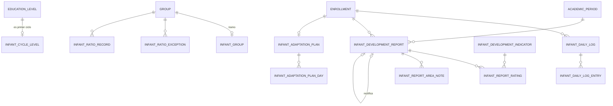

# REQ-INF · Modelo de datos

> **Estado**: **PROPUESTO** (2026-11-12), junto con `funcional.md`. Las tablas dependen de `OPEN-INF-04`, `-05`, `-07`, `-08` y `-09`: si el usuario decide otra opción, cambian.
>
> **Resumen**: catorce tablas de tenant nuevas en `apps/api/app/Modules/Inf/Database/migrations/`, repartidas por entrega: seis en `1.18-a`, dos en `-b`, cuatro en `-c` (más una columna nula en `infant_cycle_levels`), dos en `-d`. Ninguna altera una tabla de otro módulo. **Ninguna contiene datos de salud** (`funcional.md §11.2`): la tabla cifrada de `REQ-INF-006` no se diseña aquí (`OPEN-INF-03`).

---

## 1. Entidades

Todas con `TenantMigration::tenantTable()` (RLS `ENABLE` + `FORCE`, `tenant_id` con valor por defecto, `created_by`/`updated_by`, `created_at`/`updated_at`/`deleted_at` en `timestamptz`, `UNIQUE (tenant_id, id)`), salvo las dos de solo anexar, con `tenantTableAppendOnly()`. Columnas comunes que no se repiten: `id bigint`, `tenant_id bigint`, autoría y marcas de tiempo. Toda tabla lleva `public_id character(26)` único (`AR-05`). Referencias a otra tabla: clave compuesta con `tenant_id`, `NO ACTION` siempre (`AR-13`). `academic_year_id` con `TenantMigration::tenantForeignId()`.

### 1.1 `infant_cycle_levels` — primer ciclo (`1.18-a`)

| Columna | Tipo | Nulo | Descripción |
|---------|------|------|-------------|
| `academic_year_id` | `bigint` | No | Curso académico |
| `education_level_id` | `bigint` | No | FK de tres columnas a `education_levels (tenant_id, academic_year_id, id)` |
| `age_cutoff_date` | `date` | No | Fecha de corte de edad (`RN-INF-02`) |
| `development_scale_id` | `bigint` | Sí | **Añadida por una migración de `1.18-c`** (*expand*): escala de `acad` con la que se valoran los informes del ciclo en ese curso (`RN-INF-43`, `OPEN-INF-09`). FK a la tabla de escalas de `acad` [nombre exacto sin verificar]. Nula hasta que dirección la elige; sin ella, crear un informe es `422 scale_not_configured` (`api.md §3.2`) |

Única: `(tenant_id, education_level_id)` entre filas vivas.

### 1.2 `infant_groups` — tramo de un grupo (`1.18-a`)

| Columna | Tipo | Nulo | Descripción |
|---------|------|------|-------------|
| `academic_year_id` | `bigint` | No | |
| `group_id` | `bigint` | No | FK de tres columnas a `groups (tenant_id, academic_year_id, id)` |
| `age_band` | `text` | No | `CHECK (age_band IN ('0-1','1-2','2-3'))` |

Única: `(tenant_id, group_id)` entre filas vivas. Que el grupo sea de una etapa marcada es validación de servidor (`RN-INF-03`).

### 1.3 `infant_ratio_rules` — regla de ratio (`1.18-a`)

| Columna | Tipo | Nulo | Descripción |
|---------|------|------|-------------|
| `academic_year_id` | `bigint` | No | |
| `age_band` | `text` | No | Mismo `CHECK` |
| `max_students_per_group` | `integer` | No | `CHECK (>= 1)` |
| `legal_reference` | `text` | No | Norma de la que sale la cifra; `CHECK` no vacío |

Única: `(tenant_id, academic_year_id, age_band)` entre filas vivas.

### 1.4 `infant_ratio_exceptions` — excepción (`1.18-a`, **solo anexar**)

| Columna | Tipo | Nulo | Descripción |
|---------|------|------|-------------|
| `academic_year_id` | `bigint` | No | |
| `group_id` | `bigint` | No | Grupo al que autoriza una plaza |
| `kind` | `text` | No | `CHECK (kind IN ('concesion','consumo','anulacion'))` |
| `grant_id` | `bigint` | Sí | En `consumo` y `anulacion`, la concesión a la que se refiere; nulo en `concesion` (`CHECK`) |
| `enrollment_id` | `bigint` | Sí | En `consumo`, la matrícula que la usa (`CHECK`) |
| `justification` | `text` | Sí | Obligatoria y no vacía en `concesion` y en `anulacion` (motivo de la anulación); nula en `consumo` (`CHECK`) |

Sin `updated_at` ni `deleted_at`; `REVOKE UPDATE, DELETE`. Una concesión está vigente si no tiene `consumo` ni `anulacion`: índice único parcial `(tenant_id, grant_id)` para que solo exista uno de los dos.

### 1.5 `infant_ratio_records` — registro diario (`1.18-a`, **solo anexar**)

| Columna | Tipo | Nulo | Descripción |
|---------|------|------|-------------|
| `academic_year_id` | `bigint` | No | |
| `group_id` | `bigint` | No | |
| `record_date` | `date` | No | |
| `age_band` | `text` | No | Tramo ese día |
| `active_enrollments` | `integer` | No | `CHECK (>= 0)` |
| `max_allowed` | `integer` | Sí | Nulo si no había regla |
| `exceeded` | `boolean` | No | |

Única: `(tenant_id, group_id, record_date)` (idempotencia de la tarea).

### 1.6 `infant_cycle_authorizations` — autorización administrativa (`1.18-a`)

| Columna | Tipo | Nulo | Descripción |
|---------|------|------|-------------|
| `reference` | `text` | No | Número o referencia del expediente |
| `issuing_body` | `text` | No | Organismo que la concede |
| `valid_from` | `date` | No | |
| `valid_until` | `date` | Sí | `CHECK (valid_until >= valid_from)` |
| `notes` | `text` | Sí | |

**Sin `academic_year_id`**: una autorización abarca varios cursos (`ADR-034`, obligatorio-o-ausente). El estado no se guarda (`RN-INF-10`).

### 1.7 `infant_daily_logs` e `infant_daily_log_entries` — parte diario (`1.18-b`)

`infant_daily_logs`:

| Columna | Tipo | Nulo | Descripción |
|---------|------|------|-------------|
| `academic_year_id` | `bigint` | No | |
| `enrollment_id` | `bigint` | No | FK a `enrollments` de `alum` |
| `group_id` | `bigint` | No | Grupo del alumno **ese día** (`RN-INF-31`); eje del ámbito `grupo` |
| `student_person_id` | `bigint` | No | FK a `people`; eje del ámbito `unidad_familiar` [DERIVADA: el resolutor acota por columna propia, sin leer tablas de `alum`] |
| `log_date` | `date` | No | |
| `mood` | `text` | Sí | `CHECK` con el vocabulario de ánimo |
| `day_notes` | `text` | Sí | Observaciones del día; longitud por `CHECK` |
| `status` | `text` | No | `CHECK (status IN ('borrador','publicado'))` |
| `published_at` | `timestamptz` | Sí | Obligatorio si `publicado` (`CHECK`) |
| `published_by` | `bigint` | Sí | |

Única: `(tenant_id, enrollment_id, log_date)` entre filas vivas.

`infant_daily_log_entries`:

| Columna | Tipo | Nulo | Descripción |
|---------|------|------|-------------|
| `academic_year_id` | `bigint` | No | |
| `daily_log_id` | `bigint` | No | |
| `kind` | `text` | No | `CHECK (kind IN ('comida','descanso','higiene','hito','reposicion'))` |
| `occurred_at` | `time` | Sí | Hora, si se anota |
| `meal_service` | `text` | Sí | `comida`: `CHECK` de servicios |
| `meal_amount` | `text` | Sí | `comida`: `CHECK` de cantidades |
| `sleep_minutes` | `integer` | Sí | `descanso`: `CHECK (BETWEEN 0 AND 1440)` |
| `sleep_quality` | `text` | Sí | `descanso`: `CHECK` |
| `hygiene_kind` | `text` | Sí | `higiene`: `CHECK (IN ('panal','deposicion','control_esfinteres'))` |
| `supply_item` | `text` | Sí | `reposicion`: `CHECK` |
| `detail` | `text` | Sí | Texto libre corto; longitud por `CHECK` |
| `client_ref` | `text` | Sí | Identificador del cliente (`RN-INF-27`) |

`CHECK` por tipo: los campos de otro tipo, nulos; los obligatorios del propio, presentes. Única parcial: `(tenant_id, client_ref)` donde no es nulo.

**Vocabularios** [DERIVADA; `OPEN-INF-24`]: el documento fija qué se registra, no los valores. Propuesta mínima, a validar con el centro piloto antes de escribir el `CHECK`: ánimo (`contento`, `tranquilo`, `inquieto`, `triste`); servicio (`desayuno`, `media_manana`, `comida`, `merienda`); cantidad (`nada`, `poco`, `mitad`, `casi_todo`, `todo`); calidad del sueño (`bueno`, `regular`, `malo`); artículo (`panales`, `ropa_cambio`, `otro`). Añadir un valor es ampliar un `CHECK` (expand).

### 1.8 Informe de desarrollo (`1.18-c`)

`infant_development_indicators`:

| Columna | Tipo | Nulo | Descripción |
|---------|------|------|-------------|
| `academic_year_id` | `bigint` | No | |
| `area` | `text` | No | `CHECK (area IN ('armonia','entorno','comunicacion'))` |
| `age_band` | `text` | No | |
| `text_translations` | `jsonb` | No | Columna traducible con el ayudante (`ADR-062`, `AR-16`) |
| `position` | `integer` | No | `CHECK (>= 1)` |

`infant_development_reports`:

| Columna | Tipo | Nulo | Descripción |
|---------|------|------|-------------|
| `academic_year_id` | `bigint` | No | |
| `enrollment_id`, `group_id`, `student_person_id` | `bigint` | No | Como en §1.7 |
| `academic_period_id` | `bigint` | Sí | Período de `acad`; nulo solo en `final_ciclo` (`CHECK`) |
| `kind` | `text` | No | `CHECK (kind IN ('periodo','final_ciclo'))` |
| `grading_scale_id` | `bigint` | No | Escala de `acad` usada (`OPEN-INF-09`), copiada de `infant_cycle_levels.development_scale_id` al crear el informe: un cambio posterior de la escala del ciclo no altera informes ya creados |
| `version` | `integer` | No | `CHECK (>= 1)` |
| `supersedes_id` | `bigint` | Sí | Versión a la que rectifica |
| `status` | `text` | No | `CHECK (status IN ('borrador','pendiente_validacion','validado','publicado','sustituido'))` |
| `global_comment` | `text` | Sí | |
| `return_reason` | `text` | Sí | Motivo de la última devolución |
| `authored_by`, `validated_by`, `published_by` | `bigint` | Sí | |
| `submitted_at`, `validated_at`, `published_at` | `timestamptz` | Sí | Coherentes con `status` (`CHECK`) |

Únicas: `(tenant_id, enrollment_id, academic_period_id, kind, version)` con `NULLS NOT DISTINCT` (el período es nulo en `final_ciclo`); y, parcial, una sola fila en `publicado` por `(tenant_id, enrollment_id, academic_period_id, kind)`, también `NULLS NOT DISTINCT`.

**Inmutabilidad** (`RN-INF-49`): además de la regla de servicio, una barrera en base de datos que rechace cambiar el contenido o borrar una fila en `publicado` o `sustituido` (la única transición admitida es `publicado → sustituido`). Mecanismo exacto (disparador propio de `inf` o permisos de columna): lo propone `implementer` y lo revisa `db-reviewer`; no es un disparador de `academic_year_write_guard`.

`infant_development_report_ratings`: `academic_year_id`, `report_id`, `indicator_id`, `scale_value_id` (valor de escala de `acad`); única `(tenant_id, report_id, indicator_id)`.

`infant_development_report_area_notes`: `academic_year_id`, `report_id`, `area` (mismo `CHECK`), `observation text`; única `(tenant_id, report_id, area)`.

### 1.9 Adaptación (`1.18-d`)

`infant_adaptation_plans`: `academic_year_id`, `enrollment_id`, `group_id`, `student_person_id`, `status` (`borrador`, `publicado`), `published_at`, `published_by`, `notes text` nulo. Única: `(tenant_id, enrollment_id)` entre filas vivas.

`infant_adaptation_plan_days`: `academic_year_id`, `plan_id`, `plan_date date`, `planned_entry time`, `planned_exit time` (`CHECK (planned_exit > planned_entry)`), `evolution text` nulo, `evolution_recorded_at timestamptz` nulo, `evolution_recorded_by bigint` nulo. Única: `(tenant_id, plan_id, plan_date)` entre filas vivas.

---

## 2. Relaciones

`EDUCATION_LEVEL`, `GROUP`, `ACADEMIC_PERIOD` son de `acad`; `ENROLLMENT`, de `alum`. Solo clave foránea; ninguna relación Eloquent hacia sus modelos (`AR-01`).

---

## 3. Índices

Además de los únicos de §1 y del índice `(tenant_id, academic_year_id)` que pone el ayudante:

| Tabla | Índice | Consulta que lo necesita |
|-------|--------|--------------------------|
| `infant_daily_logs` | `(tenant_id, group_id, log_date)` | Día del grupo (la consulta más frecuente del módulo) y publicación en bloque |
| `infant_daily_logs` | `(tenant_id, student_person_id, log_date DESC)` | Histórico por alumno y lectura de la familia, por cursor |
| `infant_daily_log_entries` | `(tenant_id, daily_log_id)` | Anotaciones de un parte |
| `infant_development_reports` | `(tenant_id, group_id, academic_period_id, status)` | Informes del grupo en un período y bandeja de validación |
| `infant_development_reports` | `(tenant_id, student_person_id)` | Lectura de la familia e histórico del alumno |
| `infant_development_indicators` | `(tenant_id, academic_year_id, age_band, area, position)` | Formulario del informe |
| `infant_ratio_exceptions` | `(tenant_id, group_id)` | Excepciones vigentes al evaluar el veto |
| `infant_ratio_records` | el único `(tenant_id, group_id, record_date)` | Histórico por grupo y fechas |
| `infant_adaptation_plans` | `(tenant_id, group_id)` | Planes del grupo |

El veto de ratio cuenta matrículas activas de un grupo: esa consulta es de `alum` (`EnrollmentRoster` o equivalente) y usa sus índices.

---

## 4. Checklist obligatorio

- [x] `tenant_id` primera columna de todos los índices.
- [x] RLS por el ayudante en las catorce tablas (`IsolationBatteryTest` #8).
- [x] `academic_year_id` obligatorio en todas salvo `infant_cycle_authorizations`, donde está ausente; nunca *nullable*; con `tenantForeignId()` y el disparador que pone el ayudante; sin `CASCADE` ni `SET NULL` (`AR-13`).
- [x] Campos de `INV-005` en todas; las dos de solo anexar, sin `updated_at` ni `deleted_at` por diseño.
- [x] Claves foráneas, `CHECK` y unicidad en base de datos.
- [x] Política de auditoría y alias de *morph map*: §5.
- [x] `TIMESTAMPTZ`, `text`, sin `ENUM`, `public_id` ULID. **Claves de catálogo expuestas en URL: ninguna** (el tramo viaja en el cuerpo o en la consulta, no como parámetro de ruta).
- [x] Importes: no hay.
- [x] `NULLS NOT DISTINCT` en las dos únicas de `infant_development_reports`.
- [ ] **Categoría especial en tabla separada y cifrada**: no aplica a estas catorce tablas con `OPEN-INF-04` = A; **queda pendiente para `1.18-h`** y bloqueada por `OPEN-INF-03`. `AR-09` sigue sin dispararse.
- [x] Particionado evaluado: `infant_daily_log_entries` es la de más crecimiento. Estimación sin medir: del orden de 10 anotaciones por alumno y día lectivo; con 100 alumnos de 0-3 y unos 220 días, unas 220.000 filas por centro y curso. No justifica particionar; se revisa si la medición de `REQ-SEED` lo desmiente.

---

## 5. Auditoría de valores (`ADR-035`) y alias

Todos los modelos: `TenantModel` (o `AppendOnlyModel`), `Auditable`, escrituras por instancia (`AR-15`).

| Modelo | Alias | Política | Se registra el valor de | Sin valor |
|--------|-------|----------|-------------------------|-----------|
| `InfantCycleLevel`, `InfantGroup`, `InfantRatioRule` | `inf.cycle_level`, `inf.group`, `inf.ratio_rule` | `Full` | Todo (configuración, sin datos personales) | — |
| `InfantRatioException` | `inf.ratio_exception` | `Selective` | `kind`, grupo | `justification` (texto libre), matrícula |
| `InfantRatioRecord` | `inf.ratio_record` | `Selective` | Recuentos | — |
| `InfantCycleAuthorization` | `inf.cycle_authorization` | `Full` | Todo salvo `notes` | `notes` |
| `DailyLog` | `inf.daily_log` | `Selective` | `log_date`, `status`, `published_at` | `mood`, `day_notes`, persona, matrícula |
| `DailyLogEntry` | `inf.daily_log_entry` | `Selective` | `kind` | **Todo lo demás**: los valores de cuidado de un menor no entran en `audit_logs` |
| `DevelopmentIndicator` | `inf.development_indicator` | `Full` | Todo | — |
| `DevelopmentReport` | `inf.development_report` | `Selective` | `kind`, `version`, `status`, marcas de tiempo | Comentario, motivo, persona, matrícula, autores (identificadores) |
| `DevelopmentReportRating`, `…AreaNote` | `inf.report_rating`, `inf.report_area_note` | `Selective` | Área o indicador | Valoración y observación |
| `AdaptationPlan`, `AdaptationPlanDay` | `inf.adaptation_plan`, `inf.adaptation_plan_day` | `Selective` | Fechas, horas, estado | `notes`, `evolution`, persona |

Las filas `read` de lectura llevan `purpose` (`inf_daily_log_day`, `inf_daily_log_history`, `inf_development_report`, `inf_adaptation_plan`) y recuentos; nunca nombres ni claves de persona.

---

## 6. Retención y supresión

- **Plazos**: sin fijar (`OPEN-INF-16`). No se inventa ninguno. El informe de desarrollo no tiene custodia de la administración (`REQ-INF-002`): su plazo es política del centro, a registrar en `REQ-PRIV-006` cuando exista. El parte diario es un dato de vida corta por naturaleza; su plazo debe ser el menor que el asesor jurídico admita (minimización).
- **Borrado lógico** (`INV-004`): partes, planes, indicadores y configuración. Informe publicado: sin borrado (`RN-INF-49`).
- **Supresión** (`ADR-004`): al ejercerse sobre un alumno, los textos libres de partes, informes y planes son datos suyos; la estrategia (anonimización frente a conservación del informe por obligación del centro) la decide `REQ-PRIV` con asesor jurídico. `audit_logs` no contiene sus valores (§5).
- **Purga física por retención**: cuando exista, por el rol propietario y como excepción nominal de `AR-15` aprobada expresamente; las tablas de solo anexar solo se purgan así.
- **Purga de tenant** (`ADR-077`, PROPUESTA): las catorce tablas llevan `tenant_id`; no hay objetos en S3 en estas entregas.
- **Restauración**: lo suprimido no reaparece (`REQ-BKP-005`); sin mecanismo propio en `inf`.
