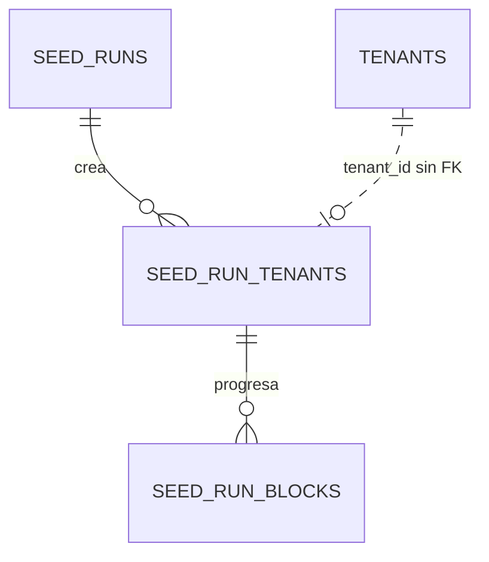

# REQ-SEED · Modelo de datos

Estado: PROPUESTO (2026-11-12). Depende de `OPEN-SEED-01`, `-02` y `-19` (`funcional.md §13`). Sin código: los tipos se describen, no se escriben migraciones.

El generador **no crea tablas de negocio**. Aporta una columna en una tabla de plataforma y tres tablas de plataforma propias. Los datos que genera viven en las tablas de cada módulo, documentadas en su carpeta.

## 1. Entidades

### 1.1 `tenants` (existente, de plataforma): columna nueva

| Campo | Tipo | Nulo | Por defecto | Descripción |
|---|---|---|---|---|
| `is_synthetic` | `boolean` | No | `false` | El centro y todo lo que cuelga de su `tenant_id` son datos sintéticos (`REQ-SEED-005`, `OPEN-SEED-02` = A) |

Reglas en base de datos:

- **Inmutable tras la inserción** (`RN-SEED-09`): un disparador rechaza cualquier `UPDATE` que cambie el valor, también para la conexión de plataforma. Motivo: pasar un centro real a sintético lo haría purgable (`RN-SEED-40`); pasar uno sintético a real ocultaría datos falsos entre los reales.
- Solo la escriben, en la creación, el bloque `centros` y `e2e-real-tenant.php`. El alta del backoffice no la expone y siempre inserta `false`.
- Migración aditiva (`CLAUDE.md §9`): columna con valor por defecto, compatible con la versión anterior del código. Los centros existentes quedan en `false`; los de E2E de una base de desarrollo ya creada hay que retirarlos y recrearlos (`operacion.md §6`).
- En producción la columna existe y vale siempre `false`.

### 1.2 `DemoProfile` (definición en código, sin tabla)

Objeto de valor del generador (`OPEN-SEED-19`): clave, slug, nombre del centro, régimen por etapa, etapas y líneas, módulos contratados, color de marca y reparto de roles del personal. Versionado con el generador (`RN-SEED-24`). No se persiste: la clave del perfil se guarda en `seed_run_tenants`.

### 1.3 `seed_runs` (nueva, de plataforma, sin `tenant_id`)

Una fila por ejecución del generador. Es el rastro de qué hizo el generador (`RN-SEED-16`).

| Campo | Tipo | Nulo | Por defecto | Descripción |
|---|---|---|---|---|
| `id` | `bigint` | No | identidad | Clave interna |
| `public_id` | `character(26)` ULID | No | — | Identificador que muestran y aceptan los comandos |
| `seed` | `bigint` | No | — | Semilla de la ejecución |
| `volume` | `text` + `CHECK` | No | — | `reduced`, `full` |
| `reference_academic_year` | `text` | No | — | Curso de referencia (`RN-SEED-22`), p. ej. año de inicio |
| `generator_version` | `text` | No | — | `RN-SEED-24` |
| `environment` | `text` | No | — | Entorno de la aplicación en el que se ejecutó |
| `status` | `text` + `CHECK` | No | `pendiente` | `pendiente`, `en_curso`, `completada`, `fallida`, `purgada` |
| `fingerprint` | `text` | Sí | — | Huella del conjunto (`RN-SEED-23`); nula hasta completar |
| `verifier_passed` | `boolean` | Sí | — | Resultado del verificador de la convención sintética |
| `error_summary` | `text` | Sí | — | Último error, sin datos personales ni secretos |
| `started_at`, `finished_at` | `TIMESTAMPTZ` | Sí | — | |
| `created_at`, `updated_at` | `TIMESTAMPTZ` | No | — | |

Nunca contiene contraseñas ni su origen (`CA-SEED-035`).

Unicidad: índice único parcial que impide más de una ejecución en `pendiente` o `en_curso` (`CA-SEED-038`).

### 1.4 `seed_run_tenants` (nueva, de plataforma)

Qué centros creó cada ejecución. Es una de las tres condiciones de la purga (`RN-SEED-40`).

| Campo | Tipo | Nulo | Descripción |
|---|---|---|---|
| `id` | `bigint` | No | |
| `seed_run_id` | `bigint` | No | FK a `seed_runs`, `NO ACTION` |
| `tenant_id` | `bigint` | No | Identificador del centro. **Sin clave foránea**: la fila sobrevive a la purga del centro como rastro |
| `tenant_slug` | `text` | No | Copia del slug en el momento de crear |
| `profile_key` | `text` | No | Clave del perfil (`RN-SEED-26`) |
| `student_count` | `integer` | No | Número de alumnos derivado de la semilla |
| `status` | `text` + `CHECK` | No | `pendiente`, `en_curso`, `completado`, `fallido`, `purgado` |
| `purged_at` | `TIMESTAMPTZ` | Sí | |
| `purge_report` | `jsonb` | Sí | Recuento de filas retiradas por tabla y de objetos (`RN-SEED-43`) |
| `created_at`, `updated_at` | `TIMESTAMPTZ` | No | |

Unicidad: `(seed_run_id, profile_key)`.

### 1.5 `seed_run_blocks` (nueva, de plataforma)

Progreso por centro y bloque (`RN-SEED-37`) y base de la reanudación (`RN-SEED-38`).

| Campo | Tipo | Nulo | Descripción |
|---|---|---|---|
| `id` | `bigint` | No | |
| `seed_run_tenant_id` | `bigint` | No | FK a `seed_run_tenants`, `NO ACTION` |
| `block_code` | `text` | No | Código del bloque (`funcional.md §6.3`) |
| `status` | `text` + `CHECK` | No | `pendiente`, `en_curso`, `completado`, `fallido`, `omitido` |
| `batches_total`, `batches_done` | `integer` | No | |
| `done_batches` | `jsonb` | No | Lotes confirmados; se actualiza en la misma transacción que los datos del lote (`RN-SEED-36`) |
| `row_counts` | `jsonb` | No | Recuento por entidad generada |
| `block_fingerprint` | `text` | Sí | Huella parcial del bloque (`CA-SEED-029`) |
| `attempts` | `integer` | No | |
| `last_error` | `text` | Sí | Sin datos personales |
| `started_at`, `finished_at`, `created_at`, `updated_at` | `TIMESTAMPTZ` | — | |

Unicidad: `(seed_run_tenant_id, block_code)`.

**Atomicidad del lote entre dos conexiones.** Los datos del lote se escriben por la conexión de tenant y `seed_run_blocks` es de plataforma. `RN-SEED-36` exige que «datos» y «hecho» se confirmen juntos; con dos conexiones no hay transacción común. Dos soluciones, a elegir en el tramo con el briefing de `explorer` y a revisar por `db-reviewer`:

1. Conceder al rol de tenant la escritura de `seed_run_blocks` restringida por política a las filas de su propio `tenant_id` (habría que añadir `tenant_id` a la tabla y RLS), y anotar el lote en la misma transacción.
2. Hacer cada lote idempotente por construcción (clave natural determinista por subsemilla y comprobación de existencia), y anotar después por la conexión de plataforma.

Recomendación: **1**, porque la idempotencia por comprobación es frágil con tablas de solo anexar. Supone que `seed_run_blocks` sí lleve `tenant_id` y política de RLS; se indica aquí para que no se descubra a mitad de tramo.

## 2. Relaciones

## 3. Índices

| Índice | Consulta que lo necesita |
|---|---|
| `seed_runs (public_id)` único | `demo:status <ejecución>`, `demo:purge` |
| `seed_runs` único parcial sobre `status` en curso | Rechazo de ejecuciones simultáneas |
| `seed_run_tenants (seed_run_id, profile_key)` único | Progreso por ejecución; unicidad |
| `seed_run_tenants (tenant_id)` | Comprobación de `RN-SEED-40` en la purga |
| `seed_run_blocks (seed_run_tenant_id, block_code)` único | Anotación y lectura de progreso |

Ninguno sobre `tenants.is_synthetic`: la guarda de `RN-SEED-03` recorre una tabla de pocas filas.

**Índices en tablas de otros módulos**: ninguno. Si las mediciones de `funcional.md §10` muestran que falta alguno, se propone en un issue contra su módulo, con la consulta delante.

## 4. Checklist obligatorio

- [x] `tenant_id`: **no aplica** a `seed_runs` ni a `seed_run_tenants` como tablas de tenant (son de plataforma y cruzan centros; `seed_run_tenants.tenant_id` es un dato, no un eje de aislamiento). `seed_run_blocks` lo lleva si se elige la solución 1 de §1.5
- [ ] **RLS**: las tablas de plataforma no llevan política de tenant; sus permisos de base de datos se limitan a la conexión de plataforma (`ADR-033 §5`, `ADR-047`). Si `seed_run_blocks` lleva `tenant_id`, lleva política y entra en `IsolationBatteryTest`. *Revisión de `db-reviewer` obligatoria: tablas nuevas, `GRANT` y cambio en `tenants`*
- [x] `academic_year_id`: no aplica (ninguna tabla propia depende del curso; `reference_academic_year` es un parámetro, no una clave)
- [ ] `created_at`, `updated_at`: sí. `deleted_at`, `created_by`, `updated_by` (`INV-005`): **no aplican, se justifica**: no son entidades de negocio; no hay usuario autenticado que las cree (consola) y no se borran lógicamente (la purga se anota como estado). Excepción a confirmar por `db-reviewer`
- [x] Claves foráneas y `CHECK` en base de datos: sí, salvo `seed_run_tenants.tenant_id`, sin FK a propósito (§1.4)
- [ ] **Política de valor de auditoría** (`ADR-035`): las tablas `seed_*` no son modelos de tenant ni `Auditable`; son ellas mismas el rastro. Si se implementan como modelos Eloquent de plataforma, siguen el precedente de `Backoffice`. Sin alias en el *morph map*

### Convenciones de tipos (`ADR-029`)

- [x] `TIMESTAMPTZ` siempre
- [x] `text`, nunca `varchar(n)`
- [x] Importes: no hay
- [x] Enumerados como `text` + `CHECK`
- [x] `public_id` ULID en `seed_runs` (aparece en la salida y los argumentos de los comandos). **Claves de catálogo expuestas en URL o API: ninguna** (no hay API)
- [x] `NULLS NOT DISTINCT`: no aplica

### Resto

- [x] Datos de categoría especial: el generador no crea ninguno en `1.15b` (NEAE diferido)
- [x] Particionado: no; decenas de filas

## 5. Retención y supresión

- **Tablas `seed_*`**: sin datos personales. Se conservan como historial del entorno; no hay plazo legal. En desarrollo desaparecen al recrear la base.
- **Datos generados**: no son datos personales (no hay interesado). Se retiran con `demo:purge` o recreando la base. Las reglas de retención de cada módulo (purgas programadas) actúan sobre ellos como sobre cualquier centro, y eso es deseable: las ejercita.
- **Auditoría generada**: `audit_logs` de cada centro sintético crece con cada generación (una fila por alta). La purga del centro la retira; es la única vía, porque es de solo anexar.
- **Copias de seguridad**: `operacion.md §8`.
